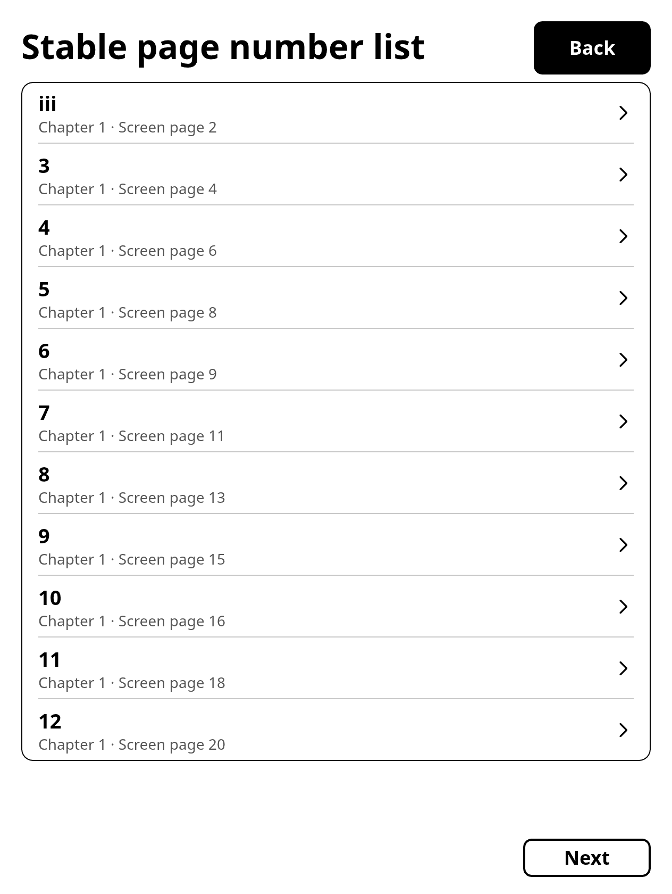
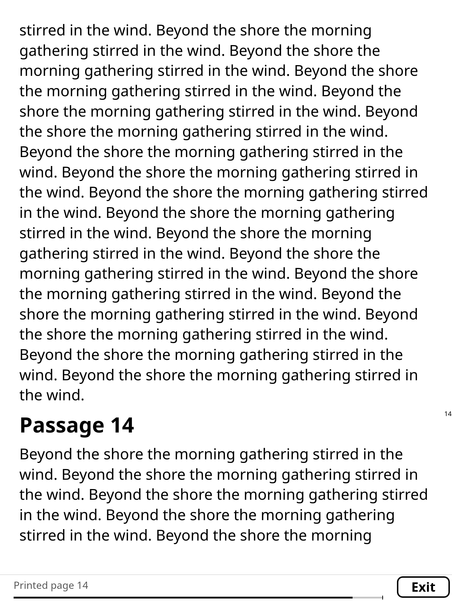

# Publisher page numbers in Reader

Open the top reading bar, choose **Navigation**, then **Stable page number list**. Each row shows the publisher’s printed label and its chapter. The open chapter also shows the screen page for the current type size. Choosing a row follows its exact source destination, even when a label occurs twice. **Previous location** returns to the passage you left. A print edition identifier appears at the end of the list when the publication supplies one.

| Number list | Printed boundary beside a passage |
| --- | --- |
|  |  |

**Printed pages in footer** and **Printed pages in margin** can be switched independently in Navigation. Each choice is saved for that book. The footer follows the last print boundary visible in a spread or scrolling viewport. It retains the preceding label between boundaries and uses the first publisher label in the front matter. A margin label appears beside the source boundary. It uses the outer margin of each leaf in a spread and follows the page’s night colors. When the selected margin is too narrow to hold a character, the list and footer still work. [Reader layout and input code](../src/app/publisher_pages.rs)

## How the label reaches the page

Reader checks the EPUB 3 navigation document, the NCX page list and the Adobe page map linked by the OPF spine. The local destination includes the chapter and element ID. Changing type size or margins resolves that source location in the new layout. Publisher labels are independent of Reader’s screen page numbers and whole-book progress. Duplicate printed labels remain selectable as separate destinations. An external URL or an ambiguous spine path cannot claim a local page. [EPUB package reader](../src/epub.rs)

The comparison uses KOReader’s installed release, its stable page menu and the CREngine bindings that calculate the active label. KOReader also supports generating labels from a configurable character count. That is a separate workflow from reading publisher labels. [KOReader stable page menu](https://github.com/koreader/koreader/blob/9192014d8bd82a91dc1012473be0f238dedfdb54/frontend/apps/reader/modules/readerpagemap.lua#L259-L326) · [KOReader page geometry](https://github.com/koreader/koreader-base/blob/6e4bc81af4e04f78d81677a323a780a71b29702a/cre.cpp#L1350-L1391) · [CREngine EPUB import](https://github.com/koreader/crengine/blob/b32a88ffbbf505cf2ea5208c1a49002d70d3609f/crengine/src/epubfmt.cpp#L287-L347)

## Original-book comparison

Nine EPUBs in the Oasis Documents collection had publisher-supplied page lists. Independent XML extraction found 3,264 labels. On eight books the installed KOReader returned all 2,311 labels in the same order. The remaining damaged book supplied 953 labels. KOReader exposed no page map when it opened that file through its fallback path. Reader recovered its package navigation. Twenty-six labels referred to chapter payloads lost from the ZIP. Reader removes those destinations and retains the 927 labels backed by surviving source elements. None of the personal page lists or source text is redistributed. [Installed engine comparison](../scripts/koreader-page-map-check.lua)

On both the Mac and the Oasis, all 3,238 surviving boundaries resolved to a location in the source edition. From the list, Reader followed the first, middle and last entries in each of the nine books, a total of 27 exact jumps per platform. The on-device checks preserved the originals and existing reading data.
