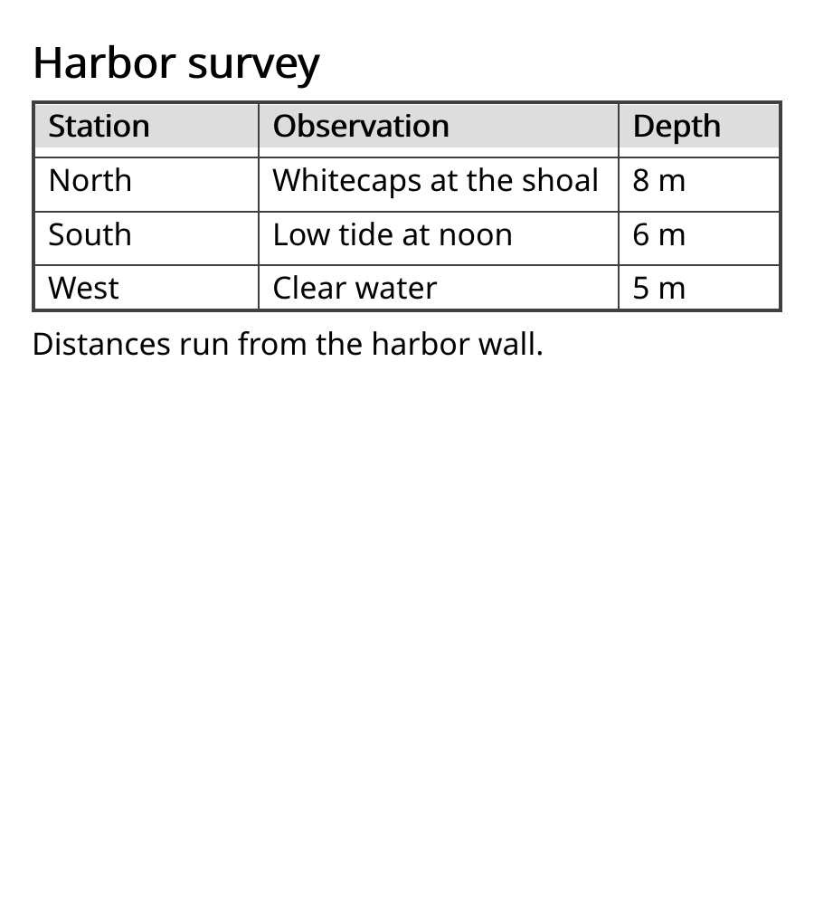

# Borders on EPUB tables

Reader draws borders around cells when the publication supplies them. A collapsed grid draws each internal line once. In a separate grid, the two cells can draw different borders and the publisher can leave space between them. Transparent borders reserve their width. Hidden borders occupy zero pixels.

| Collapsed grid | Separate cells | Transparent lines |
| --- | --- | --- |
|  |  |  |

The authored table uses a 4 px dark gray outer line and 2 px cell lines. The separate example adds 8 px horizontal and 6 px vertical gaps. In the transparent comparison every tested word retains its location, wrapping and tap target. [Screenshot fixture](../tests/fixtures/harbor-survey-table.xhtml) · [Rendering and selection checks](../src/parley_layout/table_border_tests.rs)

## Reading behavior

- Stylesheets and inline styles can independently set each edge’s width, pattern and color. Reader handles solid, double, dashed and dotted lines. It converts named colors, hexadecimal values and RGB colors to grayscale, including alpha blending.
- Table and supported block fills also accept [opaque named and RGB background colors](publisher-background-colors.md), converted to grayscale.
- In supported table and block-border layouts, explicit `currentColor` and an omitted border color use the element's computed text color. Explicitly inherited `currentColor` follows the receiving element's text color; a concrete inherited border color stays concrete. The Pure black and white tweak continues to paint borders black. This increment has had source review only; visual and device verification remain open.
- At a shared boundary, the cell on the right supplies the left stroke and the cell below supplies the top stroke. Outer edges may use a wider stroke from their row, row group or table. This follows the stock renderer’s ownership rule. Adjacent cells do not both paint the same collapsed edge. [CREngine border ownership](https://github.com/koreader/crengine/blob/b32a88ffbbf505cf2ea5208c1a49002d70d3609f/crengine/src/lvrend.cpp#L826-L940)
- Merged cells keep their edge across the rows or columns they occupy. A rule continues across visible portions of a multi-page table. Source ranges, search and selection still use the original publication text. [Reader stroke placement](../src/table_borders.rs)
- Hidden and zero-width strokes take no space. A transparent color keeps the width and skips the paint. [CREngine measurement](https://github.com/koreader/crengine/blob/b32a88ffbbf505cf2ea5208c1a49002d70d3609f/crengine/src/lvrend.cpp#L4873-L4926) · [CREngine transparent strokes](https://github.com/koreader/crengine/blob/b32a88ffbbf505cf2ea5208c1a49002d70d3609f/crengine/src/lvrend.cpp#L9290-L9323)

Reader caps stroke width and table spacing at 64 px. Tables that do not fit the horizontal layout continue using the narrow-screen text view. CSS relief patterns such as groove and ridge and entirely empty source rows remain outside this implementation. [Publisher text color](publisher-text-color.md) is handled separately.

## Table style tweaks

In **Appearance › Style tweaks › Tables, links, images › Tables**, the two controls can work together.

- **Alternate background color of table rows** paints odd rows `#eee` and even rows `#ccc`. Row groups restart the sequence. Source rows hidden by CSS still count, and consecutive rows directly under a table form an implicit group in the stock parser. Row colors override a publisher color on the same row. A cell's own background stays above the row, and the separate-border gaps stay clear.
- **Show borders on all tables** supplies black 1 px solid collapsed borders where the publisher leaves a declaration open. Publisher borders, separate layout and spacing still apply when declared. The grid includes one-column tables. Saved **Force table borders (legacy)** choices keep the stronger overrides used by earlier Reader builds.

The native Mac rehearsal invokes each KOReader control, checks the affected pixel values and restores the original frame after both controls are turned off. The Reader replay verifies the same row colors and preserved author border, checks source anchors and selections across all four modes, and loads a saved legacy choice. Font sizing, row height and the default caption tint still differ between the two engines. [Pinned stock styles](https://github.com/koreader/koreader/blob/9192014d8bd82a91dc1012473be0f238dedfdb54/frontend/ui/data/css_tweaks.lua#L634-L648) · [CREngine cell fill rules](https://github.com/koreader/crengine/blob/b32a88ffbbf505cf2ea5208c1a49002d70d3609f/crengine/src/lvrend.cpp#L10269-L10275) · [Specimen](../tests/fixtures/table-style-presets.xhtml) · [Native replay](../scripts/koreader-table-style-presets-check.lua)

| Mode | Reader on the Mac | KOReader on the Mac |
| --- | --- | --- |
| Original | [Page](screenshots/reader-table-style-original.png) | [Page](screenshots/stock-table-style-original.png) |
| Alternate rows | [Page](screenshots/reader-table-style-striped.png) | [Page](screenshots/stock-table-style-striped.png) |
| Borders | [Page](screenshots/reader-table-style-borders.png) | [Page](screenshots/stock-table-style-borders.png) |
| Both | [Page](screenshots/reader-table-style-combined.png) | [Page](screenshots/stock-table-style-combined.png) |

## Original EPUB comparison

On an original three-column table with 1 px solid rules, the installed KOReader and Reader located the same five passages before and after changing the rules. Transparent borders preserved all five positions in both engines. Hidden borders moved the start of every selection left exactly 1 px. Both engines restored the original positions and grayscale frames after resetting the styles. No publication text or screenshots from this book are included here.

| Geometry at the five passages | Reader on the Mac | Installed KOReader on Oasis 3 |
| --- | --- | --- |
| Published collapsed borders | 451, 836, 451, 836, 451 px | 451, 831, 450, 831, 450 px |
| Same rules made transparent | 451, 836, 451, 836, 451 px | 451, 831, 450, 831, 450 px |
| Hidden borders | 450, 835, 450, 835, 450 px | 450, 830, 449, 830, 449 px |
| Separate borders, zero spacing | 457, 829, 457, 829, 457 px | 457, 824, 456, 824, 456 px |

To measure actual paint, the comparison captured the pages containing the five passages and changed only the border color to transparent. Reader changed 14,052 pixels in collapsed mode and 27,572 in separate mode. KOReader changed 15,236 and 30,016 pixels respectively. Both produced eight continuous horizontal runs of at least 64 px with collapsed edges and sixteen with separate edges. Both drew a longest horizontal rule of 1,156 px. Font shaping, row height and page break positions affect vertical measurements and total ink. [KOReader in-memory comparison](../scripts/koreader-table-borders.lua) · [Earlier width measurements](table-columns.md)

## Device verification

The Oasis 3 ARMHF build passed all five authored border tests. Its six original-file layouts reproduced every Mac position, frame change count and run length above. The complete headless comparison took 5.5 seconds and peaked at 22,672 KiB resident memory. Reader’s five source passages appeared on one captured page. KOReader’s five appeared on two. Tallies use each engine’s own complete set of captured pages. The original, saved Reader state and Browser session retained their checksums after the temporary device files were removed.

The Mac also passed 509 library tests. In a second original EPUB, 186 word anchors retained their expected table cells across 89 rows, eight column spans and sixteen row spans. Returning to all 17 sampled pages restored their images.
