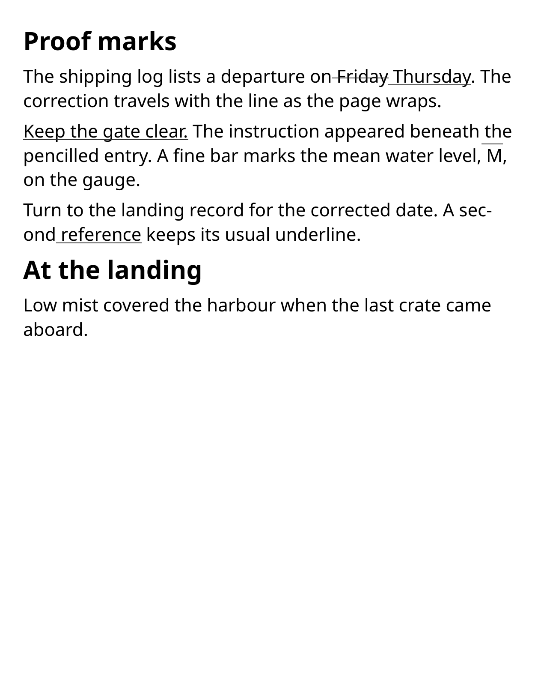

# Publisher lines and links

Reader follows the publisher's choice of underline, strike-through and overline in horizontal text. A link styled without an underline keeps its destination. Insertions and deletions retain their ordinary proof marks, and a line on a parent span continues across its child text. The shape of the line affects painting only. Search, selection and bookmarks still use the publication's original characters.

KOReader's HTML stylesheet supplies default link and revision marks. CREngine uses the font's underline thickness, positions an overline just below the top of the glyph box and draws a strike-through two sevenths of the font size above the baseline. Reader applies those positions to the shaped run so small type, superscripts and large text scale with their marks. It recognizes the simple solid line forms and styles explicit link targets with supported selectors including `a[href]` and `a:link`. [Reference HTML stylesheet](https://github.com/koreader/crengine/blob/b32a88ffbbf505cf2ea5208c1a49002d70d3609f/cr3gui/data/html5.css#L265-L292) · [Reference line painting](https://github.com/koreader/crengine/blob/b32a88ffbbf505cf2ea5208c1a49002d70d3609f/crengine/src/lvfntman.cpp#L4758-L4785)

## Document comparison

An independent stylesheet and XHTML scan found 2,919 link text spans in 14 original EPUBs for which the effective publisher rule removed the underline. Three other counts illustrate the range of author choices across the collection. There were 9,384 link spans with explicit underlines, 157 underlined text spans outside links, and one struck-through text span. These counts refer to matched text nodes, which can occur several times in one link or in repeated editions.

The Mac test opens five original books and resolves 36 source positions identified separately by an XML and CSS parser. The painted runs agreed at all 36, including 12 undecorated links, 23 underlined spans and the struck-through passage. A separate authored test changes one link's underline, compares the two page images, and verifies that all changed pixels belong to a narrow horizontal stroke. The link, its source text and the target remain accessible. [Authored reading sample](../tests/fixtures/text-decorations.xhtml) · [Reader checks](../src/parley_layout/decoration_tests.rs) · [Installed KOReader pixel comparison](../scripts/koreader-text-decoration-check.lua)
