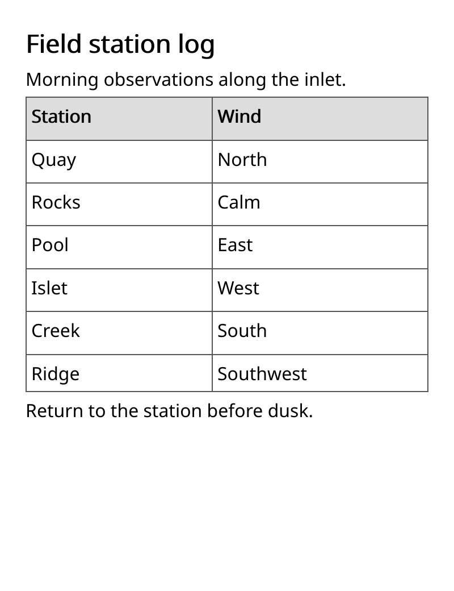
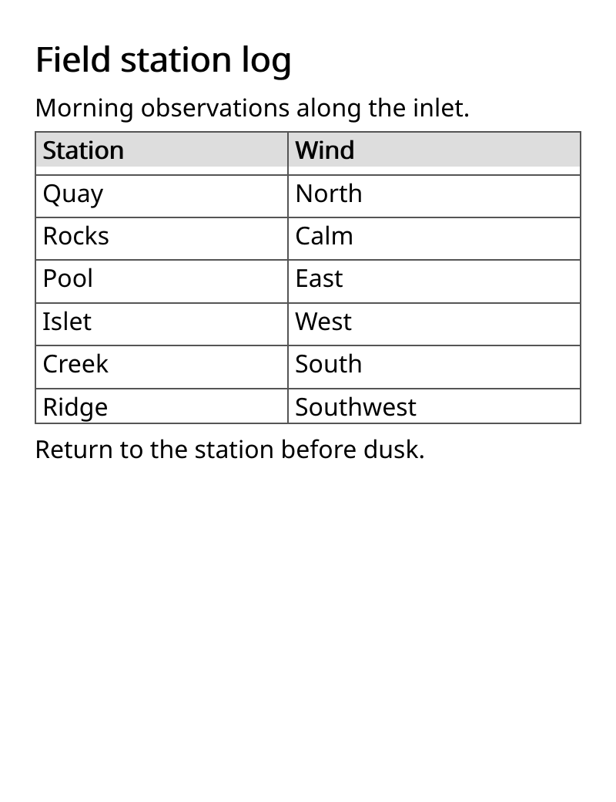

# Vertical padding in EPUBs

Reader honors publisher top and bottom padding on paragraphs, enclosing blocks and table cells. Two neighboring cells share a row. A 10 px pad on each cell adds 20 px to the row’s height. A cell containing several paragraphs gets its padding once, around the group.

| Published cell padding | Same table with cell padding cleared |
| --- | --- |
|  |  |

The sample is an independently written fixture. Its header background fills the padded cell up to its border. The bottom paragraph begins 140 px lower in the published view. [Source document](../tests/fixtures/publisher-vertical-padding.xhtml) · [Automated layout, paint and checkpoint comparisons](../src/parley_layout/vertical_padding_tests.rs)

## Reading behavior

- The CSS cascade accepts one to four shorthand values and individual top and bottom rules. Percentages use the containing box width. Publisher font-relative and absolute units follow the same conversion as horizontal padding. Block padding does not inherit by default.
- A table with separate borders can have vertical space between its outer edge and its first or last row. A collapsed table suppresses its own padding and keeps the padding of each cell. Text selection, search and bookmarks keep the original UTF-8 offsets as rows move across pages.
- To keep oversized publisher rules usable on e-ink, each accumulated leading or trailing padding boundary is limited to half the reading viewport. The comparisons cover horizontal reflow and Reader’s columnar table layout.

## Original-book comparison

A private EPUB on the Oasis 3 supplies a seven-row table with 10 px of top and bottom padding. In KOReader Book mode, the same stock font, 42 px size and 54 px margins were used for five layouts. A source XPointer found before the change was reused for each comparison. There were 19 unique source passages across the table and six following paragraphs. Clearing the collapsed table’s own padding left every source coordinate unchanged. [CREngine cell padding and row heights](https://github.com/koreader/crengine/blob/b32a88ffbbf505cf2ea5208c1a49002d70d3609f/crengine/src/lvrend.cpp#L1659-L1703) · [KOReader comparison harness](../scripts/koreader-vertical-padding.lua)

| Source position | Vertical shift from clearing both cell edges |
| --- | --- |
| Rows 1 through 7 | 10, 30, 50, 70, 90, 110 and 130 px |
| Each of the six following paragraphs | 140 px |

In Reader’s Mac simulation all 19 document-coordinate shifts matched KOReader in the published, top-only and collapsed-table controls. All 19 selections and tap targets retained their source ranges. Three KOReader passages and one Reader passage changed page number. Reader’s affected passage moved from chapter page 9 to 10 when cell padding returned. After Reader wrote its old location and bookmark to a private library file and reopened the original, both resolved to the source passage on page 10. Restoring the published styles reproduced all three sampled frames pixel for pixel. The public screenshots above contain only the authored sample.

The same candidate passed all four authored controls and the original comparison on the Oasis 3. Its 19 selections, 57 document-y differences, moved library checkpoint and three restored pages matched the Mac measurements. The original case took 11.1 s elapsed and 5.05 s of user CPU at low priority, with 20.0 MiB peak resident memory during concurrent device activity. The original EPUB hash, Documents inventory, installed Reader and active reading and Browser records remained intact throughout the case. Temporary device data was removed. A separate Mac regression kept all 186 sampled source cells reachable across 17 pages of an eight-table EPUB with merged cells.
