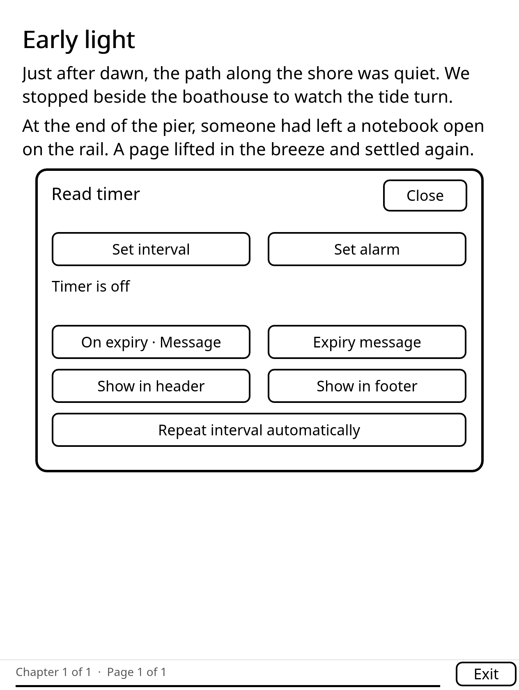
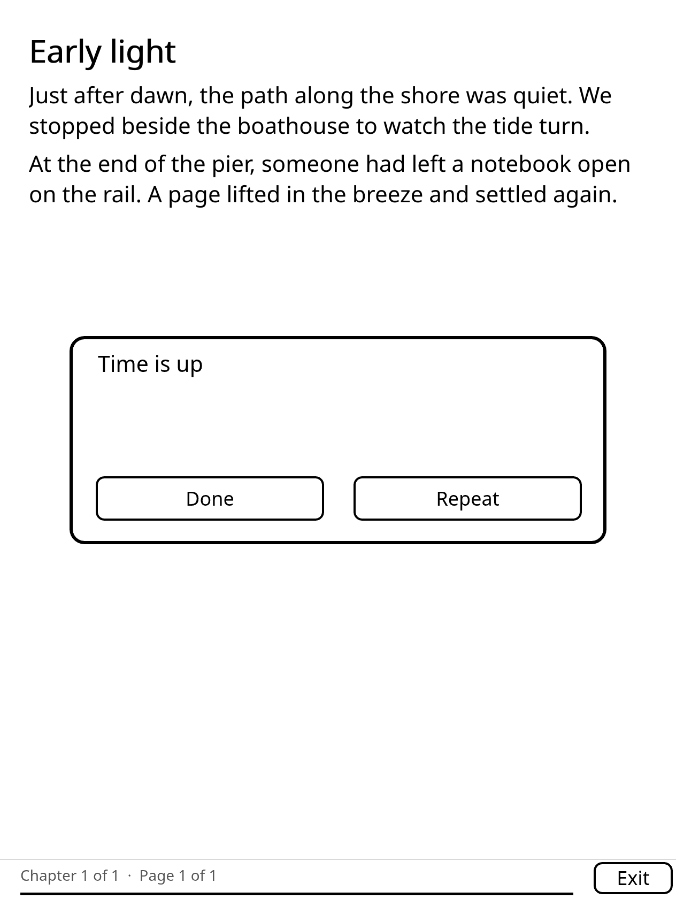

# Read timer

Open the upper reading bar, tap **Tools**, then **Read timer**. The controls open over the current EPUB or fixed-layout page. Choose **Set interval** to count down by up to 17 hours and 59 minutes, or **Set alarm** for the next occurrence of a local clock time. Tap the hour or minute buttons to move by one. A hold changes the value by four hours or ten minutes. Either start action returns to the page. The picker uses the Kindle system time zone for the next local alarm. [Time zone and clock changes](device-local-time.md) **Stop timer** cancels a running timer. Holding the **Read timer** entry in Tools also stops it.

The default expiry message has **Done** and, for an interval, **Repeat**. Done restores the underlying view. Repeat starts a full new interval from the time of the tap. Auto-repeat starts the next interval on ordinary expiry. A five-second notification lets reading continue, and **Nothing** omits the message. The timer remains active when changing books or opening reading tools in the same session. Starting Reader again restores the chosen interval and display preferences.

**Show in header** displays the countdown at the top of a reflowable reading page. **Show in footer** adds it to the reading status. Both round remaining time up to the next minute. **Expiry message** supports multiple lines and a preview with the current document. For example, enter `%T` for the title, `%C` for the chapter, `%p%` for progress or `%m` for local time. Reader uses available printed or stable page labels in a reflowable book. A multi-chapter book without a whole-book page map reports `N/A` for a whole-book screen page number. [KOReader message fields](https://github.com/koreader/koreader/blob/9192014d8bd82a91dc1012473be0f238dedfdb54/frontend/apps/filemanager/filemanagerbookinfo.lua#L1031-L1054)

## Sleep and resume

KOReader’s pinned plugin converts a selected local alarm time to an interval when it starts. Both interval and clock alarms then use the UI’s Linux monotonic clock, which stops during deep suspend. On resume, a deadline that has passed on that clock fires once. A future deadline keeps its remaining duration. A late resume clears an automatic repeat after delivering the expired interval. Neither reader installs a system wake alarm. The stock controls offer Stop, Start and Repeat without a separate pause button. [Interval and alarm logic](https://github.com/koreader/koreader/blob/9192014d8bd82a91dc1012473be0f238dedfdb54/plugins/readtimer.koplugin/main.lua#L403-L525) · [KOReader clock selection](https://github.com/koreader/koreader/blob/9192014d8bd82a91dc1012473be0f238dedfdb54/frontend/ui/time.lua#L213-L300)

The reference check loads the installed KOReader timer with a test clock and a recording UI. It checks four deliveries, the 90 seconds left on early resume, a repeat of 120 seconds, a five-second notification, stopping and carrying an active timer across views. Reader’s functional tests enter Tools through the ordinary reading bar and compare the original source position and full page before and after dismissal. All sleep checks inject the app’s Sleep and Wake events. [Stock callback check](../scripts/koreader-read-timer-check.lua) · [Reader UI and clock tests](../src/app/read_alarm/tests.rs)

The final Mac run passed 514 Reader library tests, 14 package tests and four system tests. On an Oasis 3, four focused Rust tests and the installed KOReader callback check passed. Isolated Reader sessions opened one original EPUB and one original PDF through the ordinary reading workflow. Both recovered their original reading position and all 2,123,520 page pixels after the alert closed. The original file checksums matched before and after. The two authored screenshots also matched the Mac render pixel for pixel.
