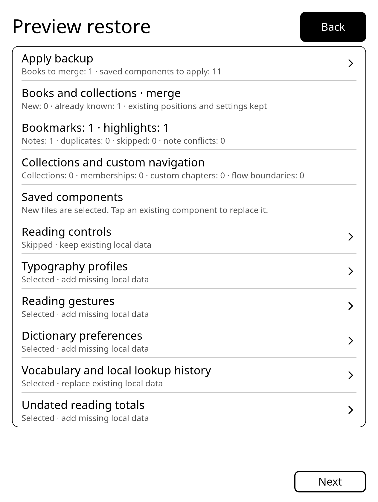

# Complete local reading-data backups

The development candidate extends **Reading data › Back up reading data** beyond
book records. A new versioned JSON envelope includes supported local reading
preferences, vocabulary review and dated history. Older library-only backups
remain accepted. Native Kindle and physical storage acceptance are pending the
combined build; this document separates those checks from desktop recovery tests.

## Controls and restore choices

**Back up reading data** first checkpoints current local reading data, then writes
`reader-backup-<time>.json` into Reader's existing exports folder. Source books,
fonts and dictionary contents are not copied.

To restore, place the file at `reader/data/reader-import.json` and open **Restore a
backup**. Preview shows the projected book/mark/collection merge and every saved
component. Missing local components start selected. Existing components start
skipped. Tap a component to select or deselect it; selecting an existing component
explicitly replaces that component's local data. The rows distinguish **add
missing**, **replace existing**, **keep existing** and **leave missing**.

Book records always use the existing additive merge. Existing positions and
per-book preferences remain current; missing book records recover their saved
state. Bookmarks, notes, highlights, collections, custom chapters and hidden-flow
boundaries follow the existing duplicate and conflict rules. Duplicate notes keep
the current nonempty note and appear in the conflict count. Choosing replacement
for a global component does not change those library merge rules.

Apply validates all selected data again, checkpoints the current profile, writes
one recoverable transaction and reloads the Reader model from the resulting files.
The app returns to the library's Reading data tools. Active reading surfaces and
timers are closed; active requests are cancelled through normal app save. No
network request, timer, download or queued job is started by restore.

| Missing local components | Existing components, explicit replacement |
| --- | --- |
|  |  |

[Existing components skipped](screenshots/backup-existing.png) · [Dark appearance](screenshots/backup-dark.png). These desktop captures use authored data and shared PrimitiveOS controls.

## Included components

| Saved component | Local data and policy | Per-component limit |
| --- | --- | --- |
| Book library | Progress, bookmarks, highlights, notes, collections and per-book preferences; existing additive merge | Existing library limit, approximately 4 MiB |
| Reading controls | Effective global controls, highlight appearance, menus, footer, save policy, page-number defaults and similar reading choices | 4 KiB |
| Typography profiles | Named reflow presets, with shared typed preference/font-name validation | 32 KiB; 16 profiles |
| New book defaults | Validated reflow and geometry-free fixed-page templates | 64 KiB |
| Reading gestures | Supported single-contact gesture/action bindings | 8 KiB |
| Dictionary preferences | Global source ordering, disabled sources and local word-form preferences | 64 KiB |
| Vocabulary and lookup history | Local searches, dictionary words, vocabulary source context, review counts and due dates | 8 MiB; 65,536 vocabulary entries |
| Undated reading totals | Previously recorded per-book screen time | 512 KiB |
| Daily reading history | Dated visits, calendar options, retained titles and undated migration baseline | 16 MiB; existing journal limits |
| Personal hyphenation | Enabled state and validated language/word/grapheme rules | 1 MiB; existing rule limits |
| Bookmark browser | Default sources, filters and ordering | 1 MiB |
| Retained book metadata | Series, language, keywords, descriptions and chapter metadata, including records whose original source is absent | 8 MiB |
| Read timer | Interval, repeat, message and display preferences; no running alarm/countdown | 8 KiB |
| Reading pace | Existing dwell samples in exact `reading-pace/<16 lowercase hexadecimal digits>.json` files | 512 KiB each |

The complete envelope is capped at **32 MiB** and 2,048 optional components. Each
component also keeps its own limit. Oversized or invalid data produces an error;
it is never silently shortened to fit. Restoring old data also needs enough
space to retain the selected current files for rollback, bounded to 32 MiB.

Reading controls are included even if their file was never written, so the
source profile's effective legacy save policy is preserved. Other absent optional
files are omitted. Referenced custom fonts and dictionaries must be installed
separately; a backup keeps their validated preference names/paths, not their data.

## Network and cache boundaries

The envelope contains no acquisition catalogs, network account credentials,
remote sync state, online lookup history/provider preferences, pending requests
or worker jobs. Legacy catalog/sync config files from earlier releases are not
loaded or changed by the current source; a restore does not copy or overwrite
them.
Only four local portions of `lookup-history.json` enter the envelope: `searches`,
`dictionary`, `vocabulary` and `review`. When replacing these portions on an
existing profile, its existing online history and language/provider values are
preserved. Existing local lookup preferences remain part of Reader's local
state; network services and account files are outside the backup envelope.

OCR output, generated page maps, layout caches and font/dictionary/book resources
are excluded. Retained bookmark metadata is included because source-removed
annotation records can no longer regenerate their descriptions. Pace samples
are included because they preserve the reader's measured time estimates.
Backups are local plain JSON containing personal reading data; passwords are not
included and the module sends nothing over the network.

## Format and recovery

The envelope identifies `format: "primitiveos-reader-backup"` and `version: 2`.
It contains a nested legacy library document and optional typed components. An
enumerated component key determines each destination; imported paths never choose
where a restore writes. Unknown component kinds, duplicate keys, unsupported
versions, malformed values and out-of-range typed preferences are rejected.
A custom library filename that collides with a reserved component target is
also rejected, including uppercase and mixed-case spellings on FAT. The live
Library retains its existing schema; older Reader versions do not understand
the v2 envelope and its optional components.

Every proposed component is validated before any restore mutation. Preview is
read-only. The transaction stages private new files and immutable copies of the
selected old files in Reader's data directory. It records a prepared journal with
SHA-256 and size checks for the old slots, then applies same-filesystem renames.
The complete new Reader model must load successfully before the journal is marked
committed. A normal failure restores all selected old files and removes files
that did not previously exist.

Public `Reader::open` runs journal recovery **before** loading the Library or any
preferences. Prepared transactions roll back; committed transactions only finish
cleanup. The transaction's own reload uses a private constructor that bypasses
startup recovery while it owns the journal. Old slots remain available until
rollback has finished, so an interrupted rollback can run again. Recovery first
validates all old slots before changing any destination. Incomplete/corrupted
recovery data reports an error and stays available instead of being discarded.

Files and journal are synced and the implementation requests directory syncing.
Some removable filesystems do not support directory fsync. These checks establish
process-interruption recovery; physical FAT power-loss, storage exhaustion and
USB interruption still need Kindle evidence.

## Verification

`src/reading_backup/tests.rs` tests the envelope and storage transaction.
`src/app/reading_backup/tests.rs` uses the actual Reader export, preview,
component actions, restore and constructor paths. The fresh-profile workflow
compares both restored in-memory objects and their actual files, exercises the
vocabulary scheduler and dated journal, opens the restored book, and reimports
with both default skips and explicit replacement. Legacy v1 input retains its
existing merge behavior.

The combined default/backup regression uses the normal Save current buttons, keyboard note entry, restore-preview rows and Apply action. After replacing an existing default component, genuinely distinct EPUB and PDF editions receive imported text/content-DPI and fixed-page defaults. Known editions keep their own preferences, source anchor/page, bookmarks and notes after restore and restart. All six input publication hashes remain unchanged. [Cross-feature regression](../src/app/backup_defaults_integration_tests.rs)

The storage tests exit a real test subprocess without unwinding after each
prepared/apply/commit step, recover from the parent process and check the entire
old-or-new state. Additional cases cover a failed reload, corrupt recovery slots,
reserved filenames, symlinks, unsupported network keys, duplicates and oversized
input. Typed malformed cases span every supported component. An actual Reader
startup also recovers a half-applied invalid Library/control pair before loading.

The optional `complete_backup_original_document_marks_and_state_round_trip_without_changing_source`
workflow takes `READER_BACKUP_ORIGINAL`, copies it only into private temporary
Documents profiles, saves a real bookmark and page position, restores into a new
profile, opens the publication and verifies the input and both copies by SHA-256.
Original EPUB/PDF evidence stays in ignored local receipts; no personal book or
reading history is checked into the repository.

The source-frozen Mac run passed **687 library tests**, with 53 opt-in cases
skipped. A focused run passed **nine backup workflows**, including the actual
subprocess exits and FAT filename guards. Four separate original-document runs
passed on two EPUBs and two PDFs, retaining input and copied-file SHA-256 values.
Exact executable/source hashes and screenshot paths are recorded in local
`build/parity-review/complete-backup/delivery.json`. Aggregate package/system and
native acceptance remain separate; no device or publication claim is made here.
