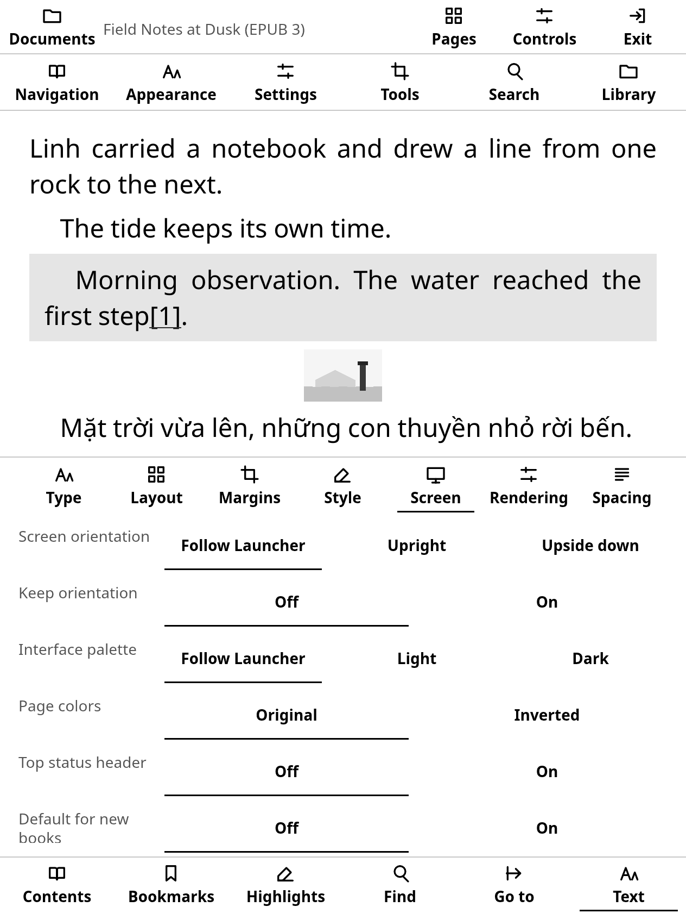
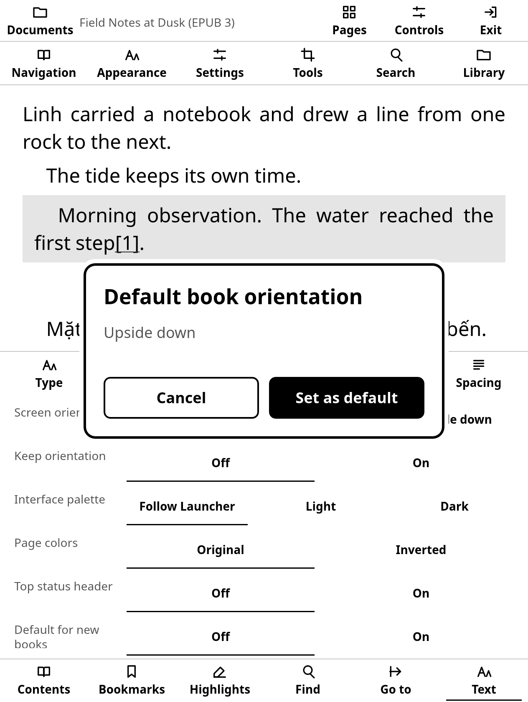

# Portrait orientation for each edition

In the lower Screen panel, tap Follow Launcher, Upright or Upside down to set the open edition’s screen orientation. Quick Display uses the same setting. Hold one of the three choices and confirm Set as default to change the starting orientation for either new reflowable books or new fixed-page documents. An edition opened before a default change keeps its saved choice. The existing app orientation supplies the fallback when a format has no saved default. [Reader Screen controls](../src/app/bottom_config.rs) · [Reader orientation policy](../src/app/reading_orientation.rs)

Turn on Keep orientation to carry the current choice through the Library, other books and a Reader restart. Visiting another book leaves its saved choice intact. A deliberate orientation change in an open book saves that edition’s choice and updates the held orientation. Turning Keep orientation off leaves the current reading view in place. The next book or Library view uses its own setting. Follow Launcher remains an inherited policy during sticky use, and older Launchers keep control of the screen while Reader retains its saved preference.

| Lower Screen controls | Hold a choice to set the format default |
| --- | --- |
|  |  |

## Pinned KOReader comparison

With sticky rotation off, KOReader reads the current edition’s rotation first, then the appropriate reflow or fixed-page default, and finally upright. Its File Manager reads its own default. Sticky rotation skips those screen resets and also skips copying the live screen turn to the book on save. An explicit bottom-bar selection still changes the book’s configurable value. Holding a choice writes the format default after confirmation. KOReader stores the last screen turn at app exit. Reader keeps the existing Follow Launcher option and preserves a held portrait choice across restarts. [Edition load and live rotation](https://github.com/koreader/koreader/blob/9192014d8bd82a91dc1012473be0f238dedfdb54/frontend/apps/reader/modules/readerview.lua#L958-L975) · [Edition capture](https://github.com/koreader/koreader/blob/9192014d8bd82a91dc1012473be0f238dedfdb54/frontend/apps/reader/modules/readerview.lua#L1209-L1222) · [Sticky switch](https://github.com/koreader/koreader/blob/9192014d8bd82a91dc1012473be0f238dedfdb54/frontend/ui/elements/screen_rotation_menu_table.lua#L64-L76) · [File Manager](https://github.com/koreader/koreader/blob/9192014d8bd82a91dc1012473be0f238dedfdb54/frontend/apps/filemanager/filemanager.lua#L63-L69) · [Explicit option dispatch](https://github.com/koreader/koreader/blob/9192014d8bd82a91dc1012473be0f238dedfdb54/frontend/ui/widget/configdialog.lua#L980-L1018) · [Configured edition save](https://github.com/koreader/koreader/blob/9192014d8bd82a91dc1012473be0f238dedfdb54/frontend/configurable.lua#L45-L65) · [Format default](https://github.com/koreader/koreader/blob/9192014d8bd82a91dc1012473be0f238dedfdb54/frontend/ui/widget/configdialog.lua#L1392-L1426)

The Mac comparison executed the pinned Lua callbacks for both document types and the File Manager. Reader tests opened authored EPUB and PDF files, switched between editions, changed and cancelled format defaults, and reopened private state. The original EPUB source anchor, PDF page and independent PDF page rotation survived those actions. The simulated screenshots show the actual lower Screen panel and the confirmation sheet.

## Landscape session preparation

`Reading::prepare_viewport` builds a separate reflow session and its rendered
frame for the requested canvas. The layout, raster stride, footer reservation
and selection coordinates use that session's geometry. It passes the same
canonical chapter, block and byte offset to the new pagination and checks that
the anchor is visible before accepting the candidate. The current frame and
queued page turns survive a refusal, as does the old geometry's page-count
cache.

The staged transition covers 1264×1680 and 1680×1264 for single-page and
continuous horizontal reflow. Facing pages and vertical writing defer the
transition until their column and writing geometry can be updated safely.

The app runtime still has to prepare its chrome and canvas, publish an
accepted frame through the shared handoff, and change the input generation
together with the reading session. Its lists, overlays and hardware resume
need to use those committed dimensions. The landscape control stays disabled
until those paths are integrated. [KOReader dimension-change path](https://github.com/koreader/koreader/blob/9192014d8bd82a91dc1012473be0f238dedfdb54/frontend/apps/reader/modules/readerview.lua#L892-L919)

Run the authored EPUB transition tests with
`cargo test --locked --lib session::viewport_tests`. Set
`READER_REFLOW_VIEWPORT_CAPTURE_DIR` to save the portrait, landscape and
returned frames. The fixture repeats the same sentence in two distinct
source blocks, so the test identifies the selected word by its exact anchor
and checks its hit region before and after changing viewport.

## Fixed-page viewport preparation

`FixedReading::prepare_viewport` stages a fully rendered frame for paged
PDF, still images and single comic pages. It records the current source
point in the document's upright coordinates. The target viewport recomputes
the existing fit or tile policy from its own dimensions. It then positions
the source point as close to the center as the current crop and pan limits
allow. A later resize uses the same point until the reader moves the page
or changes the document view. Document rotation or crop stays part of the
source projection. Screen rotation belongs to the runtime.

Rendering, hit testing, annotation clipping and footer control bounds use
the prepared viewport. The stage carries its own frame, projected PDF
regions and scratch deskew cache. `commit_viewport` accepts it only for
the same reading session and starting view. A failed stage or stale
candidate leaves the active view in place. The future runtime can present
the candidate frame, then commit the page geometry and input generation
together.

Continuous PDF, fixed EPUB, DjVu and facing comic spreads still use
their existing session policies. Each needs an explicit viewport transition
for its page or spread anchor before the app can offer landscape there.
The full Reader canvas, overlays and device runtime still need the
negotiated viewport handoff before enabling screen rotation.

Run `cargo test --locked --lib fixed_session::viewport_tests` for the
fixed-page viewport proofs. Set `READER_FIXED_VIEWPORT_CAPTURE_DIR` to
save the same authored PDF page in portrait, landscape and returned
portrait. The tests exercise a link beyond the previous portrait width,
an exact source annotation, width fitting, rotated row zoom and the
shared image and comic path.
