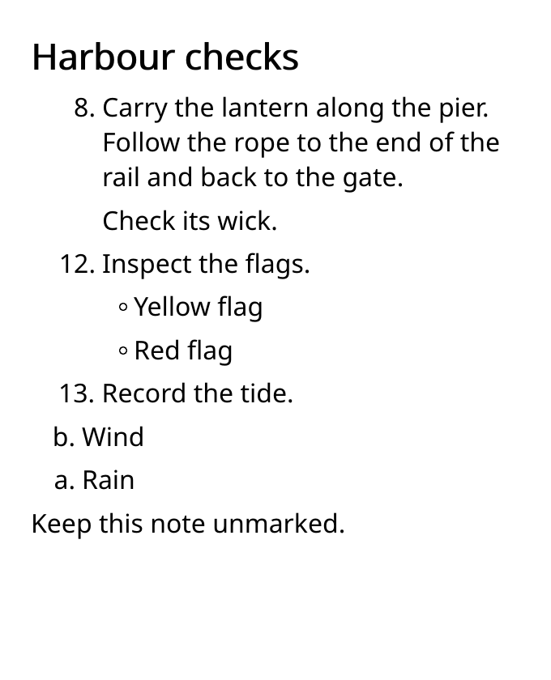

# Kindle reading parity implementation plan

**Goal:** complete the PrimitiveOS Rust Reader as a focused Kindle reading app, matching KOReader for supported reading workflows. Scope is limited to opening and rendering documents, reading navigation and layout, search and lookup, bookmarks and annotations, accessibility, offline scan reading, and local reading data. Compare these capabilities against the same KOReader version, documents, and Kindle. A proposed feature must directly support one of those reading tasks to enter implementation or the parity checklist. The [requirements](requirements.md) define acceptance checks; the [execution plan](execution-plan.md) tracks milestones; the [architecture](architecture.md) defines component boundaries.

Compare against the installed KOReader release for hardware measurements. Record the actual edition, format provider, options, and interaction being compared in each run. Keep only capabilities that directly support local reading in the parity backlog. [KOReader user guide](https://koreader.rocks/user_guide/) · [KOReader main features](https://github.com/koreader/koreader#main-features)

The [pinned native KOReader interface inventory](koreader-sdl-reference.md) adds
128 complete desktop frames, including six lower configuration tabs, selection
and dictionary popups. Its [774-control source matrix](koreader-sdl-reference-controls.json)
pairs controls with pinned handlers and workflow, partial, gap, audit,
system-owned or excluded states. Excluded controls stay as source references,
not parity tasks. The capture is a stock macOS SDL reference, separate from
Oasis acceptance. Use only in-scope reading controls to schedule implementation;
inventory counts do not measure completed parity.

## Scope and completion checklist

Use the upstream inventory to identify reading behavior. It is not a request to
recreate KOReader's extension architecture or every utility in its menus.
Before implementation, map each feature to opening, reading, navigating,
searching, understanding, annotating, or resuming a local document. Features
that support one of those tasks can be implemented as native Reader modules;
the Lua plugin ABI and a general extension host are not part of the goal. File
extensions remain in scope only as document-format identifiers.

| Scope decision | Status |
| --- | --- |
| Implement document opening and rendering, reading navigation and layout, search and lookup, bookmarks and annotations, accessibility, offline scan reading, and local reading data. | Core reading scope · K01–K20, K23–K24 |
| Keep a capability only when it directly supports reading, finding or managing a book or the reader's local data. Implement an in-scope capability natively, even when KOReader delivers it through a plug-in. | Reading-only acceptance rule |
| Do not implement or count a general plugin/extension runtime, manager or catalogue, Terminal/shell, RSS/news tools, HTTP inspectors or servers, patch management, unrelated developer utilities, online book acquisition, remote progress/annotation sync, remote annotation services, or Wikipedia article-to-EPUB export. | Explicitly excluded from this goal, tests, and release gates |
| Keep battery, Wi-Fi, clock, sleep, wallpaper and other Kindle-wide settings in PrimitiveOS Launcher. | Explicitly excluded from Reader |

Only the in-scope reading requirements contribute to parity tracking. Excluded
items are closed scope: they are not unimplemented features, release blockers,
test requirements, or part of the completion denominator. The KOReader source
and screenshot inventories remain comparison references; their full menu and
module counts are not Reader requirements.

Completion order: finish the P0–P2 local reading workflow, close the remaining
in-scope document and local reading-data gaps in P3, then validate those
workflows on the Oasis. Keep the feature-by-feature reading checklist in
[requirements](requirements.md) and use the [control matrix](koreader-sdl-reference-controls.json)
only to find and compare relevant controls.

The current implementation pass prioritizes remaining reading features across
the backlog. Unit, functional, system, simulator and Kindle acceptance are
deferred until the implementation pass is complete. Entries added during this
pass remain unverified and are not counted as completed acceptance.

Within that implementation pass, prioritize everyday EPUB and PDF opening,
document fidelity, navigation, search, annotations and saved-position
recovery before less common format variants and peripheral display options.
An explicit EPUB footnote whose XHTML resource is in the manifest but outside
the spine has a bounded, source-verified popup candidate that preserves the
persisted reading order. Broader source coverage and comparison with KOReader
remain open; see [the implementation limits](in-page-footnotes.md#explicit-notes-outside-the-epub-spine).
The remaining in-scope reading features are still required; this is an
ordering change, not a reduction in the goal. Keep implementation and release
status visible separately so a build-only candidate is not mistaken for a
tested or published release.

### Current implementation pass

The preceding Reader candidate passed a Mac build-only check. Subsequent
uncommitted changes, including Hangul selection, CJK look-ahead, Japanese
kana-conversion controls, OCR scan reflow, long-chapter windowing, and the
ordinary-element CSS hide/show candidate, have not been compiled or behaviorally
tested. The earlier build establishes neither parity nor simulator acceptance,
Kindle acceptance or release readiness for the current branch. The related
Files handoff is implemented locally. Its
earlier additional-format change had a build-only check; the later generic ZIP
and Word DOC handoffs have not yet been built. The work remains unpublished
until the user's required verification and release steps are complete.

| Area | Implemented in the current unverified candidate | Important work still open |
| --- | --- | --- |
| Book formats and resources | Bounded WOFF 2 reconstruction, Adobe-obfuscated EPUB fonts, TTC discovery, a restrictive [Word 97 DOC candidate](word-binary-candidate.md), DOCX/DOCM, [ODT](opendocument-text.md), [larger TXT/LOG and BOM-marked UTF-32](large-text-reading.md), [XML encoding compatibility](epub-utf16.md), [HTML and Markdown resources and legacy charset fallback](local-html-resources.md), [referenced HTMLZ fonts and images and image-only RTF](rtf-zip-htmlz-media.md), [single-document generic ZIPs](generic-zip-reading.md), compressed/colored and [standalone multi-page TIFF](tiff-packbits.md), animated GIF pages, CHM media, FB2/FB3 and MOBI/KF8 improvements, a limited [Palm eReader PML subset](kindle-format-reading.md), covers, EPUB image formats, per-book Fast/Best image scaling and night-mode image inversion, and bounded [CBZ metadata](bookmark-metadata.md). | Broader binary Word DOC support; exact format and layout fidelity; broader PML chapters, links and other commands; individual TTC face selection; exact image-resampling parity; large-book startup and memory; malformed-input and real-document behavior. DOCM ignores active content. Older or ambiguous ODT positions fail closed. |
| Typography and scripts | Additional licensed [hyphenation dictionaries](multilingual-hyphenation.md), distinct Latin variants and grapheme-aware marks; [style presets](reading-style-presets.md), line height, letter spacing, ligatures, numeric and East Asian font features, bounded ruby placement, CSS direction, [bounded preformatted whitespace recovery](preformatted-whitespace.md), inline bidi analysis, and an unverified ordinary-element user-CSS candidate for `display:none` and computed visibility through shared layout/search projections. The newest source candidate preserves canonical block boundaries and carries nested empty-box geometry across sibling blocks, assigning shared ancestor edges to the first and last block; empty-host margins now pass through the shared block-margin planner. | Exact stock rule and line-break comparisons, Greek and Catalan punctuation, font-feature availability, wider preformatted content and position handling, complex ruby, inline boxes, display box reclassification, vertical and other rendering paths. The empty-container candidate still needs source replay for nested and sibling geometry, margin-collapse comparison, list markers and generated-content order before it can count as accepted. |
| Reading and navigation | Cross-part notes, source-verified bookmark notes and highlight removal, search from book edges with durable incomplete-result details, [saved-mark navigation](saved-mark-navigation.md), [reflow Book Map reading time](reflow-book-map-reading-time.md), [single-chapter Page Browser fallback plus an asynchronous whole-book stripe and level-limited cross-chapter spans when the exact page index is available](page-browser-numbers.md), cancellable cross-chapter navigation and eligible relative page jumps, [explicit saved-position recovery](reading-resume-safety.md), reading profiles and gesture bindings, and an unverified [multi-action multiswipe candidate](reading-multiswipes.md) with persisted order, Execute All, One By One, and Quick Menu behavior while preserving old single-binding profiles. Also included are unverified fixed-layout EPUB and image/GIF/TIFF profile providers, Contents metadata, fixed-page search, PDF annotation exchange and quote recovery, DjVu links, conservative three-column scan navigation, and a new unverified [per-book 1/2/3-column OCR scan-reflow setting](scan-reflow-columns.md). A narrow long-chapter Parley window route is integrated behind snapshot/source checks and verified page replay; its computed-style gate admits captured publisher stylesheets, inline text styles, and CSS-only user styles when geometry remains supported; paint-only visibility masks preserve source flow while suppressed box flow remains excluded. The CSS-only user-style path and its asynchronous whole-book page index (eligible chapters through 1 MiB under the same snapshot and font limits) remain unverified implementation candidates. The current footnote-popup candidate reads computed `-cr-hint` source and target directives, computed vertical-alignment cues, source-block context and CRE-style number/letter/Roman marker counts; linked-image noteref handling now carries source metadata through main-page and foreign-note hit testing. Period reports now include an unverified breakdown of new reflow reading time by source publication and chapter; fixed-page and older visits remain explicitly unassigned. | Broader non-spine EPUB footnote coverage remains open; the unverified EPUB 2 backlink candidate now checks up to 128 note links using one host-anchor index. The unverified popup-range candidate follows final blocks in document order across nested wrappers and stops at document-fragment/body boundaries, headings, anchors, forced breaks and unsupported CSS boxes. Linked-image popup classification, exact CRE range and stop-boundary parity, and ambiguous CSS export roots remain open. The CSS classifier and extension have no behavior or simulator acceptance yet. Also open: responsive PDF search on difficult pages, unavailable-index behavior and pixel-level KOReader span comparison, complex scan layouts and OCR reflow comparisons, and Kindle verification for the untested Page Browser candidate. Page Browser anchor mapping now includes canonical saved-highlight endpoints; same-chapter spans mark their visible page range, and cross-chapter spans require the background worker's complete quote verification. The authored mapping regression and ribbon geometry still need execution, stock comparison and simulator screenshots. Also open: parity for the windowed chapter route across search, selection, navigation and resume. The long-chapter whole-book page-index path is an untested implementation candidate; search, selection, navigation and resume parity, simulator comparison, and Kindle acceptance remain open. Also open: cross-document variants, complex layouts, original saved-state compatibility, performance and feature-by-feature comparison. |
| Lookup and interface | Dictionary word forms and local cross-references; bounded Hangul dictionary-prefix selection; configurable 0–1,000 CJK look-ahead with KOReader's default of 20; an unverified Japanese morphology candidate for productive verbs, polite adjective/copula forms, bounded お/ご honorific constructions, common ください/いただく request/benefactive forms, つつ/ながら connective verbs, te/de trial, preparation and completion auxiliaries, and high-politeness i-adjective forms; all four configurable Japanese kana conversions with stock defaults; bilingual OCR configuration; Vietnamese labels for fixed Reader screen headers; and an unverified [licensed StarDict download candidate](dictionary-downloads.md) with all 803 pinned records, source-language grouping, same-language/bilingual filtering, source-digest checks, entry counts, install-state indicators, cooperative cancellation and throttled transfer progress. | Broader Japanese lexical coverage; remaining Vietnamese control/detail text and other interface languages, RTL interface layout, glyph support, text fit, catalogue refresh/cache acceptance, package-limit coverage, cancellation verification and feature comparison. The pinned KOReader source documents Japanese deinflection; Korean morphology is not a stock parity feature, while Hangul dictionary-prefix selection is covered separately below. [Japanese plugin reference](https://github.com/koreader/koreader/blob/9192014d8bd82a91dc1012473be0f238dedfdb54/plugins/japanese.koplugin/README.md) |
| Optional dictionaries and licensing | Armenian, Zulu, Serbian, Czech, Romanian, Latvian and Macedonian loaders and French, Polish and Brazilian Portuguese overrides accept separately supplied local data; those optional files are **not bundled**, and the overrides retain their built-in fallbacks. Notices and original sources for bundled third-party data are tracked under [licenses](licenses/README.md). | Missing/invalid data, packaging and distribution review for separately supplied data; Basque modified-data notice, German mixed notices and Hungarian MPL distribution obligations require release review. |

The current unverified candidates add [optional KOReader-style double-tap page
jumps](double-tap-page-jump.md), including the 300 ms default interval,
left/right ten-page actions, configurable timing and custom gesture bindings.
They also add a separate shared-input event and Reader binding map for two-finger
tap/swipe, spread/pinch and rotation. The double-tap single action is replayed
after timeout; two-contact actions suppress the overlapping single-contact
event. Neither candidate has been compiled or tested. The multi-touch Reader
depends on a new local shared-tools API that must be published and pinned before
it can build as an integrated package. Simulator and Kindle acceptance remain
open. See [multi-touch behavior and limits](multi-touch-gestures.md).

The multiswipe implementation now preserves legacy single-action settings while
supporting ordered action chains, one-by-one cycling, and an on-page quick menu.
The current candidate also adds KOReader-style menu placement, keep-open behavior,
action icons and labels, and separators. The implementation and regression cases
are authored but uncompiled and unrun. Menu screenshots, source workflow comparison, simulator
acceptance and Kindle input/refresh behavior remain in the deferred validation
phase. See [reading multiswipes](reading-multiswipes.md).

The profile editor candidate now accepts empty profiles and adds direct editing
for reflowable profile fonts, fixed-page zoom target and fit axis, manual zoom
factor, tile counts, rotation, PDF page gap, letter spacing, CJK width and scan
white level. These value editors save the profile without changing the open
book; their regression cases are authored but unrun. PDF page gap is a
Reader-specific continuous-layout setting, not counted as KOReader parity. Letter spacing and CJK width are PrimitiveOS reading extensions: they
have no matching controls in the pinned
KOReader reader UI sources, so they do not close or count toward KOReader parity
rows ([fixed-page controls](https://github.com/koreader/koreader/blob/9192014d8bd82a91dc1012473be0f238dedfdb54/frontend/ui/data/koptoptions.lua),
[reflow typography controls](https://github.com/koreader/koreader/blob/9192014d8bd82a91dc1012473be0f238dedfdb54/frontend/apps/reader/modules/readertypography.lua)).
The scan controls now expose KOReader's eight threshold presets plus fine
adjustment across 0–255, including zero; 255 is normalized to the unmodified
image state. This candidate still needs feature comparison and acceptance.
The scan panel also has a separate, per-book Dewatermark toggle using an
independently implemented, bounded global histogram threshold for PDF, DjVu
and comic pages. Its threshold selection and fixed-session integration are
authored but unbuilt and untested; it is not equivalent to KOReader's
k2pdfopt optimizer and remains a partial capability until rendered-page
comparisons establish its limits.
These changes are authored but have not been built, tested or compared on the
simulator or Kindle.
[Profile editor](reading-profiles.md) · [Scan controls](scan-controls.md)

The implementation pass continues before the requested unit, functional,
system, simulator and Kindle test phases. Each linked feature document records
its precise bounds and remaining work. User documents and saved positions
must remain intact, and the installed Launcher must not be reinstalled.

### Execution checklist

**Parity status:** the Reader is not close to full KOReader reading parity yet.
The older frozen control matrix contains 774 records: 336 mapped to a native
workflow, 63 navigation/group rows, 155 partial workflows, and 42 gaps; 82 are
system-owned and 96 are excluded. “Workflow” means a native workflow exists; it
does not mean exact KOReader behavior, current-source verification, or Kindle
acceptance. This matrix predates the current uncommitted implementation batches,
so its counts are a historical baseline, not a live completion percentage.

The earlier 73-of-91 evidence tally mixed desktop evidence, scope decisions,
and device checks, so it is not used to report feature completion. Current
implementation candidates remain uncompiled and untested until the implementation
pass is complete. The 42 recorded gaps include unsupported interface-language
choices; English is the implemented default and Vietnamese remains partial.
KOReader gates external dictionary controls on device capability; its generic
device defaults to unsupported, and Kindle does not override that capability,
so those two desktop-only rows are excluded from Oasis parity. Bug reporting,
About/version information and app restart are excluded as non-reading support
or lifecycle controls. The audited SDL fullscreen row belongs to the host
window and is unavailable in KOReader’s Kindle menu.
[Control matrix](koreader-sdl-reference-controls.json). Feature parity and device
acceptance remain open across the partial rows and newer implementation work.

The current markdown checklist has 93 task rows: 72 marked complete, 15 partial
and 6 open. This is backlog bookkeeping, not a parity percentage: some completed
rows explicitly leave Kindle acceptance open, and the control matrix is an older
source snapshot. The live completion percentage remains unmeasured until the
source matrix and every in-scope workflow are reconciled against the current
candidate and accepted evidence.

The current Mac comparison covers bounded cross-part FB3 notes and asynchronous
quote preparation for larger EPUBs. The replays verify links, selections,
saved positions and bounded fallback. A single complete text-only foreign
note can appear on a blank reference page. Notes spanning parts and more
complex layouts remain in their original link flow. Eligible local EPUB ZIPs
prepare the exact quote prefix asynchronously and preserve the current anchor
when repainting. ZIPs above 8 MiB use bounded, storage-leased reads rather
than a full archive copy. Archives and prefixes beyond the documented worker
budgets retain the foreground fallback. The later implementation batches add
candidate WOFF 2, cross-part FB3 notes and dictionaries, but their broad
verification remains open, alongside generated block boxes, richer joined
tables and additional initial layouts. Foreground Kindle verification is pending.
[FB3 reading](fb3-reading.md) · [Cross-part notes](fb3-cross-part-notes.md) · [WOFF 1 fonts](embedded-font-families.md#woff-1-publisher-fonts) · [Quote marks](quote-marks.md) ·
[Joined note comparison](in-page-footnotes.md#generated-text-in-flattened-notes)

The [statistics reset comparison](reading-statistics.md#reset-statistics) updates
seven rows with an executable stock check and Mac verification. The
[corner hold comparison](corner-hold-gestures.md) covers the ignore toggle,
a timed pause, and the fallback to text selection.
[Footnote alignment](footnote-export-roots.md#preview-text-alignment) is
independent of the book and keeps right-to-left paragraphs start-aligned.
The Mac comparisons also verify the [embedded-font switch](embedded-font-families.md#embedded-fonts-control),
[chapter titles from alternative Contents](contents-list-settings.md#chapter-titles-and-page-ranges-in-alternative-mode),
[repair of simple CSS tables](render-modes.md#repairing-missing-css-table-rows-and-roots),
and [continuous scrolling modes](reading-scrolling.md).
The next Mac comparison covers [font family details](embedded-font-families.md#font-family-details),
[FictionBook note previews](fb2-footnotes.md),
[saved mark chapter labels](bookmark-browser.md#chapter-titles-on-saved-marks),
and [consecutive publisher floats](render-modes.md#consecutive-floats-and-available-width).
Reader 0.1.32 adds [search from selection](selection-search.md),
[results density and context](search-result-presentation.md),
[temporary PDF fit](fixed-search-fit.md),
[bookmark appearance](bookmark-list-appearance.md), and
[help for the top status header](top-header-about.md).
Reader 0.1.33 adds [flexible search-result rows](flexible-search-results.md),
[focus and return from the results list](search-result-navigation.md), and
[a full-page preview of fixed-layout matches](fixed-search-result-preview.md).
Exact whole-book rendered reflow counts and foreground Kindle checks remain
separate gates.

The negotiated orientation candidate has Mac coverage for EPUB and PDF
handoff and rollback, two-page reflow in both spine directions, vertical
CJK, the Documents browser, Contents, Go to page, and selection and saved
marks. The Oasis accepted the monotonic event clock on its physical page
keys. Keep the foreground landscape milestone open through physical
refresh, touch, routed page keys, sleep, USB and exit tests.
[Orientation comparison and screenshots](reading-edition-orientation.md) ·
[Document and navigation screens](landscape-navigation.md) ·
[Selection and lookup screens](landscape-selection.md)

Mac coverage includes exact-value editors, OCR cancellation, scan text
and illustration inspection in both viewport sizes. The scan and
illustration tests preserve the source location through a rejected turn and
a return to the original view. The first live Oasis session verified portrait, both landscape turns,
injected page-key events and Exit. Later checks restored the reading frame
byte for byte after Quick Settings in both landscape directions. Mechanical
input, E Ink refresh, and sleep and USB resume checks remain open. [Exact-value editors](landscape-numeric-editors.md) ·
[Scans and OCR](landscape-scan-text.md) ·
[Illustrations](epub-gif-illustrations.md) ·
[Oasis test sequence](reading-orientation-contract.md#foreground-acceptance-on-oasis-3)

Saved profile editing covers reflow typography, hinting, kerning,
publisher styles and fonts, image rendering, page overlap, PDF crop
margin, and PDF or comic scan contrast. Enabled profiles can also apply
their included settings whenever Reader opens a matching book. The opening
rules cover file path and folder shortcuts, collections, seven metadata
fields and a separate new-book requirement. A local time window can gate
either automatic opening mode. The rules also use the screen turn
accepted when Launcher offers a verified viewport. Older Launchers and
the desktop API use the saved preference when the turn is unavailable.
Reading statistics has a whole-second duration editor with the stock
bounds, steps, defaults and accounting. It can preview and import dated
visits for the open PDF or self-contained DjVu book from a closed KOReader
database chosen in Documents. Reflowable book import still needs a stable
mapping from KOReader pages to source locations. The calendar can jump to
a typed month, the first recorded month or the current month. Returning
from a day timeline brings the calendar to the day reached in the timeline.
Dictionary result arrows
support held jumps to the first and last definition and
preserve an armed highlight while switching sources. Named dictionary
presets manage source enablement, report unavailable dictionary titles and
cycle in alphabetical order. A temporary preset applies to typed
lookup, retry after a miss and a lookup started from a definition. Offline
lookup history groups consecutive records by book, shows local timestamps,
and provides its own recording and clearing controls. Definition text has a
saved 8–32 font size with a default of 20. Its wrapping, links and word
targets use the selected size. The popup editor saves button order, visibility,
and per-row limits, with a preview and reset.
[Saved reading profiles](reading-profiles.md#editing-saved-values) ·
[Opening profiles](reading-profiles.md#apply-a-profile-on-book-opening) ·
[Opening time windows](reading-profiles.md#limit-opening-profiles-by-time) ·
[Page duration limits](reading-statistics.md#page-duration-limits) ·
[Fixed-page statistics import](reading-statistics.md#import-koreader-statistics-for-a-pdf-or-djvu-book) ·
[Calendar month navigation](reading-statistics.md#jumping-to-a-month) ·
[Dictionary result navigation](dictionary-popup-display.md#first-and-last-results) ·
[One-query preset](shared-dictionaries.md#searching-with-a-preset-once) ·
[Dictionary history](shared-dictionaries.md#dictionary-history) ·
[Definition font size](dictionary-popup-display.md#definition-font-size) ·
[Popup button layout](dictionary-popup-display.md#arrange-popup-buttons)

Opening profiles read adjacent, centralized path and fingerprint KOReader
custom metadata in the saved preference order, with publisher fallback.
They can ask before execution or use a prompt, next-tick, or explicit
delay. A separate closing profile can apply automatically or ask while the
outgoing book is still open. Close rules match any configured orientation,
metadata, path or collection and can require a local time window. Switching
to an encrypted PDF keeps the outgoing book available until the new
password is accepted. Page Browser grids can use one to six rows and
columns. A horizontal swipe along the top changes columns and a vertical
swipe along the left changes rows. The Reader simulator checks ebook source focus and PDF page
focus through grid changes and viewport turns. Blank space in the left or
right half of the grid moves by one full grid while preserving the reading
position. Holding the ribbon opens Book Map at a fixed page or reflow
chapter. Back restores the exact browser focus, including its EPUB anchor.
[Metadata sources](reading-profiles.md#apply-a-profile-on-book-opening) ·
[Conditional closing](reading-profiles.md#apply-a-profile-on-book-closing) ·
[Opening confirmation and delay](reading-profiles.md#confirm-or-delay-an-opening-profile) ·
[Page Browser grid](reading-orientation-contract.md#thumbnail-grid) ·
[Ribbon hold](reading-orientation-contract.md#open-book-map-from-the-ribbon)

The experimental Parley policies match the pinned KOReader Web mode's
width and horizontal placement for two authored paragraphs and a
centered container around ordinary paragraphs. They also match
the measured definite box heights and preserve text and source positions when
a box's background fills across a page break. In supported ordinary
paragraphs, the opt-in policies also match stock's positive physical
margins, Web mode's signed sides with physical screen clipping inside
ordinary wrappers, and explicit opening breaks inside keep groups and
beside a sibling keep. The measured Web constraint policy also resolves
ordinary paragraph widths, minimum and maximum sizes, and side alignment.
The combined constraint and signed-margin policies preserve unclipped text
positions when a wide publisher box extends beyond the physical screen.
The measured Book and Web policies also size `fit-content` paragraphs
to their text, including supported horizontal padding and solid borders.
The Layout panel now switches the four combined policies in eligible single-page EPUBs. Broader publisher geometry and Kindle acceptance remain open.
On supported EPUBs, typography edits now preserve the active passage and
rebuild the whole-book screen-page index when reading resumes, even with
the header off. Bounded horizontal text EPUBs offer a saved whole-book
rendering choice for live font-size edits. Whole-book rendering for
other typography controls and broader publication types remains open.
[Publisher comparisons](render-modes.md) ·
[Partial typography rendering comparison](whole-book-screen-pages.md#partial-typography-rendering-comparison)

- [x] Set the active Reader goal to KOReader's core Kindle reading workflows: document open/render, navigation/layout, search/lookup, bookmarks/annotations, reading progress, accessibility, offline scans, and local reading data.
- [~] Show newly recorded reflow reading time by chapter in book-period reports, preserve separate source-publication groups, and label fixed-page or older visits without chapter metadata as unassigned. Compile, test and compare this report with KOReader statistics before treating it as complete. [Reading statistics](reading-statistics.md)
- [~] Extend optional chapter lengths to custom reflow Contents entries at spine starts and saved anchors within a chapter through the existing whole-book page index. Stale, suppressed, unresolved anchors and unsupported layouts remain blank. A workflow test covers heading starts plus an interior saved anchor but remains unrun; compare the pinned KOReader behavior and capture desktop and Kindle results before closing this item. [Contents chapter lengths](contents-row-metadata.md)
- [~] Map Page Browser custom Contents, bookmark, recent-history, and canonical highlight endpoint anchors against their own spine chapter in the asynchronous whole-book index, even when they are outside the loaded chapter. The ribbon marks the visible portion of each ordered same-chapter span; cross-chapter spans require complete background quote verification. The authored regression workflow checks exact target positions and the stripe section start; run it with the Page Browser suite, compare stock span, bookmark, history, and highlight markers, capture simulator screenshots, and complete Kindle validation before closing this item. [Page Browser saved anchors](page-browser-numbers.md)
- [~] Match KOReader's language-grouped dictionary downloads with All / Same-language / Bilingual filtering, entry counts, package details, install state, cancellation, and bounded installation. The implementation now fetches and caches all 803 records from the pinned source; 799 HTTPS packages can be installed and four HTTP-only sources are visibly disabled. A bounded HTTPS HEAD preflight now exposes the package size before the explicit install action, with a retry or proceed-without-estimate path when the source omits size or rejects HEAD; archives over 32 MiB are disabled before download. The Lua parser, cache lifecycle, preflight behavior, archive limits, extraction, cancellation, and feature comparison remain unverified. [Dictionary downloads](dictionary-downloads.md)
- [x] Save per-book typography language and the embedded-tag switch. Compare the stock 53 choices and default/fallback precedence, real English line breaks, and source-anchor preservation. Broader language rules remain open. [Typography language](english-hyphenation.md#typography-language)
- [~] Match KOReader's margin workflow: size-scaled paired L/R presets, independent stock stops for top and bottom, exact values, fine adjustments, and vertical linking at the rounded average. The candidate groups icon-labeled left and right steppers in one row, gives each vertical edge separate stock-preset and fine-adjustment rows with page-edge arrows, applies one-pixel taps and five-pixel holds, and opens a combined `left,right` exact-value editor from the current pair. Compare separate-popup layout, long-hold repeat behavior, saved anchors and screenshots before closing this item. [Page margins](reflow-page-margins.md)
- [x] Expose per-book hyphenation enable, dictionary, algorithmic and soft-only modes, fitting publisher-mark precedence, and global minimum letters. Verify defaults, anchored reflow and failed-save rollback. [Hyphenation options](english-hyphenation.md#hyphenation-options)
- [x] Apply the measured Fast kerning path for eligible horizontal left-to-right runs. Verify signed pair values, narrow wrapping, carets, paint, soft hyphens and original-book restore. [Fast kerning](kerning-modes.md#fast-pair-spacing)
- [x] Report used and unused font families across eligible KF8 books using the real publisher resources and layout. Compare the authored report and five original AZW3s, including later-only fonts and damaged resources. [KF8 font reports](kf8-publication-fonts.md)
- [x] Match the hanging-punctuation workflow for the main text column. Check physical margin paint, source ranges, RTL, selection and link hits, new-book defaults and original EPUB anchors. [Hanging punctuation](english-hyphenation.md#hanging-punctuation)
- [x] Verify the existing bounded custom content DPI picker and initial preset behavior against the control inventory. [Content scaling](render-dpi.md)
- [x] Compose current page in chapter and flexible spacing in the custom footer while retaining the default caption, progress ticks and Exit. [Footer composition](footer-composition.md)
- [x] Group local dictionary results by source, with nested lookup and a return to the exact chooser page and original passage. Compare the stock Results tap and hold on EPUB and PDF. [Grouped dictionaries](shared-dictionaries.md#choosing-among-matching-sources)
- [x] Compose explicit trailing EPUB notes in an in-page band. Match saved book choice, live default, the master style switch, canonical link and selection positions, and long-note continuation. Wider note layouts remain open. [In-page footnotes](in-page-footnotes.md)
- [x] Size eligible EPUB in-page notes with all seven measured percentages and the legacy rule. Preserve inline scaling, body text, saved overrides, and original EPUB anchors. [Footnote size comparison](in-page-footnotes.md#footnote-size)
- [x] Show linked FictionBook footnotes and endnotes independently, with regular-size override, deduplicated references, and the canonical backlink. Check ordinary heading keeps and saved position through reopen. [FictionBook comparison](fb2-footnotes.md#in-page-footnotes-and-endnotes)
- [x] Add independent tap and swipe page-turn controls, stock zone shapes and bounds, a touch-lock exception, and per-edition direction and dialog mirroring. [Page-turn controls](page-turn-controls.md)
- [x] Export local KOReader-format annotation transfers on book closing, choose an existing folder, and preview merges with the Keep all policy. Stock automatic import and unsupported locations remain open. [Local exchange](annotation-exchange.md)
- [x] Show optional reading notices from seven independently saved sources and keep a 20-message session history. Compare the mapped defaults, timeout, control feedback, and scheduled profile behavior. [Reading notifications](reading-notifications.md)
- [x] Show linked classic EPUB note classes with inherited source IDs, both extension boundaries, and scoped alignment, spacing and text fixes. [Classic note comparison](in-page-footnotes.md#classic-markers-and-note-formatting)
- [x] Search live reading controls by name, preview the breadcrumb, open the result without activating it, and preserve the book position. [Menu search comparison](menu-search.md)
- [x] Give every current top- and bottom-bar action tile and submenu screen a purpose-matched icon instead of a generic page symbol. The `Action` icon dispatcher is exhaustive, so a newly added action must receive an explicit icon rather than falling through to a generic page. The map covers reading navigation, annotations, lookup, typography, profiles, scan controls, dictionaries, and local import/export actions. Visual comparison of all 210 actions and 184 screens on the simulator and Kindle remains in the deferred validation phase.
- [x] Verify the shared exit, file-browser and reading Back policies. Skip the current jump marker and restore the prior same-page PDF zoom, rotation and pan. [Back comparison](back-navigation.md)
- [x] Expose Select in the EPUB and PDF action grid and match dictionary title, count, result arrows, and dismissal. [Selection workflow](long-press-behavior.md) · [Dictionary comparison](dictionary-popup-display.md#source-and-result-count)
- [x] Implement horizontal, text-only inline-block geometry for the supported Flat, Book and Web policies. Check native width, atomic page carry, links and selections. Complex inline content remains open. [Inline-block comparison](render-modes.md#text-only-inline-blocks)
- [x] Audit all four native CREngine Render Mode masks against authored CSS and compare Reader’s existing Parley and Blitz paths. The merged policies now have per-edition and new-book settings with device verification pending. [Reference and captures](render-modes.md#composed-policies-in-reader)
- [x] Recount exact screen pages after committed typography edits for supported EPUBs. Check canonical position, ordinary opens, paint-only edits, rollback, sleep, USB and immediate Go to page after completion. [Native comparison and Mac captures](whole-book-screen-pages.md#partial-typography-rendering-comparison)
- [x] Prepare and commit complete layouts for live font-size edits in bounded text EPUBs. Verify per-book and default preferences, current source focus, old-frame navigation and cached chapter reuse. [Font size rendering](whole-book-screen-pages.md#choose-how-to-render-font-size-changes)
- [x] Match the normal Book Map's browser-on-tap and direct jump options in the Mac simulator. Check focused EPUB and PDF previews, cancel back to the same map, and one return entry on commit. [Book Map evidence](reading-orientation-contract.md#book-map-and-page-overview)
- [x] Match the measured vertical margin contributions in the horizontal Parley provider behind an internal opt-in. Check direct sibling edges, structural boundaries, and source-range restoration after pagination changes. [Block spacing comparison](render-modes.md#horizontal-block-spacing)
- [x] Add physical left and right text float exclusions and side-specific clearance to the horizontal Parley provider behind an internal opt-in. Verify per-line width, source hit-testing and ordinary-flow rollback. [Float comparison](render-modes.md#horizontal-floats-and-clearance)
- [x] Match the measured forced-break page topology through empty horizontal native boxes behind an internal opt-in. Check blank-slot reopen and canonical text resume. [Empty-break comparison](render-modes.md#forced-breaks-through-empty-boxes)
- [x] Reserve and paint the supported empty sibling boxes at the measured forced-break coordinates while retaining canonical text anchors. [Physical box comparison](render-modes.md#physical-space-and-paint)
- [x] Keep general extension/plugin systems, Terminal/shell, unrelated utilities, book acquisition, and remote services out of implementation, parity counts, test requirements, and release gates. Reading-specific capabilities remain eligible when implemented as native Reader features.
- [x] Remove OPDS acquisition and WebDAV progress-sync modules, screens, and worker commands from the current source. Keep local progress, backup, restore, and migration workflows.
- [x] Apply saved overlap and axis-order preferences to manual fixed-page turns. Physical buttons and page-turn tap zones pan through the zoomed page before advancing, matching KOReader's reading order. Fixed-page and app-level regressions pass on the Mac; the device comparison remains open.
- [x] Save Small, Medium and Large line spacing per fixed document for embedded-text and original-pixel scan reflow. Desktop checks compare KOReader’s pitch ratios and preserve the source passage through Apply, Cancel and reopen. [Evidence](fixed-reflow-spacing.md)
- [~] Implement fixed-document reflow with a saved 1/2/3-column cap, Small/Auto/Large word gaps, Auto/Left/Center/Right/Justify alignment, LTR/RTL/TBRTL writing direction and saved 0.20×–2.00× scan text scale in 0.05× steps. Keep measured OCR-word anchors and carry settings through fixed defaults and compatible profiles, including old unpublished pixel-height saves. Embedded-text PDF reflow has LTR/RTL/TBRTL through Reader’s vertical text renderer; OCR scan reflow also has separate LTR/RTL/TBRTL controls and a vertical right-to-left word-image layout candidate. Implementation is present but remains unverified; feature comparison, unit/functional/system tests, simulator captures and Kindle acceptance remain in the deferred validation pass. [Columns](scan-reflow-columns.md) · [Word gap](scan-reflow-word-gap.md) · [Alignment](scan-reflow-alignment.md) · [Direction](scan-reflow-direction.md) · [Text scale](scan-reflow-text-size.md) · [Pinned alignment choices](https://github.com/koreader/koreader/blob/9192014d8bd82a91dc1012473be0f238dedfdb54/frontend/ui/data/koptoptions.lua#L2404-L2455) · [Pinned word-gap presets](https://github.com/koreader/koreader/blob/9192014d8bd82a91dc1012473be0f238dedfdb54/frontend/ui/data/koptoptions.lua#L2540-L2557) · [Pinned scale choices](https://github.com/koreader/koreader/blob/9192014d8bd82a91dc1012473be0f238dedfdb54/frontend/ui/data/koptoptions.lua#L1678-L1684) · [Pinned writing-direction choices](https://github.com/koreader/koreader/blob/9192014d8bd82a91dc1012473be0f238dedfdb54/frontend/ui/data/koptoptions.lua#L2900-L2932)
- [~] Add an in-app offline OCR language-pack catalog for the 123 pinned `tessdata_fast` language models, alphabetized by display language. Show model size, source and Apache 2.0 license, download only on explicit selection, write attribution beside the model, show throttled byte progress and a distinct verification/install phase, support cancellation, and refresh the language picker. Candidate implemented; catalog, installation, progress, cancellation, recognition and device behavior remain unverified. [OCR pack behavior and deferred acceptance](ocr-build.md#deferred-language-pack-acceptance)
- [~] Expose KOReader's five fixed-page zoom targets: **Page, Content, Columns, Rows and Manual**. Keep custom column and row counts independent, retain the Full/Width/Height fit axis through target changes, and restore Page mode when leaving tile zoom. Existing tile geometry and traversal are connected to non-spread fixed-page providers, including saved comic profiles; the transition workflow is authored but unrun. Source comparison, tests, simulator captures and Kindle acceptance remain in the deferred validation pass. [Workflow](fixed-tile-zoom.md) · [Content fit](content-fit.md) · [Manual zoom](manual-zoom-factor.md)
- [~] Add KOReader's **Zoom to content** mode with Page/Content target and independent Full/Width/Height fit-axis controls. Switching the target preserves the fit axis, and changing the axis preserves the target. The candidate detects ink in a bounded grayscale render for PDF, DjVu, fixed-layout EPUB, comic, GIF, TIFF and image pages; normalizes contrast around a mostly uniform border median for dark, light and gray page backgrounds; saves the fit mode and crop margin; and keeps interaction geometry in source coordinates. All behavior, provider comparisons, simulator captures and Kindle acceptance remain unverified. [Source comparison and acceptance](content-fit.md)
- [~] Match KOReader's fixed-page **Manual** zoom target and factor presets with 0.1× adjustment across its 0.1×–20× range. The candidate trims to detected content, fits width, defaults to 1.5×, retains the factor when leaving Manual, reads older index-based saves, and carries the settings through book state, fixed defaults and profiles. Exact interactions, source comparison and provider/device behavior remain open and unverified. [Source comparison and acceptance](manual-zoom-factor.md)
- [x] Add **Semi-auto crop** for paged PDFs, with original-coordinate seed priority, saved adjustments, preserved links and annotation geometry, and exact Cancel restoration. The authored four-page crop comparison runs against the pinned Mac provider. [Workflow and oracle](semi-auto-pdf-crop.md)
- [x] Save PDF crop margins per book and apply them to auto/semi-auto and content-based zoom bounds. Match KOReader's 0.00–1.50-inch controls, independently scaled scroll strips and original annotation coordinates; preserve manual-crop and no-crop bounds when the margin changes, as the pinned stock implementation does. [Margin evidence](continuous-semi-auto-crop.md#detected-crop-margins)
- [x] Filter isolated margin specks from semi-auto PDF crops. Authored stock comparisons cover rotated pages, faint strokes, shaded paper and sparse notes. [Scan evidence](scan-margin-specks.md)
- [x] Apply page-specific semi-auto crops in width-fit continuous PDF reading. Desktop checks cover a split scroll frame, original note and link coordinates, Cancel, Apply and reopen. [Scroll evidence](continuous-semi-auto-crop.md)
- [x] Resolve manual and automatic crop per page while scrolling continuous width-fit PDFs. Desktop checks cover crop precedence, switching modes, native link geometry and page-specific scaling. [Scroll evidence](continuous-semi-auto-crop.md)
- [x] Provide numeric contrast presets and fine levels for PDF and comic archives. Preserve DjVu’s adaptive contrast and saved settings. Desktop checks match stock PDF and archive tones and preserve PDF and DjVu selection geometry. [Scan controls](scan-controls.md)
- [~] Add KOReader's Dewatermark toggle for PDF, DjVu and comic scans, available only with Scan white level at 255. Persist it per book and in fixed reading profiles, retain source pixels and geometry, and use a bounded native automatic threshold for the rendered page. Candidate algorithm and integration are authored; pinned k2pdfopt output comparison, test execution, simulator captures, performance checks and Kindle acceptance remain open. The global threshold is not yet equivalent to KOReader's page optimizer. [Source comparison and limits](scan-controls.md#dewatermark)
- [x] Add KOReader's continuous-scroll page overlap: configurable 1–10 repeated lines, per-book and new-book settings, page-button and automatic-turn movement, and all five stock indicators. Focused desktop tests and a simulated reading-frame capture pass; compare line placement and E Ink refresh on Kindle. [Behavior and screenshot](scroll-page-overlap.md)
- [x] Add KOReader's selection-dialog placement choices with the stock Center default and a selected-text placement option. Unit and integrated desktop tests cover geometry and persistence; capture the simulator frame.
- [x] Add the nine KOReader default text-hold actions and default single-word dictionary behavior with a setting to disable it. Implement a dedicated Select mode with Highlight, Copy and Cancel, tap or long-hold extension, reflowable selection, and cross-page PDF selection with saved continuations. Copy uses Reader's in-process clipboard and supports pasting selected EPUB/PDF text into Reader fields. [Select-mode and Copy screenshots, plus remaining device checks](long-press-behavior.md)
- [x] Add KOReader's optional highlight style/color prompts to text-selection highlighting, with per-mark appearance and no change to future book defaults. Cover Off, Style, Color and Style and color settings, cancellation, EPUB, PDF, touch targets and simulator screenshots. [Prompt behavior and screenshots](long-press-behavior.md)
- [x] Implement temporary highlight, hold-release/hold-pan selection, configurable very-long-press timing and the stock On/Off corner auto-scroll preference (On by default; active for continuous reflow). Desktop EPUB/PDF tests cover both preference states and the temporary-selection screenshot passes. PDF Select mode extends in both directions across pages when enabled, persists page continuations and rejects unreadable intermediate pages; see the [cross-page selection capture](screenshots/pdf-cross-page-selection.png).
- [~] Add KOReader's four two-finger corner taps, eight swipe directions, spread/pinch and two-finger rotation with saved bindings. The local SDK candidate tracks type-B slots, emits a separate two-contact event, suppresses duplicate single-contact actions for classified gestures, and replays KOReader's normal single tap when a two-finger tap fails its movement/duration checks before the 500 ms hold state. It uses the Oasis 3 scaled 38 px tap / 66 px pan thresholds, 900 ms swipe interval, full-screen two-finger swipe area, corner zones and direction sectors from the pinned detector. The Reader stores all 16 bindings, applies KOReader's default Contents/Bookmarks/frontlight/font actions, and protects touch-lock, selection and reading overlays. Tap duration defaults to 300 ms and saves a 100–2,000 ms range. Integration is waiting on publication and a Reader dependency-pin update; no tests have been run. Oasis touch-controller reporting and behavior when contacts lift at different times remain open. See [multi-touch behavior and limits](multi-touch-gestures.md). [Pinned KOReader gesture defaults](https://github.com/koreader/koreader/blob/9192014d8bd82a91dc1012473be0f238dedfdb54/plugins/gestures.koplugin/defaults.lua) · [Pinned input reader](https://github.com/PrimitiveOS/kindle-primtitive-tools/blob/86e593eb865b56615108406d8a7bf7bd20a38c6d/crates/primitive-input/src/lib.rs)
- [~] Match KOReader's multiswipe action sequences: legacy single-action profile migration, ordered actions, Execute All, One By One and Quick Menu with Run all. The candidate is implemented across settings, persistence, and on-page dispatch. Authored regression cases cover compatibility, storage, ordering, cycle behavior and menu selection/paging; execution, screenshot capture and device checks are deferred. Compare its exact action dispatcher and menu flow before marking parity complete. [Behavior and bounds](reading-multiswipes.md) · [KOReader dispatcher](https://github.com/koreader/koreader/blob/9192014d8bd82a91dc1012473be0f238dedfdb54/frontend/dispatcher.lua)
- [x] Add KOReader's dictionary-popup Highlight/Unhighlight toggle. Save the selected EPUB or PDF passage as a persistent annotation when the lookup closes; toggling back cancels the save. Automated EPUB/PDF interaction tests pass and the desktop popup screenshot has been inspected. Kindle acceptance remains open. [Dictionary evidence](reading-control-evidence.md#dictionary-navigation-checks)
- [x] Add KOReader's dictionary pencil: tap edits the original query and long press edits the active result headword. Submitting creates a nested lookup; Back restores the prior result and source passage. EPUB interaction tests pass and the editor screenshot has been inspected. Kindle acceptance remains open. [Dictionary evidence](reading-control-evidence.md#dictionary-navigation-checks)
- [x] Add KOReader's saved, opt-in “Show romanizations” translation setting. Google requests include the romanization response field only when enabled, and results show source text, Latin romanization when returned, and translation. Keep MyMemory unchanged and older settings Off by default. The persistence and provider-response tests pass; inspect the [Off](screenshots/translation-settings-romanization-off.png) and [On](screenshots/translation-settings-romanization-on.png) settings captures. Device acceptance remains open. [Romanization behavior](translation-romanization.md)
- [x] Match KOReader's global physical page-turn inversion and status-footer indicator. Apply inversion only to hardware page-button inputs, preserve touch and gesture behavior, default Off, and expose Page turning inverted in custom-footer Icons/Letters/Compact modes. Unit and app-level tests pass; inspect the light/dark [settings](screenshots/page-turn-inversion-settings.png) and [footer](screenshots/page-turn-inversion-footer.png) captures. Foreground Kindle acceptance remains open. [Behavior and source comparison](page-turn-inversion.md)
- [~] Add computed publisher `-cr-hint` handling, computed vertical-alignment cues, the KOReader whole-source-block exclusion, CRE-style number, letter and Roman numeral marker counts, and linked-image noteref handling to footnote popup detection. Source links support `noteref` and `noteref-ignore`; destination elements support `footnote` and `footnote-ignore`, with explicit hints and semantic note markup retaining forced behavior. These paths and existing hint regressions have no behavior verification yet. Document-order final-block extension across nested wrappers is implemented as an unverified candidate; exact boundary parity and ambiguous CSS export roots remain open. [Footnote popup comparison](fb2-footnotes.md)
- [ ] Compare selection placement, hold timing, corner zones and cross-page PDF selection behavior against KOReader on Kindle.
- [ ] Compare selection-dialog placement, long-press behavior, highlight appearance and dismissal against KOReader on the Kindle.
- [x] Run the desktop library, binary, package and layout suites with the published shared tools pin. The Mac run passed 979 Reader tests (62 ignored), one Kindle binary test, 14 EPUB package tests and four layout probes. [Verification record](execution-plan.md#current-host-and-device-integration-gate)
- [x] Run the 0.1.26 ARMHF test bundle on the Oasis. The corrected native suite passed 979 Reader tests (62 ignored). The 14 EPUB package tests and four layout probes passed. The Mac and Oasis footer captures match byte for byte. [Verification record](execution-plan.md#current-host-and-device-integration-gate)
- [x] Install the verified 0.1.26 release through the Store package transaction. Verify its executable checksum and run real EPUB, PDF, AZW3 and MOBI files through the release diagnostic. [Release and original-file checks](real-document-verification.md#reader-0126-release-on-the-oasis)
- [ ] Compare the 0.1.26 foreground reading footer on Kindle. [Verification record](execution-plan.md#current-host-and-device-integration-gate)
- [x] Run the previous v0.1.25 static ARMHF footer candidate on the Oasis and install it in place. This earlier device result does not cover the later romanization, button-inversion, footer separator, presets, or container settings. [Previous-device result and build hashes](execution-plan.md#current-host-and-device-integration-gate)
- [x] Add user-reorderable status metrics, KOReader-style footer separator and Icons/Letters/Compact symbol choices, “pages left includes current page,” and 0–2 decimal-place progress percentages. Verify settings persistence, item movement, and actual combined/custom captions; capture and inspect the [footer](screenshots/footer-item-symbols.png) and [settings](screenshots/footer-item-symbols-settings.png) simulator frames. Kindle acceptance remains open.
- [x] Add KOReader's Left, Center, and Right footer alignment choices. Preserve Left as the default, persist the selection, keep the progress track and Exit target fixed, and inspect the [Left](screenshots/footer-alignment-left.png), [Center](screenshots/footer-alignment-center.png), and [Right](screenshots/footer-alignment-right.png) simulator captures. The ARMHF suite passes; foreground visual acceptance remains open.
- [x] Add a selectable local current-time footer item and optional minute-boundary refresh, default Off. Verify local-time rendering, settings persistence, timer scheduling, sleep/wake pause and resume, and inspect the simulator capture; Kindle acceptance remains open. [Clock capture](screenshots/current-time-footer.png)
- [x] Verify 0.1.27 Kindle time zone behavior on the Oasis. Footer clocks, alarms, saved-mark dates and history calendar days matched the device clock. Vocabulary review dates share the same local date conversion. The system 12-hour format preference remains a separate comparison. [Device clock behavior and tests](device-local-time.md)
- [x] Add an optional battery percentage/charging item to the custom reading footer. Reuse the existing auto-refresh setting, update on minute boundaries, pause during sleep, and stop polling when hidden. Verify formatting, option persistence and scheduling; inspect the settings capture. Kindle battery reporting remains open. [Battery footer behavior and capture](battery-footer.md)
- [x] Match KOReader's battery hide threshold: saved 0–100% value, default 100%, and hide only when the battery level is higher than the configured threshold. Verify the exact boundary, clamping, persistence and conditional setting row. Kindle battery reporting remains open. [Battery footer behavior and capture](battery-footer.md)
- [x] Add KOReader's optional top status header for paged reflow reading, with title, author, clock, page count, progress, chapter marks, battery state and adjustable font size. Preserve the source anchor on relayout; hide the header in continuous scroll; verify battery/clock refresh scheduling, light/night screenshots and desktop behavior. Kindle appearance and battery checks remain open. [Header behavior and screenshots](top-status-header.md)
- [x] Match KOReader's progress-track positions and thickness choices, with an owner-requested default below the chapter/page caption, Thick 7 px, and 20% minimum width. Keep the horizontal track and vertical section ticks clear of the Exit target; expose adjustable widths, persist them, and verify EPUB/PDF layouts and light/dark simulator captures. Kindle acceptance remains open.
- [x] Add KOReader's optional horizontal footer separator, default Off. Persist it and draw the hairline at the reading-page/footer boundary for EPUB and fixed-page documents without moving the caption, progress track, chapter ticks, or Exit target. Verify the boundary pixels, settings persistence, EPUB/PDF render paths, and light/dark simulator captures. Kindle appearance remains open. [Source comparison and screenshots](footer-separator.md)
- [x] Add named status bar presets with KOReader-style create, apply, update, rename, and delete operations. Preserve non-footer preferences, enforce bounded case-insensitive unique names, and verify persistence with unit and application workflow tests. Inspect the settings, list, actions, and confirmation simulator captures. [Source comparison and screenshots](status-bar-presets.md)
- [x] Add KOReader's editable custom footer text item with its token set, a visible editor and token guide, 1–99 repetitions, whitespace-only separator merging, preference backup, and preset capture/apply. Verify save/reopen behavior, bounded expansion, battery glyph levels, settings, editor and reading screenshots in the Mac simulator. Kindle acceptance and battery refresh on hardware remain open. [Source comparison and screenshots](footer-custom-text.md)
- [x] Add KOReader's adjustable progress-track inset (0–140 px, 10 px default) and Thin/Medium/Thick chapter ticks (1/2/3 px, 2 px default). Persist both; test their EPUB/PDF geometry and ensure the track stays clear of Zoom, Exit, and the Next Comic control.
- [x] Add KOReader's status item container height (7–98, default 14) and bottom margin (0–49, default 1). Save them in Reader controls and footer presets, keep the default caption/track/Exit layout intact, and clip document pixels under larger footer settings. Verify minimum/maximum and invalid values, persistence, EPUB/PDF drawing, light/dark simulator captures, and screenshots. Kindle appearance remains open. [Behavior and source comparison](footer-container-layout.md)
- [x] Add KOReader's optional lock-at-minimum width for Alongside progress tracks. Persist it; verify short and long captions and EPUB/PDF geometry, and capture the simulator frame. Kindle acceptance remains open.
- [x] Add adjustable footer item text size using KOReader's 8–36 range and 14 default, plus the independently persisted bold toggle (default Off). Measure the caption at the selected weight so the adjacent progress track remains clear of Exit. Verify setting persistence, exact hyphen caption, EPUB rendering and the bold/regular [simulator captures](footer-font-size.md). Foreground Kindle appearance remains open. [Footer text size and weight](footer-font-size.md)
- [x] Add KOReader's selectable footer item font face using local TTF/OTF files, defaulting to Noto Sans. Persist the choice, include it in named status-bar presets, and use the same registered face for caption measurement and drawing in EPUB and PDF. Verify selection, persistence, preset restore and both render paths with the host workflow test; inspect the [chooser](screenshots/footer-font-faces.png), [selected setting](screenshots/footer-font-face-settings.png), [EPUB](screenshots/footer-font-face.png) and [PDF](screenshots/footer-font-face-pdf.png) captures. Foreground Kindle appearance remains open. [Font and footer controls](footer-font-size.md)
- [x] Match KOReader's ±0.5 logical font-size tap interval for books with legacy pixel-size preferences. Scale the interval through each book's captured screen/DPI context in both Text › Type and Text settings, preserve the legacy saved unit and reading anchor, and capture the simulator panel. Kindle raster comparison remains open. [Logical font behavior](logical-font-size.md)
- [x] Add KOReader's starting-position marker to book and chapter progress. Keep it anchored to the opened position, hide it after changing books, chapters, or hidden flows as appropriate, and reset it on wake. Verify its settings, EPUB/PDF behavior, and simulator capture. Kindle acceptance remains open.
- [x] Add per-book base stylesheet choices for Auto, None, Traditional, HTML Standard, and format-appropriate FictionBook. Author native CSS subsets, preserve publisher and inline cascade precedence, cover the choices with focused tests, and capture the Rendering panel. Exact CREngine CSS parity and Kindle appearance remain open. [Base stylesheet behavior and screenshot](base-stylesheets.md)
- [~] Expose ordinary-element `display:none` and computed `visibility` (`visible`, `hidden`, `collapse`) in strict user CSS through the shared rendered-text projection. Keep unsupported display box reclassification rejected. The uncompiled layout candidate now preserves canonical empty-block anchors, nested host chains across siblings, first/last generated content, merged parent box paint, and sends empty-host margins through the shared block-margin planner. A focused projection regression is authored; compilation, layout/search/selection integration, simulator comparison and Kindle acceptance remain deferred. [Style tweak limits and acceptance](style-tweaks.md) · [Projection consumers](css-flow-consumers.md)
- [ ] Compare and implement every remaining in-scope reading requirement against the pinned KOReader source and interface evidence. Keep device-owned and excluded controls out of the implementation backlog; update statuses with evidence instead of treating the source inventory as a feature list.
- [x] Run the owner-Documents system sweep on the ARMHF candidate alongside the existing unit, functional, and simulator checks. The candidate checked 183 entries in isolated profiles: 134 selectable supported files passed open/resume; three protected AZW and ten KFX entries showed Kindle Library guidance; 36 sidecar or packaged-book image paths were not selectable. One PDF passed two fresh-profile reruns after a transient first attempt, and all original files remained unchanged. [Device run details](execution-plan.md#current-host-and-device-integration-gate)
- [ ] Complete foreground Kindle acceptance for document controls, touch and exit, sleep/wake, USB handoff, state preservation and the current installed app UI. Capture comparable device screenshots for the reading surface, top and bottom controls, selection/lookup, and reading settings.
- [ ] Publish and list the candidate after the desktop and Kindle gates pass, then record the release checksum, Store listing, screenshots, and device evidence.

The [release and original file log](real-document-verification.md) records
which build passed the automated Oasis checks and which package is installed.
The source matrix records measured workflows separately from foreground
checks. Use the current installed binary for physical input, E Ink timing,
sleep and wake, and USB acceptance.

The Text → Rendering panel now offers per-book base styles. Auto follows the
document format, publisher CSS and inline declarations remain higher in the
cascade, and the built-in sheets are native subsets. See the [behavior and
desktop capture](base-stylesheets.md); Kindle visual acceptance remains open.

The optional top status header appears in paged reflow documents and has a
per-book switch, an About panel, and its own font and display settings.
The native renderer has been exercised. Foreground appearance, E Ink updates,
and battery refresh on the panel remain open. [Behavior and screenshots](top-status-header.md)

## Search result navigation

Reader 0.1.34 adds **All results** and **Results in current chapter** to the
search result options. The selected result sequence drives the list, physical
paging, previews, first/last shortcuts, and counts while batches arrive.
Authored desktop EPUB and rotated PDF tests cover stable anchors, empty
results, history and viewport restoration. The native and release checks
remain open. [Search result navigation and screenshots](search-result-navigation.md)

Whole-book screen page counts remain a separate layout task. Keep the
current section caption and allow exact global numbering only when the layout
can supply a complete count.

## Implementation checkpoint

Library and Reading Data expose local reading and data workflows. OPDS
acquisition and WebDAV progress-sync modules, UI paths and worker entry points
have been removed from the current source candidate. Existing per-user config
files are not loaded or changed by Reader. Previously published packages are
unchanged. Contextual Wikipedia and translation remain available as confirmed
reading actions under K15; local reading-data backup and migration remain in
scope.

Custom hidden reading flows now have source-anchored boundary editing, explicit hidden-page destinations, main-flow navigation and separate page counts across paged, scroll and spread layouts. Desktop source/reference and private-original checks are recorded separately from pending aggregate native and foreground acceptance. [Custom-flow evidence](custom-hidden-flows.md)

The publisher-page workflow has independent checks for source order, exact destinations and the label shown at a reflowed passage. Generated character-count numbers have their own acceptance criteria. [Printed page controls](publisher-page-numbers.md)

Automatic turns accept and persist custom inactivity intervals from 1 second
to 24 hours and signed scroll distance from −20.0 to +20.0 pages. Reflowable
scroll views move by the selected fraction and paged views advance whole pages.
Fixed-page AutoTurn exposes per-book horizontal and vertical overlap (0–90%),
horizontal-first or vertical-first traversal, and top-to-bottom or
bottom-to-top reading. **Save current** includes these settings in fixed-page
defaults for new documents. Desktop checks pass; Kindle comparison of the new
controls and resumed preferences remains open.
[Automatic page-turn parity](auto-turn-parity.md)

| Area | Development coverage | Remaining work |
| --- | --- | --- |
| EPUB reading | Saved positions, page and scroll modes, reading bars, printed page references, whole-book percentage jumps, generated contents from headings or chapter starts, publisher CSS with first-line and hanging indents and supported structural selectors, selectable native base stylesheet subsets, local fonts and illustrations, numbered and nested lists, supported tables with column widths and merged cells, footnote previews, bounded static SVG, ruby, authored soft hyphens, automatic US and British English hyphenation, inherited language, horizontal writing direction, and publisher line-breaking rules. Supported vertical chapters use right-to-left columns and the same text anchors. Fixed pages include publisher-defined spreads and the XHTML viewport directives. | More advanced stylesheet cases and exact CREngine stylesheet fidelity, additional dictionary languages and mixed writing modes within one chapter, and broader live typography checks |
| PDF | Fixed pages and continuous scroll, printed labels, page thumbnails, outlines and links, passwords, page, width and height fit, crop, contrast, search across wrapped text lines and local annotations. Visible embedded highlights import and annotated-copy export for intact unencrypted PDFs up to 16 MiB. | [Standard password revisions 2–6 and both roles](protected-pdf.md) compared with installed KOReader. Broader international input, certificate handlers, outline and annotation types, and sustained large-scan tests |
| Other offline reading | Fixed-layout EPUB, DjVu, TXT, HTML, single-document HTMLZ, Markdown, FB2, supported MOBI/PalmDOC and KF8, DOCX, CHM, RTF, TCR, CBZ, uncompressed USTAR CBT, selected CBR, JPEG, PNG, BMP, GIF first frame, portable anymaps, static SVG, selected WebP and TIFF, and compressed StarDict with synonyms | Wider format variants and larger live document samples |
| Scanned documents | Embedded and recognized text reflow across readable source pages. Original word-image reflow for scans with complete horizontal left-to-right OCR and a column view for clear two-column scans. English and Vietnamese recognized by the worker on desktop. The ARMHF package's English OCR worker produced word boxes on Oasis 3. | Broader layout and language cases, and sustained tests with real scans |
| Library and controls | Folder navigation with file types, sizes and support labels, whole-library search, favorites, reading status, collections, author and recent views, EPUB cover previews and series, [daily reading history and a calendar](reading-statistics.md), separately retained undated screen time, reusable text profiles, night pages, adjustable toolbar sizes, mirrored or disabled tap turns, touch lock, optional E Ink full refresh intervals, chapter-spanning page thumbnails, transient EPUB and fixed-page Skim previews with queued turns, origin restore, cancel and one-entry return history, location history and zoom for framed comic panels in single-page views | More configurable gestures, broader accessibility, physical Skim panel interaction and dialog preferences, outline editing for additional provider types and excluded sections, and irregular comic panels |
| Reading data | Backup and restore with preview, text/Markdown/HTML annotation exports, adjacent KOReader EPUB bookmarks and source-verified highlighted passages, KOReader JSON annotations by unique quotation, and sampled-fingerprint checks for fixed-page sidecar progress and supported reflowable EPUB CFIs and normalized CREngine DocFragment positions. Unverified import candidates now reconstruct normalized DOM fragment ordinals from the OPF and openable member streams: DOM 20240114 includes every spine media type, while 20200223, 20200824 and 20210904 include XHTML entries only. The CFI candidate follows OPF spine ordinals, recovers uniquely identified elements after structural ordinals shift, searches for a unique collapsed-context match in up to 128 KiB of chapter text when the saved text offset is stale, uses the start of a syntactically valid simple range when a single position is requested, and carries the W3C `s=a` / `s=b` side-bias parameter into source anchors. At exact pagination boundaries, `s=b` selects the preceding page while the default and `s=a` select the following page. CFI and CREngine pointers may still be compared for the same source position when their side-bias parameters differ. | Batch verification of historical/current CREngine DOM versions, CFI correction and range endpoint validation, side-bias parsing and page-boundary behavior, broader sidecar variants, and migration measurements with larger libraries |
| Kindle verification | The installed Reader 0.1.42 release opened, advanced and resumed the original EPUB, PDF, AZW3 and MOBI test books. The Oasis passed 1,171 automated checks. Five of six Oasis software captures matched the Mac frames, and one Library label differed by two pixels. [Original documents and package receipt](real-document-verification.md#reader-0142-release-on-the-oasis) | Foreground touch, actual E Ink refresh, and interactive sleep, USB and Launcher handoff still need acceptance. [Execution plan](execution-plan.md#current-host-and-device-integration-gate) · [Reading evidence](reading-control-evidence.md) |

The initial feasibility run passed 249 desktop Reader tests, six vendored Parley tests, and 16 Files tests.
Reader rendered three public-domain DjVu samples and 12 narrative chapters from
the Standard Ebooks edition of *Alice’s Adventures in Wonderland*.

The Oasis 3 session opened Markdown and DOCX from Files, sent forward and back
events through the Kindle's page button input, reopened at the exact saved page,
and used both Done and Exit Reader to return to Launcher. The installed OCR
worker recognised 46 structured rows from a grayscale PGM using the bundled
English model. The verification session used the Kindle's sleep override.

On the same Oasis 3, KOReader v2026.07.1 exposed navigation and general actions
through top tabs and formatting controls through a separate bottom panel.
Reader 0.1.1 keeps frequent document actions visible in one lower row and uses
an anchored panel for related adjustments. Its upper bar holds Library, Pages,
Controls and Exit. Opening these controls preserves the document layout.
[KOReader user guide](https://koreader.rocks/user_guide/)

Reader 0.1.2 extends the comparison using the exact KOReader v2026.07.1 source.
Its icon menus use the Primitive UI skill and the Primitive Browser action grid.
The top and bottom gestures open separate groups, including live typography,
facing pages, fixed-page adjustments, and device display controls.
The checklist records the remaining provider and hardware checks.
[KOReader controls checklist](koreader-controls-parity.md)

Each EPUB profile ran five times, with 30 warm rasterizations per run. The
median first frame took 75.4 ms on Field Notes, 300.0 ms on Long Chapter, and
75.7 ms on the vertical chapter. The median warm p95 was 10.2, 13.1, and 16.0 ms
respectively. A separate Field Notes run using the device's normal Reader
fallback fonts covered all 401 source characters with zero missing glyphs.
These measurements end when the grayscale frame is ready in memory.

## Publisher lists in horizontal reflow

The reading engine draws list markers from HTML list order, `start`, `reversed`, `li value`, HTML `type` and publisher `list-style-type` declarations. It supports decimal, leading-zero, Latin alphabetic and Roman numbering, filled discs, rings, squares and suppressed markers. The current candidate also handles inherited `list-style-position: inside` and the `list-style` shorthand by placing the marker in the first inline line without adding marker text to the source; this path is unverified. Outside markers retain their list gutter, continued paragraphs stay under their item, and nested lists inherit the parent gutter. An author-supplied matching number stays selectable and is displayed once. Heading and chapter navigation, selection, search and saved locations use the original publication text. Marker shapes for bullets are independent of font glyph coverage. The pinned CREngine list-style enum exposes the ten built-in marker types and inside/outside positions; custom `@counter-style` definitions and image markers are not exposed by that pinned interface and are not parity tasks. [Pinned list-style types and positions](https://github.com/koreader/crengine/blob/b32a88ffbbf505cf2ea5208c1a49002d70d3609f/crengine/include/cssdef.h#L1576-L1615)

One existing EPUB contained 1,597 ordered items. Of those, 1,581 had no literal ordinal at the start of their text. Before this change, the source page and two controls produced identical 1264 × 1680 frames on the Mac. One control changed the first list start to 81 and the other changed ordered lists to unordered. The corrected renderer produces distinct frames and finds the same source passage in all three variants. Its native layout covered all 201,498 source characters in that section with zero missing glyphs.

A second Mac check opened 19 list-bearing sections in five existing EPUB and KF8 files. The layouts covered 485,623 of 485,623 source characters across 667 pages with zero missing glyphs. Two of those files are editions of the same work. Its long numbered section occupies one EPUB spine entry and five KF8 sections. Both cover the same 201,498 characters. These totals count editions separately and measure layout coverage. The screenshot comparison above separately verifies the presence of markers.

The fixture also exercises repagination with larger type and checks selection geometry. The KOReader comparison uses the pinned CREngine implementation for outside marker placement and text indentation. The current horizontal renderer supports outside marker geometry; an inside-position candidate now emits a zero-text inline box and keeps marker paint separate from source ranges. Build, functional, search/selection, simulator and Kindle comparison remain open for that candidate. Custom `@counter-style` definitions and image markers are not exposed by the pinned CREngine interface. [Authored test publication](../tests/fixtures/publisher-lists.xhtml) · [KOReader marker placement](https://github.com/koreader/crengine/blob/b32a88ffbbf505cf2ea5208c1a49002d70d3609f/crengine/src/lvrend.cpp#L8684-L8705)

## P0 · Close the feasibility gate

Use Parley with direct grayscale glyph rendering as the starting EPUB engine. Keep Blitz as a reference for publisher-style differences. The Oasis 3 software tests measured 65 ms first frame and 9.1 ms warm p95 for Field Notes, and 276 ms first frame and 13.5 ms warm p95 for Long Chapter. The corresponding CREngine warm p95 measurements were 10 ms and 13 ms. Those tests stopped when a frame was ready in memory. Use the device report for the status of interactive links, actual screen timing, and USB artwork verification. [EPUB feasibility results](epub-probe-results.md)

| Requirement | Work to complete | Exit evidence |
| --- | --- | --- |
| K01 · Publication structure | [EPUB 3 Contents fallbacks and nested landmark headings](epub-landmarks.md) follow the installed CREngine on five authored publications. Retest EPUB 2 NCX, EPUB 3 navigation, publisher CSS, embedded TTF/OTF, image placement, and links. Add samples for real books with nested and mixed content, notes in separate files, and a legacy XHTML header. Record remaining format limitations. | On Kindle, activate an inline footnote, read it, and return to the originating passage. Verify actual glyphs, publisher styles, and artwork with named font files and known text. |
| K02 · Positions | Extend the existing chapter and text position with a versioned publication identity and context for recovery. Distinguish displayed page number from the stored text location. | Save both occurrences of a repeated quote. Reopen after changing font size, margins and viewport, and resolve both to their original passages. Confirm a different book with identical chapter text keeps its own state. |
| K03–K04 · Device behavior and performance | Measure button and touch input through physical panel update. Retest rapid direction changes, both available portrait orientations, abnormal input files, power and USB transitions, and return to Launcher. | Keep separate software and physical timing results under the same refresh settings. Verify rapid presses each move the reading position, the USB graphic appears during export, and the session resumes at the same passage after eject. Record timing and memory on the multilingual, image-heavy and long-chapter samples. |
| K05 · Build and distribution | Lock the ARMHF inputs and exact licence obligations. Record source versions of the tools, fonts and assets used by the release. | Rebuild from a clean workspace, review dependency and artwork notices, and verify the normal Launcher entry on Oasis 3 without reinstalling Launcher. |

## P1 · Daily EPUB reader

Build the durable document model first. Navigation, search, bookmarks, notes, and saved progress all use that model. Keep the page visible when the reader taps near the upper center to open its top and bottom bars. Put the Library, quick bookmark and Exit Reader on the top bar. Put Contents, Bookmarks, Highlights, Find and Text settings on the bottom bar, with a separate compact Done control in the normal reading view. Physical and touch inputs invoke the same reading actions. [KOReader navigation and formatting guide](https://koreader.rocks/user_guide/)

| Feature and requirement | Implementation and dependencies | Acceptance on Kindle |
| --- | --- | --- |
| Library, current book and progress · K06 | Read files from supported library locations and Files. Index title, author, cover, series if present, and reading status. Track recent books, resumable state, and per-book settings in a versioned local store. Reconcile moves and replacements using stable identity and content revision. | Resume from Launcher and Reader, then rename or move a book and retain the saved state. Keep separate positions for books with identical names. Show a repair path when a book is missing or changed. |
| Page and scroll controls · K03, K07 | Implement page and continuous scroll modes, directional tap zones, swipes, physical page buttons, chapter transitions, previous location, and touch lock. Reuse the proven page refresh pacing. The Mac now verifies the separate Back gesture for recent views, jump history, parent folder and configurable exit. [Back navigation](back-navigation.md) | Compare forward and back behavior against KOReader at chapter and book boundaries. Preserve the active location when switching from page to scroll, and verify that touch lock keeps the chosen exit or unlock control reachable. Exercise the Back gesture and the physical page buttons independently. |
| Contents, links and bookmarks · K07 | Open EPUB 3 nav and EPUB 2 NCX as nested contents. Support exact heading and fragment jumps, inline links, accessible footnotes with a back action, page or percentage jumps, and bookmarks. Confirm before handing an external link to Browser. | Jump to a nested section, open a footnote in another spine item, return to the same sentence, then reopen an added bookmark after process restart. Check invalid targets leave the page readable. |
| Everyday typography · K08 | Support reader defaults and per-book override for fonts, scaling, weight, margins, line height and text alignment. Preserve or override supported publisher fonts and styles. Validate local custom fonts and maintain script fallback. Add image inspection and readable tables to the supported reflow subset. | Verify embedded and substituted fonts, Vietnamese accents, Arabic reading direction and CJK wrapping. Compare glyphs and text order against known samples. Change typography and verify images, tables, hyperlinks and the anchored passage still work. |
| Selection, highlights and notes · K09 | Map glyph clusters to source ranges. Provide press-and-drag selection, adjustable endpoints, cross-line and cross-page ranges, note editing and deletion, and a bookmarks/highlights/notes view. Match the saved-marks “Show in items” modes: page-bookmark labels remain visible; note modes include a nonempty note and text-only mode hides it. Use distinct bookmark, highlight and note glyphs alongside the saved text. Export local UTF-8 text and versioned JSON first. | Capture one passage spanning pages, add a note, edit it, repaginate, and restore the original range after restart. Verify export text, ordering and identity. Verify that deletion remains deleted after update. |
| Search in the book · K10 | Search normalized text offline and paginate exact results on demand. Provide case options, snippets, next and previous match, cancellation, and return to the starting passage. Preserve mapping from normalized search strings to original text ranges. | Find repeated terms across chapters and a term with diacritics. Long-running search can be cancelled while navigation remains responsive. The selected result lands on the intended instance. |
| Reading accessibility · K03, K08 | Support readable minimum control sizes, larger UI text, high contrast, stable contrast in night mode, and hardware or touch access to core navigation. Expose left-handed zones, a usable selection mode, and controls that work in both portrait orientations. | Verify every daily workflow with larger UI text, high contrast and both orientations. Operate navigation with page buttons, including picker and contents lists, and verify that contrast keeps text distinguishable on book artwork. |

**P1 acceptance.** Complete a continuous reading session with Wi-Fi off, including chapter navigation, a footnote round-trip, search, note creation, sleep and wake, and USB export and eject. Verify package install, update and removal against a populated library and confirm books and exports survive. Run these checks with the other reading phases during the automated Kindle verification. [PrimitiveOS package and catalog contract](https://github.com/PrimitiveOS/kindle-primitive/blob/main/docs/contracts.md)

## P2 · Fixed-page and offline reading

Add a fixed-page path beside EPUB reflow. Keep fixed-page coordinates independent of viewport zoom and crop, then reuse Library, bookmarks, annotation storage and navigation contracts where the format exposes them. Check the Viewer renderer and the existing PrimitiveOS handoff before selecting the PDF component. [PrimitiveOS Viewer](https://github.com/PrimitiveOS/kindle-primitive-viewer) · [KOReader PDF and comics guide](https://koreader.rocks/user_guide/)

| Feature and requirement | Implementation and dependencies | Acceptance on Kindle |
| --- | --- | --- |
| PDF reading · K12 | Evaluate the renderer used in Viewer for PDF rendering, document outlines, links, and text access. Build fit page, width, height and crop-to-content, zoom, pan, rotation, scroll and page modes, page labels, and jump-to-page. Support ordinary PDF passwords if the selected parser can validate them locally. Bound tile and thumbnail cache usage. | Use vector, image-heavy, large, mixed-orientation, malformed and locally password-protected samples. Preserve page and zoom state across reopening. Check crisp text, valid password behavior, page labels, both page buttons and memory while zoomed. |
| PDF text, links and annotations · K13 | Map extracted text and quadrilaterals to page space. Support a visible selection, page links, context search, dictionary entry hooks, and highlights/notes stored as Reader data. Preserve rotation and crop transforms. | Select text on rotated and cropped pages, follow an internal link, and find a repeated phrase. Restore overlay alignment after changing zoom and orientation. Show a useful message when a page has no embedded text. Compare the source file hash throughout. |
| PDF annotation interchange · K13 | Read existing PDF highlight and note annotations. Add explicit export to an annotated copy once write support passes engine and licence review. Permit inspection of unsupported annotation types so an exported copy retains original content. | Import one file with pre-existing annotations. Export a copy and reopen it in Viewer and KOReader, checking text, page geometry, notes and source file integrity. Verify export cancellation or failure leaves the original intact. |
| Images, comics and manga · K14 | Support indexed image sequences and CBZ first. Add natural sorting, right-to-left reading, single and spread views, fit/zoom, page refresh frequency, grayscale controls, and next-volume handoff. Add panel zoom after testing ordered crops. | Read `1`, `2`, `10` image pages in order in both directions. Verify zoom pan and page turn behavior, resume a large archive, open the next volume, and record ghosting and peak memory. |
| Offline dictionary · K15 | Add user-installed StarDict with bounded index/data reads. Support multiple dictionaries, preset order, tap and selection lookup, a smaller lookup popup, history controls, and a language-aware exact match before fuzzy or deinflection fallback. Read local formatted definitions safely. | With the radio off, look up known and unknown terms, switch dictionaries, and dismiss to the exact passage. Check a missing index, repeated terms and multiple languages. Repeat on PDF text. [KOReader dictionary setup](https://github.com/koreader/koreader/blob/master/frontend/ui/quickstart.lua) |
| Common reflow adapters · K16 | Adapt TXT, FB2, and offline HTML/XHTML to shared structural blocks, metadata, links and source locators. Keep parsing format-specific. Preserve original inputs and document character encodings and local resource rules. | Use representative fixtures per format, including a legacy encoding, structured chapters, styled text and a broken resource. Verify search, progress, annotation, and navigation on the device for each declared variant. |

**P2 acceptance.** Verify PDF, comics and images through normal open and resume flows plus a sustained offline reading run. Confirm inputs with missing glyph data or scan text are handled safely. Document each verified format variant and its feature support.

## P3 · Advanced reading and specialist formats

P3 includes work that depends on a suitable rendering component or on evidence from specialist document collections. A blocked component leaves its capability open in the parity plan until an alternate implementation can meet the acceptance criteria. [KOReader guide](https://koreader.rocks/user_guide/) · [KOReader reference engines](https://github.com/koreader/koreader-base)

| Feature and requirement | Implementation and dependencies | Acceptance on Kindle |
| --- | --- | --- |
| DjVu and scanned documents · K17 | Evaluate an ARMHF DjVu decoder, text-layer extraction, and page outlines. Add a scan pipeline that can crop margins, rotate or deskew, adjust contrast, segment columns, and apply configurable reflow. Compare native document reflow, image segmentation, and OCR-assisted reading against the same scans. | Use clean and skewed scans, scans with and without text layers, and multi-column pages. Verify text order and page regions, navigate and reopen at the intended passage, and check latency and memory on large files. |
| Offline OCR · K17 | A bounded Tesseract engine, page-coordinate recognition and language-aware cache are implemented. The unverified candidate adds an in-app catalog of 123 pinned Tesseract fast language models, explicit per-model download, cooperative cancellation and an Apache attribution file beside each download. Reflow reuses original word crops and source anchors. | Compare catalog coverage and licensing, install and cancel models, recognize known text in scanned PDF and DjVu samples, search for recognized words, highlight and look them up, cancel a slow page, recover from a missing pack, and confirm normal reading remains usable. |
| Advanced EPUB and typography · K19 | A native fixed-layout EPUB path is integrated for uniform XHTML and static-SVG spines. It reads viewport size, page direction and publisher spread placement; fixed sessions supply page labels, outlines, page turns, zoom, rotation and resume. Mixed fixed/reflowable spines and unsupported media are rejected, and inline SVG is rasterized under explicit limits. Extend reflow to more publisher CSS, inherited styles, custom CSS overrides, hyphenation rules and user exceptions, ligatures, ruby, vertical writing, RTL mixed-script layout, tables and supported complex content. | Compare publisher-spread edge cases, blank slots and viewport changes against KOReader on fixed-layout fixtures. Verify per-page resume and record gaps in fixed-page text extraction, search, selection, link activation, scripts, CSS and media. Check mixed scripts, ruby, vertical text and viewport rotation, then publish the supported reading-system cases and limits. [EPUB reading systems requirements](https://www.w3.org/TR/epub-rs-33/) · [KOReader typography reference](https://github.com/koreader/koreader/blob/master/frontend/apps/reader/modules/readertypography.lua) · [Reader fixed-page source](../src/fixed_epub.rs) |
| Navigation depth and display controls · K07, K20 | Skim mode, book map, page browser/thumbnails, history, publisher page references and stable calculated references, custom contents and ignored sections. Skim's EPUB/PDF preview, origin return, cancel, commit history and Exit path pass four focused desktop tests. Offer reading direction, page refresh, and per-book layout profiles with reset. | Compare Skim's controls and dismissal with KOReader on Kindle. Move between a bookmarked passage, a thumbnail, a printed-page label, and an inline link without losing return history. Verify profile precedence, skipped sections, and reading controls on each target model. |
| Reading library and accessibility · K20 | Add collections, favorites, search/sort/filter, reading statuses, per-book statistics and configurable gestures. The Mac simulator verifies calendar book spans, independent timeline boundaries, and the last seven days of reading with separate Today and Session totals. Extend accessibility with larger selections and alternate interactions. KOReader v2026.07.1 has no built-in TTS; third-party speech plugins are outside this core parity goal. Kindle Oasis 10th Generation exposes system VoiceView over Bluetooth, which remains firmware-owned. EPUB media-overlay playback still needs a separate source comparison before it can enter this implementation scope. [Statistics](reading-statistics.md) · [KOReader TTS status](https://github.com/koreader/koreader/issues/14906) · [Oasis accessibility capabilities](https://digprjsurvey.amazon.com/csad/help/node/Tnx3eeuXDtZL0Q91ms) | Validate library edits and search offline with thousands of files and multiple editions. Verify a timed session excludes sleep, the progress report refreshes on wake, the calendar's time editor and month drill-down work in the foreground, and a custom gesture avoids unwanted navigation. |
| Annotation formats · K09, K13 | Local plain-text, Markdown, HTML, Kindle Clippings and multi-book exports are implemented. Human-readable exports preserve literal quotations, notes and bookmark locations; JSON retains named highlight colors and precise supported anchors. | Compare overlapping marks and Kindle grayscale presentation with KOReader, and confirm interrupted export writes can be retried safely. [Export behavior and limits](library-highlights-export.md) · [KOReader annotation export guide](https://koreader.rocks/user_guide/) · [W3C Web Annotation Data Model](https://www.w3.org/TR/annotation-model/) |
| KOReader import, metadata backup and file associations · K23–K24 | Import known export formats and sidecar snapshots as bounded data. Match publication and revision before mapping source pointers. Show resolvable, ambiguous and missing targets. Add Reader export/restore with duplicate protection and use the existing Files handler choice for shared formats. | Import known progress and highlights twice without duplicate records, produce a useful unresolved list for missing or edited books, verify source hashes, and restore Reader metadata on a fresh test installation. Confirm Reader, Viewer and KOReader all continue to open files through their chosen handlers. |

Online book acquisition, remote progress sync, service-based annotation export or sharing, and article-to-EPUB export are outside this goal. Contextual Wikipedia and translation requests launched from the reading view are in scope as reading actions; they require explicit confirmation and must preserve local reading state. Local annotation and reading-data export/import remain in scope.

**P3 acceptance.** For each native format, record its variant coverage, reference version, constraints and Kindle evidence. Complete tests for advanced EPUB, scan reflow, OCR and interoperation before declaring reading parity. Keep unresolved capabilities visible in the status record.

## Format disposition and acceptance

Use this table as the initial format inventory. A decoder that opens a file qualifies only for the capabilities exercised on documented variants. A conversion or an explicit handoff provides access while native parity for the input format remains open. Record the reference provider and result for each target, since some formats have more than one provider. [KOReader reflow providers](https://github.com/koreader/koreader/blob/master/frontend/document/credocument.lua) · [KOReader fixed-page providers](https://github.com/koreader/koreader/blob/master/frontend/document/pdfdocument.lua) · [KOReader image providers](https://github.com/koreader/koreader/blob/master/frontend/document/picdocument.lua) · [KOReader DjVu provider](https://github.com/koreader/koreader/blob/master/frontend/document/djvudocument.lua)

| Format or family | Stage and planned disposition | Checks before a support claim |
| --- | --- | --- |
| Reflowable EPUB 2 and 3 | P0 subset measured. Native daily reading in P1, broader standards cases in P3. | Content order, nav documents, CSS and fonts, links and footnotes, glyph coverage, selection, repagination and resume. |
| Fixed-layout EPUB 3 | P3 native static XHTML adapter with facing-page placement and publisher direction. | Viewport metadata, embedded content, spreads and direction, pan and zoom, links, and per-page resume. |
| PDF | P2 native fixed pages and text. P3 scanned PDF tools. | Text and image-only PDFs, outlines, passwords, rotation, crop, source preservation, and PDF annotation interchange. |
| DjVu/DJV | P3 native decoder evaluation followed by scan tools. | Multipage containers, single pages, outlines, embedded text, coordinate accuracy and scanned reflow. |
| JPEG/PNG and standalone image sequences | P2 native using the fixed-page surface. | EXIF orientation, alpha, grayscale, zoom, dimension limits, invalid input, and resume in image sequences. |
| GIF, BMP, WebP, TIFF, SVG, JPEG 2000, JPEG XR, and portable bitmap images | Native BMP, GIF first frame, PAM/PBM/PGM/PNM/PPM, bounded static SVG and single-image lossy VP8 WebP. TIFF accepts one top-left page of uncompressed 1-bit or 8-bit grayscale strips. JP2 containers and raw J2K codestreams open in Library and inside supported comics. JPEG XR, HDP, WDP and broader variants remain to evaluate. | Animation/static policy, multi-image behavior, compression variants, orientation, alpha, external SVG resource rules, and bounded decode. |
| CBZ, CBT, CBR | Native CBZ and uncompressed USTAR CBT. CBR supports bounded single-volume, unencrypted, non-solid RAR4 and RAR5 with independent page extraction and checksum checks. Opening an installed KOReader remains available in Files for wider RAR variants. | Entry order, paths, archive variants and signatures, grayscale displays, reading direction, spreads and large archive limits. |
| TXT, FB2/FB2.ZIP, FB3 | P2 native TXT/FB2. P3 adds bounded FB3 package reading and navigation. [FB3 comparison](fb3-reading.md) | BOM and encoding variants, FB2 metadata/sections/notes/images, embedded identifiers, larger FB3 sections, and bounded archive resources. |
| HTML, XHTML, HTM, HTMLZ, Markdown, XML, and plain text aliases | Native offline HTML/XHTML and single-document Calibre-style HTMLZ with one root HTML file, local PNG/JPEG and CSS, and optional OPF metadata. Standalone Markdown and `.md.zip` can snapshot bounded directly referenced local images; other archive-contained resources remain open. A bounded large TXT/LOG implementation candidate preserves the legacy path for smaller books and partitions newly accepted larger inputs with source-verified anchors; these additions remain untested. [Local resources](local-html-resources.md) · [Large plain-text books](large-text-reading.md). Evaluate other markup and archive variants in P3. | Links, images and anchors within permitted book resources, conversion fidelity, text selection, and explicit handling of unsupported script or remote content. |
| MOBI, PRC, DRM-free AZW and KF8 variants | Native legacy MOBI and PalmDOC. Reflowable KF8 accepts plain, PalmDOC and HUFF/CDIC text. Reader reconstructs chapter order, KindleGen markup and auxiliary flows, local links, stylesheets, JPEG, PNG, first-frame GIF and supported SVG artwork. Long or image-heavy chapters retain their original destinations across layout sections. Legacy MOBI preserves images, source-byte links, publisher paragraph alignment and inline font sizes. Reader’s Contents panel opens publisher navigation at verified subject headings and preserves nested entries. Exact destinations match all 194 publisher entries in the two original legacy MOBIs. Fourteen original AZW3s expose 664 publisher headings with verified KF8 fragment addresses, including eight later-fragment headings that use a zero offset. Readable hybrid legacy editions keep their original chapter paths and positions. A validated unencrypted KF8 section can take over if the primary compression or encoding is unsupported. The HUFF/CDIC decoder verifies all 58 text records of three independent public books against libmobi. Fixed-layout KF8 and links into arbitrary legacy text offsets remain open. | Metadata, text encoding, links, images and mixed layouts, location recovery, and clear messages for encrypted inputs. |
| RTF, legacy DOC, CHM, PalmDOC/PDB, and TCR | Native RTF, PalmDOC and bounded TCR text. CHM opens static local help topics and nested contents through a bounded ITSF/LZX adapter. Merged help files, active content and legacy binary DOC remain open. | Structural fidelity, character sets, images, links, nested archive handling, and reading state tied to the original revision. |
| DOCX/DOCM, ODT, PPTX, XLSX, XPS and compound files | [Initial ODT reading subset](opendocument-text.md) is implemented but unverified; richer ODT styling and structure remain open. Native DOCX reading subset for macro-free Strict and Transitional Word files. Supports title and author metadata, heading contents, paragraphs, basic emphasis, and table cell order. Files offers XPS to an installed KOReader. Native XPS would require a fixed-page renderer for OpenXPS resources, font obfuscation, glyph runs and package links. [ECMA-376](https://ecma-international.org/publications-and-standards/standards/ecma-376/) · [KOReader XPS provider](https://github.com/koreader/koreader/blob/v2026.07.1/frontend/document/pdfdocument.lua) | TOC or sheet order, displayed content, text search/selection where available, malformed or unsupported variants, and bounded document processing. |
| ZIP and TAR as document wrappers | P3 validate book, image and comic payload combinations individually. | Entry recognition, collision and storage limits, format selection, and position after reopening a verified payload. |

The DjVu reader uses the pinned Rust decoder for embedded text and NAVM publisher contents. The Mac comparison verified all 391 headings in five DjVuLibre reference books. [DjVu destinations and evidence](djvu-contents.md)
Desktop proof includes rotated text selection and rendering real public-domain
scans. Reader caps the vendored BZZ decoder's expanded output at 8 MiB and
checks the declared IW44 coefficient allocation before rendering.
Large-file memory, additional OCR languages and scan-reflow performance still
need Kindle evidence. [Offline OCR build](ocr-build.md)

The [Kindle format reading report](kindle-format-reading.md) records the Mac picker, page turn and resume results for 16 AZW3 books and one legacy MOBI, together with the synthetic format regression tests.

The Mac Reader rendered an independently generated macOS DOCX with its bold
heading and italic paragraph intact. A Calibre-generated standalone KF8 sample
produced seven pages and covered all 3,312 extracted characters. That sample
uses PalmDOC compression and contains obfuscated fonts, which Reader leaves
unused. [Pinned KF8 reference sample](https://github.com/bfabiszewski/libmobi/blob/906274205c11944b628da1c553b255acb1af7c55/tests/samples/sample-obfuscated-fonts.mobi)

Reader rendered all 567 topics from the official PuTTY 0.83 CHM on the Mac
with complete coverage of 489,427 source characters and zero missing glyphs.
The pinned CHM dependency read all 570 ordinary members of that archive.
The package retains the upstream MIT notice and limits archive directory,
topic, LZX window and frame allocations. [PuTTY 0.83 release](https://www.chiark.greenend.org.uk/~sgtatham/putty/releases/0.83.html)

KOReader registers both `.jp2` and `.j2k` with its fixed-page provider. Reader
opens single-image JP2 containers and raw JPEG 2000 Part 1 codestreams from
Library and comic pages. The decoder accepts opaque unsigned grayscale, sRGB
and sYCC with equal component depths from 1 to 16 bits. Palette colors, ICC
profiles, CMYK, alpha, signed or mixed-depth samples, and JPX or motion
containers remain outside this implementation. [KOReader provider registration](https://github.com/koreader/koreader/blob/9192014d8bd82a91dc1012473be0f238dedfdb54/frontend/document/pdfdocument.lua#L401-L402) · [Hayro JPEG 2000 decoder](https://docs.rs/hayro-jpeg2000/0.5.0/hayro_jpeg2000/)

Reader checks the encoded source and metadata before allocating wavelet or
color planes. Each file or archive page is limited to 8 MiB, 4,096 pixels
per side, 4,194,304 pixels, 8,388,608 component samples and 1,024 tiles. The
box metadata and codestream main header are each capped at 1 MiB. Independent
OpenJPEG comparisons cover tiled images, lossless grayscale and RGB values,
16-bit downconversion, and lossy decoding with subsampled chroma. The desktop
workflow opens both extensions through Library, turns a mixed comic page and
resumes it after restart. [Fixtures and verification](../tests/fixtures/README.md#jpeg-2000-pages) · [Simulator capture](screenshots/jpeg2000-beacon.png)

The desktop Reader rendered the same first page from independently prepared
compressed RAR4 and RAR5 comics. Tests cover natural ordering, independent
page access, invalid checksums and unsupported archive variants. CBR limits
the tracked decoder workspace to 32 MiB, the RAR5 dictionary to 16 MiB,
and each encoded or packed image page to 16 MiB or the format's smaller
limit. [Pinned RAR decoder](https://docs.rs/rars/0.12.3/rars/)

The horizontal line breaker supports automatic US and British English and authored soft
hyphens. The Text panel saves Automatic, Authored or Off per book. A chosen
hyphen must fit in the original font. Search, tap selection and bookmarks use
the same UTF-8 positions across all three settings. A side-by-side fixture
and the actual-book measurements are available in the [hyphenation comparison](english-hyphenation.md).

Eligible `vertical-rl` chapters shape upright glyphs with HarfRust and paint
sideways Latin from horizontal glyphs rotated clockwise. Supported ruby
pronunciations sit next to their base character or phrase. Anchored links,
selections and chapter positions use the original source. Vertical chapters
use pages and preserve the book's scroll preference for horizontal chapters.
Mixed writing modes, tables, artwork and unavailable vertical font coverage
use the horizontal rendering path.
One Japanese title showed placeholder glyphs in the desktop toolbar while the
book text rendered correctly. Verify shared UI font fallback on Kindle.
[CSS Writing Modes](https://www.w3.org/TR/css-writing-modes-3/#block-flow)

Reader rendered all seven pages at the expected dimensions across four W3C
fixed-layout publications covering device dimensions, unit suffixes, repeated
dimensions, and multiple viewport declarations.
[EPUB 3.3 fixed-layout requirements](https://www.w3.org/TR/epub-rs-33/#sec-fxl-icb)
· [W3C EPUB 3.3 test suite](https://w3c.github.io/epub-tests/epub33/)

The EPUB outline scans one bounded spine item at a time. Its heading links use
the same anchors as bookmarks and include a chapter-start fallback. Comic panel
zoom checks a small grayscale sample for enclosed panels and opens a separate
view so dismissal restores the prior view exactly. [KOReader contents tools](https://koreader.rocks/user_guide/#table-of-contents-tools)
· [KOReader panel zoom](https://koreader.rocks/user_guide/#panel-zoom)

[Parley shaping](https://github.com/linebender/parley/blob/6e1143dda817360dd3a2a64f9133c6e5dfabd881/parley_engine/src/shape/shaper.rs)
· [Parley line breaking](https://github.com/linebender/parley/blob/6e1143dda817360dd3a2a64f9133c6e5dfabd881/parley/src/layout/line_break.rs)
· [Blitz writing modes](https://github.com/dioxuslabs/blitz/blob/92b11f1bd8ab7975411328b0406a95a09445b4e7/packages/blitz-dom/src/layout/writing_mode.rs)
[DjVu codec source](https://github.com/matyushkin/djvu-rs/tree/c8e86c93214f9f10093c2c696945cfef0c9e500d)

## Evidence and release checkpoints

1. Assign each capability above its stage, verified formats, and current disposition. Mark a capability **verified** only when device evidence demonstrates its workflow. Use **partial** for a narrower working subset and **open** for planned or blocked work. Record conversion and external handlers separately from native support.
2. Build a reproducible, redistributable corpus with a manifest, hashes, expected locations, and precise file variants. Use representative full books and scanned documents for performance checks. Use focused fixtures for malformed input, uncommon scripts, repeated anchors, mixed writing directions, unsupported codecs and failure recovery. [Reader EPUB fixtures](../tests/fixtures/README.md) · [W3C EPUB test suite](https://github.com/w3c/epub-tests)
3. Run implementation and regression checks on the computer first. After the core reading build is ready, deploy it once to the existing Launcher and run the Kindle verification as a single automated batch. Track cold first readable screen, warm p95 across at least 30 turns, chapter or volume changes, peak RSS, and physical e-ink updates separately. Start EPUB comparisons with the P0 1.5× first-frame and 1.25× warm p95 software budgets and record equivalent KOReader baselines before setting targets for PDF, images or other formats.
4. Require rollback or recovery for corrupted state, interrupted exports, directory moves, missing fonts, and removed application files. Test releases against an existing populated Reader install. Verify source books stay intact through app update or removal and confirm official package contents, licences and dependency notices from the clean ARMHF build.
5. Publish each verified release to GitHub, validate the Store catalog entry and package checksums, and document device results. Publish a reading parity summary only after every claimed capability and format has verification or an explicit open disposition. Keep the outstanding features visible as follow-up work until resolved. [PrimitiveOS Store publication workflow](https://github.com/PrimitiveOS/kindle-primitive/blob/main/docs/store-submit-app.md)

## EPUB footnote preview

The Navigation panel offers **Footnote previews** for reflowable books. With previews enabled, tapping a recognized reference opens a panel at the bottom of the page. Short notes use their text height. Longer notes use up to one third of the display, with tap, swipe and physical page controls. The original chapter, reading anchor and jump history stay in place while the panel is open. Tapping a second reference can replace the current note directly. A hold opens the dictionary for a word in the note. After closing the dictionary, tap another word to extend the selection and use **Look up** for the phrase. [Simulated Oasis reading screen](screenshots/footnote-preview.png)

**Open in book** or a leftward swipe follows the full target and records the source in location history. **Previous location** returns to the source. A link within the note follows its own destination, including a publisher's backlink to an exact inline reference. Closing the preview or tapping outside resumes the source page. A rightward swipe also closes it. A downward swipe closes a short note, or a longer note when started above the text.

| Behavior compared with KOReader v2026.07.1 | Rust evidence and scope |
| --- | --- |
| Recognizing a note link and choosing when to follow it | Publisher `epub:type` and document roles take precedence. Unmarked superscript, subscript or short letter/number references can open notes when embedded in prose. Heading and contents destinations and ordinary backlinks keep normal navigation. **Preview more links** can also open plausible unmarked links pointing earlier in the book. [Reader link policy](https://github.com/koreader/koreader/blob/9192014d8bd82a91dc1012473be0f238dedfdb54/frontend/apps/reader/modules/readerlink.lua#L1406-L1514) · [Rust detection and extraction](../src/footnotes.rs) |
| Rendering a note apart from the book | A separate Parley layout renders the target container's XHTML with inherited language, direction and local resource paths. A semantic note can contain multiple paragraphs, emphasis, images and links. Oversized or unreadable excerpts fall back to full-page navigation. Rust limits a preview to 10,000 text characters and 96 KiB of serialized note markup. [KOReader popup layout](https://github.com/koreader/koreader/blob/9192014d8bd82a91dc1012473be0f238dedfdb54/frontend/ui/widget/footnotewidget.lua#L260-L365) · [Rust panel and input](../src/app/footnote_popup.rs) |
| Detection and selection differences | The current unverified candidate reads computed `-cr-hint: noteref/noteref-ignore` on source links and `footnote/footnote-ignore` on destination elements, and classifies computed raised text runs. It rejects inferred references whose linked text is the complete source-block text, while explicit semantic and `-cr-hint` references retain their forced behavior. The source-marker check follows CRE's counts for one to three digits, one to two letters with up to two digits, and one to ten Roman numeral characters after ignoring punctuation and spaces. It extends a note through final blocks in document order, including nested wrappers, stopping at document-fragment/body boundaries, headings, new anchors, forced breaks, or uncertain CSS boxes. Exact range boundaries and arbitrary CSS final-box ownership remain open. Reader matches the trusted notes and comments sections in the [FictionBook popup comparison](fb2-footnotes.md). Rust supports hold-to-lookup and a tap to extend the selection. KOReader also distinguishes a prolonged hold for Wikipedia. [Upstream detection](https://github.com/koreader/koreader-base/blob/6e4bc81af4e04f78d81677a323a780a71b29702a/cre.cpp#L2962-L3670) · [Upstream note gestures](https://github.com/koreader/koreader/blob/9192014d8bd82a91dc1012473be0f238dedfdb54/frontend/ui/widget/footnotewidget.lua#L140-L200) |

The original Night Landing EPUB passes EPUBCheck 5.4.0. The desktop workflow tests the opt-in control, ordinary full-page fallback, short and long cross-chapter notes, replacement and dismissal, light and dark paper, selection and dictionary return, internal backlinks, and both ways to follow a note to its full page. Run `cargo test --locked --features kindle --lib footnote`. Set `READER_FOOTNOTE_SCREENSHOT` to a PNG path and `READER_TEST_FONTS` to a path list of Noto Sans Regular and Bold to reproduce the screenshot.

## CJK and Hangul dictionary selection

The desktop candidate enables Parley's supported complex-script segmentation models, adds bounded independently authored Japanese lookup forms and NFKC candidates, and checks the longest Japanese, Chinese, or Hangul source prefix through a cancellable background dictionary pass. It exposes the KOReader Japanese plugin's 0–1,000 look-ahead range with the same default of 20, plus its four kana-conversion toggles and defaults. Hangul syllables and jamo now participate in literal Korean dictionary-prefix selection. Grapheme-safe source endpoints retain voicing marks, variation sequences and original anchors. Shared UI fonts now use supplied script fallbacks while preserving ASCII pixels. The Korean, conversion and expanded morphology candidates remain unverified; native acceptance and broader Japanese lexical coverage remain open. New independent rules cover common honorific godan polite stems, polite adjective/copula forms, お/ご phrases, te/de auxiliaries, いい/よい adjective alternations, じる/ずる verbs, colloquial `ねえ` negatives, `ぬ`/`ん` negatives, literary or dialectal `うた`/`うて` forms, classical `き` / `しげ` adjectives, and common kana-final negative imperatives plus Japanese obligation and compulsion phrases and negative appearance adjective forms. The pinned KOReader source documents its deinflection and dictionary-based segmentation in the Japanese plugin; its GPL rule table is not bundled under this repository's PolyForm Noncommercial license. It has no equivalent Korean morphology requirement. [Behavior, source comparison and limits](cjk-dictionary-selection.md) · [Pinned Japanese plugin](https://github.com/koreader/koreader/blob/9192014d8bd82a91dc1012473be0f238dedfdb54/plugins/japanese.koplugin/README.md)

## Global document defaults

Separate reflow and fixed-page templates now apply only to unseen content. Explicit save/reset/clear controls use the existing icon language. Older saved books retain their settings; reset keeps source position and annotations and retains fixed crop/pan within valid view bounds. Desktop regressions inject reflow/write failures, reopen both formats, preserve unavailable-font recovery and exercise four original EPUB/PDF publications. The optional versioned64KiB configuration shares validators with backup import. Native acceptance remains pending. [Behavior, source comparison and storage](document-defaults.md)
