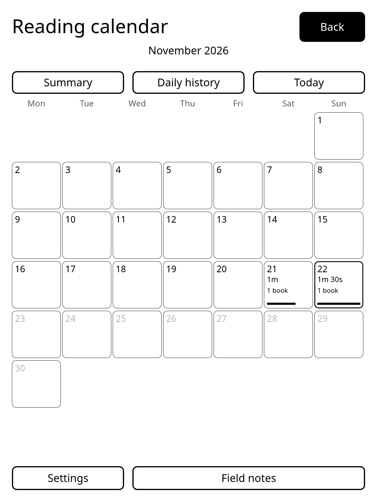

# Daily reading statistics

Open **Tools › Reading statistics**, **Reading data › Reading statistics**, or tap **Reading time** in a book's information. The clock icon in Tools opens statistics for the current book. Choose **All books** to compare the library, including books whose source file is no longer available.

| View | Controls and information |
| --- | --- |
| Summary | Recorded reading time, distinct reading screens, capped page time, earlier undated screen time, daily history and calendar |
| Daily history | Dates in reverse order, reading time, distinct screens and books; tap a date for its timeline |
| Time range | Compare reading time and distinct screens by week or month, then open a period for its individual books |
| Calendar | A month grid with reading time, book counts and relative duration bars; tap a day, swipe, or use page buttons to change months |
| Day timeline | An hourly histogram and book intervals clipped to the selected day; tap an interval for its book sessions and **Continue reading** |
| Settings | Enable statistics, minimum and maximum visit time, freeze finished books, week start, calendar day origin, histogram and future months |

[Summary](screenshots/reading-statistics-summary.png) · [Daily history](screenshots/reading-daily-history.png) · [Books](screenshots/reading-statistics-books.png) · [Book sessions](screenshots/reading-book-sessions.png) · [Settings](screenshots/reading-statistics-settings.png)

## Time range reports

Choose **Time range › Books by week** or **Books by month**. Each period
shows recorded reading time, distinct reading screens and the number of
books. Tap a period to see its books, ordered by their last visit within
that period. Open a book to see its totals and resume from its saved
position if it is in the library. Back returns to the same report page.
The existing book filter applies to both reports.
[Weekly report](screenshots/reading-statistics-weekly.png) · [Monthly report](screenshots/reading-statistics-monthly.png) · [Books in a week](screenshots/reading-statistics-period-books.png)

Reports use each visit's local start date. Weeks run from Monday through
Sunday, including across a year boundary. Each reread contributes time.
A recurring screen counts once per book within the selected period.
Undated time remains visible in the main statistics summary. These reports
query the existing journal. [Pinned KOReader time range menu](https://github.com/koreader/koreader/blob/9192014d8bd82a91dc1012473be0f238dedfdb54/plugins/statistics.koplugin/main.lua#L1280-L1359) · [Pinned grouping queries](https://github.com/koreader/koreader/blob/9192014d8bd82a91dc1012473be0f238dedfdb54/plugins/statistics.koplugin/main.lua#L1793-L1836) · [Pinned books-in-period query](https://github.com/koreader/koreader/blob/9192014d8bd82a91dc1012473be0f238dedfdb54/plugins/statistics.koplugin/main.lua#L2079-L2131)

## Counting time

New history defaults to the stock five-second minimum and 120-second maximum per visit. Quick skims do not count. Re-reading keeps a new visit. Reading time includes those rereads; capped page time sums at most the configured maximum for each distinct reading screen. These are separate values, as in KOReader's uncapped and capped book queries. Finished books continue recording by default, with an option to freeze them. [Stock defaults and total queries](https://github.com/koreader/koreader/blob/v2026.07.1/plugins/statistics.koplugin/main.lua#L29-L90) · [Page visit accounting](https://github.com/koreader/koreader/blob/v2026.07.1/plugins/statistics.koplugin/main.lua#L2560-L2652)

Daily history groups visits by their recorded start date. The calendar and histogram instead clip each recorded interval at the selected day's boundaries. Thus a visit across midnight can contribute time to two calendar days while its start-date total remains on the first day. The calendar can start its day at midnight, 04:00 or 06:00. The date list retains midnight grouping. A day has the duration given by the device's local calendar, including daylight-saving transitions. [Stock daily totals](https://github.com/koreader/koreader/blob/v2026.07.1/plugins/statistics.koplugin/main.lua#L1453-L1479) · [Stock timeline clipping and gap merging](https://github.com/koreader/koreader/blob/v2026.07.1/plugins/statistics.koplugin/main.lua#L2862-L2934)

Disabling statistics or freezing a finished book pauses all three time trackers, including the existing screen-time and pace counters. Sleep, USB storage and non-reading screens pause recording. Short intervals on the same page can combine across sleep toward the minimum, without counting the pause or resetting the visit's maximum. Returning to Library finishes that visit. Timeline rows merge adjacent intervals for the same book when their gap is no more than the larger of 30 seconds and the minimum visit time. Gaps contribute no reading time to totals or the histogram.

Elapsed time comes from the monotonic clock. UTC timestamps provide dates. If the observed wall clock changes independently, the ambiguous interval stays explicitly undated; later reliable intervals can receive dates again. Dates before 2000 are also treated as uncertain device time. Changing the device time zone regroups known instants in its current local zone. [Device time zone and day boundaries](device-local-time.md) Whole-second clock sampling allows two seconds of observation tolerance.

## Existing data and storage

The existing `reading-stats.json` screen-time counter is retained. On the first use of the separate `reading-history.json` journal, its saved totals become **Earlier screen time · undated**. Reopening Reader preserves that snapshot even as the older counter continues updating while statistics are enabled. No dates are invented for those aggregates, and they are never added to recorded history totals. **Uncertain clock · undated** belongs to the new filtered history and is already included in recorded reading time.

The new journal has its own versioned format and atomic save. It checkpoints active reading every minute and at save transitions. Failed writes retain completed pending records for retry and leave the existing file intact. USB return discards an uncommitted active interval. Unrecognized, corrupt or oversized history is preserved with a warning. The journal is bounded to 100,000 interval records, 10,000 book labels and 16 MiB. It reports a full history rather than silently deleting earlier records.

## Evidence and remaining comparisons

Deterministic tests cover min/max boundaries, rereads, capped and uncapped totals, migration and reopening, midnight, shifted days, UTC offsets, leap years, year changes, fractional notifications, clock corrections, sleep, USB and atomic write failures. Separate process tests exercise 23-hour and 25-hour local days. Desktop controls check calendar navigation, book filters, settings and black/white held feedback. Real cached EPUB and PDF workflows open the source documents, browse statistics, save and verify unchanged reading positions and source bytes. Native acceptance remains pending the combined Kindle build.

Reflow uses source-position reading-screen identities, so page numbers
and totals need separate layout-change comparisons with KOReader's
rescaling view. Reader's pace estimator has its own sample policy.
Rolling time ranges, additional day and week breakdowns, minute-level
day-origin editing, configurable book-span labels, database import and
sync, and history deletion remain separate work. Reader records the
actual pre- and post-pause portions of each visit.
[Stock layout rescaling](https://github.com/koreader/koreader/blob/v2026.07.1/plugins/statistics.koplugin/main.lua#L439-L441) · [Stock pause and resume timestamps](https://github.com/koreader/koreader/blob/v2026.07.1/plugins/statistics.koplugin/main.lua#L2694-L2732)
