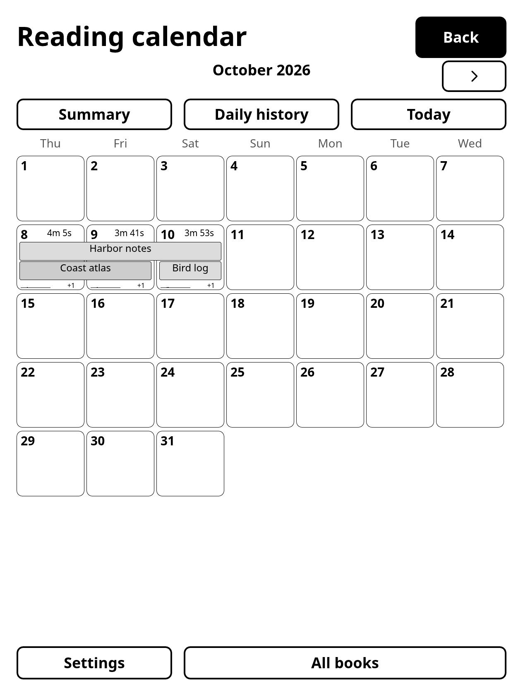
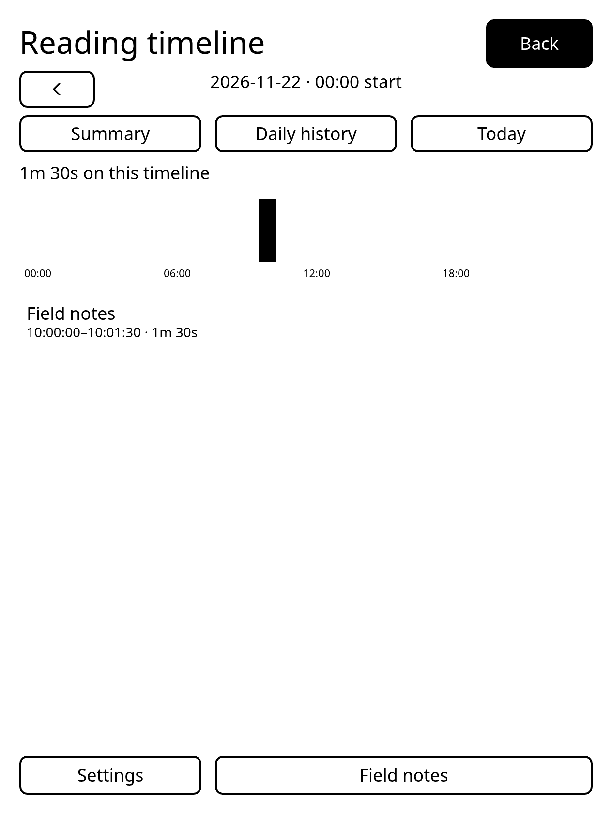

# Daily reading statistics

Open **Tools › Reading statistics**, **Reading data › Reading statistics**, or tap **Reading time** in a book's information. The clock icon in Tools opens statistics for the current book. Choose **All books** to compare the library, including books whose source file is no longer available.

| View | Controls and information |
| --- | --- |
| Summary | Recorded reading time, distinct reading screens, capped page time, earlier undated screen time, daily history and calendar |
| Reading progress | Seven dated bars, weekly totals and averages, and separate Session and Today cards |
| Daily history | Dates in reverse order, reading time, distinct screens and books; tap a date for its timeline |
| Time range | Compare reading time and distinct screens by week or month, then open a period for its individual books |
| Calendar | A month grid with reading time, book titles that span consecutive days, and an optional hourly histogram. Tap a day, swipe, or use page buttons to change months. |
| Day timeline | An hourly histogram and book intervals clipped to the selected day; tap an interval for its book sessions and **Continue reading** |
| Settings | Enable statistics, set visit limits, freeze finished books, choose the starting weekday, edit the timeline start, apply the shift to the calendar, limit book spans, show the histogram, and browse future months. |

[Summary](screenshots/reading-statistics-summary.png) · [Daily history](screenshots/reading-daily-history.png) · [Books](screenshots/reading-statistics-books.png) · [Book sessions](screenshots/reading-book-sessions.png) · [Settings](screenshots/reading-statistics-settings.png)

## Jumping to a month

Tap the month heading in **Reading calendar** and enter a month in
`YYYY-MM` format. The editor accepts years 1000–9999. An exact jump can
visit a month before the first reading record or after the current month.
The outer arrows jump to the earliest month for the selected book filter
and to the current month. The inner arrows, swipes, and page buttons step
one month at a time. **Browse future months** controls forward stepping.
[Calendar controls](screenshots/reading-calendar-month-navigation.png) ·
[Month editor](screenshots/reading-calendar-month-editor.png)

Open a day in the calendar and step across a month boundary in its
timeline. Back opens the month containing the date you reached. Timelines
opened from Daily history return to that list. The Mac simulation checks
the editor, both sets of arrows, and the reading position and totals.
The checksum-verified stock comparison executes the pinned month controls
and timeline-close callback. Its host Lua calendar steps through supported
civil dates, and Reader's Gregorian arithmetic also steps through dates
before 1900.
[Pinned stock controls](https://github.com/koreader/koreader/blob/9192014d8bd82a91dc1012473be0f238dedfdb54/plugins/statistics.koplugin/calendarview.lua#L1164-L1234) ·
[Pinned timeline return](https://github.com/koreader/koreader/blob/9192014d8bd82a91dc1012473be0f238dedfdb54/plugins/statistics.koplugin/calendarview.lua#L1452-L1468) ·
[Executable comparison](../scripts/koreader-calendar-month-navigation-check.py)

## Calendar and timeline settings

Set **Daily timeline starts at** to group midnight reading with the preceding
evening. Hours step by one or four on hold. Minutes step by ten or thirty on
hold and wrap at the limit. **Set time** saves both values. **Also use in
calendar view** applies the shift to month cells independently. Older journals
with a shifted calendar keep that preference. Today in the timeline opens the
previous date until the configured start time arrives. [Time editor](screenshots/reading-calendar-start-time.png)

The week can start on Friday, Saturday, Sunday, or Monday, the choices in the
pinned stock menu. An existing weekday from an older Reader journal remains
active until you choose a new start. **Books per calendar day** accepts one
through five and defaults to three. The
calendar sorts titles by time read, breaking ties by stable book ID. A title
that also ranks on the next day keeps its row through that week. The `+n` count
shows additional titles. Tap the day for its full timeline. The optional
hourly histogram uses the relevant calendar or timeline start for its bins.
[KOReader settings](https://github.com/koreader/koreader/blob/9192014d8bd82a91dc1012473be0f238dedfdb54/plugins/statistics.koplugin/main.lua#L1148-L1227) · [KOReader week spans](https://github.com/koreader/koreader/blob/9192014d8bd82a91dc1012473be0f238dedfdb54/plugins/statistics.koplugin/calendarview.lua#L194-L247)

The native stock replay opens the real count and time controls and verifies
the 1–5 span range, cancelling a draft, applying 04:20, and switching the
calendar shift off and on while keeping that time. Reader’s Mac tests check
the same choices through Settings, week-spanning titles and original reading
position. [Stock start-time editor](screenshots/stock-calendar-start-time.png) ·
[Native replay](../scripts/koreader-calendar-options-check.lua)

## Time range reports

**Time range** shows the eight stock report choices. **All books** shows
recorded time across the library. **Books by week** and **Books by month**
open a period and its individual books. The last week, last month, and
last year offer daily reports. The last year also offers weekly groups,
and **All stats by month** includes every recorded month. Select a weekly
or monthly total to see its days, then select a day to see the books read.
Back restores the list and page. Continue reading resumes the selected book.
The book filter applies to dated reports. All books uses the entire library.
[Report menu](screenshots/reading-statistics-range-menu.png) · [Last month by day](screenshots/reading-statistics-range-days.png) · [Weekly report](screenshots/reading-statistics-weekly.png) · [Books in a week](screenshots/reading-statistics-period-books.png)

Reports use each visit's local start date and count repeat visits toward
elapsed time. Each screen counts once per book within the displayed group.
Rolling cutoffs follow the stock 7-, 30-, or 365-day calculation and include
the cutoff instant. Weekly groups follow SQLite's calendar year and Monday
week numbering, including Week 00. Drill-down uses the dates included in
the selected report, including a partial first week or a year boundary.
Earlier undated time remains in the summary. [Pinned Time range callbacks](https://github.com/koreader/koreader/blob/9192014d8bd82a91dc1012473be0f238dedfdb54/plugins/statistics.koplugin/main.lua#L1303-L1448) · [Pinned SQL grouping and cutoff](https://github.com/koreader/koreader/blob/9192014d8bd82a91dc1012473be0f238dedfdb54/plugins/statistics.koplugin/main.lua#L1793-L1998)

The executable Lua comparison runs the pinned menu callbacks and extracts
its SQLite queries. An authored UTC fixture checks a visit one second before
and exactly at the cutoff, rereads, and the New Year weekly split. Mac tests
exercise nested reports, saved positions, screenshots and the unchanged
history journal. Kindle verification is pending.
[Stock comparison](../scripts/koreader-statistics-time-ranges-check.lua) · [History aggregation tests](../src/reading_stats/history/report.rs) · [Reader interaction tests](../src/app/reading_history/tests.rs)

## Seven-day reading progress

Open **Reading statistics → Reading progress**. The report covers today's
local date and the preceding six dates, including days with zero reading.
Each date counts a screen once per book. Rereads add time to the same date, and
weekly page totals add the seven daily counts. Average time and page count use
all seven days. The bars scale to the longest day. The separate **Today** and
**Session** cards show their own page counts and time. The report uses the
whole library when opened from a single book's statistics. [Portrait capture](screenshots/reading-progress.png) · [Landscape capture](screenshots/landscape-reading-progress.png)

Session time starts when a document opens, when Reader wakes, or when statistics
are enabled again. A report left open through wake refreshes the session card.
Daily totals follow a visit's start date, independent of the calendar's optional
timeline shift. Reader measures page counts with its stored reading-screen IDs
and displays elapsed time to the second. Civil dates stay consecutive across
clock changes. A visit dated after the report or without a trusted date stays
outside its bars and totals. **Close**, either page button, or a downward swipe
returns to the statistics list. [Stock SQL](https://github.com/koreader/koreader/blob/9192014d8bd82a91dc1012473be0f238dedfdb54/plugins/statistics.koplugin/main.lua#L2144-L2185) · [Stock widget](https://github.com/koreader/koreader/blob/9192014d8bd82a91dc1012473be0f238dedfdb54/plugins/statistics.koplugin/readerprogress.lua)

The isolated pinned SDL runtime opened the actual progress widget and ran its
SQLite queries over authored visits. The Rust history test used the same dated
visits and checked the weekly result of 195 seconds and five pages, today's 110
seconds and two pages, and the current session's 120 seconds and two pages. The
fixture includes a cutoff visit, rereads, inactive dates, and a visit spanning
midnight. Mac app tests exercise the empty report, both orientations, returning
to the same passage, the preserved journal, and refreshing on wake. The opt-in
workflow also opened the report from cached original EPUB and PDF documents
and returned to the same page with identical source bytes. Kindle
acceptance remains open. [Stock capture](screenshots/koreader-reading-progress.png) · [Native comparison runner](../scripts/koreader-reading-progress-check.py)

## Reset statistics

Open **Reading statistics › Statistics settings › Reset statistics**. Reset
its current book, choose another book from the recorded list, or clear books
below 1, 5, 15, 30 or 60 minutes. Bulk reset protects the current book. The
confirmation shows the selection or count. Cancel returns without applying it.

Reader removes recorded visits and the earlier undated snapshot for the
selected books. Book information starts its displayed timer at zero and the
footer learns a fresh reading pace. Source files, bookmarks, notes and resume
positions are preserved. The reset journal tracks a baseline for the earlier
screen-time counter and invalidates previous pace samples. This keeps the
reset durable in a single atomic save while reading data remains compatible
with existing profiles.

The pinned Lua comparison executes the reset menu and callbacks. It verifies
the current-book and per-book actions, strict cutoffs and confirmation. Mac
tests cover all three paths, exact threshold behavior, write failure, reopening,
old pace samples and the unchanged source EPUB. Kindle verification is pending.
[Reset menu](screenshots/reading-statistics-reset-menu.png) · [Confirmation](screenshots/reading-statistics-reset-confirm.png) · [Pinned KOReader callbacks](https://github.com/koreader/koreader/blob/9192014d8bd82a91dc1012473be0f238dedfdb54/plugins/statistics.koplugin/main.lua#L2338-L2534) · [Executable comparison](../scripts/koreader-statistics-reset-check.lua)

### Reset one book for a day, week or month

Open the list of books for the date or period, then hold a book row. The
confirmation shows the selected book, dates and number of recorded visits.
Reset removes those visits and refreshes the report. Other books, visits
outside the displayed dates, undated screen time and the reading pace are
preserved. Cancel leaves the report intact.

The pinned comparison exercises Cancel and Reset, checks the selected book
and interval in the SQLite statement and verifies the refresh callback. Reader
uses an exclusive upper date boundary to preserve visits at the next midnight.
[Simulator](screenshots/reading-statistics-period-reset.png) · [Pinned KOReader period reset](https://github.com/koreader/koreader/blob/9192014d8bd82a91dc1012473be0f238dedfdb54/plugins/statistics.koplugin/main.lua#L2222-L2265)

## Counting time

New history defaults to the stock five-second minimum and 120-second maximum per visit. Quick skims do not count. Re-reading keeps a new visit. Reading time includes those rereads; capped page time sums at most the configured maximum for each distinct reading screen. These are separate values, as in KOReader's uncapped and capped book queries. Finished books continue recording by default, with an option to freeze them. [Stock defaults and total queries](https://github.com/koreader/koreader/blob/v2026.07.1/plugins/statistics.koplugin/main.lua#L29-L90) · [Page visit accounting](https://github.com/koreader/koreader/blob/v2026.07.1/plugins/statistics.koplugin/main.lua#L2560-L2652)

### Page duration limits

Open **Reading statistics › Statistics settings › Read page duration limits**.
The minimum accepts 0–120 seconds, with 1-second taps and 10-second holds.
The maximum accepts 10–7200 seconds, with 10-second taps and 60-second holds.
Tap a value to type it on the number pad. **Defaults** loads 5 and 120 seconds
into the draft. **Apply** saves both values together. Cancel leaves the saved
limits in place, and a failed write keeps the draft available for retry.

The pinned KOReader widget and page accounting confirm the independent bounds.
With minimum 120 and maximum 10, a ten-second visit is below the minimum.
An eleven-second visit exceeds the maximum and contributes ten seconds.
Reader's keypad accepts arithmetic with addition, subtraction, multiplication,
division, parentheses and decimals, for example `2*60` or `(15+5)/2`. A
result must be a whole number of seconds because the saved limits and page
accounting currently use integer seconds. Division by zero, incomplete
expressions, and results outside the allowed range are rejected without
changing the draft. KOReader's general number field also accepts fractional
results; fractional-second limits remain unsupported in Reader.
Reader keeps already recorded visits when the limits change.
[Reader editor](screenshots/reading-statistics-duration.png) ·
[Reader number pad](screenshots/reading-statistics-duration-keypad.png) ·
[Stock editor](screenshots/reading-statistics-duration-stock.png) ·
[Pinned settings](https://github.com/koreader/koreader/blob/9192014d8bd82a91dc1012473be0f238dedfdb54/plugins/statistics.koplugin/main.lua#L1065-L1104) ·
[Stock simulator check](../scripts/koreader-reading-progress-check.py)

### Import KOReader statistics for a PDF or DjVu book

Close KOReader and copy `statistics.sqlite3` from its settings directory to
Kindle Documents or a folder inside it. In Reader, open the PDF or
self-contained DjVu book, open its **Book details › Reading statistics**, then
choose **Import KOReader statistics**. Both `.djvu` and `.djv` filenames are
accepted. **Preview database** opens `Documents/statistics.sqlite3` directly.
Use **Browse Documents** to choose a `.sqlite3`, `.sqlite`, or `.db` copy
in a visible Documents folder. The browser supports touch and the page buttons.
The preview shows the matched KOReader book and the selected file, along with
the number of new records, reading time, and dates. Check the matched title
and file before importing.
Choose **Import records** to add them to Reader's history. Back closes the
preview. The statistics database and book stay in place.

Reader checks KOReader's sampled book fingerprint and physical page count.
Editions with differences outside the sample can share a fingerprint. Reader
accepts schema 20221111 snapshots up to 8 MiB and 20,000 rows for the matched
book. Use a closed copy with all commits applied. Reader checks for a
nonempty WAL or rollback journal beside the selected file, using that file's
own name. It opens files and folders without following symbolic links.
A main file copied without
its active WAL can be incomplete even when no journal is present. Duplicate or conflicting
page-time records and rows saved under a different page count are shown in the
preview and skipped. A changed book, database, or Reader journal requires a new
preview or a restart before saving. Import adds the dated visits without
changing the reading position, notes, or the pace estimator.

The pinned Mac KOReader runtime used its native page turns and statistics
write path to record the two-page PDF and six-page *Beacon Atlas* DjVu. SQLite
and Reader agreed on 60 seconds over two physical PDF pages and 75 seconds
over DjVu pages 1, 3, and 6. The DjVu visit to page 3 used its physical
ordinal even though the bundled component is named `reef-42.djvu`. Reader
kept the zoomed and panned position. Reopening the same bytes as `.djv`
recognized all four DjVu records as already imported. Each visit's start time
and duration survive the import.
[PDF import preview](screenshots/reading-statistics-import.png) ·
[DjVu import preview](screenshots/reading-statistics-import-djvu.png) · [Stock database
generator](../scripts/koreader-fixed-statistics-import-check.py) · [Pinned schema
and rescaling](https://github.com/koreader/koreader/blob/9192014d8bd82a91dc1012473be0f238dedfdb54/plugins/statistics.koplugin/main.lua#L403-L493)
· [Pinned stock write path](https://github.com/koreader/koreader/blob/9192014d8bd82a91dc1012473be0f238dedfdb54/plugins/statistics.koplugin/main.lua#L909-L964)
· [KOReader DjVu page mapping](https://github.com/koreader/koreader-base/blob/6e4bc81af4e04f78d81677a323a780a71b29702a/djvu.c#L322-L336)

[Landscape database browser](screenshots/landscape-statistics-database-picker.png) ·
[Preview of a selected snapshot](screenshots/landscape-statistics-database-preview.png)

Daily history groups visits by their civil start date. Reader clips the elapsed intervals used by the calendar and timeline to the chosen day's boundaries. A visit that crosses a boundary can contribute time to both calendar days while its daily-history total remains on the start date. KOReader's monthly SQL assigns each visit to a date using its start timestamp, with the optional offset. Day boundaries follow the current device time zone, including daylight-saving transitions. [Stock daily totals](https://github.com/koreader/koreader/blob/v2026.07.1/plugins/statistics.koplugin/main.lua#L1453-L1479) · [Stock calendar query](https://github.com/koreader/koreader/blob/9192014d8bd82a91dc1012473be0f238dedfdb54/plugins/statistics.koplugin/main.lua#L2822-L2861) · [Stock day timeline](https://github.com/koreader/koreader/blob/v2026.07.1/plugins/statistics.koplugin/main.lua#L2862-L2934)

Disabling statistics or freezing a finished book pauses all three time trackers, including the existing screen-time and pace counters. Sleep, USB storage and non-reading screens pause recording. Short intervals on the same page can combine across sleep toward the minimum, without counting the pause or resetting the visit's maximum. Returning to Library finishes that visit. Timeline rows merge adjacent intervals for the same book when their gap is no more than the larger of 30 seconds and the minimum visit time. Gaps contribute no reading time to totals or the histogram.

Elapsed time comes from the monotonic clock. UTC timestamps provide dates. If the observed wall clock changes independently, the ambiguous interval stays explicitly undated; later reliable intervals can receive dates again. Dates before 2000 are also treated as uncertain device time. Changing the device time zone regroups known instants in its current local zone. [Device time zone and day boundaries](device-local-time.md) Whole-second clock sampling allows two seconds of observation tolerance.

## Existing data and storage

The existing `reading-stats.json` screen-time counter is retained. On the first use of the separate `reading-history.json` journal, its saved totals become **Earlier screen time · undated**. Reopening Reader preserves that snapshot even as the older counter continues updating while statistics are enabled. No dates are invented for those aggregates, and they are never added to recorded history totals. **Uncertain clock · undated** belongs to the new filtered history and is already included in recorded reading time.

The new journal has its own versioned format and atomic save. It checkpoints active reading every minute and at save transitions. Failed writes retain completed pending records for retry and leave the existing file intact. USB return discards an uncommitted active interval. Unrecognized, corrupt or oversized history is preserved with a warning. The journal is bounded to 100,000 interval records, 10,000 book labels and 16 MiB. It reports a full history rather than silently deleting earlier records.

## Evidence and remaining comparisons

Deterministic tests cover min/max boundaries, rereads, capped and uncapped totals, migration and reopening, midnight, shifted days, UTC offsets, leap years, year changes, fractional notifications, clock corrections, sleep, USB and atomic write failures. Separate process tests exercise 23-hour and 25-hour local days. Desktop controls check calendar navigation, book filters, settings and black/white held feedback. Real cached EPUB and PDF workflows open the source documents, browse statistics, save and verify unchanged reading positions and source bytes. Native acceptance remains pending the combined Kindle build.

Reflow uses source-position reading-screen identities, so page numbers
and totals need separate layout-change comparisons with KOReader's
rescaling view. Reader's pace estimator has its own sample policy.
The pinned Lua/SQLite check exercises the save and shift callbacks, picker
wrapping, book duration ranking, and spans across adjacent days. Rust tests
cover the 04:20 boundary in a fractional-offset zone, both shift choices,
failed saves, book filtering, and the saved reading position.
Reader records the actual pre- and
post-pause portions of each visit.
[Stock calendar comparison](../scripts/compare-calendar-options.py) · [Stock layout rescaling](https://github.com/koreader/koreader/blob/v2026.07.1/plugins/statistics.koplugin/main.lua#L439-L441) · [Stock pause and resume timestamps](https://github.com/koreader/koreader/blob/v2026.07.1/plugins/statistics.koplugin/main.lua#L2694-L2732)
