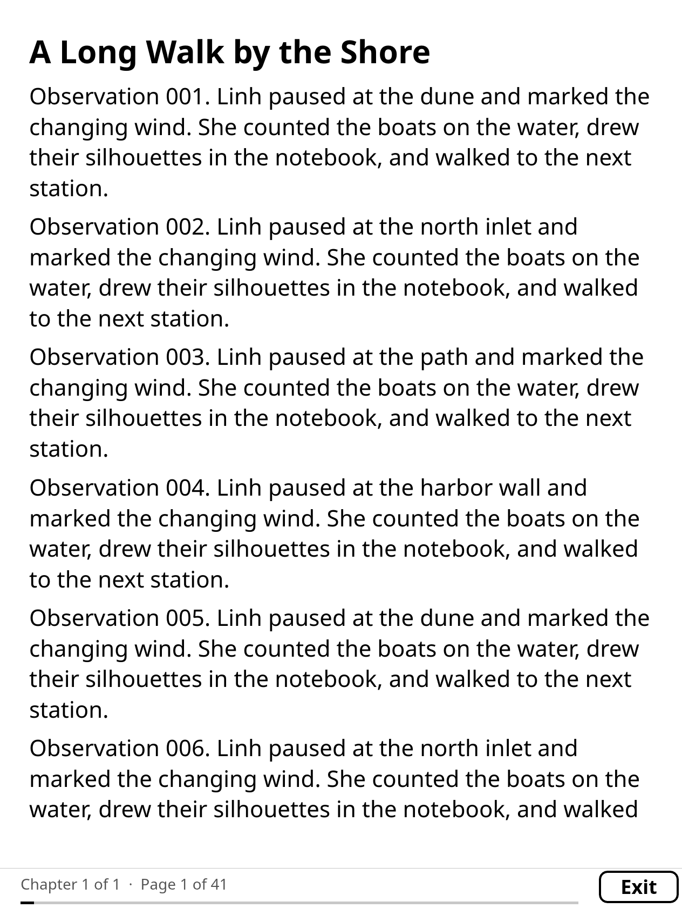

# Opening books from Kindle Documents

The compatibility run uses the owner's existing books on an Oasis 3 with firmware 5.18.2.
The reference is KOReader v2026.07.1, the version installed on this device.
Public records include aggregate outcomes. The original files, names, book text,
screenshots of personal books and saved reading positions are absent from the repository.

## What the test exercises

The device driver runs the release Rust code on the Oasis. It browses folders under
Documents through the normal picker, uses the page button to reach later rows, taps the
file row, renders the first page and sends a forward page-button event. It writes its own
scratch profile, quits and opens Continue reading to compare both the saved position
and the rendered page body. This software path can run while another app is in the
foreground. Physical touch, e-ink timing and sleep are separate checks.

For a single file under an authorized Documents root, run the example with a fresh
scratch directory and the same Noto Sans fonts as Launcher.

```sh
READER_VERIFY_PICKER=1 cargo run --locked --release --example verify_document -- \
  "$documents_root" "$book_path" "$new_scratch_directory" "$regular_font" "$bold_font"
```

## Reader 0.1.5 on the Oasis

| Format | Files attempted | Opened and drew a page |
| --- | ---: | ---: |
| EPUB | 31 | 14 |
| AZW3 | 16 | 0 |
| PDF | 4 | 3 |
| TXT | 4 | 3 |
| Legacy MOBI | 2 | 1 |
| Amazon AZW | 3 | 0 |
| KFX and related Kindle files | 10 | 0 |

The baseline used the ordinary document opener. It covered 70 original files including
nested Downloads and dictionary folders. Earlier generated test books and Kindle
sidecar directories were excluded. Of the 17 EPUB failures, nine involved the first
chapter, four involved XML declarations and four involved ZIP packaging. The equivalent
installed KOReader engine opened representatives of each EPUB failure category. All
three AZW headers report encryption. Reader has no KFX engine.

## Comparable page images

Both views show the same generated long-chapter publication, using Noto Sans at
42 pixels. The KOReader image is CREngine's 1264 × 1606 document surface on the
Oasis. The Reader image is the 1264 × 1680 app simulator including its footer.
Paragraph indentation, line breaks and pagination differ. These captures make
those differences visible without publishing a page from the owner's library.

| KOReader on Oasis | PrimitiveOS Reader |
| --- | --- |
|  |  |
