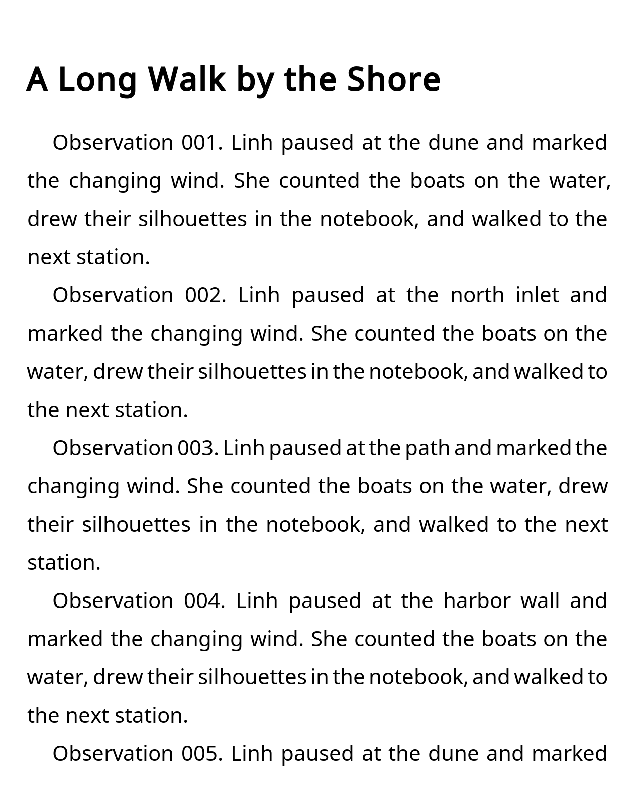

# Opening books from Kindle Documents

The compatibility run uses the owner's existing books on an Oasis 3 with firmware 5.18.2.
The reference is KOReader v2026.07.1, the version installed on this device.
Public records include aggregate outcomes. The original files, names, book text,
screenshots of personal books and saved reading positions are absent from the repository.

## What the test exercises

The device driver runs the release Rust code on the Oasis. It browses folders under
Documents through the normal picker, uses the page button to reach later rows, taps the
file row, renders the first page and sends a forward page-button event. It writes its own
scratch profile, quits and opens Continue reading to compare both the saved position
and the rendered page body. This software path can run while another app is in the
foreground. Physical touch, e-ink timing and sleep are separate checks.

For a single file under an authorized Documents root, run the example with a fresh
scratch directory and the same Noto Sans fonts as Launcher.

```sh
READER_VERIFY_PICKER=1 cargo run --locked --release --example verify_document -- \
  "$documents_root" "$book_path" "$new_scratch_directory" "$regular_font" "$bold_font"
```

The installed production binary exposes the same diagnostic, including the picker,
so release checks can exercise the exact executable from Store. The scratch directory
must be new. The caller can remove it after reviewing the result.

```sh
/mnt/us/reader/bin/reader-kindle --check-document "$book_path" "$new_scratch_directory"
```

Set `READER_VERIFY_SPINE=sample` to check the first, middle and final spine entries
and paint their first, middle and final pages. Use `READER_VERIFY_SPINE=all` to
paint every page of every entry. An ordinary open skips these diagnostics.
Fixed-layout EPUBs count successfully decoded pages and painted frames. The
reflow audit also reports the following evidence.

| JSON field | Interpretation |
| --- | --- |
| `failed_indices` | A spine index failed to open, lay out or paint. Indices start at zero. |
| `genuine_reflow_sections`, `recovered_placeholder_indices`, `empty_body_indices` | A section contains original text or illustrations, a recovery notice supplied by Reader, or a verified attribute-free and structurally empty source body, respectively. `empty_layout_with_markup_indices` records other empty layouts separately for review. |
| `mapped_chars` and `source_chars` | Counts of normalized, non-whitespace source characters covered by line byte ranges and total such characters in genuine sections. `missing_glyphs` separately counts shape results without a glyph in the supplied fonts. |
| `source_graphics`, `decoded_graphics` and `placeholder_graphics` | Image occurrences identified by the reading source model, decoded previews available to the renderer and fallback boxes, respectively. Repeated placements count individually. |
| `located_fragments` and `source_fragments` | Counts of extracted fragment anchors that resolve to a page and the total extracted from genuine sections. |
| `exact_page_anchors` and `inspected_page_anchors` | For each tested page with a reading anchor, the checker resolves the anchor back to a page and compares the index. |
| `painted_pages_with_ink` and `painted_pages` | Page bitmaps with at least one nonwhite pixel and all successfully painted pages, including blank leaves and recovery notices. |
| `issues` | Per-section counts for missing mappings, artwork, glyphs or page anchors. White pages inside genuine chapters can arise from whitespace. Up to eight zero-based example pages identify each blank-frame or anchor mismatch. |

The JSON contains counts and numeric positions. The scratch profile can contain
book metadata and stays local. [Audit implementation](../src/document_check/spine.rs)

On a device, `READER_VERIFY_SPINE=all-sections` checks the source and layout of every chapter and paints its first, middle and final page. Use `all` to inspect every page boundary.

## Whole-spine verification on Mac

Ten anonymized EPUB entries from Kindle Documents went through the production
`reader-kindle --check-document` command with `READER_VERIFY_SPINE=all`, 1264-pixel
width and the Launcher Noto Sans regular and bold fonts. Entries 035 and 065 are
byte-identical copies at different picker locations. The counts below include
both. All 315 spine entries opened and every one of the 8,575 pages painted.

| Entry | Original sections / entries | Pages painted | Source characters mapped | Images decoded / referenced | Fragment anchors located | Missing glyph instances |
| --- | ---: | ---: | ---: | ---: | ---: | ---: |
| 031 | 24/24 | 1,134 | 1,222,865 | 15/15 | 599 | 0 |
| 032 | 11/11 | 1,156 | 1,226,557 | 14/14 | 0 | 0 |
| 033 | 12/12 | 403 | 357,788 | 31/31 | 149 | 63 |
| 035 | 33/33 | 411 | 372,040 | 25/25 | 353 | 0 |
| 046 | 31/31 | 1,207 | 1,184,691 | 79/79 | 24 | 0 |
| 052 | 21/21 | 366 | 419,252 | 39/39 | 1,193 | 2 |
| 053 | 48/49 | 1,973 | 2,102,842 | 1,726/1,757 | 3,259 | 555 |
| 055 | 40/42 | 1,151 | 1,071,808 | 1/1 | 141 | 0 |
| 061 | 59/59 | 363 | 328,305 | 64/64 | 9,017 | 0 |
| 065 | 33/33 | 411 | 372,040 | 25/25 | 353 | 0 |
| **Total** | **312/315** | **8,575** | **8,658,188** | **2,019/2,050** | **15,088** | **620** |

- The checker mapped every normalized non-whitespace character and resolved all
  15,088 extracted fragments. All 8,571 available page anchors returned to their
  original pages. Entry 053 previously restored two illustration pages to the
  first image in the paragraph. Saved anchors now retain the image ordinal.
- In 033, 052 and 061, valid PNG and JPEG illustrations near the ends of chapters
  previously showed placeholders. Reader now budgets the retained grayscale
  previews separately from decoding the full source. Pictures keep their
  display and touch geometry when their cached resolution is reduced.
- In 053, index 21 rendered a recovery notice. It contributes zero source
  characters, illustration references or fragment anchors. Independent ZIP
  validation found 41 unavailable image members. The surviving chapters
  reference 31 of those missing images and 1,726 intact image occurrences.
  The renderer decoded all 1,726.
- In 055, indices 40 and 41 are two literal empty body elements. Both pages
  stayed empty. Two further white frames occurred inside genuine chapters at
  (032, section 2, page 102) and (061, section 11, page 10). The former
  contains a trailing whitespace line and the latter has no visible line
  in the final layout region. These are zero-based positions.
- Character coverage records layout mapping. The 620 missing-glyph instances
  are a separate font-coverage limitation with the supplied fonts. This Mac
  pass measures the software renderer and input handlers. Physical display
  behavior is covered by the separately identified Oasis runs.

### Trailing reflow pages

A follow-up Mac run checked the two all-white trailing views from the whole-spine table. In 032, the final 113.9 pixels held a terminal hard break and an empty layout line. In 061, the paragraph's nominal height extended 0.44 pixels past the page boundary after its last visible line. Reader now ends pagination at the final line, illustration, annotation or paragraph background with visible content. End-of-chapter links and saved text positions still resolve.

The two affected chapters produced 102 and 10 pages respectively. All 112 pages showed ink, all 112 page anchors returned to their original pages, all 214 source fragments resolved and all 120,896 non-whitespace characters mapped to laid-out lines. The two intentionally empty entries in 055 each continued to paint a single white page. Authored regression tests also check multiple terminal breaks, a trailing anchor and shaded whitespace.

## Reader 0.1.5 on the Oasis

| Format | Files attempted | Opened and drew a page |
| --- | ---: | ---: |
| EPUB | 31 | 14 |
| AZW3 | 16 | 0 |
| PDF | 4 | 3 |
| TXT | 4 | 3 |
| Legacy MOBI | 2 | 1 |
| Amazon AZW | 3 | 0 |
| KFX and related Kindle files | 10 | 0 |

The Kindle's Store receipt identified the installed Reader as 0.1.2. For the comparison above, the latest public source at the beginning of the run (0.1.5) was rebuilt and run on the same Oasis. The baseline used the ordinary document opener. It covered 70 original files including
nested Downloads and dictionary folders. Earlier generated test books and Kindle
sidecar directories were excluded. Of the 17 EPUB failures, nine involved the first
chapter, four involved XML declarations and four involved ZIP packaging. A reference is counted as an EPUB only when the engine identifies its format as
EPUB. CREngine can return a successful load and a page count after falling back
to plain text on a damaged ZIP. All three AZW headers report encryption. Reader
has no KFX engine.

## Reader 0.1.6 on the same Oasis

| Original documents | Opened, rendered and resumed | What changed |
| --- | ---: | --- |
| EPUB | 31 of 31 | Read publisher XML declarations, compressed or displaced mimetype entries, recoverable ZIP directories, blank leaves, and SVG covers with linked pictures. Display an invisible character safely in a picker label while preserving the underlying filename. |
| AZW3 | 16 of 16 | Read unencrypted KF8 books with auxiliary flows, larger text sections, producer-specific markup and embedded illustrations. |
| Legacy MOBI | 2 of 2 | Bound decompression and paginate long text into manageable sections. |
| PDF | 4 of 4 | Read the large scanned document within the 128 MiB source budget. |
| TXT | 4 of 4 | Recognize an HTML text export containing terminal color escapes. |
| Protected AZW | 0 of 3 | The original Palm database headers report encryption. The Documents list points to Kindle Library. |
| Kindle KFX | 0 of 10 | The Documents list identifies KFX and points to Kindle Library. |

The picker results above used the original files under Documents, including nested
folders. The 96,319,018-byte PDF took 45.7 seconds to open in the instrumented run.
Reading the file took 8.2 seconds and rendering the cover took 35.6 seconds. On
reopen, rendering the following page took 0.29 seconds. Further PDF cover work
has a measurable target.

In one damaged EPUB, 1,418 of 1,460 archive members could be validated. Forty-one
images and one chapter were missing or damaged. Reader preserves the original
chapter numbering, displays a message for that missing chapter and allows the
next turn. A successful open cannot reconstruct bytes that are absent from the file.

A different EPUB has 42 linear spine entries. Reader rendered all 40 entries
containing text or artwork. The final two first frames were blank. Inspection of
their original CRC-checked XHTML entries found two byte-identical 269-byte files,
each with an empty title and a body containing one whitespace character. Neither
entry contains an image, stylesheet, script, or any element inside the body.
The blank frames match those source pages.

The extended picker run also exercised 36 JPEG files, 23 individual XHTML chapters
and the complete extracted publication. All 60 opened and resumed. In total, 117
of the 130 entries rendered and restored the same page body; 13 were identified
as Kindle Library formats or protected books. The same source revision passed 324
library tests, 14 package tests and four layout tests on both the Mac and the
Oasis. Those automated suites use the project’s own fixtures.

## What KOReader does with the same files

The tagged front end chooses a provider by registered extension, saved preferences
and provider weight. CREngine registers EPUB, MOBI, AZW, TXT and XHTML. MuPDF
registers PDF and JPEG. An engine-only test of an AZW3 file uses an explicitly
selected provider; the tagged front end has no stock AZW3 registration.
[Provider selection](https://github.com/koreader/koreader/blob/9192014d8bd82a91dc1012473be0f238dedfdb54/frontend/document/documentregistry.lua#L91-L141)
· [CREngine registration](https://github.com/koreader/koreader/blob/9192014d8bd82a91dc1012473be0f238dedfdb54/frontend/document/credocument.lua#L1580-L1628)
· [MuPDF registration](https://github.com/koreader/koreader/blob/9192014d8bd82a91dc1012473be0f238dedfdb54/frontend/document/pdfdocument.lua#L380-L410)

- **Archive recovery.** CREngine's ZIP code first looks for the central directory
  and can retry against local headers. On the damaged 49-entry spine in this
  corpus, its binding returned success but identified the book as *Plain text TXT*
  with 7,962 pages. Reader recovered the EPUB package, displayed the 48 surviving
  chapters and kept the missing chapter's position. The binding considers the
  document loaded when it has a DOM, which makes a page-count-only comparison
  misleading. [ZIP reader](https://github.com/koreader/crengine/blob/b32a88ffbbf505cf2ea5208c1a49002d70d3609f/crengine/src/lvstream.cpp)
  · [CREngine Lua binding](https://github.com/koreader/koreader-base/blob/6e4bc81af4e04f78d81677a323a780a71b29702a/cre.cpp#L690-L707)
- **PDF drawing.** The installed MuPDF engine recognized 1,041 pages in the
  same 92 MiB PDF and painted the cover in 8.42 seconds including open. Reader's
  comparable instrumented run took 45.7 seconds including its picker, identity
  and first paint. These are single observations with different startup scopes.
  MuPDF paints the requested rectangle into a grayscale pixmap. The cover
  contains over 32 million source pixels across three CMYK JPEGs. Reader's
  measured bottleneck is color conversion during the first paint. [MuPDF drawing](https://github.com/koreader/koreader-base/blob/6e4bc81af4e04f78d81677a323a780a71b29702a/ffi/mupdf.lua#L716-L749)
  · [KOReader PDF dependency](https://github.com/koreader/koreader-base/blob/6e4bc81af4e04f78d81677a323a780a71b29702a/thirdparty/mupdf/CMakeLists.txt#L125-L132)

## Checking past the opening page

The published 0.1.7 binary was then checked in place through the Oasis Documents picker. All 117 readable entries opened, turned where available, and resumed at the saved reading position. Across 72 spine checks, all 212 sampled sections loaded and all 349 available page anchors matched. The three protected AZWs and ten KFX files each returned their Kindle Library guidance. The test included 31 EPUBs, 16 AZW3s, two MOBIs, four PDFs, four text files, 36 JPEGs, 23 XHTML files and an extracted EPUB. The two interior chapters which had failed in 0.1.6 both passed.

The public 0.1.6 ZIP was installed in place on the Oasis. Its 23 files matched the release checksum manifest and the three existing Reader data files retained their checksums. The installed executable rendered and resumed all 117 readable entries. In the same run, it tried 212 first, middle or final spine entries, including entries reached from the extracted book's separate XHTML files. Two sampled chapters in one EPUB failed after its opening page had passed.

In this book, a font's ascenders and descenders overlapped the next line's nominal bounds. Reader treated an entire long paragraph as inseparable at a page break. The revised layout uses the font's natural line spacing for a paragraph whose overlapping lines would otherwise fill a whole screen. The Oasis rendered the first and last pages of **all 29 chapters** and restored the page after a fresh start. The two initially failing chapters accounted for 34,478 non-whitespace source characters on the Mac; all of them mapped to laid-out lines. On this same Oasis, KOReader identified the original as EPUB, laid it out in 844 pages and painted 30 distinct first, last or contents destinations. The page counts depend on the selected fonts and margins. CREngine's page splitter explicitly distinguishes an oversized single line from a group of lines that can be separated. [Upstream page splitting](https://github.com/koreader/crengine/blob/b32a88ffbbf505cf2ea5208c1a49002d70d3609f/crengine/src/lvpagesplitter.cpp#L539-L600)

With the combined layout and image fixes on the Mac, all 932 pages of this 29-chapter book drew visible content. All 754,940 normalized non-whitespace characters, 144 illustrations, 464 fragment destinations and 932 page anchors passed their respective checks. The chosen fonts produced zero missing glyph instances.

The optional check `READER_COMPARE_CONTENTS=1` makes the installed KOReader comparator paint every distinct contents destination plus the opening and closing pages. Only counts, detected format and timings are reported. [Reference tool](../scripts/koreader-document-check.lua)

## Comparable page images

Both views show the same generated long-chapter publication, using Noto Sans at
42 pixels. The KOReader image is CREngine's 1264 × 1606 document surface on the
Oasis. The Reader image is the 1264 × 1680 app simulator including its footer.
Paragraph indentation, line breaks and pagination differ. These captures make
those differences visible without publishing a page from the owner's library.

| KOReader on Oasis | PrimitiveOS Reader |
| --- | --- |
|  |  |


## Oasis firmware font coverage

A follow-up Mac run shaped all 82 spine entries of the three originals that contributed the 620 missing glyphs in the whole-spine table. It used the same Launcher regular and bold fonts and the installed Oasis 3 firmware fonts in Reader's preference order. Every missing character belonged to Unicode's Common script. The source contained 556 mathematical symbol occurrences, 63 other symbol occurrences and one nonprinting C1 control.

| Font configuration | Missing printable glyphs | Missing control glyphs |
| --- | ---: | ---: |
| Launcher Noto Sans regular and bold | 619 | 1 |
| Launcher fonts plus the existing Noto Naskh Arabic and TBGothic firmware fallbacks | 64 | 1 |
| Same configuration with the installed Code2000 last | 0 | 1 |

Reader discovers Code2000 when the firmware provides it. Fontique maps the firmware files on demand. Removable user fonts keep their existing in-memory handling. The check retained source characters and counted the control's missing glyph explicitly. The regression test uses two redistributable fixture fonts, and the release contains no Oasis firmware fonts.

On the Mac, an authored EPUB's first-page layout and raster took a median of 19.80 ms with the previous stack and 19.55 ms with the additional file-backed fallback. Each configuration ran 21 times, alternating their order after three warm-up rounds. These are warm-filesystem host timings. The Kindle foreground stayed undisturbed during this comparison.

## Table columns in EPUB and AZW3

One original EPUB and its AZW3 edition contain a seven-row, three-column table with three headers and 21 nonempty cells. On the Oasis, KOReader's CREngine drew the EPUB headers at x = 142, 534 and 922 on the same baseline. In Reader 0.1.7 all three headers began at x = 54 on separate lines in both editions. This displaced each value from its heading. [CREngine table cells and spans](https://github.com/koreader/crengine/blob/b32a88ffbbf505cf2ea5208c1a49002d70d3609f/crengine/src/lvrend.cpp#L417-L539)

Reader now measures and places the cells of a row within the page width. Each source block retains its own text positions for links and selection. With 42-pixel type in the Oasis-sized simulator, both editions placed their three headers at x = 63, 448 and 833 at a common height. Tests use two viewport widths, hit-test text in all three columns, and verify the first paragraph after a multi-paragraph cell. The grid supports cells spanning rows or columns, empty cells, row groups, and right-to-left column ordering. Percentage widths in column declarations shape the grid. A merged cell reserves its column through its last row, including a span to the end of a row group. Very narrow layouts, nested tables and layouts without a safe page break retain linear reading order. CSS-defined borders and intrinsic column sizing require further work. [Authored simulator example](screenshots/publisher-table.png)

## Full-page playback with publisher list and table layout

The Mac verifier opened eleven entries from the Oasis and rendered all 344 spine positions at reading size, including a duplicate edition in another folder. Across 9,503 rendered pages, 9,501 contained ink. The two white pages are empty leaves present in the publisher's source. All 9,413,128 normalized non-whitespace characters mapped to lines, all 15,552 fragment destinations resolved, and all 9,500 available page anchors returned to the same page. The check used Noto Sans Regular and Bold. Character-to-line coverage is independent from whether a particular glyph exists in the selected fonts.

The damaged EPUB retained its missing-chapter notice and rendered all 1,726 available image placements out of 1,757 in the surviving markup. Across all eleven entries, 2,163 of 2,194 image placements rendered. The 31 unrecoverable placements refer to absent resources in that same EPUB. All 1,947 pages rendered in its surviving and recovered spine positions contained visible content.

One of this book's five-row tables declares 30%, 40% and 30% columns. A heading spans all three columns and the left label spans four rows. Ten word, caret and page-location probes in the original matched their cells. Changing the columns to 20%, 50% and 30% in an isolated comparison copy moved the middle column 116 pixels to the left while leaving the right column at the same x coordinate. Eight original tables in the same chapter combine both kinds of span. Checks across 89 rows verified 186 native-text cell positions and all 17 tested page anchors. One empty or non-word cell had no word to hit-test.


On the Oasis, the 0.1.7 baseline painted identical first-page images for the source list and two altered copies. In the 0.1.8 candidate, setting the first ordinal to 81 changed 1,548 of 2,123,520 pixels. Switching to bullet markers changed 326,050 pixels. All three versions mapped the same 201,498 source characters and returned the same single search match. The physical EPUB and AZW3 table-header probes both returned x = 63, 448 and 833 on a single row in their respective pages. The source file hashes matched the independent Mac check.


The merged-table case was repeated offscreen on the physical Oasis using its production fonts. The ten word and caret probes and both page anchors matched the independent Mac build. In the original table the second and third columns started at x = 410 and 872 on three subsequent rows, and the three-column heading reached x = 932. An isolated width-control copy moved the middle column by −116 pixels and the last column by zero on both machines.

The list audit also exercised the 103 text-bearing list sections found in ten EPUB and Kindle-format files on the Mac. Each section painted its opening page and accounted for all of its normalized source characters, totaling 1,590,530 characters across 1,729 layout pages. The sample includes different editions of the same publication. The reusable [layout verifier](../examples/verify_reflow_geometry.rs) reports aggregate positions and pixel differences for a list or table in a supplied original and isolated controls.

## Following coordinates in PDF links

Three original PDFs containing 2,148 pages were checked on the Mac. The audit read every link annotation and outline item. It compared exact physical page numbers against the PDF page references, and sampled selectable words and their rectangles on 95 pages. The originals contained 50 valid local links, 11 external links and 51 outline entries with valid page targets.

In the 1,066-page PDF, all 50 valid local links specify both coordinates of an XYZ destination. Nine specify a point 72 points from the left edge and 144.46 points below the top. The others specify the page corner. At 300% zoom, Reader 0.1.8 opened the correct page for every link, but the selected viewport placed all 50 target points offscreen. The revised Reader placed all 50 within one rendered pixel of the upper-left corner in both paged and continuous modes. KOReader also passes a resolved PDF link's coordinates to its page or scroll controller. [KOReader link coordinates](https://github.com/koreader/koreader-base/blob/6e4bc81af4e04f78d81677a323a780a71b29702a/ffi/mupdf.lua#L639-L668) · [KOReader destination positioning](https://github.com/koreader/koreader/blob/9192014d8bd82a91dc1012473be0f238dedfdb54/frontend/apps/reader/modules/readerpaging.lua#L1147-L1165)

Another 27 contents links and 27 outline entries in the same file specify a null target page. MuPDF's fallback sends those entries to the first page. Reader identifies the missing destination as unavailable. Two further outline entries contain no destination. All 51 well-formed outline targets and all 50 well-formed link targets resolved to their exact source page numbers.

The mixed-orientation PDF has a landscape cover and 1,040 portrait pages. With a manual crop applied, simulated forward and back button presses crossed that boundary, the visible words tested on the second page remained selectable, and returning to the cover reproduced its first grayscale frame byte for byte.

An independently authored two-page PDF exercises the ordinary tap, same-page link, history navigation, and reopen paths. Separate regression tests cover named and explicit destinations, rotated crop boxes, and paged and continuous reading at 300% zoom. Reader keeps the current zoom. A missing coordinate retains page-only navigation. [Oasis-size simulator after following a link](screenshots/pdf-link-destination.png)

## Saved locations across the 0.1.8 upgrade

Reader 0.1.9 reopened the stored 0.1.8 anchors for eleven original EPUB entries. On the Mac the test restored a painted page at two widths, with automatic and authored word breaks. All 33 restorations kept the publication, chapter and source revision identifiers. A change in displayed page number is expected when line breaks or the available width change.

With the 0.1.9 default layout the same eleven entries produced 9,436 pages across 344 spine positions. All 9,413,128 source characters mapped to layout, 2,163 available illustrations rendered, and all 9,433 available page anchors returned to their page. The two blank leaves and the 31 missing illustrations have the same source explanation recorded above.
