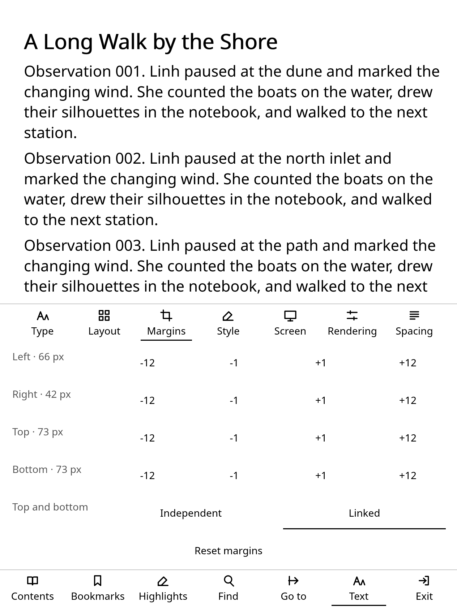
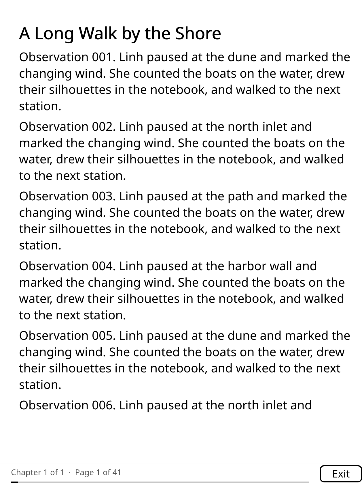

# Adjusting page margins

Open **Text → Margins** from the bottom of a reflowable book. The **L/R preset** row provides the nine KOReader size stops (5, 10, 15, 20, 30, 50, 70, 100, 140) for paired horizontal margins. In **L/R margins**, the inward/outward arrows distinguish the left and right steppers; tap for a one-pixel change or hold for a five-pixel change. Tap the current pair to open the combined `left,right` exact-value editor. Each vertical edge has a separate row of the same nine stock stops, followed by a five-control adjustment row with page-edge arrows, one-pixel taps, five-pixel holds, twelve-pixel taps and an exact **Set** editor. Values are scaled from the short screen side using KOReader's `scaleBySize` rule. The page updates under the panel. **Reset margins** restores the Reader default of 54 pixels at each edge. **Text → Layout → Side margins** still changes both horizontal edges together.

| Reading controls | Page with the controls closed |
| --- | --- |
| [](screenshots/individual-page-margins.png) | [](screenshots/asymmetric-reading-page.png) |

The controls image shows the earlier four-row horizontal editor and combined vertical controls. Replace it during the deferred simulator capture pass so the paired L/R row and separate vertical preset and adjustment rows are shown accurately.

Choose **Linked** to keep the top and bottom margins equal. Linking 55 and 66 pixels sets both to 61, their rounded average. From then on, either vertical control adjusts both. **Independent** keeps the two current values and lets you change them separately. Each book remembers its edges, link setting, open panel and source passage. Existing saved uniform and paired side margins also reopen with their previous dimensions.

The available text width is the page width minus the left and right edges. The two-page view applies the settings to each leaf and keeps the central gutter clear. Vertical text starts its columns from the right edge. Glyphs, underlines, illustrations, touch selection, highlight rectangles and printed page labels use the same physical edges. Printed labels use the outer margin of each leaf. Fixed-page PDF, comic and DjVu documents have their own fit and crop controls.

## KOReader reference

The tagged KOReader controls offer a paired horizontal preset plus a detailed left/right adjustment and separate top and bottom values. Its horizontal popup uses two independent spin controls with one-pixel taps and five-pixel hold steps; switching on vertical synchronization rounds the average and updates both edges. Its frontend scales configuration units for the screen before passing four margins to CREngine and can reserve footer height. PrimitiveOS Reader now groups independent left and right steppers in one row, maps taps and holds to the stock one- and five-pixel steps, and keeps the exact pair editor one tap away. The Reader control stays inline in the bottom panel instead of opening KOReader's separate popup, and long-hold repeat behavior still needs comparison. The margin candidate has not yet been validated in the simulator or on Kindle. [KOReader horizontal and vertical controls](https://github.com/koreader/koreader/blob/9192014d8bd82a91dc1012473be0f238dedfdb54/frontend/ui/data/creoptions.lua#L132-L211) · [Margin handlers and scaling](https://github.com/koreader/koreader/blob/9192014d8bd82a91dc1012473be0f238dedfdb54/frontend/apps/reader/modules/readertypeset.lua#L445-L475) · [Stock screen scaling rule](../build/parity-review/koreader-macos-reference/sources/koreader/base/ffi/framebuffer.lua#L414)


## Verification

Two original EPUBs were tested on the Mac and directly on the Oasis 3. Their Reader measurements matched on both machines. At a recorded source location, the normal bottom controls changed the horizontal margins from 54/54 to 66/42 pixels. The page still had the same content width. Every text and illustration pixel in all 1,606 rows shifted right by exactly 12 pixels. The same source word remained selectable at its new screen coordinates. Both books reopened at the same source location with linked 73-pixel vertical margins. Resetting restored a pixel-identical page. The originals retained their SHA-256 digests.

| Original | Spine item | Translated nonwhite pixels | Matching rows |
| --- | ---: | ---: | ---: |
| 035 | 12 | 241,577 | 1,606 of 1,606 |
| 042 | 15 | 107,651 | 1,606 of 1,606 |

Installed KOReader independently found a unique passage shared with each Reader measurement. At the controlled 1,264 × 1,606 viewport, the passages were on CREngine pages 92 of 466 and 325 of 844. Its seven settings transitions matched the reference. Moving the two horizontal margins translated all 1,606 raster rows by 12 pixels in each book. The first passage occupied one selection rectangle and the second occupied two. Each rectangle moved exactly 12 pixels horizontally and retained its vertical coordinates. Reapplying the original margins restored both KOReader frames byte for byte.

The two native Reader test processes peaked at 37,380 and 27,360 KiB resident memory. Four additional authored scenarios passed on the Oasis. The books, Documents file inventory, user reading state, Browser session and installed Reader retained their original checksums. All isolated device data was removed.

Authored fixtures independently check horizontal illustration hit testing, vertical right-to-left columns, the Blitz renderer, both leaves of a two-page spread and the empty gutter. Other tests check old side-margin records, an explicit zero edge and an invalid saved value. The Mac suite passed 462 library tests, 14 EPUB-package tests and four layout integration tests. Seven opt-in library scenarios require separate fixtures. The screenshots use the authored test book.

The paired stepper row and exact-value entry are newer implementation candidates and have not been run through the checks above. The separate-popup layout and long-hold repeat behavior remain to be compared with KOReader before parity is considered complete.

```sh
READER_MARGIN_PANEL_IMAGE="$PWD/margins.png" \
READER_MARGIN_PAGE_IMAGE="$PWD/margins-page.png" \
cargo test --locked --lib reading_bars::margin_tests
```

The main workflow also accepts a local publication through `READER_MARGIN_BOOK` and a one-based `READER_MARGIN_CHAPTER`. The installed-KOReader comparison uses the same page passage, verifies the stock settings transitions, renders into memory and reports only numeric results. [Reader margin tests](../src/app/reflow_margin_tests.rs) · [KOReader comparison script](../scripts/koreader-reflow-margins-check.lua)
