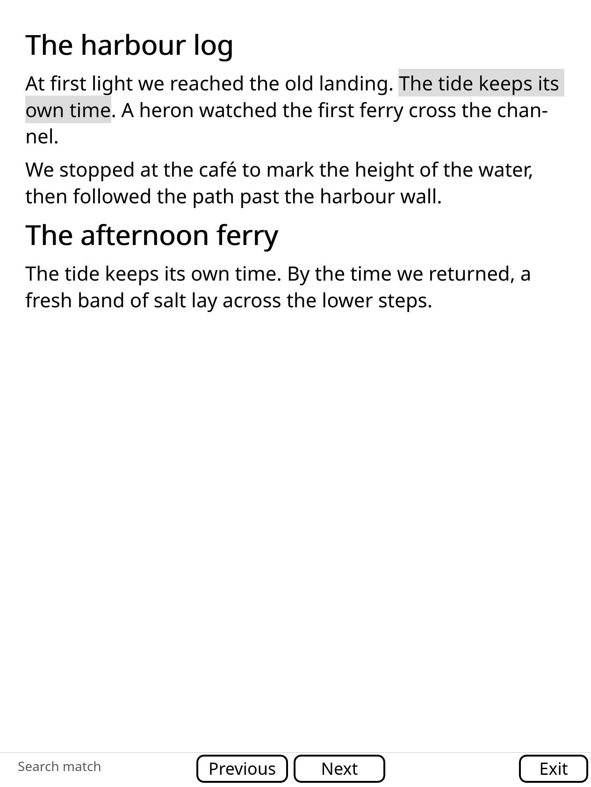

# Finding text from a reading position

In a reflowable book, open **Find in document**, enter a phrase and tap **Find next** or **Find previous**. The first search includes the visible page or spread. After a match opens, **Previous** and **Next** move from that occurrence, including other occurrences on the same page. A search stops at the start or end of the book. Return to the previous location to resume the original passage. **Find all** on the keyboard retains the existing list of up to 100 results in document order.

| Search controls | Matched passage |
|---|---|
|  |  |

KOReader v2026.07.1's search input offers All, Backward and Forward. Its rolling-document panel also exposes a whole-book start/end jump and checks an optional regular expression before searching. Reader now offers directional literal search, case sensitivity and optional accent folding. Whole-book start/end shortcuts, regular expressions and KOReader's page-level grouping remain outside this implementation. [KOReader search input](https://github.com/koreader/koreader/blob/9192014d8bd82a91dc1012473be0f238dedfdb54/frontend/apps/reader/modules/readersearch.lua#L249-L333) · [Directional origin and continuation](https://github.com/koreader/koreader/blob/9192014d8bd82a91dc1012473be0f238dedfdb54/frontend/apps/reader/modules/readersearch.lua#L648-L679)

A single worker reads chapters in the requested direction and stops at the nearest match. It loads one spine item at a time and releases Kindle storage before parsing, matching or waiting for input. Replacing or cancelling a request discards its result. Case folding, optional removal of accents and invisible soft hyphens map back to the source's UTF-8 boundaries. Tests cover overlapping strings, multi-character Unicode folds, a decomposed accent and a soft hyphen inside a selected word.

## Original EPUB comparison

The Mac comparison used a position midway through the occurrences in each chapter. The verifier used the active layout engine to find literal source offsets independently, then compared the preceding and following hits with both anchors, the text selected by those anchors and the quoted word in each result. The first 100 whole-book results omitted the chosen position in all seven checks. [Source and geometry verifier](../examples/verify_nearby_search.rs)

| Anonymous original | Target spine item | Target-chapter matches | Last spine item in the 100-result list |
|---|---:|---:|---:|
| 035 | 12 | 320 | 5 |
| 042 | 14 | 491 | 7 |
| 046 | 16 | 867 | 7 |
| 052 | 10 | 590 | 6 |
| 033, English query | 8 | 39 | 8 |
| 033, Vietnamese query | 8 | 382 | 5 |
| 061 | 28 | 112 | 8 |

All chapter and page indices in this document are one-based. The screenshots use an original project fixture. [Harbour log](../tests/fixtures/nearby-search.xhtml)
