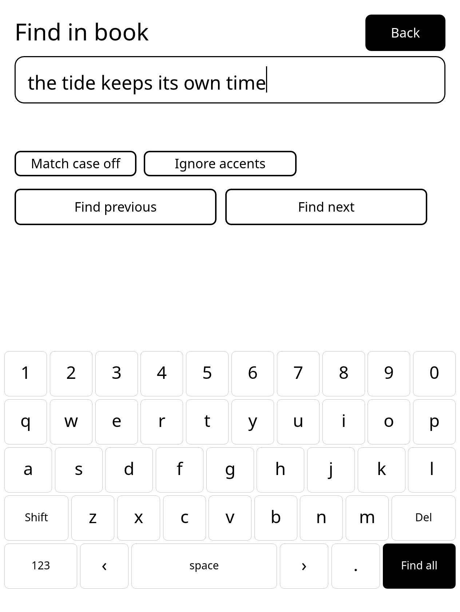
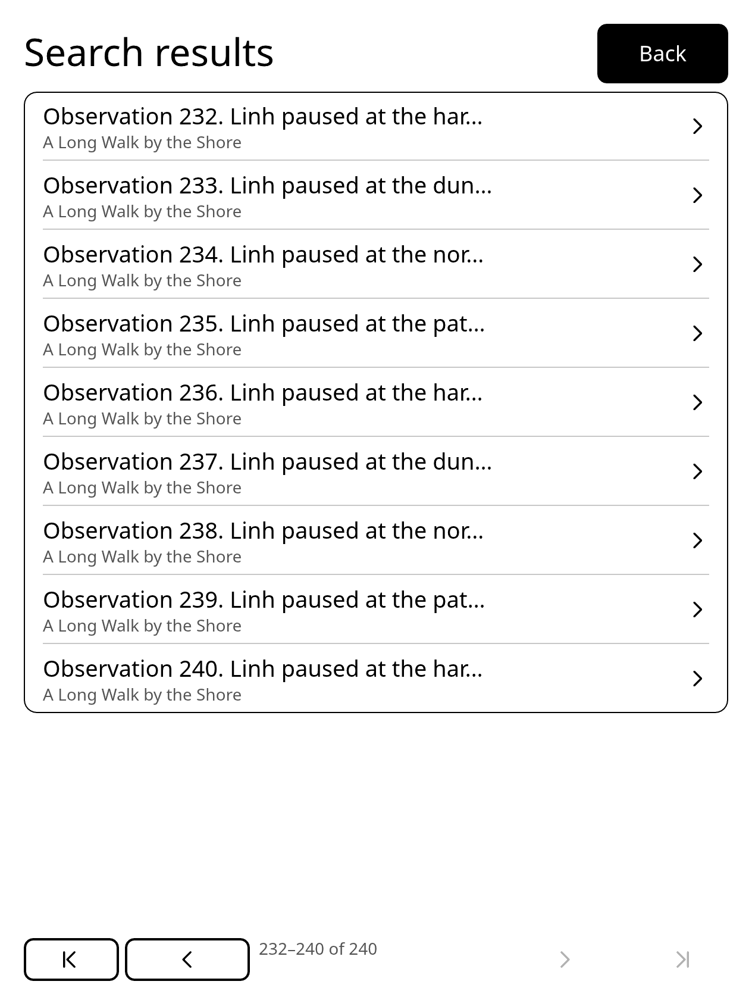

# Finding text from a reading position

In a reflowable book, open **Find in document**, enter a phrase and tap **Next** or **Previous**. **From start** and **From end** search towards the current page from the corresponding edge of the book. The first search includes the visible page or spread. After a match opens, **Previous** and **Next** search beyond the current visible page or spread. A search stops at the start or end of the book. Return to the previous location to resume the original passage. **Find all** lists up to 5,000 occurrences in document order. Tap the first or last icon to jump through a long list. The middle arrows or the device page buttons move one results page.

| Search controls | Matched passage |
|---|---|
|  |  |

KOReader v2026.07.1's search input offers All, Backward and Forward. Its rolling-document panel also exposes a whole-book start/end jump and checks an optional regular expression before searching. Reader offers directional literal search, case sensitivity, optional accent folding and regular expressions. The start/end shortcuts include the current visible page. Directional continuation uses the visible text edge, declining to continue if that edge cannot be resolved. A cancellable background scan highlights up to 32 additional matches inside the destination's verified visible chapter window, without changing stored marks; stale results are discarded. Geometry is cached in single-match event-loop steps, with a 4 KiB per-match text limit and 512 total rectangles; excess matches are omitted and reported. If source or font verification is unavailable, the original matched occurrence remains highlighted. Ordinary sleep cancels unfinished decoration work, preserving completed cached highlights; waking retries unfinished work only when the same query, selection, layout and viewport remain. USB handoff clears the extra highlights, which are not automatically rebuilt after storage return. Matches crossing a visible page edge within the same source block are included and clipped to the visible geometry. Foreign chapters are excluded; a spread is limited to its current chapter. A pattern that exceeds the existing per-block work budget leaves the original selected occurrence highlighted. Find-all results retain occurrence-by-occurrence navigation. These continuation and page-highlighting changes have not yet been behaviorally tested. [KOReader search input](https://github.com/koreader/koreader/blob/9192014d8bd82a91dc1012473be0f238dedfdb54/frontend/apps/reader/modules/readersearch.lua#L249-L333) · [Directional origin and continuation](https://github.com/koreader/koreader/blob/9192014d8bd82a91dc1012473be0f238dedfdb54/frontend/apps/reader/modules/readersearch.lua#L648-L679)

The edge shortcuts stop at the current page: **From start** does not jump past it to a later occurrence, and **From end** does not jump to an earlier one. When a page contains no searchable text, Reader conservatively excludes its current spine item if it cannot resolve a text boundary; searchable items beyond that page are never included.

Directional search now stops with an incomplete-search message if an intervening
chapter cannot be read or parsed. It keeps the current reading location: a match
after the unreadable chapter might not be the nearest one. Verified matches found
before any unreadable chapter remain available. Display-only notices for missing
or unsupported spine items also stop the directional search; they are not the
original chapter text. This change has not yet been behaviorally tested.

A single worker reads chapters in the requested direction and stops at the nearest match. It loads one spine item at a time and releases Kindle storage before parsing, matching or waiting for input. Replacing or cancelling a request discards its result. Case folding, optional removal of accents and invisible soft hyphens map back to the source's UTF-8 boundaries. Tests cover overlapping strings, multi-character Unicode folds, a decomposed accent and a soft hyphen inside a selected word.

## Directional search in Reader 0.1.13

The Mac comparison used a position midway through the occurrences in each chapter. The verifier used the active layout engine to find literal source offsets independently, then compared the preceding and following hits with both anchors, the text selected by those anchors and the quoted word in each result. The first 100 whole-book results omitted the chosen position in all seven checks. [Source and geometry verifier](../examples/verify_nearby_search.rs)

| Anonymous original | Target spine item | Target-chapter matches | Last spine item in the 100-result list |
|---|---:|---:|---:|
| 035 | 12 | 320 | 5 |
| 042 | 14 | 491 | 7 |
| 046 | 16 | 867 | 7 |
| 052 | 10 | 590 | 6 |
| 033, English query | 8 | 39 | 8 |
| 033, Vietnamese query | 8 | 382 | 5 |
| 061 | 28 | 112 | 8 |

All chapter and page indices in this document are one-based. The screenshots use an original project fixture. [Harbour log](../tests/fixtures/nearby-search.xhtml)

## Directional search on the Oasis 3, Reader 0.1.13

The Oasis 3 ran three native automated tests on authored documents. The tests checked Unicode offsets, chapter boundaries, cancellation, the Find controls, stepping in both directions and returning to the original reading position. Two additional offscreen comparisons used the original files from Documents. The English case in original 035 had 320 occurrences in chapter 12. The Vietnamese case in original 033 had 382 in chapter 8. For each book, both directions returned the adjacent occurrence with the expected start and end offsets and the complete selected word. The 0.1.13 lists of 100 results ended at chapter 5 in both cases.

The verification used isolated storage. SHA-256 checks confirmed both books, the installed Reader binary, the library, the reading statistics and the Browser session were preserved. The Documents inventory matched before and after, and the temporary device files were removed. The normal foreground was available throughout.

The Mac simulator also opened the existing PDF search fixture at 300% zoom. Four words across two lines stayed highlighted in both paged and continuous views, and Back restored the source page. The wrapped-passage capture matched the earlier version byte for byte. A two-result PDF displayed the shared Previous control beside zoom and Exit. [Wrapped passage](screenshots/pdf-wrapped-search.png) · [Two-result search](screenshots/pdf-search-target.png)

## Typographic punctuation in ordinary search

A straight keyboard apostrophe finds the published curly apostrophe. A typed hyphen also finds a typographic dash or minus sign. One space can match the author's nonbreaking, thin or repeated spaces. These equivalences apply to **Find all**, **Find previous** and **Find next** with either case setting. The search result and selected passage keep the original spelling and exact UTF-8 positions. **Regular expression** retains its ECMAScript character semantics. PDF search and saved-quote matching retain their provider-specific behavior.

KOReader's default rolling search sets the space, apostrophe and hyphen-folding flags. Its punctuation table identifies seven apostrophe forms and the typographic spaces. For dashes it uses the Unicode Dash Punctuation category and the minus sign. [Default reflow search flags](https://github.com/koreader/koreader/blob/9192014d8bd82a91dc1012473be0f238dedfdb54/frontend/apps/reader/modules/readersearch.lua#L32-L50) · [CREngine character equivalences](https://github.com/koreader/crengine/blob/b32a88ffbbf505cf2ea5208c1a49002d70d3609f/crengine/src/lvtinydom.cpp#L12782-L12920)

On the Mac, 16 comparisons across nine original EPUBs included five apostrophe passages, four dash passages and seven passages with nonbreaking spaces. With exact keyboard punctuation the target was missing in all 16 controls. Ordinary search found the original source range in the results list and from both directions in every case. In one book the list contained both the normally spaced spelling and the publisher-spaced spelling. The verifier selected each reference range in the layout and compared its UTF-8 text with the source. An authored UI test entered a straight apostrophe and normal space, moved forward and backward across two differently spaced passages and compared both endpoints with the all-results list. [Original-book verifier](../examples/verify_typographic_search.rs)

The Oasis 3 also ran the authored keyboard and matching tests and compared original 035 with its installed KOReader. Both readers returned the same six apostrophe hits, one dash hit and one hit containing two consecutive nonbreaking spaces. Their character totals and ordered UTF-8 checksums matched in each case. Reader returned to every target from both directions and selected the original publisher text. The original document, installed Reader, library, reading statistics, Browser session and Documents inventory passed the preflight and postflight checks. All comparison files were removed from the device.

## Finding every occurrence in a reflowable book

KOReader defaults to 5,000 entries in **Find all**. Its results menu offers first, previous, next and last page controls. Reader loads results on a background worker and makes the first batch available while the search continues. Press Back to cancel. The list builds the visible rows as needed. Each displayed row retains its start and end positions in the publication, including positions after the first hundred occurrences. [KOReader search limit](https://github.com/koreader/koreader/blob/9192014d8bd82a91dc1012473be0f238dedfdb54/frontend/apps/reader/modules/readersearch.lua#L49-L64) · [KOReader list navigation](https://github.com/koreader/koreader/blob/9192014d8bd82a91dc1012473be0f238dedfdb54/frontend/ui/widget/menu.lua#L749-L855)

Find all keeps a completeness indication with its retained results when the
list is reopened. Tap **Details** in the results footer to see scanned chapter
skips as a lower bound alongside any hit or memory limit; a stopped or failed
search may also have unsearched chapters. Done or Back closes the details without
moving the result list or reading position. Unsupported or missing-spine
placeholder notices are skipped rather than searched as publication text.
Existing verified hits remain selectable. The status does not count unscanned
chapters and has not yet been behaviorally tested.

The device's retained result data has an 8 MiB budget. Very long chapter names or excerpts can reach it before 5,000 occurrences. In either case the list explains where it stopped. Directional search can continue beyond the list from the reading position. Fixed-page search retains its provider-specific limits.

| Original EPUB | Installed KOReader on Oasis | Reader on Mac | Last result in Reader | Ordered UTF-8 checksum |
|---|---:|---:|---|---|
| 033, Vietnamese word | 2,371 | 2,371 | Spine 12, layout page 19 | a9ce1dcb |
| 035, English word | 4,983 | 4,983 | Spine 33, layout page 2 | 985469a0 |
| 042, English word | — | 5,000 | Spine 17, layout page 28 | 93b77ef1 |

The checksums include the matched UTF-8 bytes and a delimiter for each match in reading order. For every book, the Mac verifier selected the first, hundredth, hundred-and-first, middle and last occurrences at their exact source anchors. All three scans completed without a skipped chapter. The Mac simulation used a 600 × 800 viewport. [Whole-list verifier](../examples/verify_reflow_results.rs)

KOReader's CREngine can continue a match from one visible inline text node to the next inside a logical block. The scan stops at a different block. A displayed page break can fall inside the matched text. [CREngine source traversal](https://github.com/koreader/crengine/blob/b32a88ffbbf505cf2ea5208c1a49002d70d3609f/crengine/src/lvtinydom.cpp#L13189-L13282)

| Mac comparison on original EPUBs | Result from Find all and both directions |
|---|---|
| 035, spine 5, formatting changes inside a phrase | A single match restored all 26 source bytes. A separate phrase made from adjacent paragraphs returned zero matches. |
| 035, spine 12, displayed page turn | A 32-byte selection began on page 4 and ended on page 5. |
| 033, spine 5, Vietnamese accents | The 17-byte input selected the original 23-byte spelling with Ignore accents enabled. |
| 053, spine 11, published soft hyphen | A nine-byte input selected the eleven-byte word, including its original soft hyphen. |

The boundary checks compare both endpoints of each positive result with the selection from the opposite search direction. A separate authored test combines inline emphasis, a decomposed accent, a soft hyphen and a real paragraph break in one passage. [Boundary verifier](../examples/verify_search_boundaries.rs)

### Oasis 3 results

The complete list and its first, hundredth, hundred-and-first, middle and final selected passages matched the Mac on originals 033 and 035. Through Reader's normal controls, an automated test jumped to the final list page, opened occurrence 2,371 or 4,983, verified its highlighted source range, and returned to the original reading position in each book. Three additional native tests exercised long-list controls on an authored book, capped and memory-limited lists, and source offsets in styled and hyphenated text.

| Normal-controls process, including opening the original and returning | 033 | 035 |
|---|---:|---:|
| User CPU | 1.84 s | 3.45 s |
| Elapsed time | 6.74 s | 10.11 s |
| Peak resident memory | 19,632 KiB | 44,016 KiB |

The measurements ran at low priority during another library verification. Installed KOReader and native Reader each found the formatted phrase, the displayed-page-spanning phrase and the Vietnamese accent-insensitive phrase exactly once. Both returned zero results for the false join between paragraphs. The soft-hyphen check on original 053 used the Mac. The device checks preserved both originals, the Documents inventory, installed Reader, library, reading statistics and Browser session. The private test folder was removed.

A separate simulator regression starts a dense search, uses Back after the first batch, then finds a single numbered observation. It checks that pending rows from the cancelled search cannot appear in the replacement results.
