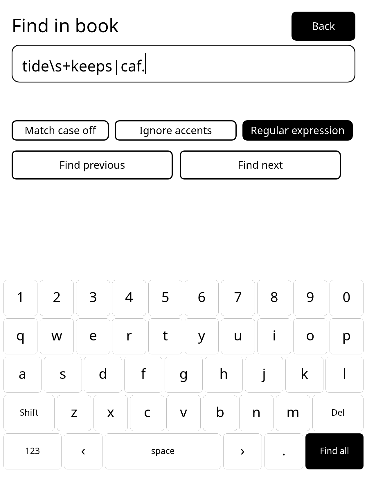
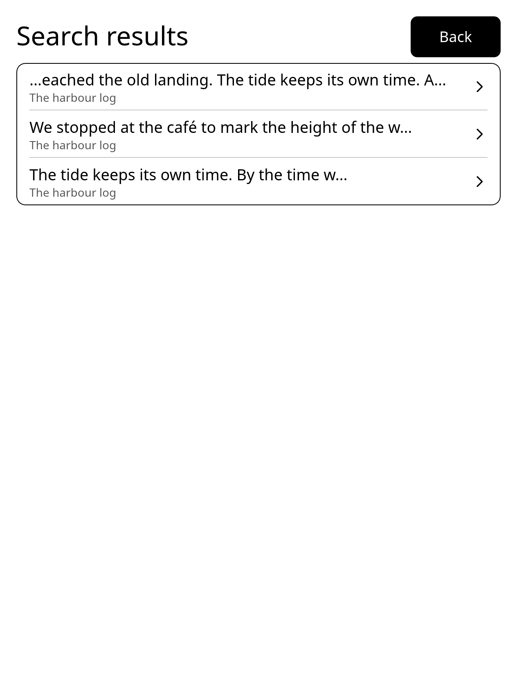

# Regular expressions in reflow search

In an EPUB or another reflowable book, open **Find in book** and select **Regular expression**. Use **Find previous** or **Find next** to jump from the current passage. **Find all** lists up to 100 occurrences in reading order. Back cancels a pending list search, or returns from a selected match. Search history remembers the pattern and case sensitivity. PDF and other fixed-page providers retain literal search.

| Enter a pattern | Open a result |
|---|---|
|  |  |

The shared keyboard's **123** and **#+=** pages include brackets, the backslash and the other pattern operators. For example, `[0-9]{2,4}` selects two to four digits and `harbour|harbor` selects either spelling. **Match case** applies to patterns. Selecting **Ignore accents** switches back to literal matching. Finding a passage from a text selection uses its original wording.

## Reference behavior and limits

KOReader v2026.07.1 exposes regular expressions for reflowable documents. A query from typed input is canonically composed before compilation. Highlighting text resets search to literal mode. Its CREngine strips soft hyphens, uses ECMAScript syntax with a 32,768 backtracking limit, and lowercases plain pattern characters separately from escapes for case-insensitive search. [KOReader search types](https://github.com/koreader/koreader/blob/9192014d8bd82a91dc1012473be0f238dedfdb54/frontend/apps/reader/modules/readersearch.lua#L29-L52) · [Search input and validation](https://github.com/koreader/koreader/blob/9192014d8bd82a91dc1012473be0f238dedfdb54/frontend/apps/reader/modules/readersearch.lua#L249-L277) · [CREngine expression compilation](https://github.com/koreader/crengine/blob/b32a88ffbbf505cf2ea5208c1a49002d70d3609f/crengine/src/lvtinydom.cpp#L12414-L12517)

Reader builds the same SRELL 3.018 header, with the Unicode tables disabled as they are in CREngine. The search accepts captures, backreferences, lookarounds, alternation, ranges and counted repetition. An invalid expression reports its error before the search starts. Matching preserves exact UTF-8 source boundaries, including an authored soft hyphen within a word. Beginning and end anchors refer to the paragraph when searching from the middle. A zero-length match cannot identify a selectable passage and is skipped. [Pinned engine](../vendor/srell/README.md) · [Source-coordinate implementation](../src/search/pattern.rs)

The Kindle accepts patterns up to 256 UTF-8 bytes, 24 group levels and a maximum counted repetition of 4,096. The execution budget is 8,388,608 byte-iterator steps per source text block, with a 1 MiB block-size limit. The engine checks cancellation every 1,024 steps even while evaluating expressions with backreferences or lookarounds. Result rows display up to 256 matched characters. Opening a row selects the full source range. The UI shows a complexity or size message when a limit is reached. Directional and whole-book searches share one background worker. Each operation releases its storage lease before matching starts.

## Verification

The automated tests cover overlapping lookaround context, alternation, Unicode case, an accented Vietnamese expression, backreferences, whole-paragraph anchors, authored soft hyphens, empty results, malformed patterns, a work-limit error and cancellation. The simulator test entered a pattern, stepped forward and back through three matches, reopened the pattern from history, cancelled the background list search and verified that a PDF kept its ordinary search. Both screenshots use a project-authored text.

On the Mac, four anonymous original EPUBs were searched with word-alternative, Vietnamese, numbered and lookbehind patterns. The verifier checked all 100 selected source ranges per original and the preceding and following occurrences at a midpoint. [Reader comparison](../examples/verify_pattern_search.rs) · [Installed KOReader comparison](../scripts/koreader-pattern-check.lua)
