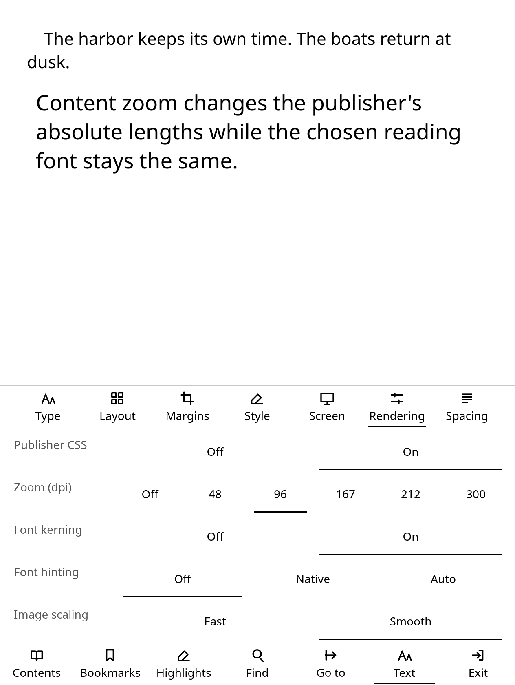

# Reflow content scaling

The lower reading toolbar's Text → Rendering panel offers **Zoom (dpi)** with
**Off, 48, 96, 167, 212, 300**, plus a separate **Custom zoom** row showing the
current value without reducing the preset touch targets. Custom values are
whole numbers from **0 to 300 dpi**. The baseline default is 96. This scales publisher content
independently of the font size chosen by the reader. It is a reflow control;
PDF/image zoom remains in the fixed-document controls.

[Large controls in dark mode](screenshots/content-scale-dark.png)

## Pinned reference

This implementation was compared with the checked-out KOReader
`9192014d8bd82a91dc1012473be0f238dedfdb54`, base
`6e4bc81af4e04f78d81677a323a780a71b29702a`, and its CREngine
`b32a88ffbbf505cf2ea5208c1a49002d70d3609f`:

| Source | Behavior used |
| --- | --- |
| `frontend/ui/data/creoptions.lua:331–359` | Exact six presets, default 96, separate content/font scaling. |
| `frontend/ui/widget/configdialog.lua:1274–1306` | The numeric picker derives minimum 0 and maximum 300 from the preset endpoints; step 1, held step 20, saved global default or 96. |
| `frontend/apps/reader/modules/readertypeset.lua:168` | Change render DPI then relayout at the existing reading position. |
| `frontend/document/credocument.lua:1207` | `crengine.render.dpi`; selected font scaling is a separate property. |
| `crengine/src/lvrend.cpp:54–59,2581–2700` | At 0, px remains unchanged; physical units resolve to 0. Percent/em/rem use their original containing width/font. |
| `crengine/src/lvrend.cpp:2710–2770` | Intrinsic images scale with DPI; physical image constraints are ignored at 0. |
| `crengine/include/lvrend.h` | CSS base 96; automatic font scaling with DPI is off by default. |

The comment near `gRenderDPI` mentions an older point conversion. The actual
`lengthToPx` switch treats **pt as a physical unit**, so Off does not mean
automatic screen DPI and does not treat 1 pt as 1 pixel.

## Implemented behavior

| Content | Off | 96 | Other presets |
| --- | --- | --- | --- |
| Supported CSS px padding, indent, table borders/spacing | Existing pixels | Existing pixels | Multiply by DPI/96 |
| Supported CSS in/cm/mm/pt/pc/q box lengths | Zero | Existing normalized physical length | Multiply by DPI/96 |
| CSS image physical constraints | Ignore the constraint | Use physical length | Multiply by DPI/96 |
| CSS image px dimensions, HTML numeric image dimensions | Existing dimensions | Existing dimensions | Multiply by DPI/96 |
| Intrinsic image dimensions | Original dimensions | Original dimensions | Multiply by DPI/96 |
| Percent and em/rem lengths | Existing containing width/font | Same | Same |
| Selected reading font and user page margins | Unchanged | Unchanged | Unchanged |

Content scaling runs **after** the cascade. An inherited indent or table spacing
is scaled once. Physical units retain their original normalized 96-DPI float
value and a physical-unit tag; this preserves existing 96-DPI box rounding while
letting Off distinguish them from px. Image variants include DPI in their cache
key. The decoder preserves aspect ratio unless both dimensions are authored,
fits the reading viewport, and keeps every output dimension at least 1 pixel.

The selected content DPI is stored with the book, included in named reading profiles,
and inherited from document defaults. Old records without the field inherit the
baseline 96 preset (or the selected global default). Invalid stored values do not
override valid settings. The same 0–300 validator covers live settings, book
preferences, profiles, document defaults and typed backup components; 301 and
larger values remain invalid.

The custom picker reuses Reader's numeric keyboard and has minus/plus buttons
with held steps of 20. **Default** changes the draft to the explicit reflow
Document Defaults value, including Off, or 96 when no value was saved. Back
discards the draft. Set prepares an anchored reading candidate, atomically
persists its preference and position, then replaces the old page and returns to
the Rendering panel. A failed layout or save keeps the old frame, location,
preferences and typed draft. The editor carries the edition identity so a stale
picker cannot change a different book. Screen DPI and selected font size remain
independent. No fixed-page PDF/image zoom is changed by this control.

CSS physical and rem image dimensions were previously ignored by Reader. They
are now supported deliberately. Consequently historical 96-DPI pixel identity
applies to **previously supported input**, not to those newly honored image
constraints. A private original-file inventory records which books use them.

## Scope and verification

The native Parley reflow path is covered. Existing Reader q lengths continue
to behave as physical units; q is a Reader extension beyond the pinned CRE unit
enum. Author absolute font-size mapping and
the legacy 0-DPI line-height strut differences remain separate work: CREngine's
legacy strut uses font metrics, while Reader retains its existing numeric
line-height model. This change does not implement arbitrary CSS widths, floats,
all rendering modes, or DPI support in the experimental Blitz renderer.

Tests cover the complete preset set, physical versus pixel Off behavior,
unchanged relative lengths/font size, inherited dimensions, 96-DPI box
quantization, image cache isolation, actual decoded archive artwork, viewport
bounds, touch controls, source selections, book reopening, and profile storage.
Historical verification of the initial six-preset slice:

| Check | Result |
| --- | --- |
| Complete ordinary suites | 714 library + 14 package + 4 layout passed; 57 opt-in cases ignored. |
| Focused DPI cases | Eight passed, including decoded image geometry, UI input, defaults and reopening. |
| Authorized original-file workflows | EPUB, AZW3 and MOBI each passed all presets, source selection, unchanged source bytes and 96-DPI round-trip raster equality. |
| Distinct-edition source/style inventory | 48 editions, 1509 sections, 3893 image occurrences, 1,569,252 identical 96-DPI box resolutions. No applied physical/rem image constraints were present in this corpus. |
| Historical first-frame comparison | All 2,123,520 pixels matched the immutable pre-DPI desktop build in each of the three original editions. This is a first-frame check, not an all-page raster comparison. |
| UI screenshots | Four compact/large light/dark frames visually inspected; 24/24 individual DPI labels recognized by cropped OCR. |

The ordinary suite and original-file results are recorded in the private
`build/parity-review/render-dpi-evidence` receipts. No Kindle execution, physical
e-ink acceptance, publication, or release is claimed by this desktop slice.

The custom-picker follow-up adds seven ordinary workflows for real keyboard input
at 72 and 123 dpi, draft steps/default/cancel and sleep/wake, invalid/stale
editions and same-length on-disk replacements, failed layout and atomic save rollback/retry, profile/default/v2 backup
restore, and compact/large light/dark capture targets. The existing original-file
opt-in workflow also checks 72 and 123 alongside every preset. Its separate
`custom-content-dpi-evidence` receipts identify actual executed tests and captures;
the older preset results above do not establish new custom-picker acceptance.
