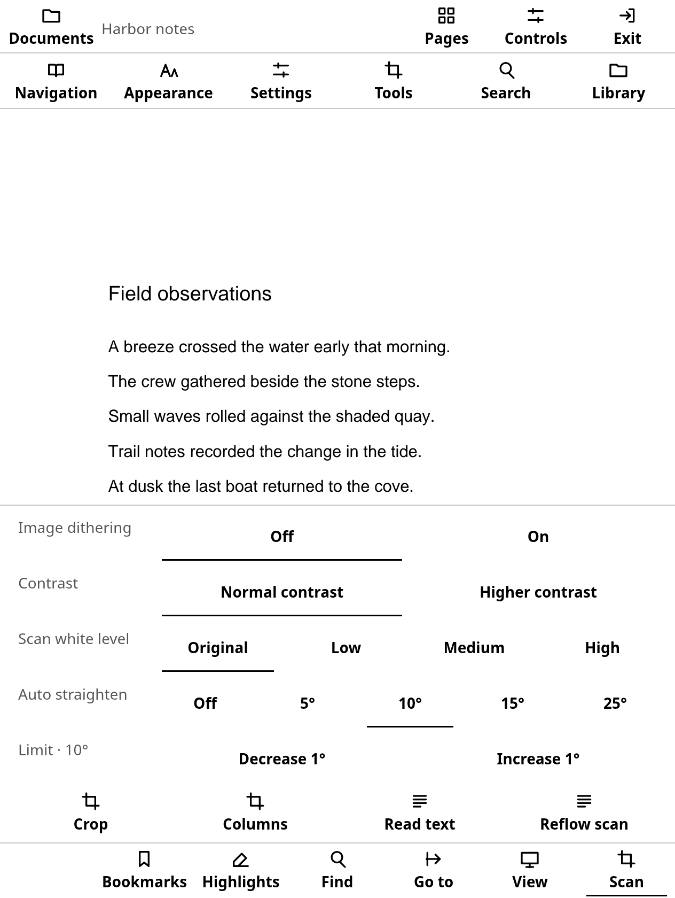
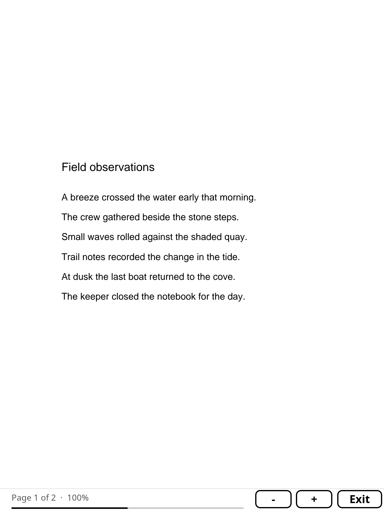
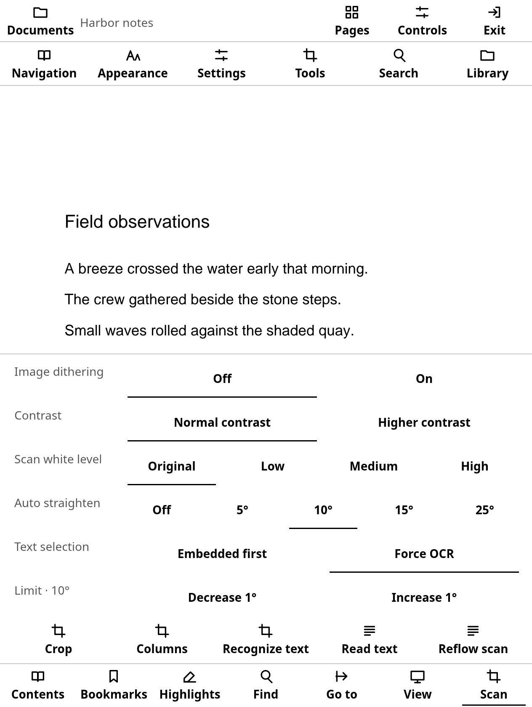
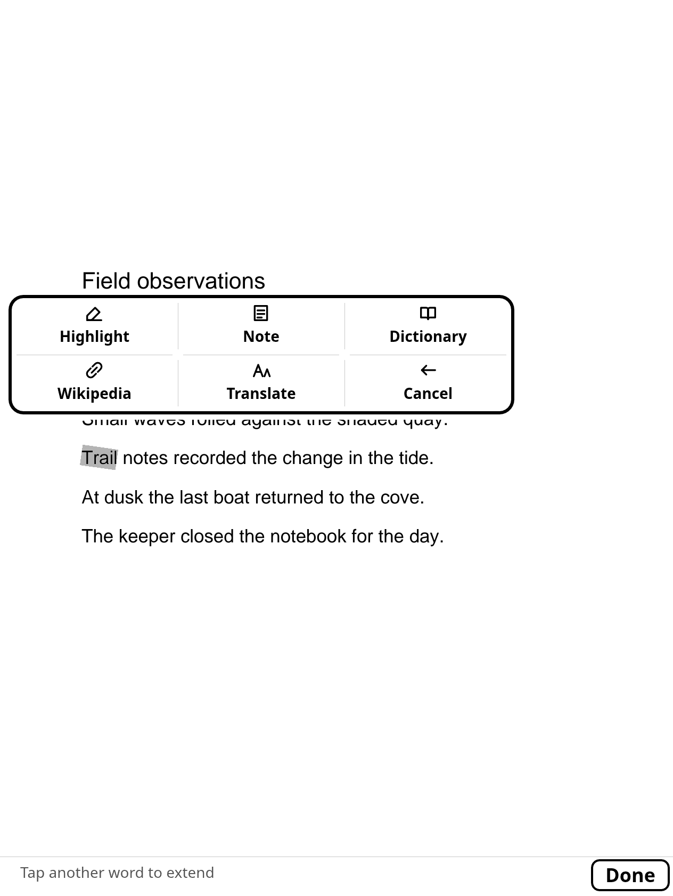

# Scan controls

Open a PDF or DjVu, open the bottom reading controls, and choose **Scan**. Reader saves the scan controls for that book. Source pages, OCR word rectangles, bookmarks and exported annotation coordinates retain their original coordinate system.

## Auto straighten

**Auto straighten** sets the maximum tilt Reader will correct. The five presets are Off, 5°, 10°, 15° and 25°. **Decrease 1°** and **Increase 1°** adjust the limit between presets. Each visible page gets its own estimate. A 5° limit leaves an 8° tilt alone. A 10° limit straightens that page. Blank pages and pages with weak evidence of tilted text retain their original appearance.

| Original 8° tilt | Live Scan controls | Corrected page |
| --- | --- | --- |
|  |  |  |

KOReader v2026.07.1 passes its maximum angle from the bottom panel to the kopt context and selects an optimized page renderer when that angle is positive. Its thumbnail path disables straightening. The pinned native implementation scores horizontal pixel distributions at trial angles. Reader estimates a dominant baseline from a grayscale preview at most 400 pixels on its longest side, then applies a display transform to the source. It stores only the estimate for each visited page. PDF drawing uses the vector renderer at the selected zoom. DjVu drawing samples bounded source tiles. Both paths fit the rotated page or crop into its existing slot. The exact angle and framing can differ between the engines. [KOReader presets](https://github.com/koreader/koreader/blob/v2026.07.1/frontend/ui/data/koptoptions.lua#L139-L155) · [Renderer dispatch](https://github.com/koreader/koreader/blob/v2026.07.1/frontend/document/koptinterface.lua#L400-L414) · [Thumbnail settings](https://github.com/koreader/koreader/blob/v2026.07.1/frontend/apps/reader/modules/readerthumbnail.lua#L466-L480) · [Pinned native estimator](https://github.com/koreader/libk2pdfopt/blob/1fcffeb1e61ec43265d23e2ac77d9a901f8c45d2/willuslib/bmp.c#L4554-L4745)

Inverse projection maps a touch to its original page before hit-testing a word or link. Highlight and crop rendering use the four transformed corners. In continuous PDF reading the gap between pages has no source coordinates. The crop editor and the OCR worker use the original orientation. The restored reading view applies the selected correction to the crop. [Scan transform and detector](../src/scan_deskew.rs) · [Fixed-page reading](../src/fixed_session.rs)

## Forced OCR

With an OCR pack installed, **Text selection** offers **Embedded first** and **Force OCR**. Force OCR uses recognized words for long-press selection, including on pages with an existing text layer. The first long press on an uncached page runs the offline worker and opens the word actions at the original touch when recognition succeeds. Cancel dismisses the pending job. A later long press can use the page cache. The language selected under **Recognize text** is remembered for that book. Changing the language requests a new recognition when the cached model differs.

| Scan with an installed English model | Actions on the recognized word “Trail” |
| --- | --- |
|  |  |

These two simulator frames used the actual Tesseract 5.5.2 English engine on the Mac. The fixture has an embedded text layer and an 8° tilt. The test applies a crop, straightens the page, long-presses a word, cancels the first recognition, and repeats the long press to open the word popup.

Book search and the text reading view continue to use embedded text first. They use cached recognition on pages without readable embedded text. KOReader independently selects its OCR boxes for word selection and queries the native text boxes when searching. [KOReader OCR control](https://github.com/koreader/koreader/blob/v2026.07.1/frontend/ui/data/koptoptions.lua#L635-L647) · [Selection source](https://github.com/koreader/koreader/blob/v2026.07.1/frontend/document/koptinterface.lua#L625-L640) · [Search source](https://github.com/koreader/koreader/blob/v2026.07.1/frontend/document/koptinterface.lua#L1592-L1608)

## Verification

The synthetic PDF has two pages with opposite 8° tilts, a native text layer and an internal destination. Tests exercise the under-limit and over-limit behavior, a long press and link on rotated and cropped text, both page directions in a continuous view, settings persistence and restoration of the original raster. A DjVu fixture puts a dark patch under an embedded word and checks its rendered location in all four orientations with a 13° correction. [PDF fixture](../tests/fixtures/tilted-scan.pdf) · [Fixture generator](../scripts/generate-fixtures.py) · [DjVu test](../src/djvu.rs)

```sh
cargo test --locked --lib scan_deskew
cargo test --locked --lib straighten
cargo test --locked --lib arbitrary_djvu_rotation
cargo test --locked --lib forced_ocr
```

Set `READER_DESKEW_SHOTS` to an output directory to reproduce the three scan screenshots. `READER_TEST_FONTS` accepts a platform-separated list of UI font paths. The forced OCR test normally runs a deterministic worker that returns a different word from the embedded text at a known source rectangle. Set `READER_TEST_TESSERACT` and `READER_TEST_TESSDATA` to a Tesseract executable and English trained-data file to exercise real recognition. `READER_OCR_SHOTS` and `READER_TEST_FONTS` also capture the selection panel and resulting word popup.

To time a large PDF, set `READER_PDF_OPEN_TIMINGS=1` when running the normal application or the `verify_document` example. Standard error reports milliseconds for the storage read, identity calculation, PDF parsing, outline and first page render. It also records PDF drawing commands and pixel rasterization separately for each rendered viewport. The verifier also reopens the saved page and records those opening stages again. PDF identity uses the bytes already read for parsing so existing bookmarks and highlights continue to resolve.

## Large print-color PDFs on Kindle

On 32-bit ARM, Reader reuses the RGB result of an ICC conversion when a large DeviceCMYK image repeats exactly the same four ink values. It compares all four components. It retains the original image dimensions, color profile and vector artwork at every zoom. The temporary cache holds at most 2,449,408 bytes of pixel data and lookup entries per image. Images with fewer than 65,536 pixels take the original conversion path. Images with little color repetition switch back to that path after the first 65,536 pixels. [Interpreter change and reproduction commands](../vendor/hayro-interpret/PRIMITIVEOS.md)

An Oasis 3 rendered the first page of a 96,319,018-byte, 1,041-page PDF. The cover contains three print-color JPEGs, including two photographs with over 15 million pixels each. The test opened the original file with the same Reader verifier, viewport and settings for each build. It repeated the comparison in reverse order to reduce the effect of file caching. Each table column shows both timed runs, in the order they were taken for that build.

| Oasis 3 measurement | Reader 0.1.6 | Exact-color cache |
| --- | ---: | ---: |
| First-page render | 32.888 s / 33.620 s | 23.429 s / 23.345 s |
| Open to first frame, including file reads | 41.341 s / 37.127 s | 26.312 s / 26.397 s |
| Peak resident memory | 241,016 KiB | 243,480 KiB |

The complete first-frame PNGs matched byte for byte in both orders. An independent [print-chart fixture](../tests/fixtures/cmyk-print-chart.pdf) also produced identical full PNGs on the Oasis, with first renders of 0.628 s and 0.619 s. Both documents opened and resumed in both builds. The desktop simulator separately compared all 2,029,984 grayscale pixels in each document viewport and found zero differences on both documents.

KOReader’s installed MuPDF engine rendered the same cover directly in grayscale in 8.418 s at 1264 × 1606. That measurement excludes the surrounding application and storage-open time. Reader’s first-page render still takes about 15 s longer on this cover. Measurements here apply to this device and these files.
