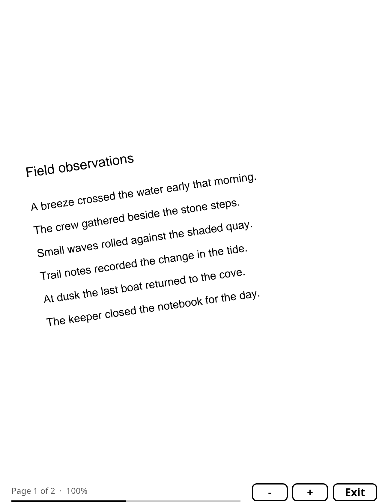

# Scan controls

Open a PDF, DjVu, or comic archive, open the bottom reading controls, and choose **Scan**. Reader saves the scan controls for that book. Source pages, OCR word rectangles, bookmarks and exported annotation coordinates retain their original coordinate system.

## OCR scan reflow columns

In **Reflow scan**, open **Layout** and choose a maximum of one, two, or three
columns. The default is two. Reader looks for clear column gutters in the
source raster, then orders the original OCR word images down each detected
column. It follows the selected LTR, RTL or TBRTL direction when ordering
columns and keeps the source word as the location anchor when the layout
changes. LTR is the default. The choice is saved per book and is shared by
that book's OCR scan reflow views.
See the [reference comparison and deferred acceptance checklist](scan-reflow-columns.md).

Detection is intentionally conservative. If the page does not have clear
gutter evidence, Reader keeps the OCR-provided order. Uneven columns, text
boxes spanning a gutter, mixed-direction pages, and complex magazine layouts
can still need a better layout engine. This implementation has not yet entered
the deferred unit, functional, simulator, or Kindle comparison pass.

KOReader exposes the same maximum-column choices for its reflow engine, with
two columns as its default. [Pinned option and help text](https://github.com/koreader/koreader/blob/9192014d8bd82a91dc1012473be0f238dedfdb54/frontend/ui/data/koptoptions.lua#L3007-L3035) · [KOReader default](https://github.com/koreader/koreader/blob/master/defaults.lua)

## Reading scan columns

**Tools › Columns** now tries a clear three-column layout before the existing
two-column detector. Page controls move between the detected columns, and the
document's saved reading direction chooses their order. **Done** restores the
original view without saving the temporary crops. Detection requires two
clear gutters and repeated text in all three columns; complex magazine
layouts, uneven or interrupted columns, and pages with ambiguous gutters can
still be rejected. This new path awaits desktop and Kindle testing.
This temporary crop view remains separate from OCR scan reflow above.

## OCR scan reflow word gap

The reflow **Layout** panel also has **Word gap** choices: Small, Auto and
Large. Auto scales the measured gap between OCR word boxes with the reflow
text; if the OCR geometry has no usable gap, it uses a conservative fallback.
Small and Large use the pinned KOReader preset ratios against the selected
scan text height. This is a native approximation because Reader repositions
word-image crops instead of passing them through KOReader's k2pdfopt engine.
The choice is saved per book and in fixed-document defaults and reading
profiles. The implementation awaits the deferred desktop and Kindle checks.

## OCR scan reflow alignment

**Alignment** offers Auto, Left, Center, Right and Justify. Auto estimates the
dominant alignment from OCR source-line geometry, then uses the selected writing
direction when the page does not provide enough evidence. Justify distributes remaining
line width between the word images except on a paragraph's last line. This is
a native approximation of KOReader's text alignment option; compare its line
breaks and source alignment on real pages before claiming parity.
See the [source comparison and deferred checklist](scan-reflow-alignment.md).

## Fixed-document reflow direction

The fixed-document **Layout** panel offers **LTR**, **RTL** and **TBRTL** for
embedded-text PDF reflow and OCR scan reflow. OCR TBRTL places word images
top-to-bottom in columns ordered right-to-left. Each reflow mode remembers its
own direction per book, with LTR as the default. This implementation candidate
is unverified. See the [source comparison and deferred acceptance
checklist](scan-reflow-direction.md).

The scan-size **−** and **+** controls adjust the OCR word-image scale from
0.20× to 2.00× in 0.05× steps. Each factor scales that source page's median
OCR word-box height, and the footer shows the current multiplier. The saved
default is 1.05×, corresponding to KOReader's 1.00× preset plus its default
+0.05× fine adjustment. Reader remembers the value per book and includes it
in fixed-document defaults and profiles. KOReader's pinned controls offer
twelve main scale choices from 0.2× to 2.0× and separate ±0.05× fine
adjustments. Reader combines these into one fine-grained stepper and still
repositions OCR word-image crops rather than scaling rendered text. This is
feature-range parity, not renderer equivalence.
See the [source comparison and deferred acceptance checklist](scan-reflow-text-size.md).

## Contrast

PDF and CBZ, CBT and CBR comic archives offer **Contrast** presets of
0.8, 1.0, 1.5, 2.0, 4.0, 6.0, 10.0 and 50.0. Choose 1.0 for the original
tones, 0.8 to lighten midtones, or a higher setting to darken faint ink.
The **Fine** row adjusts contrast in steps of 0.1 or 1.0. **Adaptive**
selects Reader’s automatic paper and ink adjustment.

DjVu offers **Normal contrast** and **Higher contrast**. Higher contrast
uses the adaptive adjustment, including for books with that setting already
saved. Reader discards numeric values carried into a DjVu view by a saved
fixed-page default. Word selection, links and annotation coordinates use the
original page geometry. The display applies contrast before white level and
dithering.

The pinned KOReader MuPDF renderer matched the contrast curve at 16 tones
for each preset and custom 2.3, in the authored PDF and in each of the three
comic archive formats. The same renderer options left all 132 sampled DjVu
tones unchanged at every tested level. The executable check uses grayscale
fixed-page rendering with reflow, rotation and background cleanup disabled.
Pass the authored DjVu fixture first, then any authored comic archives
containing a sixteen-band grayscale ramp as optional arguments.
[PDF controls](screenshots/scan-contrast-levels.png) · [DjVu controls](screenshots/scan-contrast-djvu.png) · [Executable comparison](../scripts/verify-stock-scan-contrast.lua) · [KOReader MuPDF archive providers](https://github.com/koreader/koreader/blob/9192014d8bd82a91dc1012473be0f238dedfdb54/frontend/document/pdfdocument.lua#L360-L387) · [Contrast presets](https://github.com/koreader/koreader/blob/9192014d8bd82a91dc1012473be0f238dedfdb54/frontend/ui/data/koptoptions.lua#L486-L507)

## Scan white level

Scan white level has KOReader's eight threshold presets: **255, 224, 192, 160,
128, 96, 64** and **32**. **255** preserves the original image. **Fine tune**
accepts every integer from 0 to 255; pixels above the threshold become white
while darker tones stay intact, so 0 turns every nonblack pixel white. The
saved setting is available for PDF, DjVu and comic scans. [KOReader threshold
presets, range and step](https://github.com/koreader/koreader/blob/9192014d8bd82a91dc1012473be0f238dedfdb54/frontend/ui/data/koptoptions.lua#L528-L544) · [KOReader implementation discussion](https://github.com/koreader/koreader/pull/15412)

## Dewatermark

**Dewatermark** is available for PDF, DjVu and comic pages while **Scan white
level** is 255. KOReader routes pages through its k2pdfopt page optimizer when
this option is enabled. The Rust candidate estimates one automatic grayscale
threshold from a bounded page histogram, then paints lighter pixels white in
the display frame. It leaves the stored page raster, source coordinates,
selection geometry and document file unchanged. Its threshold estimate is
cached for the current frame and invalidated when the frame or scan tone
settings change.

This is an independent native approximation, not a port of k2pdfopt. The
current algorithm uses one global histogram split; it does not remove spatially
varying watermarks or perform k2pdfopt's region analysis. It has authored unit
and fixed-session regression cases, but has not been built, run against the
pinned KOReader renderer, captured in the simulator, or accepted on Kindle.
Keep this feature marked partial until those comparisons close the difference.
The k2pdfopt implementation is AGPL-3.0-or-later; no k2pdfopt source or binary
is bundled by this candidate.

[KOReader toggle and threshold dependency](https://github.com/koreader/koreader/blob/9192014d8bd82a91dc1012473be0f238dedfdb54/frontend/ui/data/koptoptions.lua#L552-L565) · [Optimized-page dispatch](https://github.com/koreader/koreader/blob/9192014d8bd82a91dc1012473be0f238dedfdb54/frontend/document/koptinterface.lua#L400-L435) · [Optimizer API](https://github.com/koreader/libk2pdfopt/blob/1fcffeb1e61ec43265d23e2ac77d9a901f8c45d2/lib/koptimize.c#L31-L97) · [Rust threshold candidate](../src/scan_dewatermark.rs)

## Auto straighten

When the normal dark-ink detector finds too few edges, Reader estimates the
paper tone in the bounded preview and retries against a relative threshold for
faint gray text. The existing confidence check still decides whether to
rotate. This fallback awaits desktop and device comparison; its behavior is
not claimed to be identical to KOReader's estimator.

**Auto straighten** sets the maximum tilt Reader will correct. The five presets are Off, 5°, 10°, 15° and 25°. **Decrease 1°** and **Increase 1°** adjust the limit between presets. Each visible page gets its own estimate. A 5° limit leaves an 8° tilt alone. A 10° limit straightens that page. Blank pages and pages with weak evidence of tilted text retain their original appearance.

| Original 8° tilt | Live Scan controls | Corrected page |
| --- | --- | --- |
|  |  |  |

KOReader v2026.07.1 passes its maximum angle from the bottom panel to the kopt context and selects an optimized page renderer when that angle is positive. Its thumbnail path disables straightening. The pinned native implementation scores horizontal pixel distributions at trial angles. Reader estimates a dominant baseline from a grayscale preview at most 400 pixels on its longest side, then applies a display transform to the source. It stores only the estimate for each visited page. PDF drawing uses the vector renderer at the selected zoom. DjVu drawing samples bounded source tiles. Both paths fit the rotated page or crop into its existing slot. The exact angle and framing can differ between the engines. [KOReader presets](https://github.com/koreader/koreader/blob/v2026.07.1/frontend/ui/data/koptoptions.lua#L139-L155) · [Renderer dispatch](https://github.com/koreader/koreader/blob/v2026.07.1/frontend/document/koptinterface.lua#L400-L414) · [Thumbnail settings](https://github.com/koreader/koreader/blob/v2026.07.1/frontend/apps/reader/modules/readerthumbnail.lua#L466-L480) · [Pinned native estimator](https://github.com/koreader/libk2pdfopt/blob/1fcffeb1e61ec43265d23e2ac77d9a901f8c45d2/willuslib/bmp.c#L4554-L4745)

Inverse projection maps a touch to its original page before hit-testing a word or link. Highlight and crop rendering use the four transformed corners. In continuous PDF reading the gap between pages has no source coordinates. The crop editor and the OCR worker use the original orientation. The restored reading view applies the selected correction to the crop. [Scan transform and detector](../src/scan_deskew.rs) · [Fixed-page reading](../src/fixed_session.rs)

## Forced OCR

With an OCR pack installed, **Text selection** offers **Embedded first** and **Force OCR**. Force OCR uses recognized words for long-press selection, including on pages with an existing text layer. The first long press on an uncached page runs the offline worker and opens the word actions at the original touch when recognition succeeds. Cancel dismisses the pending job. A later long press can use the page cache. The language selected under **Recognize text** is remembered for that book. Changing the language requests a new recognition when the cached model differs.

| Scan with an installed English model | Actions on the recognized word “Trail” |
| --- | --- |
|  |  |

These two simulator frames used the actual Tesseract 5.5.2 English engine on the Mac. The fixture has an embedded text layer and an 8° tilt. The test applies a crop, straightens the page, long-presses a word, cancels the first recognition, and repeats the long press to open the word popup.

Book search and the text reading view continue to use embedded text first. They use cached recognition on pages without readable embedded text. KOReader independently selects its OCR boxes for word selection and queries the native text boxes when searching. [KOReader OCR control](https://github.com/koreader/koreader/blob/v2026.07.1/frontend/ui/data/koptoptions.lua#L635-L647) · [Selection source](https://github.com/koreader/koreader/blob/v2026.07.1/frontend/document/koptinterface.lua#L625-L640) · [Search source](https://github.com/koreader/koreader/blob/v2026.07.1/frontend/document/koptinterface.lua#L1592-L1608)

## Verification

The synthetic PDF has two pages with opposite 8° tilts, a native text layer and an internal destination. Tests exercise the under-limit and over-limit behavior, a long press and link on rotated and cropped text, both page directions in a continuous view, settings persistence and restoration of the original raster. A DjVu fixture puts a dark patch under an embedded word and checks its rendered location in all four orientations with a 13° correction. [PDF fixture](../tests/fixtures/tilted-scan.pdf) · [Fixture generator](../scripts/generate-fixtures.py) · [DjVu test](../src/djvu.rs)

```sh
cargo test --locked --lib scan_deskew
cargo test --locked --lib straighten
cargo test --locked --lib arbitrary_djvu_rotation
cargo test --locked --lib forced_ocr
```

Set `READER_DESKEW_SHOTS` to an output directory to reproduce the three scan screenshots. `READER_TEST_FONTS` accepts a platform-separated list of UI font paths. The forced OCR test normally runs a deterministic worker that returns a different word from the embedded text at a known source rectangle. Set `READER_TEST_TESSERACT` and `READER_TEST_TESSDATA` to a Tesseract executable and English trained-data file to exercise real recognition. `READER_OCR_SHOTS` and `READER_TEST_FONTS` also capture the selection panel and resulting word popup.

To time a large PDF, set `READER_PDF_OPEN_TIMINGS=1` when running the normal application or the `verify_document` example. Standard error reports milliseconds for the storage read, identity calculation, PDF parsing, outline and first page render. It also records PDF drawing commands and pixel rasterization separately for each rendered viewport. The verifier also reopens the saved page and records those opening stages again. PDF identity uses the bytes already read for parsing so existing bookmarks and highlights continue to resolve.

## Large print-color PDFs on Kindle

On 32-bit ARM, Reader reuses the RGB result of an ICC conversion when a large DeviceCMYK image repeats exactly the same four ink values. It compares all four components. It retains the original image dimensions, color profile and vector artwork at every zoom. The temporary cache holds at most 2,449,408 bytes of pixel data and lookup entries per image. Images with fewer than 65,536 pixels go directly through the ICC transform. Images with little color repetition switch back to direct conversion after the first 65,536 pixels. [Interpreter change and reproduction commands](../vendor/hayro-interpret/PRIMITIVEOS.md)

An Oasis 3 rendered the first page of a 96,319,018-byte, 1,041-page PDF. The cover contains three print-color JPEGs, including two photographs with over 15 million pixels each. The test opened the original file with the same Reader verifier, viewport and settings for each build. It repeated the comparison in reverse order to reduce the effect of file caching. Each table column shows both timed runs, in the order they were taken for that build.

| Oasis 3 measurement | Reader 0.1.6 | Exact-color cache |
| --- | ---: | ---: |
| First-page render | 32.888 s / 33.620 s | 23.429 s / 23.345 s |
| Open to first frame, including file reads | 41.341 s / 37.127 s | 26.312 s / 26.397 s |
| Peak resident memory | 241,016 KiB | 243,480 KiB |

The complete first-frame PNGs matched byte for byte in both orders. An independent [print-chart fixture](../tests/fixtures/cmyk-print-chart.pdf) also produced identical full PNGs on the Oasis, with first renders of 0.628 s and 0.619 s. Both documents opened and resumed in both builds. The desktop simulator separately compared all 2,029,984 grayscale pixels in each document viewport and found zero differences on both documents.

KOReader’s installed MuPDF engine opened the same file and rendered its cover directly in grayscale at 1264 × 1606 in 8.418 s. Opening took 0.652 s, leaving 7.766 s for first-page painting. Reader’s first-page render took about 15.6 s longer on this cover. Measurements here apply to this device and these files. [Reference timing boundaries](../scripts/koreader-document-check.lua)

The image decoder can also reuse the CMYK image allocation for its RGB output.
It converts up to 8,192 pixels at a time using a 24 KiB scratch buffer, then
copies each RGB block into space occupied by the original CMYK pixels. For a
16,486,425-pixel photograph, this avoids allocating a second 49,459,275-byte
pixel buffer. Other stages, including JPEG decoding and resampling, still
allocate working memory. In the Mac verifier, the original cover page and its
resources used 190,240 KiB peak with Reader 0.1.6 and 153,120 KiB with the
cache and in-place conversion. The two desktop viewport captures were pixel-identical.
[Color conversion and tests](../vendor/hayro-interpret/src/color/device_cmyk/repeated_colors.rs)

With the original 96,319,018-byte file on the Oasis, in-place conversion reduced
peak resident memory from 243,480 KiB with the cache alone to **195,300 KiB**,
a reduction of 48,180 KiB (47.1 MiB). Reader 0.1.6 used 241,016 KiB in the
same test. The compacted version spent 23.451 s rendering the cover and 34.350 s
opening to the first frame with a cold file read. The print chart took 0.481 s
to render and reached 31,216 KiB peak. Both complete PNG files again matched
Reader 0.1.6 byte for byte.
