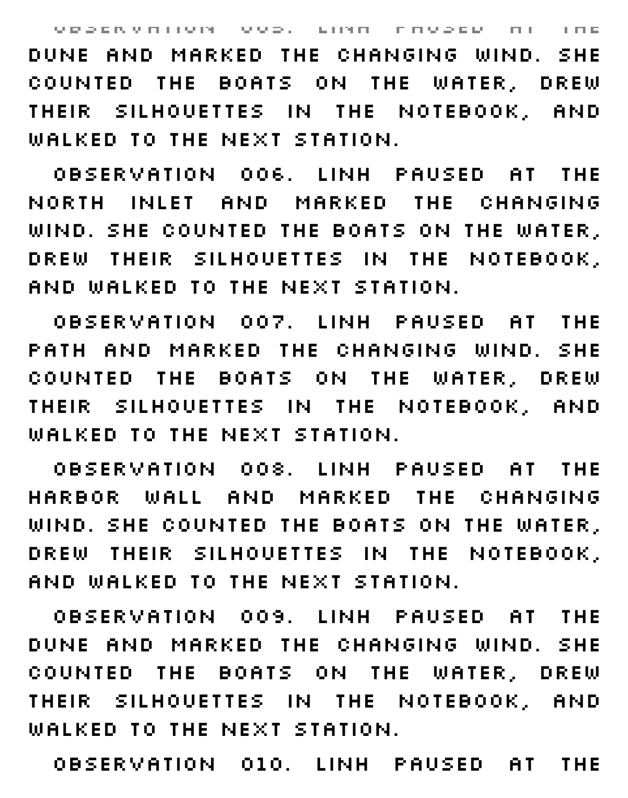
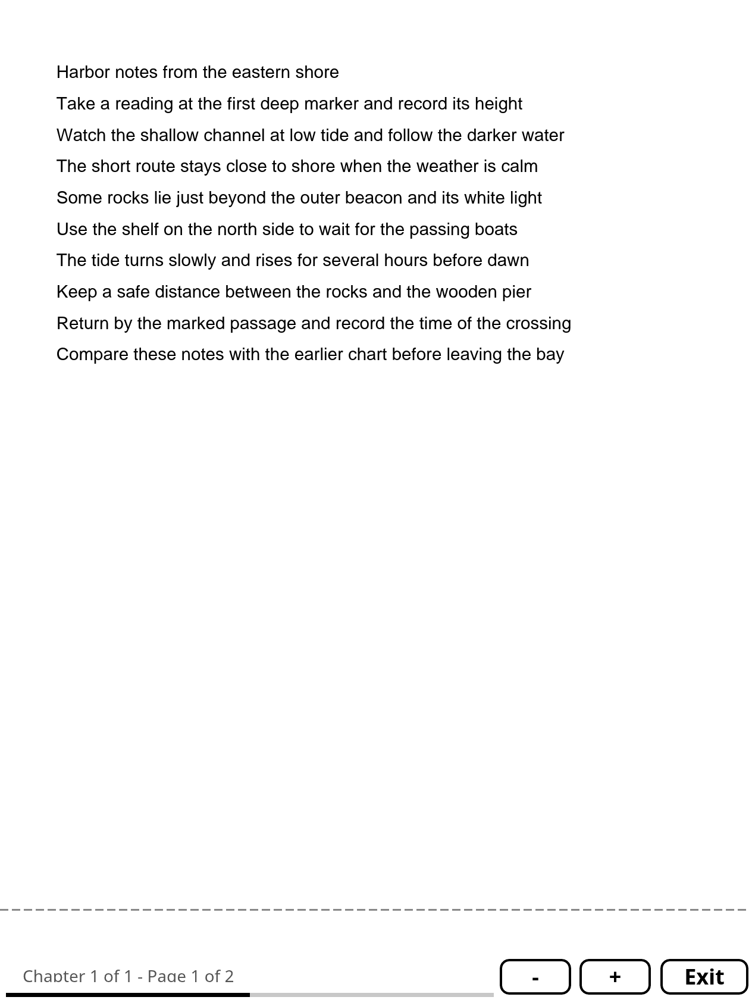

# Page overlap

Use page overlap to keep your place when a page turn repeats some of the
previous view. The switch defaults to Off. With it on, choose **No indicator**,
**Gray out**, **Arrow**, **Solid line**, or **Dashed line**. Reader saves these
choices per book and can include them when saving document defaults.

## EPUB

In a reflowable book, switch **Type** to **Scroll**, open the bottom **Layout**
panel, and turn on **Page overlap**. Choose from 1 to 10 repeated lines, with
one line as the default. Page buttons and automatic turns use the current
font size and line spacing to calculate the repeated height. Free panning
uses the gesture distance. A full turn paints the cue, and Reader clears it
near the end of a chapter. [Stock EPUB navigation](https://github.com/koreader/koreader/blob/9192014d8bd82a91dc1012473be0f238dedfdb54/frontend/apps/reader/modules/readerrolling.lua#L894-L915) · [Stock line and indicator controls](https://github.com/koreader/koreader/blob/9192014d8bd82a91dc1012473be0f238dedfdb54/frontend/ui/elements/page_overlap.lua)

KOReader stores the line count as a shared preference and uses its own
visible document height, including its footer rules. Reader stores the line
count per book and uses its existing text area to calculate movement. Each
renderer therefore uses its own line pitch and page distance.

## PDF and DjVu

In a single-page view, choose **Fit width**, a zoom level above 100%, or
tile zoom. Open the bottom **Layout** panel and turn on **Page overlap**.
The amount of overlap follows the actual movement on the PDF page. The
horizontal and vertical zoom-pan percentages still determine movement. A
turn at the page edge can move fewer pixels than the usual step. In that
case, the indicator uses the larger intersection of the two views.

When the page changes, the indicator clears. Free swipes reposition the page
without painting it. Full-page fit, height fit, and continuous PDF scrolling
hide these controls. KOReader also enables its indicator in reflowed fixed
pages. Reader’s separate fixed-text and scanned-column views do not use this
indicator. [Stock fixed-view eligibility and indicators](https://github.com/koreader/koreader/blob/9192014d8bd82a91dc1012473be0f238dedfdb54/frontend/apps/reader/modules/readerview.lua#L1298-L1327) · [Stock fixed-page movement](https://github.com/koreader/koreader/blob/9192014d8bd82a91dc1012473be0f238dedfdb54/frontend/apps/reader/modules/readerpaging.lua#L958-L1117)

## Mac simulator evidence

The pinned native KOReader replay exercises its own PDF paging, viewport
clamping, and MuPDF rendering. On the authored reference PDF, Fit width
moves 79 px and retains 1,527 px. The replay sees the dashed cue at that
boundary, three pixels high at gray level 136. It checks all five indicator
choices and verifies the reverse and
horizontal intersections and the cue clearing on the next page. A second
replay uses native CRE EPUB scrolling with two and ten lines, fractional
movement, and end-of-book clamping. [Pinned replay script](../scripts/koreader-page-overlap-check.lua)

Run the script under the pinned native runtime. Pass
`tests/fixtures/scan-reflow/vector.pdf`, the output PNG path,
`tests/fixtures/long-chapter.epub`, `tests/fixtures/fonts/NotoSans-Regular.ttf`,
and an empty CRE cache directory, using absolute paths.

Reader’s native tests drive the PDF Layout controls and the real Page Forward
input route. They compare every pixel outside the marker rows, check that
changing the marker preserves the reading anchor, and reopen the saved book.
Additional tests cover reverse automatic turns, direct swipes, and clearing
at the page boundary. The corresponding EPUB checks cover the same renderer
markers, the configured line range, and continuous scroll moves. The 3,792
pixels across the dashed indicator rows match the pinned PDF replay exactly.

The desktop checks do not measure physical E Ink refresh artifacts. Kindle
verification remains pending.
