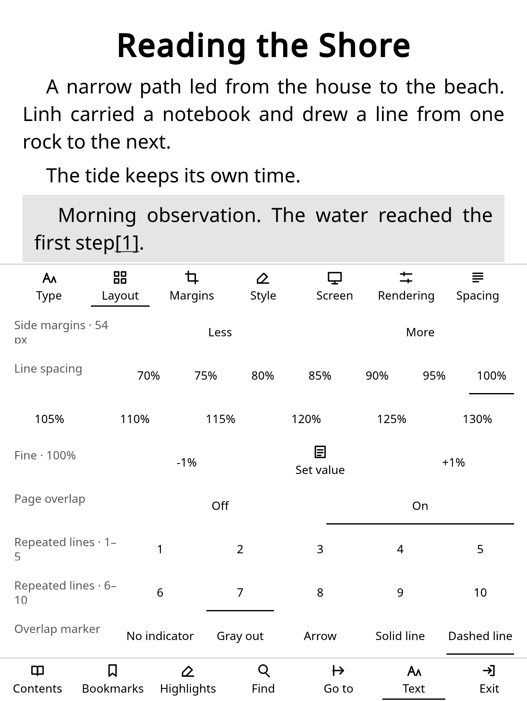
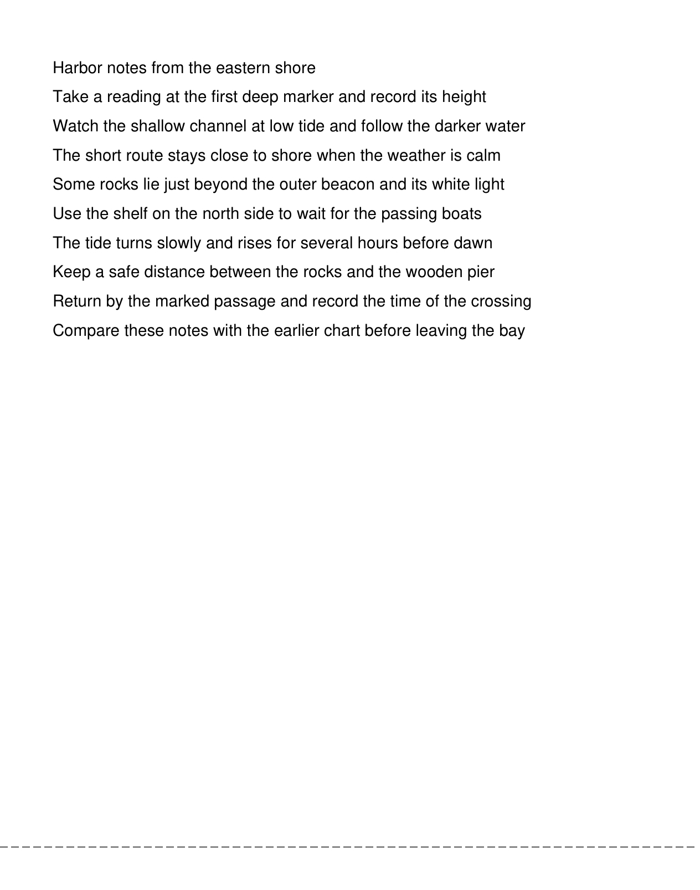
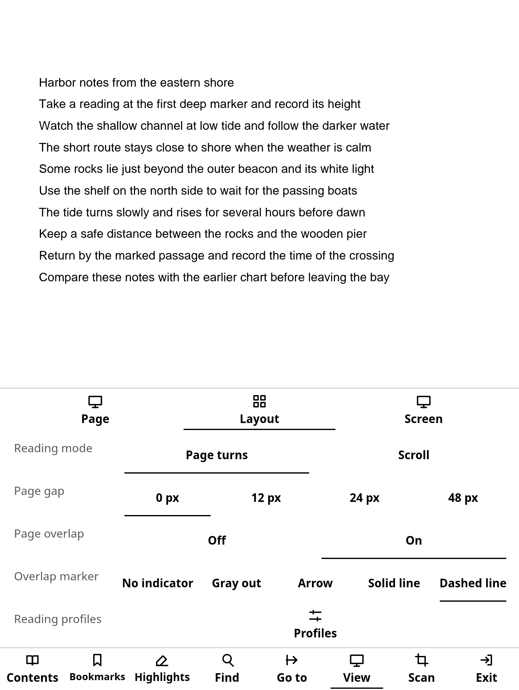
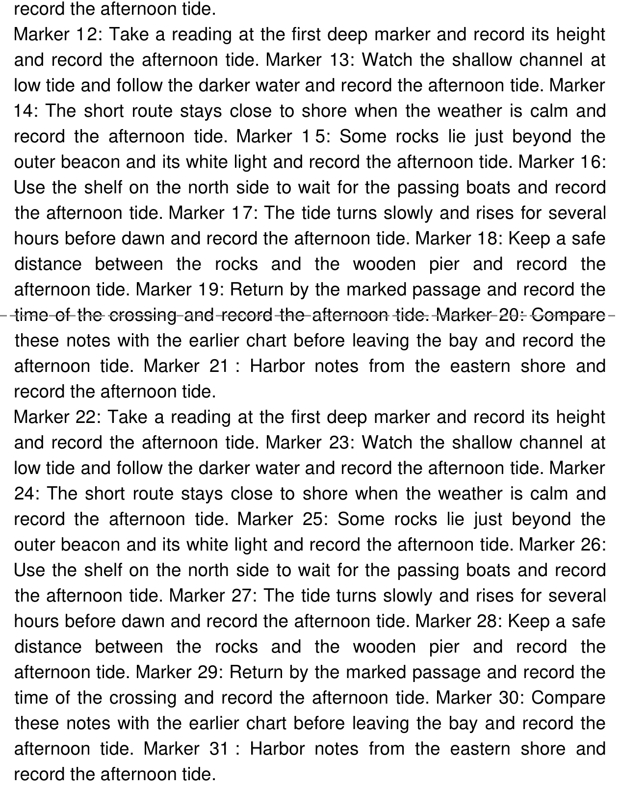
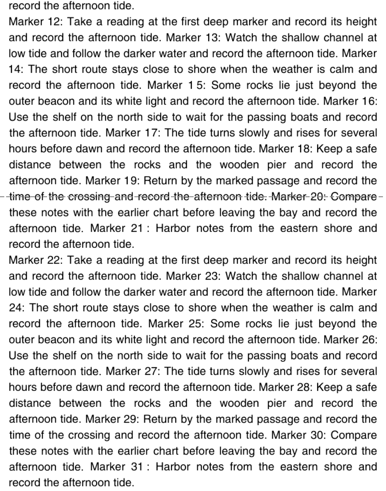
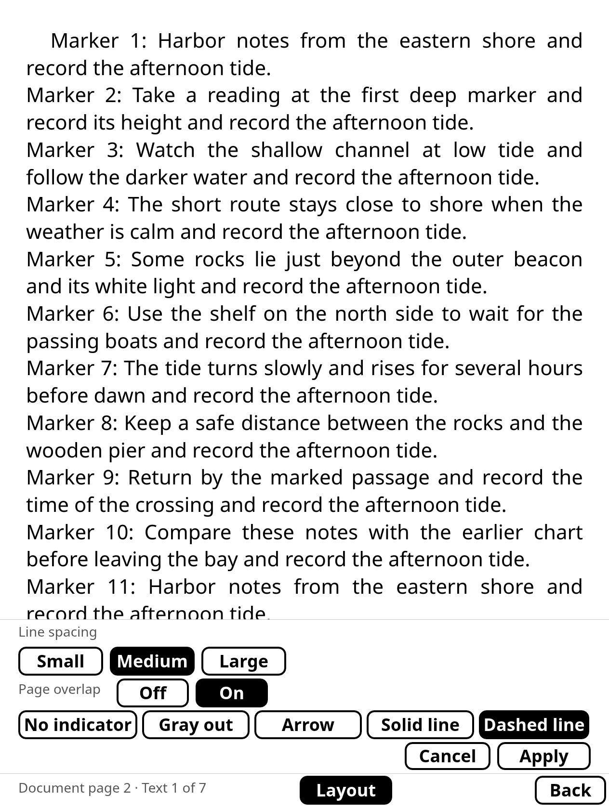
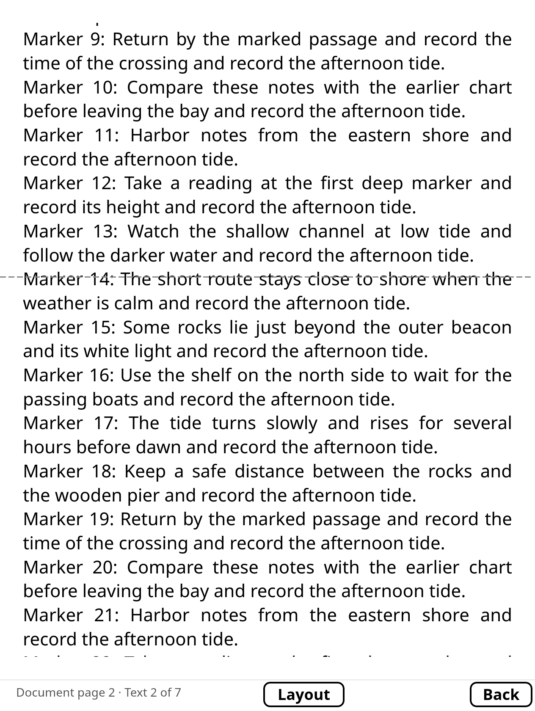
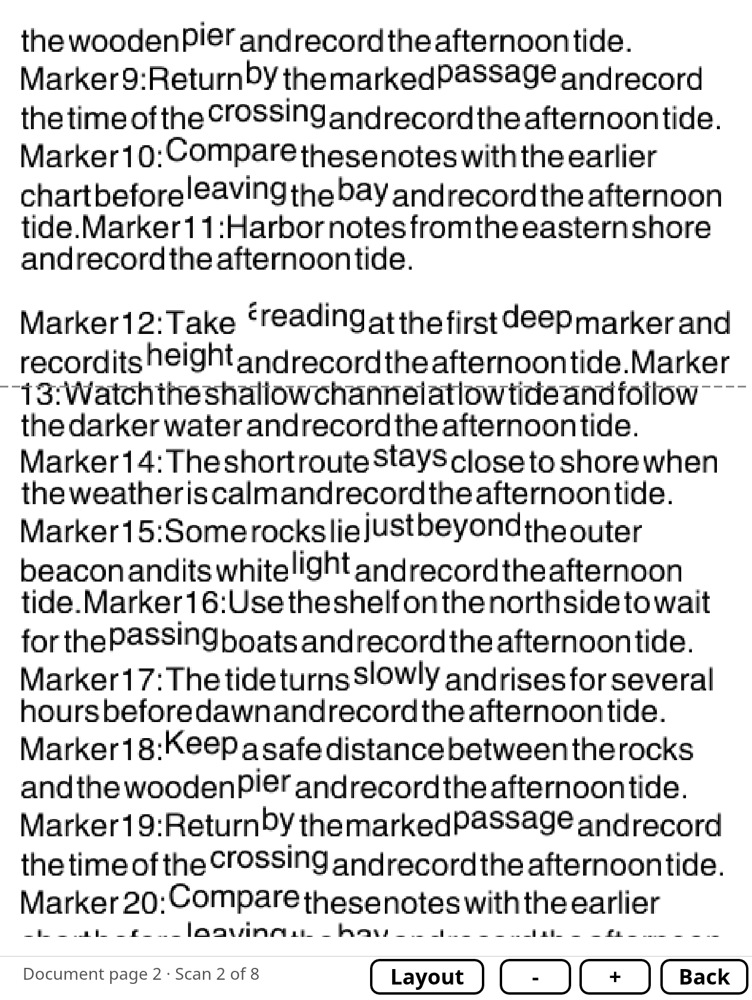

# Page overlap

Use page overlap to keep your place when a page turn repeats some of the
previous view. The switch defaults to Off. With it on, choose **No indicator**,
**Gray out**, **Arrow**, **Solid line**, or **Dashed line**. Reader saves these
choices per book and can include them when saving document defaults.

## EPUB

In a reflowable book, switch **Type** to **Scroll**, open the bottom **Layout**
panel, and turn on **Page overlap**. Choose from 1 to 10 repeated lines, with
one line as the default. Page buttons and automatic turns use the current
font size and line spacing to calculate the repeated height. Free panning
uses the gesture distance. A full turn paints the cue, and Reader clears it
near the end of a chapter. [Stock EPUB navigation](https://github.com/koreader/koreader/blob/9192014d8bd82a91dc1012473be0f238dedfdb54/frontend/apps/reader/modules/readerrolling.lua#L894-L915) · [Stock line and indicator controls](https://github.com/koreader/koreader/blob/9192014d8bd82a91dc1012473be0f238dedfdb54/frontend/ui/elements/page_overlap.lua)

KOReader stores the line count as a shared preference and uses its own
visible document height, including its footer rules. Reader stores the line
count per book and uses its existing text area to calculate movement. Each
renderer therefore uses its own line pitch and page distance.

## PDF and DjVu

In a single-page view, choose **Fit width**, a zoom level above 100%, or
tile zoom. Open the bottom **Layout** panel and turn on **Page overlap**.
The amount of overlap follows the actual movement on the PDF page. The
horizontal and vertical zoom-pan percentages still determine movement. A
turn at the page edge can move fewer pixels than the usual step. In that
case, the indicator uses the larger intersection of the two views.

When the page changes, the indicator clears. Free swipes reposition the
unreflowed page without painting it. Full-page fit, height fit, and continuous
PDF scrolling hide these controls. [Stock fixed-view eligibility and indicators](https://github.com/koreader/koreader/blob/9192014d8bd82a91dc1012473be0f238dedfdb54/frontend/apps/reader/modules/readerview.lua#L1298-L1327) · [Stock fixed-page movement](https://github.com/koreader/koreader/blob/9192014d8bd82a91dc1012473be0f238dedfdb54/frontend/apps/reader/modules/readerpaging.lua#L958-L1117)

## Reflowed fixed documents

Open **Read text** or **Reflow scan** from the **Scan** panel, then tap
**Layout** at the bottom. Choose an overlap cue and tap **Apply**. **Layout**
also contains the three line-spacing choices. The cue setting is shared with
the same book’s zoomed fixed-page view.

Each page turn moves through the current physical page. The saved vertical
zoom-pan overlap sets how much of the previous view repeats, with 40% by
default. The movement is the same with the cue switched off. A turn reaches
the edge of the current physical page before a following turn changes pages.
Entering another source page clears the cue. Reflow keeps the physical-page
bookmark and reading location. Reader paints the cue beneath its reading
guides and controls. Changing the layout preserves the current source
passage. A scan still needs recognized word positions before Reader
can reflow it. The separate scan-column view uses its own column navigation.
[Stock reflowed page dimensions](https://github.com/koreader/koreader/blob/9192014d8bd82a91dc1012473be0f238dedfdb54/frontend/document/koptinterface.lua#L370-L385)

## Mac simulator evidence

The pinned native KOReader replay exercises its own PDF paging, viewport
clamping, and MuPDF rendering. On the authored reference PDF, Fit width
moves 79 px and retains 1,527 px. The replay sees the dashed cue at that
boundary, three pixels high at gray level 136. It checks all five indicator
choices and verifies the reverse and
horizontal intersections and the cue clearing on the next page. A second
replay uses native CRE EPUB scrolling with two and ten lines, fractional
movement, and end-of-book clamping. [Pinned replay script](../scripts/koreader-page-overlap-check.lua)

Run the script under the pinned native runtime. Pass
`tests/fixtures/scan-reflow/vector.pdf`, the output PNG path,
`tests/fixtures/long-chapter.epub`, `tests/fixtures/fonts/NotoSans-Regular.ttf`,
and an empty CRE cache directory, using absolute paths.

Reader’s native tests drive the PDF Layout controls and the real Page Forward
input route. They compare every pixel outside the marker rows, check that
changing the marker preserves the reading anchor, and reopen the saved book.
Additional tests cover reverse automatic turns, direct swipes, and clearing
at the page boundary. The corresponding EPUB checks cover the same renderer
markers, the configured line range, and continuous scroll moves. The 3,792
pixels across the dashed indicator rows match the pinned PDF replay exactly.

The native K2pdfopt replay opens both the original embedded-text fixture and
its raster counterpart. Each reflows to a 1,264 × 4,643 px canvas. Actual
stock page commands move 964 px, retain a 642 px band, and keep the same
movement when the cue is off. A reverse turn puts the marker below the new
text. Crossing into the previous physical page clears the marker. Run the
script in the pinned native runtime with the vector PDF and its output PNG
path, followed by the raster PDF and its output PNG path.
[Reflow overlap replay](../scripts/koreader-fixed-reflow-overlap-check.lua)

Reader uses its own reshaped text and OCR word crop layouts. The two
providers use their visible content height rather than K2pdfopt’s margins
and line placement, so their pixel distances differ. Tests exercise both
from the Layout controls, verify identical movement with the cue off, and
compare the visible frames outside the marker rows. Pending OCR on a
neighboring page preserves the open page and shows the OCR message.

The desktop checks do not measure physical E Ink refresh artifacts. Kindle
verification remains pending.
