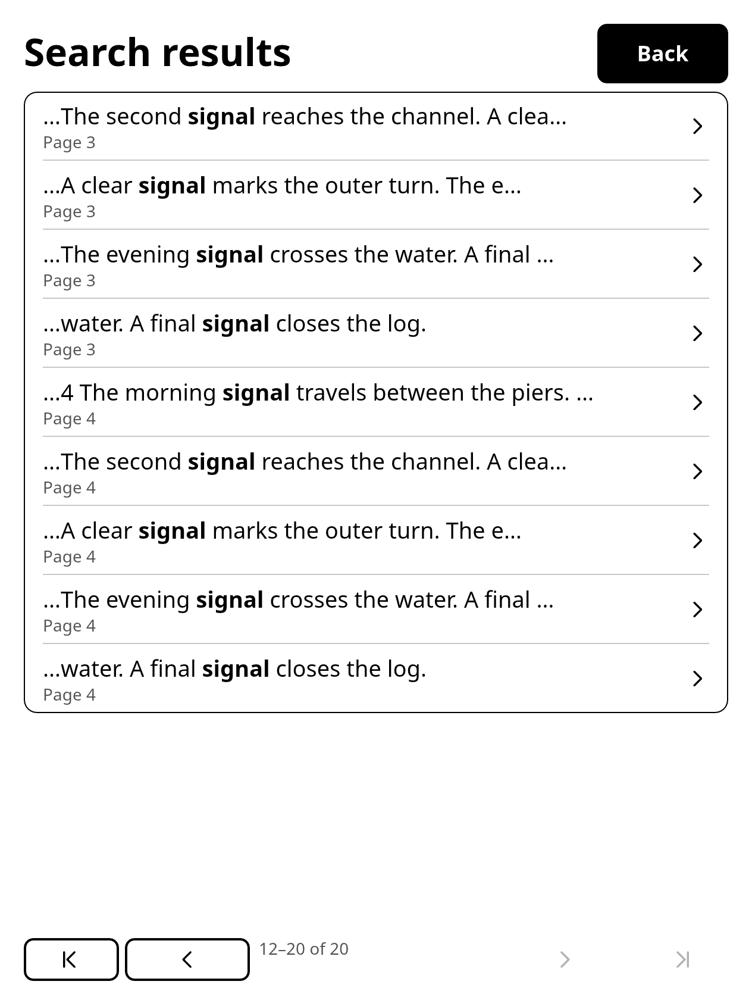
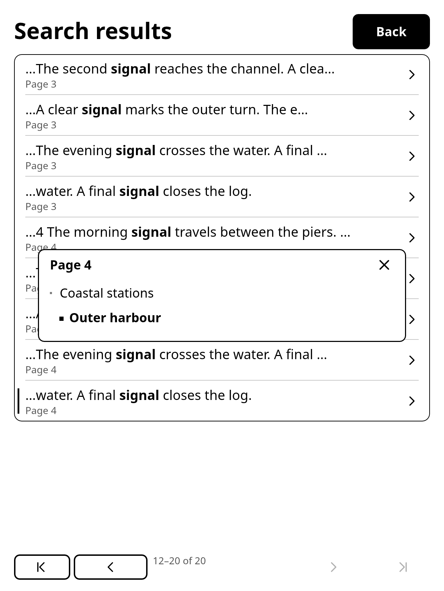

# Finding a passage in the results list

Open **Find in book**, type a word or phrase and choose **Find all**. The result list shows the matching words in bold within their surrounding text. Tapping a row opens the passage. The physical page buttons move through the list.

| Reading the results | Holding a result |
|---|---|
|  |  |

Hold a row to see its page and its place in the table of contents. A fixed document uses its page label. A reflowable book uses a publisher or generated reference page when one is available. Without a reference page, Reader shows the current chapter’s screen page, or the chapter number and percentage for a passage in another chapter. Opening the information for another chapter preserves the active reading position. The screen shows the deepest heading in bold. Swipe vertically to read a hierarchy longer than nine headings.

Tap the screen or press either physical page button to dismiss the panel. A small line beside the held result marks the row. Tap that row to open the passage, or continue through the results with the page buttons.

KOReader emphasizes the full matching PDF word and adds a reflowable word's prefix and suffix around a substring match. Its result-hold action obtains a page label and the nested section titles. Its information panel closes on a tap or a key press. Reader uses the source word and the same look-up order. The text renderer shapes the whole row in one paragraph, including mixed-direction text and combining marks. [KOReader result formatting and hold](https://github.com/koreader/koreader/blob/9192014d8bd82a91dc1012473be0f238dedfdb54/frontend/apps/reader/modules/readersearch.lua#L710-L784) · [CREngine word context](https://github.com/koreader/koreader-base/blob/6e4bc81af4e04f78d81677a323a780a71b29702a/cre.cpp#L4052-L4087) · [Chapter-path lookup](https://github.com/koreader/koreader/blob/9192014d8bd82a91dc1012473be0f238dedfdb54/frontend/apps/reader/modules/readertoc.lua#L382-L473) · [KOReader dismissal](https://github.com/koreader/koreader/blob/9192014d8bd82a91dc1012473be0f238dedfdb54/frontend/ui/widget/infomessage.lua#L306-L313)

The screenshots use a four-page harbour register authored for this test. Its result on page four belongs to *Coastal stations › Outer harbour*. The same interface test holds an entry for chapter 48 in an EPUB, dismisses it with the physical back button, opens the exact match, and returns to the starting position. [Reader result presentation and regression tests](../src/app/result_context.rs)
