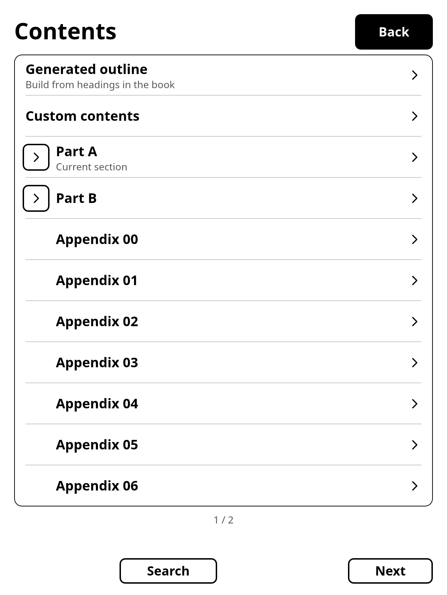
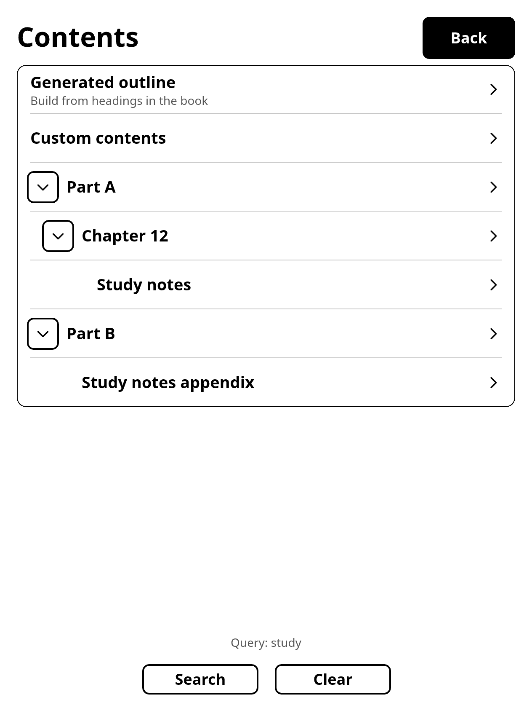

# Searchable contents

Open **Contents** from the upper Navigation menu or lower reading bar. Publisher
outlines start with their branches collapsed. Reader opens the branches that
lead to the current heading and other headings on the same page. A left
chevron expands or collapses the branch. The heading beside it still opens
its original EPUB fragment, fixed page, or saved custom location.

**Search** uses the shared keyboard to find heading text without matching case.
Results keep their ancestor headings for context. A single `*` expands the
whole outline. **Clear** restores the full list and reveals the current
heading again. Cancelling or entering an unmatched query keeps the previous
view. The physical page buttons, on-screen buttons, and vertical swipes page
the list without changing the book position. Only choosing a destination adds
to navigation history.

The generated and custom outline entry points stay available. Searching uses
whichever publisher or custom outline is active. Chapter lengths, row and font
settings, page labels in the Contents list, dot leaders, and per-depth progress
tick settings remain separate parity work.

## Evidence

The authored EPUB test opens a nested heading, collapses a branch, uses the
physical page button input, types a query, and verifies cancel, no-results,
and clear. Its final tap follows the original fragment and leaves one return
entry. The authored PDF test checks the same split between branch controls and
page navigation. Existing EPUB, MOBI, KF8, and DjVu fixtures also exercise
provider-specific targets and restore the original reading frame.

| Collapsed | Current path expanded | Title results |
| --- | --- | --- |
|  |  |  |

The full-screen captures use the authored EPUB. All three rendered frames
matched byte for byte between the Mac simulator and the ARMHF executable
running on the Oasis 3. The Mac run passed 994 Reader library tests, one
Reader binary test, 14 EPUB package tests and four layout checks. The native
run passed 998 Reader library tests, 14 EPUB package tests and four layout
checks. Both runs skipped 62 optional Reader tests. The native run used an
isolated profile and exercised page-button input through the app harness.
Physical E Ink behavior and foreground interaction remain separate checks.

[Reader list and input](../src/app/contents_view.rs) · [Tree and title matching](../src/app/contents_tree.rs) · [EPUB and PDF workflow tests](../src/app/contents_view/tests.rs) · [KOReader source](https://github.com/koreader/koreader/blob/9192014d8bd82a91dc1012473be0f238dedfdb54/frontend/apps/reader/modules/readertoc.lua#L770-L1182)
