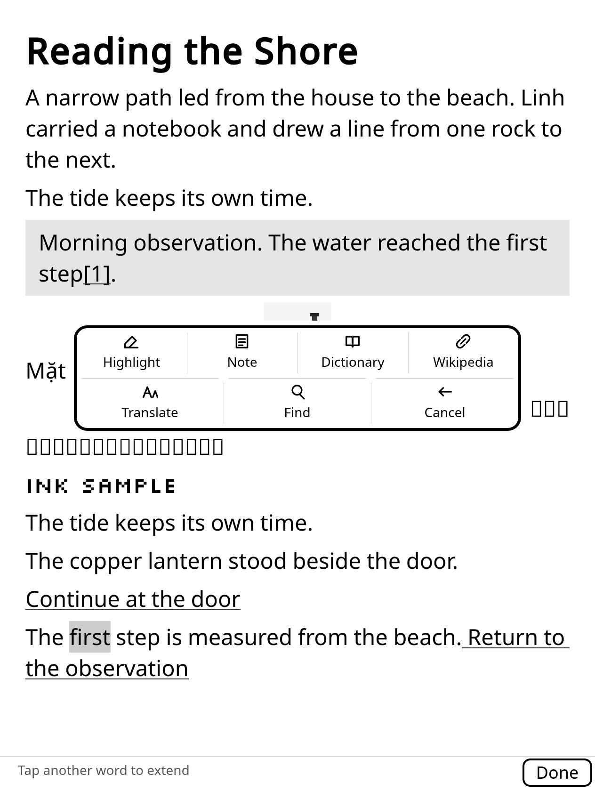

# Selection dialog placement

KOReader v2026.07.1 offers Top, Center, Bottom and Highlight position for its
selected-text dialog. Center is the stock default. Reader now exposes the same
fixed positions plus **By selected text**, saved in the existing
`reading-controls.json` preferences. Older settings files without this field
continue to use Center.

In **Reader › Settings › Selection dialog position**, choose a position. The
selected-text mode tries below the selected passage first, then above it; when
neither fits on the reading page, the action panel moves to the footer beside
Done. Fixed positions are centered horizontally and constrained to the reading
page, leaving the footer available for Done.

The integrated desktop test checks Settings reachability, the selected option,
preference persistence, all popup action targets, Center geometry and
selected-text placement. The capture below shows the Center default on the
PrimitiveOS simulator.

Long-press actions and the stock single-word dictionary behavior are now
configurable in Reader. Their desktop behavior and remaining differences are
tracked in [Long-press reading actions](long-press-behavior.md). Device
placement, e-ink repaint quality and dismissal behavior remain open until
Kindle acceptance is available. See the [pinned KOReader handler](https://github.com/koreader/koreader/blob/v2026.07.1/frontend/apps/reader/modules/readerhighlight.lua#L348-L380)
and the [controls matrix](koreader-sdl-reference-controls.json) for the exact
reference scope.
