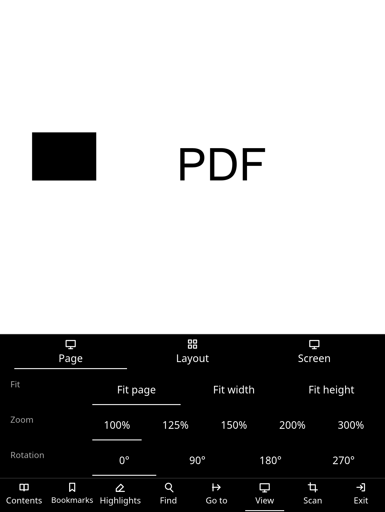

# Reader workflow simulation review

The 22 November 2026 Mac review covers the combined bookmark browser, mark creation dates, library highlight exports, publisher non-linear flows, vertical table padding, highlight opacity and line height, and the corrected document-resume checker. It also covers the lower toolbar label adjustment. Kindle execution and publication of this combined candidate remain pending.

The complete Mac run passed **573 library tests, 14 EPUB package tests and four system tests**. Its 33 opt-in tests were skipped in that run. These results establish the cases exercised by those tests. The full feature comparison continues against [K01–K24](requirements.md) and the [KOReader source inventory](koreader-source-inventory.md).

## Compared workflows

| Workflow | Candidate evidence | Further acceptance |
| --- | --- | --- |
| Find saved marks across books | The bookmark browser groups books, combines sources and filters, searches quotations and notes, previews marks and follows a saved target with return history. Creation dates survive import and editing. [Browser behavior and tests](bookmark-browser.md) | Metadata property selection, saved color choices and the remaining stock browser preferences require their own comparisons. Confirm the combined build on Kindle. |
| Export reading annotations | History, selected books and collections produce KOReader JSON, text, Markdown and HTML. Tests cover identity, quotations, notes, style filters and unchanged original inputs. [Export contract](library-highlights-export.md) | Compare additional upstream exporters individually and verify the combined native workflow. |
| Publisher non-linear content | The per-book setting excludes marked fragments from ordinary reading while preserving explicit destinations and return history. [Non-linear flow evidence](nonlinear-reading.md) | Reader-authored hidden ranges have separate acceptance work. The combined native build remains to be exercised. |
| Publisher table padding | Layout, source selection and saved anchors follow supported top and bottom cell padding. [Padding measurements](publisher-vertical-padding.md) | Broader publisher CSS and vertical cell alignment retain separate evidence and limits. |
| Saved highlight appearance | Opacity, line height and four drawing styles are exercised in the simulator, including fixed-page and reflow selection rules. [Highlight drawing comparisons](highlight-drawing-styles.md) | Saved colors and note margin symbols remain separate controls. Verify current aggregate rendering and touch on Kindle. |
| Resume from a final page | The checker closes the optional end-of-document prompt through the ordinary Back input before comparing saved document pixels. The JPEG and XHTML regression confirms the prompt appears and closes before Continue reading restores the content. [Resume checker](../src/document_check.rs) · [Regression](../src/app/end_of_book.rs) | The earlier installed 0.1.22 sweep reported 37 prompt-versus-content comparisons as failures. The corrected original-file replay and the final installed-package sweep remain pending. |
| Compact and large reading controls | Eight authored EPUB/PDF captures cover both themes and toolbar sizes. Independent OCR recognizes all 60 complete shortcut labels. The functional test opens Bookmarks through its actual touch rectangle in both toolbar sizes and document formats. [Toolbar layout and regression](../src/app/reading_bars.rs) | These are framebuffer simulations. Physical touch, orientation, e-ink update completion and page-button timing require current Kindle evidence. |

## Visual inspection

The reviewed large EPUB toolbar keeps Contents, Bookmarks, Highlights, Find, Go to, Text and Exit distinct. The large dark PDF toolbar also fits its View and Scan shortcuts. The document remains visible above the configuration panel. The bookmark results and saved-mark preview show their source, location and visible return controls. [Bookmark results](screenshots/bookmark-browser.png) · [Mark preview](screenshots/bookmark-details.png)

The initial Latin-only font set showed missing-glyph boxes in the authored Arabic passage. The updated Mac preview uses Noto Sans with the Mac's installed Geeza Pro and Arial Unicode fallback fonts. A separate render of this authored passage maps all 401 source characters and reports zero missing glyphs. These system fonts stay on the Mac. Later device comparisons will use the Kindle's own font stack.

The earlier audit describes seven full Oasis KOReader states covering upper categories, lower settings and the dictionary overlay. Those original image files could not be located in the retained working folders during this review. An image-by-image comparison of those seven frames remains unverified. The pinned Lua handlers and earlier written observations remain available for the functional comparison. The comparison baseline is KOReader `9192014d8bd82a91dc1012473be0f238dedfdb54`. [Earlier observations](reading-control-evidence.md) · [Pinned upstream source](https://github.com/koreader/koreader/tree/9192014d8bd82a91dc1012473be0f238dedfdb54)

## Open acceptance across the full plan

K03, K04 and K11 still require current device lifecycle, latency, memory, package-update and host-return checks for this candidate. The original-document sweep continues. Separate desktop replays passed bookmark navigation and highlight export on two original EPUBs and two original PDFs, and publisher hidden-flow navigation on five original EPUBs. All selected source hashes matched after these workflows. The remaining opt-in cases have their own receipts. Earlier component results establish their recorded source and device configurations.

K08 and K19 retain detailed rendering work. The next independent control comparison is numeric font gamma and base weight, including complete values, glyph coverage, per-book preferences and source positions. The source inventory also retains provider-specific zoom, scan and typography controls that need individual acceptance. K21 and K22 retain the acquisition and synchronization contracts listed in the requirements. Completing this simulation review leaves the full reading-parity goal active.
