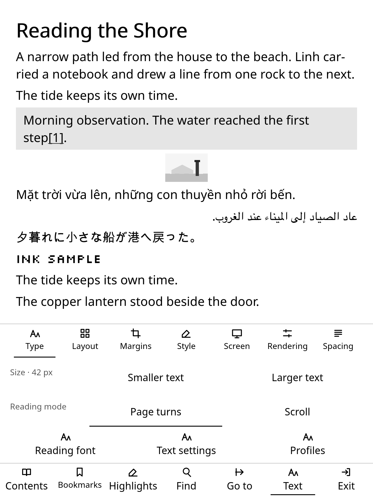

# Reader workflow simulation review

## Current Mac simulator checkpoint

**Table styles** add full-width, intrinsic, and centered layouts, plus
alternating row backgrounds and a stock-priority border preset. The HTML
presentation switch suppresses supported legacy attributes while preserving
CSS, row and column spans, and link targets.
[Table settings and native comparisons](table-style-tweaks.md)

**Numbered notes** flatten explicit EPUB and Wikipedia list-root
paragraphs while painting one marker at the start. The marker stays
outside searchable source text. The Mac and pinned KOReader replays
check decimal and Roman numbers, the note strip, and original backlinks.
[Note comparison and screenshots](in-page-footnotes.md#inline-all-footnote-content)

The full Mac run passed 1,638 library tests, one Kindle entry test,
14 EPUB package tests, and four layout tests. The standard run skipped
73 opt-in cases. The separate 33 focused checks passed, and the Reader
and stock replays reproduced 33 published screenshots.

The four original EPUB, PDF, AZW3, and MOBI documents opened through
the picker, turned a page, and resumed with unchanged source bytes.
The original EPUB footnote replay verified 65 bands and 63 canonical
anchors across eight composed chapters.

The locally staged ARMHF executable is stripped and statically linked.
It contains 39,486,548 bytes with SHA-256
`62a294d2ce7055ce39831a156591f93d9203a3a81e272f2588324b0d814ad836`.
The 32 staged files total 49,093,143 bytes. The project licenses, SQLite
and dictionary notices, embedded Launcher icon, and OCR model passed
inspection. Foreground Kindle testing and Store publication remain
pending.

## Link and image styles, standalone artwork, and hyphenation checkpoint

**Link styles** expose all four pairs for ink, weight, slant, and
underlining. The pinned replays check nested text and named anchors,
and the renders measure black at gray 0 and blue at gray 63. Styling
preserves source selections and link targets.
[Comparison and screenshots](link-style-presets.md)

**Image styles** put full-width images on their own line and independently
center inline images relative to text. Width-constrained images follow the
column’s leading edge in left-to-right and right-to-left settings.
[Comparison and screenshots](image-style-tweaks.md)

**Standalone note artwork** appears in the footnote strip and can move
inline with surrounding paragraphs. Tests verify the original image,
link, and source ordinal in Reader. Stock exposes the original-image
action and paints the copy in its strip.
[Comparison and screenshots](in-page-footnotes.md#inline-all-footnote-content)

**Estonian and Finnish hyphenation** adds 3,691 and 284 pinned single-word
rules with their language defaults. The replays distinguish dictionary
candidates from line breaks chosen by the renderer, including the
Estonian case where a dictionary break is available but the stock
layout chooses a later one. [Comparison and screenshots](multilingual-hyphenation.md)

The full Mac run passed 1,631 library tests, one Kindle entry test,
14 EPUB package tests, and four layout tests. The standard run skipped
73 opt-in cases. The Reader simulator and pinned KOReader replays reproduced 38 new
screenshots. The four original EPUB, PDF, AZW3, and MOBI files opened
through the picker, turned a page, and resumed with unchanged source
bytes. The separate original EPUB footnote test verified 65 bands and
63 canonical anchors across eight composed chapters.

The locally staged ARMHF executable is stripped and statically linked.
It contains 39,435,668 bytes with SHA-256
`b87a986d9564abcb17d51539aa556e45eb7a7351077c6e73e18668c7622caff3`.
The 32 staged files total 49,042,263 bytes. Project and dictionary
licenses, SQLite notices, the embedded Launcher icon, and the OCR
model passed inspection. Foreground Kindle testing and Store
publication remain pending.

## Fixed-page reflow, inline artwork, paragraph spacing, and Quickstart checkpoint

**Fixed-document reflow** now overlaps page turns within the same physical
page in **Read text** and **Reflow scan**. The cue can be hidden with the
same movement and bookmark behavior. The pinned K2pdfopt replay exercises
the exact page-turn route on the vector and raster fixtures.
[Reflow comparison and screenshots](scroll-page-overlap.md#reflowed-fixed-documents)

**Illustrated inline notes** preserve fitting artwork, source anchors,
and links in both the footnote band and the original note. The native
replay and Reader compare the complete chart raster. Standalone artwork
uses the ordinary note layout.
[Footnote comparison and screenshots](in-page-footnotes.md#inline-all-footnote-content)

**Paragraph styles** add full, half, and no-spacing presets and a generic
browser paragraph style. Stock and Reader checks measure the paragraph
gaps and publisher overrides. The menu test replaces a global default
with a per-book choice and reopens at the same passage.
[Spacing comparison and screenshots](reading-style-presets.md#paragraph-spacing-and-browser-defaults)

**Quickstart** is available offline from Reader settings and Documents.
A fresh profile opens it once from Launcher. The guide leaves the book
and its position intact when dismissed.
[Guide comparison and screenshots](quickstart-guide.md)

The full Mac run passed 1,621 library tests, one Kindle entry test,
14 EPUB package tests, and four layout tests. The standard run skipped
73 opt-in tests. The 53 focused checks also passed. The Reader simulator
and pinned KOReader replays reproduced 22 new and five refreshed screenshots.
The four original EPUB, PDF, AZW3, and MOBI files opened
through the picker, turned a page, and resumed with unchanged source bytes.
The original EPUB footnote check retained 65 bands and 63 canonical anchors
across eight composed chapters.

The locally staged ARMHF executable is stripped and statically linked.
It contains 39,349,244 bytes with SHA-256
`6dc55af1c5f37553ffa94b731f3f2a4949ef1d79e67fe4968fae66e88a57beb8`.
The 31 staged files total 48,953,775 bytes. The project licenses, SQLite
notices, embedded Launcher icon, and OCR model passed inspection.
Multi-window DjVu reflow, foreground Kindle testing, and Store publication
remain pending.

## Menu pager, fixed zoom, and reading styles checkpoint

**Menu paging** goes straight to the first or last page on a held arrow
in settings lists and Documents. A tap or physical page key moves one
page. The stock replay verifies the two edge destinations and disabled
arrows. Reader commits the hold when the reader lifts their finger.
[Menu comparison and screenshots](menu-pager.md)

**Fixed-page overlap** marks the repeated part of the previous viewport
when a page turn pans inside a zoomed PDF or DjVu page. Free swipes and
page changes clear the cue. The reference dashed PDF cue matches all
3,792 pixels of the pinned native marker, and both simulators exercise
continuous EPUB overlap. Fixed text reflow remains open.
[Overlap comparison and screenshots](scroll-page-overlap.md)

**Inline notes** flatten nested text lists and multi-paragraph list items
without losing source spans, selection, or backlinks. Illustrated notes
keep their ordinary layout. The stock replay checks the flattened geometry
and resolves the backlink from the canonical note.
[Footnote comparison and screenshots](in-page-footnotes.md#inline-all-footnote-content)

**Reading styles** add a centered CJK grid that follows the character-width
setting, a preset for unindenting consecutive paragraphs, and a black-and-white
preset for supported borders and publisher backgrounds. Simulators compare
the same CJK specimen at 100% and 125% and the border and fill colors.
[Reading style comparisons](reading-style-presets.md)

The full Mac run passed 1,612 library tests, one Kindle entry test,
14 EPUB package tests, and four layout tests. The standard run skipped
73 opt-in tests. The 41 focused checks passed. The Reader simulator and
pinned KOReader replays reproduced 26 new screenshots.

The four original EPUB, PDF, AZW3, and MOBI documents opened through
the regular picker, turned a page, and resumed with matching source
bytes. The separate original EPUB note test verified 65 bands and 63
anchors across eight composed chapters.

The locally staged ARMHF executable is stripped and statically linked.
It contains 39,228,772 bytes with SHA-256
`3ccce5cd07924109bcb69c170bc6ef3dab4873cb8059007df08d623c873c4d63`.
The 31 staged files total 48,833,303 bytes. The project and dependency
notices, Launcher icon, and OCR model passed inspection. Foreground
Kindle verification and Store publication remain pending.

## Book details, inline lists, and multilingual hyphenation checkpoint

**Book details** saves title and author edits for the open reflowable book.
The optional header reflects the edit on return without moving the page
or changing the pixels below the header. Reset restores imported or
publication metadata for the selected field. The EPUB and imported
sidecar retain their original bytes. The native reference replay exercises
both header changes and the same reading position.
[Book details comparison and screenshots](top-status-header.md)

**Inline EPUB notes** join single-level text list items into the note
band and canonical original. Search, selection, and backlinks use their
original source positions. Unsupported nested and multi-block items keep
their original layout. [Inline notes comparison](in-page-footnotes.md#inline-all-footnote-content)

**Hyphenation dictionaries** add Spanish, Italian, and European Portuguese
with the pinned rules and limits. The native and Rust checks compare
the break positions of ten words, including accented samples, with
stock and overridden limits. Reader also verifies rendering, word selection
across line breaks, original search offsets, reopening, and the language
shown in settings. [Dictionary comparison and screenshots](multilingual-hyphenation.md)

The full Mac run passed 1,602 library tests, one Kindle entry test,
14 EPUB package tests, and four layout tests. The standard run skipped
73 opt-in tests. The 33 focused checks passed, and the Reader simulator
and pinned KOReader replays reproduced 16 new screenshots.

The four original EPUB, PDF, AZW3, and MOBI documents opened through the
normal picker, turned a page, and resumed with matching file bytes. The
separate original EPUB note test retained 63 canonical anchors and 65
bands across eight composed chapters.

The local ARMHF package staged a stripped, statically linked
39,247,604-byte executable with SHA-256
`27c2d82a37426322f642bcacd9e6a6154d0556e23c2b9522131470b6ebcd343c`.
Its 31 files total 48,852,135 bytes. Project licenses, third-party dictionary
notices, the Launcher icon, SQLite notices, and the OCR model passed
inspection. Foreground Kindle verification and Store publication remain
pending.

## Menu, links, archive, and optional header checkpoint

**Menu activation** lets readers control tap, swipe, and automatic opening
of the bottom bar separately. The stock edge zones and Reader's upper-center
shortcut both work. If two expanded panels would collide, only the bottom
shortcuts open alongside the top panel. Reader preserves the reading
location, footer, and Exit. [Menu comparison and screenshots](menu-activation.md)

**Enlarged link taps** use KOReader's 57-pixel radius on the 300 DPI Oasis
canvas. A tap near a web link honors the external-link setting. Allowed web
links show the address, Copy, and QR controls over the EPUB page. Dismissal
restores the same frame. [Link comparison and screenshot](link-taps.md)

**Metadata archives** can move between Documents folders. Reader commits
the merged destination before retiring the old snapshot and keeps newer
dated copies for matching editions. Equal or unavailable dates
retain both copies. KOReader's move uses the source copy on a collision.
[Archive comparison and screenshots](book-metadata-archive.md#move-the-archive)

**The optional EPUB header** has separate time, page, progress, chapter
mark, and battery controls. A narrow header alternates author and title.
Live metadata edits, immediate battery-event redraws, and exact whole-book
counts for additional layouts remain open. The default chapter-and-page
footer, marked progress track, and far-right Exit still render exactly.
[Header comparison and screenshots](top-status-header.md)

**Inline EPUB notes** join supported note paragraphs in the note band and
at the original location. Per-paragraph anchors, selection, and backlinks
still point to the source. Rich notes or failed composition retain their
ordinary layout. [Inline notes and screenshots](in-page-footnotes.md#inline-all-footnote-content)

The full Mac suite passed 1,595 library tests, one Kindle entry test,
14 EPUB package tests, and four layout tests. The standard run skipped
73 opt-in tests. The 18 focused Mac workflows passed twice. The five
pinned native KOReader replays and the Mac simulator reproduced all 17
new screenshots and the updated note-options screenshot byte for byte.

The four original EPUB, PDF, AZW3, and MOBI documents opened through
the normal picker, turned a page, and resumed with unchanged source
bytes. A separate original EPUB note run verified 65 bands and 63
canonical anchors across eight composed chapters.

The local ARMHF package staged a stripped, statically linked
38,889,212-byte executable with SHA-256
`389c3341b6acaea8696dff12c31564f832b5a5375aeff627bf10d8bcfd059cb7`.
The 30 staged files total 48,488,712 bytes. Both project licenses,
SQLite notices, Launcher icon, OCR model, and the new control labels
passed inspection. Foreground Kindle verification and Store publication
remain pending.

## Shortcuts, live metadata, note flows, and footer widths checkpoint

**Book shortcuts** save a book or Documents folder. A folder can open its
file list or the most recent available book, with optional subfolders.
Reader verifies persistence, removal, unavailable targets, and reopening
through a tap or assigned multiswipe. The native stock replay verifies
the chooser, routing options, and hold-to-remove.
[Shortcut comparison and captures](book-shortcuts.md)

**Live metadata** can be saved beside a book, by path in the Reader
profile, or by edition fingerprint. Tests migrate between the three
locations, restore a renamed EPUB, retry failed writes, keep newer
alternate records, and prefer the current library index over a sidecar.
Reader selects its profile by default and writes versioned JSON.
[Metadata location comparison](book-metadata-location.md)

**Non-linear footnotes** group consecutive originals into supplemental
page ranges. In supported single-page EPUBs, the normal reading path
skips these originals while readers can still use the note bands or
follow the source links. Whole-note flattening remains open.
[Footnote comparison and captures](in-page-footnotes.md#combined-non-linear-footnotes)

**Footer widths** independently cap author, book title, and chapter text
using the active footer font. Reader verifies combined, cycling, and
landscape layouts and the original default caption, progress track, and
far-right Exit. Existing Mac checks also verify separate dictionary fuzzy
preferences and justification of supported HTML articles. [Footer widths](footer-composition.md#item-maximum-width) ·
[Fuzzy search](dictionary-word-forms.md#reference-behavior) ·
[Definition display](dictionary-popup-display.md)

The full suite passed 1,581 Mac library tests, one Kindle entry test,
14 EPUB package tests, and four layout tests. The standard run skipped
73 opt-in tests. The 17 focused workflows passed twice from the same
integrated binary. Four native KOReader replays and the integrated
simulator reproduced all 18 new comparison screenshots byte for byte.

Four original EPUB, PDF, AZW3 and MOBI files opened through the normal
picker, turned a page, and resumed at the saved location with matching
source bytes. An original EPUB opened through a saved shortcut and
resumed after a page turn and restart. Both the verification copy and
the original retained their SHA-256. The separate original EPUB note
check retained 63 canonical anchors and 65 bands across eight chapters.

The local ARMHF package staged a stripped, statically linked
39,036,596-byte executable with SHA-256
`e059fe5656f4fa4aec4cd18fc4ff00397aab068e469aca1efd9a7c126e16e3bd`.
The 30 staged files total 48,636,096 bytes. Both project licenses,
SQLite notices, Launcher icon, and OCR model passed inspection.
Foreground Kindle verification and Store publication remain pending.

## Status readouts, multiswipes, metadata archive, and notes checkpoint

**Reading status** adds optional brightness and warmth items, a 12-hour
clock in Reader, and hide rules for inactive items. The simulator tests
combined status, cycling, presets, reopening, older saved item order, and a
pixel-identical return to the chapter-and-page footer with the progress
track and far-right Exit. [Footer controls and screenshots](footer-composition.md#inactive-items-and-clock)

**Multiswipes** adds 35 editable one-finger presets, a custom recorder and an
assignment overview. The integrated controls dispatch on release and
restore the continuous scroll position before the assigned action starts.
Fast bends can fall between toolkit samples. [Multiswipe comparison and screenshots](reading-multiswipes.md)

**Reading metadata** can be archived on close or before deletion. The
simulator opens the same EPUB edition after a rename and restores its
position and saved marks. A successful restore saves the live record
before consuming the chosen snapshot. A failed archive write prevents
deletion. Reader uses its own archive format. Live KOReader sidecar writing
and automatic relocation of existing archives remain open.
[Archive comparison and screenshots](book-metadata-archive.md)

**In-page notes** adds a cosmetic spacing fix and support for local
EPUBs with the tested Wikipedia reference markup. Reference links and
selectable note text remain usable. Whole-note flattening and automatic
non-linear grouping remain open. [Note comparison and screenshots](in-page-footnotes.md)

The 11 focused Reader checks passed in the integrated simulator. The
comparison regenerated 18 Reader screenshots and five pinned KOReader
screenshots byte for byte. The five native stock replay modes exercised
status-item visibility and time, multiswipe configuration, metadata
archiving, cosmetic note spacing, and Wikipedia reference bands.

Four original EPUB, PDF, AZW3 and MOBI files opened through the normal
picker, turned a page, and resumed at the saved location. Their source bytes
matched. The opt-in original EPUB note test also retained 63 canonical
anchors with 65 bands across eight chapters.

The full Mac suite passed 1,568 library tests, one Kindle entry test, 14 EPUB
package tests and four layout tests. The standard run skipped 72 opt-in tests.

The local ARMHF package staged a stripped, statically linked 38,599,708-byte
executable with SHA-256
`9c4a02a96cc4ee52217b00263b900ff152b1b098604017e7fdfa8219fa9f1d6c`.
Both builds produced the same executable hash. The 30 staged files total
48,199,208 bytes. Both project licenses, SQLite notices, Launcher icon,
OCR model, and the new control labels passed inspection.
Foreground Kindle verification and Store publication remain pending.

## Menu search, selection, Back, and classic footnotes checkpoint

**Menu search** searches the open document’s available controls. It opens
the matching route, marks the control and preserves the reading position.
Normal tap shows the path first. A hold jumps directly. The pinned stock
callback replay and integrated EPUB/PDF tests verify literal punctuation,
case, remembered queries and a nested note setting. Reader jumps without
the optional stock animation. [Comparison and captures](menu-search.md)

**Dictionary and Select** show source, matched headword and result number
as separate fields. Tapping title Back ends Find or leaves one lookup. A
hold closes the stack and saves an armed highlight once. The explicit
**Select** action extends a source range in EPUB and PDF before saving.
[Dictionary comparison](dictionary-popup-display.md#source-and-result-count) ·
[Selection control](long-press-behavior.md)

**Back navigation** skips the current jump marker and can return to the
previous distinct fixed-page view. The continued comparison verifies
same-page PDF zoom, rotation and pan while retaining the open document’s
other settings, the Documents root, and the direct Exit control. Physical
Backspace mapping remains a platform gap on keyboards that support it.
[Back comparison](back-navigation.md)

**Classic EPUB footnotes** resolve links to IDs inside a class-marked note.
The extension options stop at the next entry or at a heading. Four note
fixes adjust indentation, justification, spacing and inherited sizing.
In both renderers the measured note moved from x=96 to x=32 and the
ordinary body stayed at its existing size. [Classic footnote comparison](in-page-footnotes.md#classic-markers-and-note-formatting)

The calendar audit runs the stock widget callbacks for one to five titles,
editing the timeline start and toggling the independent calendar shift.
The stock progress and duration checks also ran again. The in-scope matrix
now reflects these verified Reader workflows. [Statistics evidence](reading-statistics.md)

The combined replay passed 87 focused Mac tests and reproduced all 35
new or updated screenshots byte for byte. Original EPUB, PDF, AZW3 and
MOBI documents opened from the normal picker, turned a page and resumed.
Two original EPUBs also retained all 63 visible note anchors, with 65
bands across eight chapters at the 65% note size. Their source bytes matched.

The full Mac suite passed 1,556 library tests, one Kindle entry test, 14 EPUB
package tests and four layout tests. The standard run skipped 72 opt-in tests.

The local ARMHF package staged a stripped, statically linked 38,455,076-byte
executable with SHA-256
`e7d330a942421e872930a579b5cd2f4824e7af371a7110c0992f374f725ac585`.
The stage contained 30 files totaling 48,054,576 bytes uncompressed. Both
project licenses, SQLite notices, Launcher icon and OCR model passed inspection.
Foreground Kindle verification and Store publication remain pending.

## Footnote sizing, page turns, annotation exchange, and notifications checkpoint

**In-page notes** have seven EPUB block sizes and a legacy setting, with
independent book choices and a live default. Reader and KOReader keep
ordinary text at the reading size and retain relative inline sizing. The
65% check composed 65 note bands in eight chapters across two original
EPUBs and retained all 63 visible canonical note anchors. The
FictionBook workflow toggles footnotes and endnotes independently, applies
regular-size text on request, and retains canonical selection and backlinks.
[EPUB sizing and captures](in-page-footnotes.md#footnote-size) ·
[FictionBook controls and captures](fb2-footnotes.md#in-page-footnotes-and-endnotes)

**Page turns** can use taps, swipes, or both, with independent physical
buttons and a touch-lock swipe exception. The native replay checks the four
tap-zone shapes and their clamp. Reader also checks landscape editing,
edition defaults, and mirrored Contents, Book Map, Page Browser, Skim and
progress controls through their normal touch targets.
[Page-turn comparison and captures](page-turn-controls.md)

**Annotation exchange** writes KOReader local transfers on request or
when a book closes with export enabled. Reader can choose a folder and
preview imports before merging them. Pinned CREngine and MuPDF read the
export and selected the same EPUB and PDF text. Reader keeps the source
file and previews the transfer before changes. A separate original EPUB
export kept the document bytes and reopened at the saved passage.
Automatic import on open and additional source-location variants remain open.
[Local exchange comparison and captures](annotation-exchange.md)

**Reading notifications** offer seven independently saved switches and
a history of the last 20 displayed messages. The replay checks the stock
defaults and timeout. Reader’s transient notice leaves underlying touch
feedback and scheduled changes usable. More informational events and
history search remain open. [Notification comparison and captures](reading-notifications.md)

The integrated replay passed 33 focused Mac tests and reproduced all 22
new or updated screenshots byte for byte. Separate original EPUB, PDF,
AZW3 and MOBI files opened through the normal picker, turned a page, and
resumed from the saved position. Their source bytes matched.

The full Mac suite passed 1,545 library tests, one Kindle entry test, 14 EPUB
package tests and four layout tests. The standard run skipped 72 opt-in tests.

The local ARMHF stage verified a stripped, statically linked 38,369,420-byte
executable with SHA-256
`429a3316631e2351081f5a92def09fdecfd40ef5e07c6787d114e89065349ba5`.
It assembled 30 files totaling 47,968,920 bytes. Both project licenses,
SQLite notices, the Launcher icon and the OCR model passed inspection.
Physical Kindle verification and Store publication remain open for this build.

## Typography, footnote layout, and embedded font checkpoint

**Hanging punctuation** shifts visual glyphs at the margins after line breaking.
The pinned KOReader replay compares left, right, justified, centered, preformatted
and Arabic text. The Mac checks preserve line breaks and the screen-page index,
paint both margins, retain the opening quote's link, and save the per-book or
new-book setting. The original EPUB check preserved page anchors and bytes.
[Optical margins and captures](english-hyphenation.md#hanging-punctuation)

**Fast kerning** applies the classic horizontal font pairs in eligible
left-to-right runs. The pinned FreeType and KOReader runs confirm 18 signed
size-and-pair adjustments and three caret deltas. The Mac run covers intrinsic
width, wrapping, hidden soft hyphens, paint, and reopening an original EPUB.
[Fast kerning comparison](kerning-modes.md#fast-pair-spacing)

**In-page EPUB notes** now compose from interleaved or trailing targets
and support ordinary body artwork and hard page breaks. Reader and pinned
KOReader both show note bands in the same eight original chapters, including
six illustrated chapters. Reader reported 70 bands and retained 63 visible
canonical anchors. Both engines respected publisher-hidden targets in the
other six chapters. [Notes and captures](in-page-footnotes.md)

**Embedded Fonts** distinguishes used and unused families in eligible KF8
whole-book scans. The Mac opened and scanned five original AZW3s in 181
seconds in the isolated debug run. It found four used entries, two unused
entries and one empty report. Each original kept its reading position, jump
history and file bytes. The pinned KOReader callback had no registered
families for the same KF8 inputs.
[KF8 reports and capture](kf8-publication-fonts.md)

The exact candidate passed 16 focused Mac tests and reproduced all 12 new or
updated images. Original EPUB, PDF, AZW3 and MOBI files opened through Reader's
picker, turned a page, and resumed. Their source bytes matched.

The full Mac suite passed 1,525 library tests, one Kindle entry test, 14 EPUB
package tests and four layout tests. The standard run skipped 71 opt-in tests.

The local ARMHF stage verified a stripped, statically linked 38,168,652-byte
executable with SHA-256
`3c5a912d27e121a933a831b7aef9f37718b2fab9104d6a3f0e0eebb164ac7697`.
It assembled 30 files totaling 47,768,152 bytes uncompressed. Both project
licenses, SQLite notices, the Launcher icon and the OCR model passed inspection.
Physical Kindle verification and Store publication remain open for this build.

## Render modes, hyphenation, in-page style control, and footer checkpoint

The bottom Layout panel changes **Legacy, Flat, Book, or Web** on eligible
single-page EPUBs. The Mac workflow checks per-book restore, a separate
new-book default, and the original frame after returning to Reader layout.
The pinned KOReader replay checks the four source policies and the
interaction of floats with a publisher width cap. A private original EPUB
reopened at the same serialized source anchor in all four policies. Broader
renderer geometry remains open. [Render modes and captures](render-modes.md#composed-policies-in-reader)

**Hyphenation** has saved dictionary, algorithmic and soft-only methods,
an enable switch, a preference for fitting publisher marks, and global
minimum lengths. Mac tests exercise used and unused publisher marks,
source ranges, new-book defaults, reset, and failed-save rollback. The
native replay measures both a fitting mark and a later mark that still
allows an earlier dictionary split. Nine existing DPI checks and one
original-EPUB DPI check also passed. [Hyphenation controls and captures](english-hyphenation.md#hyphenation-options) · [Content scaling](render-dpi.md)

**In-page EPUB footnotes** can be enabled in Style tweaks for an edition
or through the live default. Authored tests check a visible note band,
continuation, source resume, and the normal Kindle-sized viewport.
Fourteen chapters from two original EPUBs kept their reading position
and ordinary layout when the option was changed. [Footnote comparison and captures](in-page-footnotes.md)

**Current page in chapter** and **Dynamic filler** are independent custom
footer items. The default chapter-and-page caption, section ticks, bar,
and rightmost Exit remain in the default configuration. Pinned stock and
Mac checks exercise chapter counts, filler fitting and fixed-page controls.
[Footer comparison and capture](footer-composition.md)

The combined replay passed 19 focused Mac tests and reproduced all 16
new or updated frames byte for byte. The stock menu and render replays
passed. Original EPUB, PDF, AZW3 and MOBI files also passed the normal
picker, page turn and reopen workflow. Their source bytes matched.

The full Mac suite passed 1,516 library tests, one Kindle entry test,
14 EPUB package tests and four layout tests. The standard run skipped
67 opt-in tests.

The local ARMHF stage verified a stripped, statically linked 38,067,140-byte
executable with SHA-256
`4453e69e8570668b5f9c918b308529c3489e65c52eb19c9f595946c0a3973b6e`.
It assembled 30 files totaling 47,666,640 bytes uncompressed. Both project
licenses, SQLite notices, Launcher icon and OCR model passed inspection.
Physical Kindle verification and Store publication remain open for this build.

## Typography language, grouped dictionaries, and inline content checkpoint

**Typography rules** now supports the 53 main language choices, the
publication language, independent embedded-language tags, and a default or
fallback for new books. The simulator checks English US and UK break
positions, a Vietnamese span, the exact reading anchor, landscape list
navigation, and reopening. The stock replay exercises the actual preset
and embedded-tag handlers and confirms CREngine selects the expected
language. Broader language-specific dictionaries and layout remain open.
[Typography workflow and captures](english-hyphenation.md#typography-language)

**Grouped dictionary results** allows source selection and a deeper
lookup from EPUB and PDF. Back returns to the same page of results and
keeps the original passage selected. The pinned KOReader tap and hold
callbacks were replayed against the grouped result contract.
[Dictionary workflow and captures](shared-dictionaries.md#choosing-among-matching-sources)

**In-page EPUB footnotes** have an internal opt-in for supported
same-chapter trailing notes. The reading band follows a boxed marker
across a page break, preserves a short note's complete paint, and carries
a long note onto the next page. Reopening a continuation and selecting
links still use the original source. The visible preference and broader
note layouts remain open.
[Footnote replay and captures](in-page-footnotes.md)

**Text-only inline blocks** follow the measured Legacy, Flat, Book and
Web behavior in the supported horizontal layouts. The native and Mac
checks cover fixed and intrinsic widths, linked text, and an entire box
moving to the next page. The selector and unsupported box contents remain
open. [Render-mode comparison and captures](render-modes.md#text-only-inline-blocks)

The focused replay passed 14 Mac tests. Nine Reader simulator frames and
four pinned KOReader frames reproduced byte for byte. Original EPUB, PDF,
AZW3 and MOBI files opened through Reader's picker, turned a page and
resumed without source changes. The reading statistics and publisher-margin
checks also passed on original files.

The full Mac suite passed 1,499 library tests, one Kindle entry test,
14 EPUB package tests and four layout tests. The standard run skipped
67 opt-in tests.

The local ARMHF stage verified a stripped, statically linked 37,971,644-byte
executable with SHA-256
`ee0ebc194185a779e9de1bcd5c8de53024ba84e9a6563c0abb27cf6dc55acfb2`.
It assembled 30 files totaling 47,571,144 bytes uncompressed and verified
both project licenses, SQLite notices, the Launcher icon and OCR model.
Physical Kindle verification and Store publication remain open for this build.

## Font reports, FictionBook links, saved marks, and consecutive floats checkpoint

The Embedded Fonts details panel shows declared families and actual use.
The Mac report identifies a family used only in a later chapter, preserves
the settings panel and reading position through rotation, and labels
unchecked families in layouts outside the whole-book scan. The pinned
help callback reports the same used and unused families for the authored
EPUB. [Font family reports and captures](embedded-font-families.md#font-family-details)

Classic FictionBook note and comment links can preview their full sections.
The native replay and the Mac workflow distinguish trusted sections from
ordinary links and verify source position on dismissal. The Mac run also
checks an actual backlink and reopen.
[FictionBook comparison and captures](fb2-footnotes.md)

Alternative Contents now supplies the chapter title saved with new EPUB
and PDF bookmarks and annotations. The native replay verifies source
position and same-page heading ties. The Mac run checks the saved label
through editing, reopen and backup. The reading footer keeps its established
caption, section ticks, progress bar and Exit placement.
[Saved mark chapters and captures](bookmark-browser.md#chapter-titles-on-saved-marks)

The internal horizontal renderer packs consecutive publisher floats at
the available edges, chooses the first gap for dropped floats, and
applies left and right clearance independently. The pinned Legacy,
Flat, Book and Web comparisons exercise 108 source and geometry marks.
The four-mode selector remains open.
[Consecutive float comparison and captures](render-modes.md#consecutive-floats-and-available-width)

The full Mac suite passed 1,486 library tests, one Kindle entry test,
14 EPUB package tests and four layout tests. The standard run skipped
67 opt-in tests.

The screenshot replay passed 18 workflows. Thirteen new and updated
Reader frames and five pinned stock frames matched the reviewed PNGs byte
for byte. Original EPUB, PDF, AZW3 and MOBI files opened through the picker,
turned a page and resumed at matching positions without changes to their
source bytes. Two additional original EPUBs matched all 31,258 sampled
glyph clusters to the assigned publisher font resource. The original-file
reading statistics and EPUB margin checks also passed.

The local ARMHF stage verified a stripped, statically linked 38,023,004-byte
executable with SHA-256
`75b96b01a1ee81aa66f2f8e2e6d68e0a18c210a155ec95cc0e28da682aa40880`.
It assembled 30 files totaling 47,622,504 bytes uncompressed and verified
both project licenses, SQLite notices, the Launcher icon and OCR model.
Physical Kindle checks and Store publication remain open.

## Continuous scrolling, embedded fonts, chapter spans, and CSS tables checkpoint

Embedded fonts are a separate saved book choice. The pinned KOReader
replay and Mac tests verify that the toggle changes the bundled face while
leaving the installed family, other publisher styling, and source
selection intact. The control is disabled when Publisher CSS is off or
the bounded inventory finds no supported face.
[Embedded font comparison and captures](embedded-font-families.md#embedded-fonts-control)

Alternative Contents now supplies the active chapter title and section
page span to Reader. The Mac check covers several headings on one page,
cross-spine titles, independent title depth filtering, and Skim. In the
reading view the footer keeps its chapter and page caption, progress bar,
section ticks, and Exit.
[Alternative chapter titles and captures](contents-list-settings.md#chapter-titles-and-page-ranges-in-alternative-mode)

The horizontal renderer can repair simple CSS tables with missing row
or table elements. The pinned Legacy, Flat, Book and Web comparison
checks explicit and generated table layouts. The Mac tests verify canonical
selection and links through the grid and across page breaks. The repair
is an internal policy. The four-mode selector remains open.
[CSS table comparison and captures](render-modes.md#repairing-missing-css-table-rows-and-roots)

Classic, Turbo, and On-release scrolling are available in eligible
continuous EPUB and PDF views. The pinned rolling and fixed-page callbacks
verify activation delay, incremental and cumulative movement, and release
behavior. Reader tests cover the same patterns, menu and gesture routing,
PDF zoom, and position restoration. The SDK opt-in input channel passed
367 Mac tests, with five opt-in tests skipped.
[Continuous scrolling comparison and captures](reading-scrolling.md)

The full Mac suite passed 1,474 library tests, one Kindle entry test,
14 EPUB package tests, and four layout tests. The standard run skipped
67 opt-in tests.

The screenshot replay passed 11 Mac workflow tests. Seventeen Reader
frames and four pinned KOReader reference frames matched the reviewed
PNG files byte for byte. The ordinary file picker reopened original EPUB,
PDF, AZW3 and MOBI files at matching positions after a page turn. Their
source bytes matched, and the separate reading statistics and EPUB
margin checks passed on original files.

The local ARMHF stage verified a stripped, statically linked 37,894,892-byte
executable with SHA-256
`dd2207c137163312af3075ab7d864b40fd961c3aca7298c5431a5d01100beec0`.
The package assembled 30 files totaling 47,494,392 bytes uncompressed.
The stage verified both project licenses, SQLite notices, embedded Launcher
icon, and OCR model. The source graph and third-party notices use the same
verified Tools commit. Physical Kindle checks and Store publication remain open.

## Corner holds, alternative progress markers, fitted heights, and font rendering checkpoint

Corner holds now run their assigned action before text selection. The Mac
simulator verifies the opt-out, a timed pause, and a release after the
deadline. Taps, swipes, and the reading footer still respond while a mapped
hold is paused.
[Corner gestures and captures](corner-hold-gestures.md)

Alternative Contents supplies chapter ticks to the reading header, footer,
and Skim. For indexed paged EPUBs, it resolves headings on other spine items.
The Mac run checks the three surfaces without moving the reading location or
adding history.
[Alternative progress markers and captures](contents-list-settings.md#progress-markers-in-alternative-mode)

Web layout uses publisher height constraints on fitted EPUB paragraphs,
including a decoration-only continuation followed by a forced page break.
Book mode uses the natural height. The pinned comparison covers both modes
at 96 DPI and measures physical-unit sizing at 144 DPI.
[Fitted height comparison and captures](render-modes.md#height-constraints-on-fitted-paragraphs)

Font size edits in bounded text EPUBs can prepare the whole book before
applying the new size. Reader keeps the current layout available during
preparation. It applies the edited layout at the latest passage and can
reuse the prepared chapters for subsequent turns. Other typography controls
still prepare the active chapter first.
[Font size rendering and captures](whole-book-screen-pages.md#choose-how-to-render-font-size-changes)

Footnote popup justification has a saved setting independent of the book.
The stock callback defaults to On. The Mac replay verifies justified and
start-aligned Latin text, identical right-to-left output, and a selection
preserved through rotation and return to the reading passage.
[Footnote alignment and captures](footnote-export-roots.md#preview-text-alignment)

The Mac suite passed 1,464 library tests, one Kindle entry test, 14 EPUB
package tests and four layout tests. The standard run skipped 67 opt-in
tests. The separate screenshot replay passed 13 workflow tests.

The normal file picker opened original EPUB, PDF, AZW3 and MOBI files. Each
turned a page and resumed at matching positions and central page pixels.
The original bytes matched. Separate reading-statistics and positive EPUB
margin checks passed with original files. Twelve replayed Mac simulator
screenshots and two native reference screenshots matched the reviewed PNGs
byte for byte.

The local ARMHF stage verified a stripped, statically linked 37,726,092-byte
executable with SHA-256
`357ccdf9c7b2521a8aa4475001f86f4c71c1607c6d46e61a110ee23a904e63df`.
It assembled 30 files totaling 47,325,592 bytes uncompressed and verified
both project license files, the SQLite notices, embedded Launcher icon and
OCR model. Foreground Kindle verification and the Store release remain open.

## Dictionary layouts, alternative contents, partial typography and EPUB padding checkpoint

Dictionary popup actions can be reordered, hidden and arranged one to four
per row. The pinned KOReader callbacks cover sorting, toggling, paired
arrows, preview and reset. The Mac simulator checks a saved layout after
reopen, action paging, Translate confirmation and a highlight saved at the
starting EPUB passage.
[Popup layout comparison and captures](dictionary-popup-display.md#arrange-popup-buttons)

An alternative table of contents can use document headings in the normal
Contents list and remember that mode for the edition. The pinned native
comparison verifies the hierarchy, placeholder levels, soft-hyphen
cleanup and fragment fallback across two authored EPUBs. The Mac simulator
checks the confirmed switch, nested touch jumps, publisher restore, and
preserved source location.
[Alternative contents and captures](contents-list-settings.md#alternative-table-of-contents)

Typography edits in supported EPUBs repaint the current chapter and rebuild
whole-book page counts once reading resumes, including with the header off.
The Mac fixture grows from 32 to 84 screen pages and keeps the saved passage
visible on page 6. A separate foreground layout agrees with the verified
count. The pinned CREngine replay compares its own delayed and full render
states and restores the original source location. The selectable mode to
render the whole document before returning to reading remains open.
[Typography pagination comparison and captures](whole-book-screen-pages.md#partial-typography-rendering-comparison)

Fitted EPUB paragraphs in the internal Book and Web policies resolve
vertical padding and keep its edges with the first and last text lines
through page turns. The pinned native comparison checks 40 geometry
and page-position cases. Mac tests verify the text links, selection
and resume across a forced break and a naturally split paragraph.
The engines still make different line and page cuts.
[Vertical padding comparison and captures](render-modes.md#vertical-padding-at-page-boundaries)

The four-thread Mac suite passed 1,450 library tests, one Kindle entry
test, 14 EPUB package tests and four layout tests. Sixty-seven opt-in
tests were skipped in that run.

The normal file picker opened original EPUB, PDF, AZW3 and MOBI files. Each
read through a page turn and resumed at matching positions and central page
pixels. The source hashes matched. The separate reading-statistics and
positive EPUB margin checks also passed on original files. Twelve screenshots
from the combined simulator matched the reviewed PNGs byte for byte.

The local ARMHF stage verified a stripped, statically linked 37,541,620-byte
executable with SHA-256
`f26849bd472bc7f7fde1e40edfd0f723aa5e637e2efb358a96dccb97cbafc935`.
The stage assembled 28 files totaling 47,115,469 bytes uncompressed and
verified the SQLite notices, embedded Launcher icon and OCR model. Physical
Kindle verification and the Store release remain open.

## Dictionary size, ribbon navigation, closing profiles and decorated widths checkpoint

Dictionary definitions use a saved font size from 8 to 32. The pinned
KOReader callbacks and Mac tests check the default of 20, tap and hold
steps, bounds and Apply. The simulator checks line wrapping, long-press
lookup, four-digit HTML sense markers, and return to the original EPUB
passage and PDF selection.
[Dictionary controls and captures](dictionary-popup-display.md#definition-font-size)

Closing profiles can match the outgoing book's accepted screen turn,
metadata, path or collection, with an optional time window. The native
stock replay checks all four conditions and the overnight clock endpoints.
Reader's test confirms one prompt for multiple matches and saves the
approved profile to the outgoing EPUB at its original anchor. The PDF
case retains its physical page. Reader saves opening and closing time
windows separately.
[Closing profile comparison and captures](reading-profiles.md#apply-a-profile-on-book-closing)

Holding the Page Browser ribbon opens Book Map at the chosen page in
fixed-layout documents or chapter in reflowable books. Mac tests cover
PDF, CBZ, DjVu and EPUB. The nested Back path restores the launching
thumbnail window and preserves the live reading position through a turn.
[Ribbon comparison and captures](reading-orientation-contract.md#open-book-map-from-the-ribbon)

The internal EPUB Book and Web policies support fitted paragraphs with
horizontal padding, opaque solid borders and either box-sizing convention.
The native oracle checks 32 geometry cases across four stock modes and
recovers 128 saved quotes. Mac tests verify the selected text and links
inside the padded box and the border placement during fractional scrolling.
Vertical padding, patterned and translucent strokes, and the full Render
Mode control remain open.
[Decorated widths and captures](render-modes.md#horizontal-padding-and-solid-paragraph-borders)

The four-thread Mac suite passed 1,438 library tests, one Kindle entry
test, 14 EPUB package tests, and four layout tests. Sixty-seven opt-in
tests were skipped in the main run. Twelve simulator captures reproduced
the reviewed PNGs byte for byte.

The Mac simulator opened original EPUB, PDF, AZW3 and MOBI files through
the picker, turned a page and resumed at matching positions and page
pixels. The source hashes matched. The separate reading-statistics and
positive EPUB margin checks also used original files.

The local ARMHF stage verified a stripped, statically linked 37,505,732-byte
executable with SHA-256
`6e0bbe8e06c440cf8215b365782e3f4a7e0807b063a023bbdf27d939e5e181f9`.
The stage assembled 28 files totaling 47,079,581 bytes uncompressed and
verified the SQLite notices, embedded Launcher icon and OCR model.
Physical Kindle verification and the Store release remain open.

## Central metadata, closing profiles, grid gestures and intrinsic widths checkpoint

Opening profiles read KOReader custom metadata by adjacent sidecar,
centralized path, or sampled fingerprint. The pinned KOReader runtime
verified the location preference and settings backup, source paths, and
EPUB and PDF fingerprints. Reader's tests exercise the effective value,
publisher fallback, and retained EPUB and PDF reading positions.
[Metadata comparison](reading-profiles.md#apply-a-profile-on-book-opening)

Saved profiles can also run when a book closes. The Mac simulator checked
confirmation, a rejected font, cross-book bookmark navigation, and an
encrypted PDF opened from the same folder. The outgoing book retains its
saved position through password retries and Cancel. USB return cancels a
pending close or protected switch. Reader asks before releasing the outgoing
book so confirmed formatting can still be applied to that book.
[Closing profile comparison](reading-profiles.md#apply-a-profile-on-book-closing)

The Page Browser changes columns with an edge swipe across the top of the
grid and rows with a vertical swipe along the left edge. The Mac simulator
checked both viewport orientations, physical page keys, and saved source
focus in a right-to-left EPUB. Blank space on either side moves one full
grid at a time, including empty slots in the final grid. The pinned Lua
comparison checks gesture directions, touch targets, and tap precedence.
[Page Browser controls and captures](reading-orientation-contract.md#thumbnail-grid)

The internal EPUB Book and Web policies size ordinary `fit-content`
paragraphs to their text. The pinned native test covers ten horizontal paint
bands in each of the four stock modes. The Reader comparison restores all
ten quotes and checks an active link in the left user margin. Line wrapping,
decorated paragraph boxes, and the general Render Mode control remain open.
[Intrinsic widths and captures](render-modes.md#paragraphs-that-fit-their-text)

The four-thread Mac suite passed 1,427 library tests, one Kindle entry
test, 14 EPUB package tests, and four layout tests. Sixty-seven opt-in
tests were skipped in the main run. The normal file picker opened original
EPUB, PDF, AZW3 and MOBI documents,
turned a page and resumed at the same saved position with identical central
page pixels and matching source hashes. The separate original-file reading
statistics and positive margin checks passed. Eight Page Browser, profile and
intrinsic-width frames from the combined simulator matched the reviewed PNGs
byte for byte.

The local ARMHF stage verified a stripped, statically linked 37,549,644-byte
executable with SHA-256
`ec35ce82aef307f60ca984d82467aeac7e0d513c759ddc0f8ba0b689a96d3129`.
The stage assembled 28 files totaling 47,123,493 bytes uncompressed and checked
the SQLite notices, embedded Launcher icon and OCR model. Kindle foreground
acceptance and the Store release remain open.

## Adjacent metadata, profile timing, grids and signed widths checkpoint

The experimental EPUB layout combines explicit and constrained widths
with signed side margins. The pinned Mac runtime covers eight measured
boxes across all four stock modes. Reader matches Web's visible paint
bands and can recover complete quotes and link targets from clipped text.
[Signed width comparison and captures](render-modes.md#width-constraints-with-negative-side-margins)

Opening profiles can use the seven custom properties in an adjacent
KOReader `.sdr` folder. The pinned stock writer generated the fixture
used by the Reader tests. The checked EPUB and PDF openings preserve the
reading position and fall back to publisher values for missing fields or
an invalid sidecar. The Current book shortcut uses the effective value.
[Custom metadata comparison and capture](reading-profiles.md#apply-a-profile-on-book-opening)

Opening profiles can ask for confirmation and run promptly, on the next
app tick, or after a custom delay. The pinned tests check that a custom
countdown starts when the reader accepts. The Mac simulations verify the
accepted-turn boundary, no settings change before consent, preserved EPUB
and PDF positions, sleep and wake, and cancellation on reopening or USB.
[Opening confirmation, delay, and captures](reading-profiles.md#confirm-or-delay-an-opening-profile)

The Page Browser can use one to six rows and columns. The simulator checks
per-book persistence, the last chosen fallback, preview strides, and the
same EPUB source location or PDF page after resizing or returning to Book
Map. Reader keeps its adaptive four-thumbnail grid before the first choice.
[Thumbnail grid and captures](reading-orientation-contract.md#thumbnail-grid)

The four-thread Mac suite passed 1,409 library tests, one Kindle entry
test, 14 EPUB package tests, and four layout tests. Sixty-seven opt-in
tests were skipped in the main run. The normal picker opened original
EPUB, PDF, AZW3 and MOBI files, turned a page, and resumed with identical
central page pixels, the same saved positions and unchanged source hashes.
The separate original-file reading statistics and positive margin checks
passed. Seven confirmation, delay and grid captures from the combined
binary matched the reviewed files byte for byte.

The Mac ARMHF release build produced a stripped, statically linked
37,501,924-byte executable with SHA-256
`cfd045f0ea2f177574ec53872db5c7629bcff86da560aec225f200b9ac67d0c6`.
The local hard-float stage assembled 28 files totaling 47,075,773 bytes
uncompressed and verified the SQLite notices, embedded Launcher icon,
and OCR model. Kindle foreground acceptance and the Store release remain
open.

## Clock, folder shortcuts, Book Map and constrained widths checkpoint

Opening profiles can use a local clock window and folder shortcuts in
saved paths. The pinned profile callbacks cover every minute of daytime,
overnight and equal-endpoint windows and verify that time gates both
automatic opening modes. The native shortcut comparison checks expansion
before comma splitting, literal quotes, preview and matching. Reader uses
the folders of its own library session.
[Opening time windows and captures](reading-profiles.md#limit-opening-profiles-by-time) ·
[Folder shortcut guide](screenshots/landscape-profile-folder-shortcuts.png)

The Book Map can focus the Page Browser on the tapped location in EPUB
and fixed-page documents. Closing the preview returns to the map, and
choosing a page records one reading jump. The stock callback comparison
also verifies the optional direct jump through the same map setting.
[Book Map and Page Overview](reading-orientation-contract.md#book-map-and-page-overview)

The opt-in EPUB constraints policy matches eight pinned KOReader Web
paint bands for explicit widths, minimum and maximum sizes, and margin
alignment. The Reader tests cover linked text, repagination and restored
source quotes. The mode stays experimental.
[Constrained layout and captures](render-modes.md#explicit-widths-constraints-and-side-placement)

The four-thread Mac suite passed 1,395 library tests, one Kindle entry
test, 14 EPUB package tests, and four layout tests. Sixty-seven opt-in
tests were skipped in the main run. The normal picker opened an original
EPUB, PDF, AZW3 and MOBI, turned a page, and resumed at the saved position
with identical central page pixels and unchanged source hashes. The
separate original-file reading statistics and positive margin tests also
passed.

The Mac ARMHF release build produced a stripped, statically linked
37,381,156-byte executable with SHA-256
`ef43e5fefb91ab1d4292c140409884ce0cb606c1dd041721670807bf56978f4d`.
The local hard-float stage assembled 28 files totaling 46,955,005 bytes
uncompressed and verified the SQLite notices, embedded Launcher icon,
and OCR model. Kindle foreground acceptance and the Store release remain
open.

## Accepted screen turn, metadata, calendar and clipping checkpoint

Reader composes book-opening profiles against the accepted screen turn
when Launcher offers a verified viewport. The Mac transactions preserve
the EPUB anchor, resolve competing metadata and orientation rules in list
order, and match the committed reading frame to the candidate byte for
byte. The PDF test rejects a landscape opening, turns a page in the
fallback, then commits against the verified fallback turn. The desktop
API and older Launchers continue to use the saved orientation preference.
[Opening profiles and screenshots](reading-profiles.md#apply-a-profile-on-book-opening)

Opening rules can match seven publisher metadata fields. The pinned stock
profile callbacks and native EPUB, PDF, DjVu, and comic providers were
checked against authored examples. Reader can fill a condition from the
current book, including Unicode characters, and uses a filename title
when the provider has none.
[Metadata fields](screenshots/landscape-profile-opening-metadata.png) ·
[Native provider comparison](../scripts/koreader-profile-metadata-providers.lua)

The portrait calendar can jump to a typed month, the first recorded month,
or the current month. Returning from a day timeline opens the month of the
day reached. The pinned stock callbacks and Mac interaction tests cover
these paths while preserving the reading position and statistics.
[Calendar controls and captures](reading-statistics.md#jumping-to-a-month)

The signed EPUB layout policy matches KOReader Web's paint bands for
two negative sides, a paragraph in width-neutral wrappers, and text and
background that extend beyond either physical screen edge. Reader clips
the displayed selection while restoring the complete source quote.
[Screen-edge clipping and comparisons](render-modes.md#two-negative-sides-and-clipping-at-the-screen-edge)

The four-thread Mac suite passed 1,385 library tests, one Kindle entry
test, 14 EPUB package tests, and four layout tests. Sixty-seven opt-in
tests were skipped in the main run. The normal picker opened original
EPUB, PDF, AZW3 and MOBI files, turned a page, and resumed at the same
saved position with identical central page pixels and unchanged source
hashes. The separate original-file statistics and positive-margin tests
also passed.

The Mac ARMHF release build produced a stripped, statically linked
37,361,684-byte executable with SHA-256
`b01170ba291c7ea852d50e43760d095844f1fae22352dd7ffd15b144d6e332b7`.
The local hard-float stage assembled 28 files totaling 46,935,533 bytes
uncompressed and verified the SQLite notices, embedded Launcher icon,
and OCR model. Kindle foreground acceptance and the Store release remain
open.

## Opening conditions and grouped dictionary history checkpoint

The opening-profile simulator checks conditional file paths, collections,
preferred orientation and first-time reading. The pinned KOReader callbacks
confirm that any configured condition can match and that the new-book gate
applies separately. Reader keeps its alphabetical profile order and can fill
the current book's path directly, including characters outside the Kindle
keyboard. Matching the actual display turn remains open.
[Opening profiles and captures](reading-profiles.md#apply-a-profile-on-book-opening)

The fixed-page statistics importer can browse nested Documents folders for
a KOReader SQLite snapshot. The simulator checks that the chosen database
stays associated with its preview and that the original reading anchor and
source files survive the import. Dictionary history groups local lookups by
book and time and has its own recording and clear controls. The pinned Lua
comparison checks logging, dates, repeat lookup and privacy.
[Statistics import and captures](reading-statistics.md#import-koreader-statistics-for-a-pdf-or-djvu-book) ·
[Dictionary history and captures](shared-dictionaries.md#dictionary-history)

The opt-in EPUB renderer matches the pinned Web mode's 20-pixel extensions
into either user margin for two authored paragraphs. The simulator checks
visible link hits, text selection, source anchors and the painted result.
[Signed margins and captures](render-modes.md#one-negative-physical-side-on-an-auto-width-paragraph)

The four-thread Mac suite passed 1,376 library tests, one Kindle entry
test, 14 EPUB package tests, and four layout tests. Sixty-seven opt-in
tests were skipped in the main run. Separate original-file checks passed
for the dated statistics workflow and positive publisher margins. The
normal picker opened an original EPUB, PDF, AZW3, and MOBI, turned a page,
and resumed at the saved position with identical pixels in the central
reading area and unchanged source hashes.

The Mac ARMHF release build produced a stripped, statically linked
37,298,996-byte executable with SHA-256
`ce0f519a8706abb7a6d92f206ca96601181f9efd250f2537fc3db0573c95f4a3`.
The local hard-float stage assembled 28 files totaling 46,872,845 bytes
uncompressed and verified the SQLite notices, embedded Launcher icon,
and OCR model. This checkpoint used the Mac only. Kindle foreground
acceptance and the Store release remain open.

## DjVu history and positive EPUB margins checkpoint

Reader imports reading-history visits for self-contained DjVu books.
Pinned KOReader's four visits mapped to the same physical pages in
Reader and totaled 75 seconds across three distinct pages. Import kept
the zoomed reading position, and reopening the same book as `.djv`
identified all four records as duplicates. The simulator also checked
the previously supported PDF flow.
[Fixed-page history import](reading-statistics.md#import-koreader-statistics-for-a-pdf-or-djvu-book)

Reading profiles can apply when a matching book opens. The Mac tests
check composition, missing-font recovery, the saved EPUB passage and
the PDF's physical page and tiled zoom. Dictionary presets now report
unavailable titles and can cycle through saved sets from the list or
an assigned reading gesture.
[Opening profiles](reading-profiles.md#apply-a-profile-on-book-opening) ·
[Dictionary presets](shared-dictionaries.md#named-dictionary-presets)

The opt-in EPUB layout policy matches KOReader's measured positive
side margins on supported auto-width paragraphs. Two passages in
an original EPUB matched the pinned native measurements. The Reader
test restored their saved quotes and link targets against unchanged
source bytes. [Publisher margins and captures](render-modes.md#positive-physical-margins-on-auto-width-paragraphs)

The four-thread Mac suite passed 1,365 library tests, one Kindle entry
test, 14 EPUB package tests, and four layout tests. Sixty-seven opt-in
tests were skipped. Separate original-file checks passed for the
publisher margins and the reading-history workflow. The normal picker
opened an original EPUB, PDF, AZW3, and MOBI document, turned a page, and
reopened the same rendered page with unchanged source hashes.

The Mac ARMHF release build produced a stripped, statically linked
37,212,644-byte executable with SHA-256
`2d515fef108c64d2587c2959b1e717d9794b27cfcc1055cb6a150bc348dbe379`.
The local stage passed the hard-float binary check and assembled 28
files totaling 46,786,493 bytes uncompressed, including the SQLite
notices, Launcher entry and OCR model. Kindle foreground testing and
the Store release remain open.

## PDF history import checkpoint

Reader previewed and imported the three visits written by pinned KOReader
for an authored PDF. The 60 seconds stayed attached to the same two
physical pages. Duplicate and conflicting records were reported before
Apply, and tests checked cancellation, source replacement, a full journal
and concurrent writes.
The dictionary picker applies a saved set to one query, including the
existing spelling worker and nested definitions. The source comparison
exercises typed lookup, misses and definition edits.
[PDF statistics import](reading-statistics.md#import-koreader-statistics-for-a-pdf-or-djvu-book) ·
[Dictionary lookup and light/dark captures](shared-dictionaries.md#searching-with-a-preset-once)

Saved reflowable profiles now edit hinting, kerning, publisher styles and
fonts, and daytime and night image rendering. The opt-in EPUB layout
policy matched KOReader Web's 485-pixel centered container at x = 389
on the authored EPUB fixture. The Rust tests check wrapped text,
source selection and a background that continues across pages.
[Profile comparisons](reading-profiles.md#editing-saved-values) ·
[Centered containers](render-modes.md#sized-wrappers-around-ordinary-paragraphs)

The four-thread Mac suite passed 1,351 library tests, one Kindle entry
test, 14 EPUB package tests, and four layout tests. Sixty-six opt-in
tests were skipped. The Reader picker opened cached original EPUB, PDF,
AZW3, and MOBI files, turned a page, and resumed with identical page
pixels and source hashes. The separate original EPUB/PDF reading-history
workflow also passed.

The Mac ARMHF release build from the same source produced a stripped,
statically linked ARM EABI5 executable of 37,188,196 bytes. Its SHA-256 is
`c7c519dfa4c4d8d1afe7c4c179485843a0fbc1a3357847b486a9defaccd338db`.
The local staging check assembled 28 files totaling 46,762,045 bytes
uncompressed and checked the SQLite version marker, SQLite dependency
notices, launcher entry, and OCR model. Kindle foreground acceptance
and the Store release remain open.

## Duration and named dictionary preset checkpoint

Reader's page-duration sheet matches the pinned KOReader whole-second
bounds, tap and hold steps, defaults, and accounting for ordinary visits.
Reader saves both values with Apply and keeps failed edits for retry.
Saved PDF profiles now edit crop margin, and PDF and comic profiles edit
scan contrast. The opt-in EPUB renderer uses the measured opening break
priority for supported keep groups and keeps the saved source anchor.
Offline dictionary presets can be created, applied, updated, renamed, and
deleted from Dictionaries. Presets record which sources to enable.
[Duration controls and frames](reading-statistics.md#page-duration-limits) ·
[Saved scan profile controls](reading-profiles.md#editing-saved-values) ·
[Opening-break comparison](render-modes.md) ·
[Offline dictionary presets](shared-dictionaries.md#named-dictionary-presets)

The normal picker opened cached original EPUB, PDF, AZW3, and MOBI files.
Each turned a page and reopened with identical resumed pixels and an
unchanged source hash. An additional EPUB/PDF run verified that the
statistics views leave the reading position and original bytes intact.
The four-thread Mac suite passed 1,338 library tests, one Kindle entry
test, 14 EPUB package tests, and four layout tests. Sixty-six opt-in tests
were skipped. Two OCR fixtures timed out in the higher-concurrency run,
then passed in isolation and in the complete four-thread run.
Kindle foreground acceptance and the Store release remain open.

## Seven-day report checkpoint

The seven-day reading progress report reproduces stock weekly, daily, and
session totals on the same authored visits. The actual pinned SDL widget
and Reader's portrait and landscape report have reviewed frame captures.
Reader restores the statistics menu and the same passage when dismissed.
The saved profile editor adds font weight and contrast. The internal EPUB
renderer retains the incoming paragraph margin at ordinary forced breaks.
Per-book dictionary exclusions apply across exact lookup, word forms,
fuzzy retry, and automatic CJK selection.
[Seven-day report](reading-statistics.md#seven-day-reading-progress) ·
[Saved profile values](reading-profiles.md#editing-saved-values) ·
[Forced-break comparison](render-modes.md) · [Dictionary exclusions](shared-dictionaries.md#excluding-a-source-for-one-book)

The normal Reader picker opened four cached original files on the Mac in
EPUB, PDF, AZW3, and MOBI formats. Each turned a page, saved, and resumed with
the same page pixels. Their source SHA-256 values matched before and after.
The separate original EPUB/PDF progress workflow passed. The combined Mac
suite passed 1,326 library tests, one Kindle entry test, 14 EPUB package
tests, and four layout checks. Sixty-six opt-in tests were skipped by the
standard run. Kindle foreground testing and the Store release remain open.

## Previous Mac simulator checkpoint

This pass exercises calendar book spans, a minute-based timeline start and a
separate month shift. The reviewed calendar and time editor use original
fixtures. The stock callback harness also executes the ranking query and week
span calculation. An offline dictionary miss offers a one-shot fuzzy retry
when fuzzy search is disabled. Saved profiles accept word spacing and expansion
before Apply, and the internal EPUB keep policy uses available space for an
oversized text group. [Calendar controls](reading-statistics.md#calendar-and-timeline-settings) ·
[One-shot dictionary retry](dictionary-word-forms.md#fuzzy-retry-after-a-miss) ·
[Saved profile values](reading-profiles.md#editing-saved-values) ·
[Publisher keep comparison](render-modes.md)

The latest original-file verifier opened one cached EPUB, PDF, and AZW3 through
the file picker, turned a page, and resumed at identical page pixels. The
source SHA-256 values matched before and after. The reviewed dictionary retry
and time editor frames were reproduced byte for byte. The exact combined Mac
run passed 1,318 library tests, one Kindle entry test, 14 EPUB package tests,
and four layout checks. Sixty-six opt-in tests were skipped. Kindle foreground
acceptance and the Store release remain open.

## Earlier Mac simulator checkpoint

This pass added the Reader Back gesture, independent fuzzy dictionary
search, saved profile margin editing, and nested publisher margin collapse. In
the simulator, Back restores exact within-page EPUB scroll positions and PDF pan
offsets. The real-file picker opened one cached original EPUB, PDF, and AZW3,
turned a page, and restored the page pixels through Continue reading. Each
original's SHA-256 was identical before and after. [Back navigation](back-navigation.md) ·
[Dictionary preferences](dictionary-word-forms.md) · [Saved profiles](reading-profiles.md#editing-saved-values) ·
[Nested EPUB margins](render-modes.md)

The combined Mac run passed 1,309 library tests, one Kindle entry test,
14 EPUB package tests, and four layout checks. Sixty-six opt-in cases were
skipped. The Skim placement workflow retained its existing options and order,
and the exit confirmation matched the reviewed frame byte for byte. Physical
Kindle acceptance for this candidate remains open. [Back settings capture](screenshots/back-navigation-settings.png)

## Initial viewport simulator checkpoint

The desktop example opened an authored EPUB and PDF in separate simulator
profiles. It rendered the ordinary Reader surfaces, top and bottom toolbars,
Contents and footer at the Kindle's 1264 × 1680 resolution. The EPUB preview
used the Mac's Japanese fallback for the mixed-script fixture. Functional
captures separately exercise landscape dictionary result navigation and
editing saved font size and content zoom. The renderer comparison uses
authored text-box fixtures against pinned KOReader Web mode.

The integrated Mac run passed 1,299 library tests, one Kindle entry test,
14 EPUB package tests and four layout checks. Sixty-six opt-in cases were
skipped. The latest integration reproduced the reviewed dictionary result,
profile font size and fixed overlap frames byte for byte.

[Dictionary navigation](dictionary-popup-display.md#first-and-last-results) ·
[Saved profile values](reading-profiles.md#editing-saved-values) ·
[Publisher geometry](render-modes.md)

The 22 November 2026 Mac review covers the combined bookmark browser and publisher metadata, mark creation dates, library highlight exports, publisher and custom hidden flows, vertical table padding, highlight opacity and line height, numeric font controls, contextual vocabulary review, character-reference compatibility and the corrected document-resume checker. It also covers daily reading calendars, named highlight colors and bulk edits, Japanese lookup and shared UI font fallback, catalog acquisition, opt-in progress sync and the lower toolbar label adjustment. Kindle execution and release publication of this combined candidate remain pending.

This record describes an earlier candidate. Catalog acquisition and remote progress sync are excluded from the active local-reading goal and have been removed from the current source candidate; their former checks are historical only.

The combined checkpoint at `31612701` passes **724 library tests, 14 EPUB package tests and four system tests**. Its 59 opt-in cases are omitted from that ordinary run. Separate exact-binary runs pass the original EPUB/PDF backup and default-reset workflows, content-DPI controls on original EPUB/AZW3/MOBI, Japanese public-edition lookup, original-file sync and highlights, and actual catalog subprocess acquisition. A cross-feature regression restores defaults and verifies that new editions receive them while known editions retain their own settings, anchors and notes. Source hashes remain unchanged. Initial harness failures and their corrected reruns are retained privately. These checks establish the cases they exercise; the active comparison follows [K01–K20 and K23–K24](requirements.md) and the [KOReader source inventory](koreader-source-inventory.md).

The later supported user-style slice at `4649b6ca` passes 739 library, 14 package and four system tests, plus 15 focused cases and three original-file apply/reopen/restore workflows. Its full default-style replay covers the same 48 editions, 1,509 sections, 28,075 frames, 28,065 exact page anchors and 33,405 fragment destinations as `b8ab53a6`, with no recorded spine-result changes and no modified originals. The separate combined source at `464dc69a` adds the projection foundation and passes [GitHub CI](https://github.com/PrimitiveOS/kindle-primitive-reader/actions/runs/45002113965). Renderer, search and selection migration to CSS flow remains in progress; the foundation does not yet enable hiding controls. The native package checkpoint below remains tied to `31612701`.

## Compared workflows

| Workflow | Candidate evidence | Further acceptance |
| --- | --- | --- |
| Find saved marks across books | The bookmark browser groups books, combines sources and filters, searches quotations and notes, previews marks and follows a saved target with return history. Creation dates survive import and editing. Publisher property selection and descriptions passed on 46 original documents, including independent checks of 182 fields and 19 descriptions. [Browser behavior](bookmark-browser.md) · [Metadata comparison](bookmark-metadata.md) | Additional metadata providers retain separate comparisons. Confirm the combined build on Kindle. |
| Export reading annotations | History, selected books and collections produce KOReader JSON, text, Markdown and HTML. Tests cover identity, quotations, notes, style filters and unchanged original inputs. [Export contract](library-highlights-export.md) | Compare additional upstream exporters individually and verify the combined native workflow. |
| Publisher and custom hidden content | Publisher defaults, per-book overrides and source-anchored custom markers preserve explicit hidden destinations and return history. Desktop checks include paged, scrolling and facing views, five original EPUB/PDF inputs, hidden final-page resume and comic continuation. [Publisher flows](nonlinear-reading.md) · [Custom flows](custom-hidden-flows.md) | Exercise the combined native workflow and retain the documented upstream final-regular-page defect as a comparison limit. |
| Numeric font controls | All 57 gamma tables match 14,592 values from the pinned C++ generator. Signed quarter-step weight settings retain source anchors, hit geometry and publisher face roles. Contrast repaints the retained spread or scroll view. [Font control evidence](font-contrast-and-weight.md) | FreeType and Kurbo synthesized-outline pixel equality remains unverified. Current Kindle rendering and timing remain pending. |
| Vocabulary review | Manual and opt-in automatic saving retain source context, due dates, source/search filters, explicit existing-word choices and per-word undo. The scheduler matches 2,720 pinned Lua transitions. Two original EPUBs and two PDFs retain source bytes and resume positions. [Vocabulary acceptance](vocabulary-review.md) | Native execution, SQLite migration/synchronization and source-title catalog editing have separate acceptance work. |
| Numeric reference compatibility | Defined Windows-1252 numeric references follow pinned CREngine behavior. Literal controls and CDATA retain their text. Older positions, Ruby revisions and block identities stay resolvable. One real EPUB's U+0092 glyph report is resolved without changing its source file. [Character references](numeric-character-references.md) | The fresh corpus replay is complete; current native checks remain. Private-use font symbols retain the separate scope below. |
| Publisher table padding | Layout, source selection and saved anchors follow supported top and bottom cell padding. [Padding measurements](publisher-vertical-padding.md) | Broader publisher CSS and vertical cell alignment retain separate evidence and limits. |
| Saved highlight appearance | Opacity, line height, named colors, four drawing styles and margin note markers have independent provider checks. The aggregate also verifies confirmed bulk edits, intersection filters and exported colors while retaining quotations, notes and creation dates. [Drawing comparisons](highlight-drawing-styles.md) · [Colors and markers](highlight-colors-and-note-markers.md) · [Bulk workflows](highlight-workflows.md) | Interface mirroring, retained stock frames and current native touch remain separate checks. |
| Daily reading history | Dated intervals, the monthly calendar and day timeline preserve reading positions. Deterministic accounting includes rereads, sleep, uncertain clocks and 23/25-hour local days. [Statistics](reading-statistics.md) | Full range reports, migration/sync and current native acceptance remain separate. |
| Japanese lookup | Productive forms and a cancellable longest-prefix dictionary pass retain source graphemes. Supplied font fallbacks now paint the headword correctly. Four real W3C Japanese passages and an unchanged owner English book provide separate controls. [CJK lookup](cjk-dictionary-selection.md) | Broader lexical classes, conversion options and native execution remain open. |
| Catalog acquisition | Earlier OPDS Atom/JSON, search, pagination, format choices and validated downloads passed component and real calibre 9.19 checks. [Historical acquisition record](opds-acquisition.md) | Removed from current source and excluded from the reading goal. No new acquisition/provider work is planned. |
| Progress sync | Earlier WebDAV exchange covered conflict choice, conditional writes, interrupted replies and durable clears. The two-Reader original EPUB/PDF scenario passed. [Historical sync record](progress-sync.md) | Removed from current source and excluded from the reading goal. No production provider or interoperability work is planned. |
| Document defaults | Independent reflow and fixed-page templates apply to previously unseen editions. Explicit reset retains the source position and annotations; failed reflow/persistence retains the prior view. Nonfinite typed inputs cannot replace the saved file. [Defaults](document-defaults.md) | Current native behavior, broader profile actions and model-specific viewport constraints retain separate checks. |
| Complete local backup | Versioned component preview supports existing-data preservation, explicit replacement, legacy import, process-interruption recovery and six-document cross-feature integrity. Credentials and running jobs are excluded. [Backup contract](reading-data-backups.md) | Physical storage/power and large-library memory/latency require native evidence. |
| Content DPI | Six reference presets scale supported absolute CSS boxes and images independently of reader font size. The 48-edition style inventory preserves 96-DPI arithmetic, and three original first frames match every baseline pixel. [DPI semantics and limits](render-dpi.md) | Native display checks and documented author-font/legacy-strut differences remain open. |
| User styles | Eighteen supported presets, live global defaults, per-book choices, reviewed CSS editing/import and atomic reflow have focused desktop checks. Three original formats verify changed ink and exact baseline restoration. The default-style full-corpus replay has no spine-result changes. [Supported CSS and captures](style-tweaks.md) | Full CSS rendering and integrated native behavior remain open. Unsupported input is rejected rather than accepted as an inert setting. |
| Resume from a final page | The checker closes the optional end-of-document prompt through the ordinary Back input before comparing saved document pixels. The JPEG and XHTML regression confirms the prompt appears and closes before Continue reading restores the content. [Resume checker](../src/document_check.rs) · [Regression](../src/app/end_of_book.rs) | The earlier installed 0.1.22 sweep reported 37 prompt-versus-content comparisons as failures. The corrected original-file replay and the final installed-package sweep remain pending. |
| Compact and large reading controls | Eight authored EPUB/PDF captures cover both themes and toolbar sizes. Independent OCR recognizes all 60 complete shortcut labels. The functional test opens Bookmarks through its actual touch rectangle in both toolbar sizes and document formats. [Toolbar layout and regression](../src/app/reading_bars.rs) | These are framebuffer simulations. Physical touch, orientation, e-ink update completion and page-button timing require current Kindle evidence. |

## Visual inspection

The reviewed large EPUB toolbar keeps Contents, Bookmarks, Highlights, Find, Go to, Text and Exit distinct. The large dark PDF toolbar also fits its View and Scan shortcuts. The document remains visible above the configuration panel. The bookmark results and saved-mark preview show their source, location and visible return controls. [Bookmark results](screenshots/bookmark-browser.png) · [Mark preview](screenshots/bookmark-details.png)

The initial Latin-only font set showed missing-glyph boxes in the authored Arabic passage. The updated Mac preview uses Noto Sans with the Mac's installed Geeza Pro and Arial Unicode fallback fonts. A separate render of this authored passage maps all 401 source characters and reports zero missing glyphs. These system fonts stay on the Mac. Later device comparisons will use the Kindle's own font stack.

The earlier audit describes seven full Oasis KOReader states covering upper categories, lower settings and the dictionary overlay. Those original image files could not be located in the retained working folders during this review. An image-by-image comparison of those seven frames remains unverified. The pinned Lua handlers and earlier written observations remain available for the functional comparison. The comparison baseline is KOReader `9192014d8bd82a91dc1012473be0f238dedfdb54`. [Earlier observations](reading-control-evidence.md) · [Pinned upstream source](https://github.com/koreader/koreader/tree/9192014d8bd82a91dc1012473be0f238dedfdb54)

## Open acceptance across the full plan

K03, K04 and K11 still require current device lifecycle, latency, memory, package-update and host-return checks for this candidate. The fresh b8ab53a6 replay passes all 48 cached reflow editions, 1,509 sections, 28,075 painted frames and 28,065 exact text anchors. It maps all 26,592,055 tested non-whitespace source characters and locates all 33,405 extracted fragments. Original source hashes are unchanged. The damaged original still uses its documented recovery chapter and 31 unavailable-image placeholders; two KF8 sections with markup and an empty layout and two literal empty EPUB bodies remain distinguishable from reading content. This verifies the stated workflows and source coverage, not whole-engine pixel equality with KOReader. Additional workflow checks combine hidden ranges, bookmark navigation, exports and numeric typography on authored documents and original EPUB/PDF inputs. All checked source hashes remain unchanged.

Font fallback changes the coverage result. The baseline two-font replay reported 892 missing glyphs across 11 editions. Mac fallback fonts reduced that result to 135. The numeric-reference correction resolves one further report. The remaining 134 characters are private-use scalars in a Kindle book that supplies no font identity or font payload. Raw and converted sequences match. Reader already honors a genuinely supplied Windows Symbol cmap in an authored control. The earlier firmware-font query only checked default charmaps; its secondary-cmap and actual KOReader comparison remain pending. [Symbol provenance](symbol-font-provenance.md)

K08 and K19 retain broader publisher, scan and typography cases. Global defaults, complete local backup and content DPI pass the combined desktop gate; the supported user-style slice has its separate checks above. Canonical-source-preserving CSS suppression is undergoing consumer integration. Network acquisition and synchronization are outside the current parity goal; dated reading statistics remain an in-scope workflow with separate native acceptance. The exact `31612701` source cross-compiles into a static ARM32 hard-float production binary and five native test executables. Its 20,614,502-byte draft package verifies all 26 manifest files and 325 dependency notices. Those binaries have not run on the disconnected Kindle, and this candidate is not a published release or Store update. Completing this simulation review leaves the reading-parity goal active.
