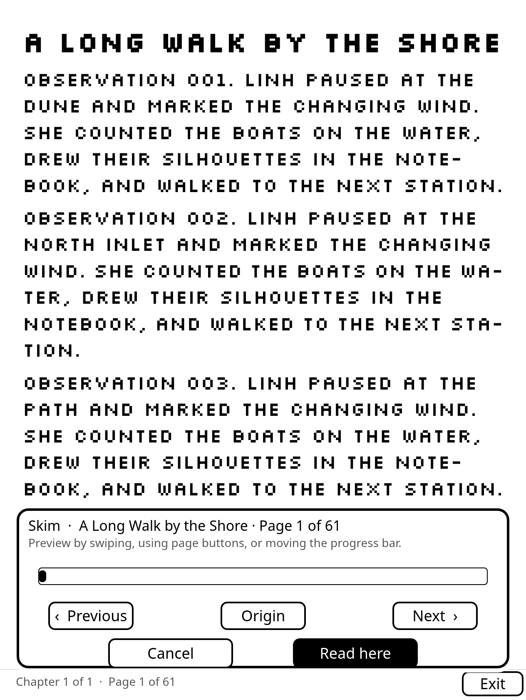
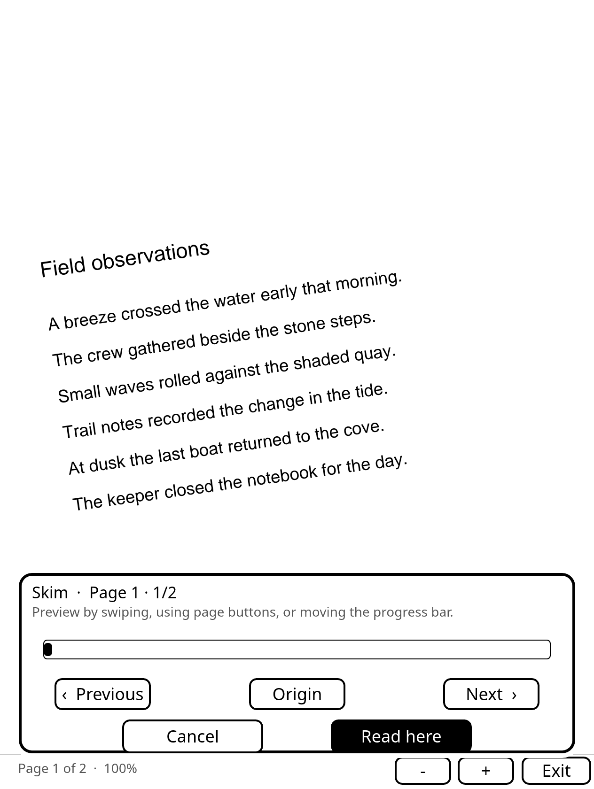

# Skim navigation

Skim previews a reading position without leaving the current EPUB or fixed-page document. It opens from **Navigation › Skim**, the configured footer hold, or a gesture bound to **Skim**. Page buttons and the progress bar move the preview; **Origin** restores the entry position; **Cancel** returns there without adding history; **Read here** keeps the preview and adds the entry position once to the return history. The fixed-page footer's **Exit** remains visible and works while Skim is open.

EPUB progress uses the existing weighted chapter progress; preview navigation uses the normal paced page-turn queue. PDF and other fixed-layout documents use physical-page progress and preserve the original scan point when returning to the start. Cancel does not change the reading history. Committing a changed location creates one return entry, which **Previous location** can restore.

In a fixed-page document, Skim also offers **Marks**. Turn it on to browse
successive pages with saved bookmarks or highlights using horizontal swipes
or the physical page keys. Turning it off restores the exact position where
the mode was enabled; **Cancel** still restores the position where Skim was
opened, while **Read here** commits the preview using the usual history rule.
The mode is temporary and does not change normal page-key behavior outside
Skim. Explicit page, chapter and progress controls still work within the
overlay. Invalid fixed-document bookmarks and saved pages outside the book are
skipped. The original KOReader mode is offered for fixed-page documents and
[browses saved marks by swipe](https://github.com/koreader/koreader/blob/9192014d8bd82a91dc1012473be0f238dedfdb54/frontend/apps/reader/modules/readerpaging.lua#L294-L302)
and [restores its entry position when disabled](https://github.com/koreader/koreader/blob/9192014d8bd82a91dc1012473be0f238dedfdb54/frontend/apps/reader/modules/readerpaging.lua#L229-L245).
This Reader mode has not yet been validated in simulation or on Kindle.

The behavior is compared with the pinned KOReader `skimtowidget.lua`: [source state transitions](https://github.com/koreader/koreader/blob/v2026.07.1/frontend/ui/widget/skimtowidget.lua#L421-L506). Reader uses an explicit **Read here** and **Cancel** choice to make preview intent clear on e-ink; exact dismissal and dialog preferences remain part of the device comparison.

Six focused desktop tests cover EPUB preview and cancel, cancellation during queued turns, committing one return location after queued turns, progress-track dragging across multiple chapters, fixed-page scrub and cancel, and the always-available Exit control. Separate existing regressions cover footer activation and night pages. Captures are generated by the same Kindle UI renderer used by the desktop simulator. The ARMHF Reader candidate was installed and launched through the existing Launcher, and automated Kindle checks passed against real local EPUB and PDF documents for first frame, page change and resume. The Skim overlay’s touch and button interactions have not yet been verified on the physical panel.
