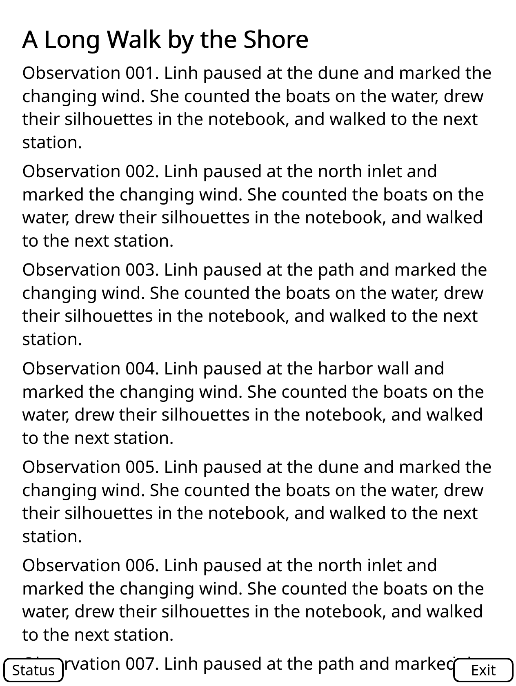
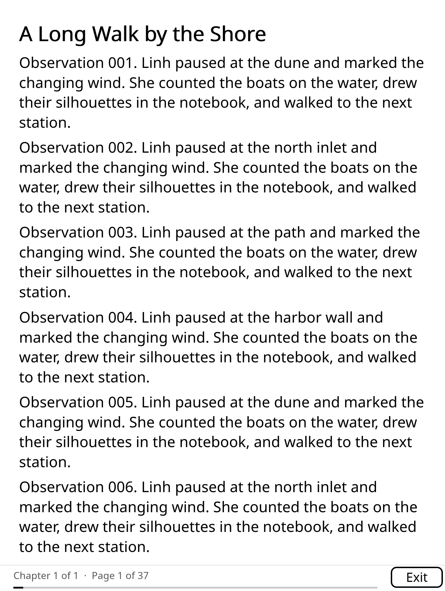

# Reading beneath the status bar

Open a reflowable book and choose **Controls › Reading status bar › Overlap status bar**. With overlap enabled, the book uses all 1,680 screen rows on an Oasis 3. Choose the minimal status view to read the last lines without a status strip. **Status** brings back the footer over the current page. **Exit** remains available in the lower right. A visible footer receives taps before the text beneath it. With the footer hidden, the exposed text supports selection, links and annotations.

The setting is saved across books. Enabling or disabling overlap lays out the current chapter around its saved source anchor. Showing the footer, cycling its contents or hiding it keeps the current pagination and position. Facing pages and continuous scrolling use the same height. The default reserves 74 pixels for status and Exit.

| Footer hidden | Footer shown over the same page |
| --- | --- |
|  |  |

## KOReader reference

KOReader's status settings offer a choice to reclaim the height of a hidden footer. In CREngine documents its margin handler adds the footer's height to the bottom margin when space is reserved. Enabling overlap removes that extra margin. Showing status can then temporarily obscure the last lines. [Status behavior description](https://github.com/koreader/koreader/blob/9192014d8bd82a91dc1012473be0f238dedfdb54/frontend/apps/reader/modules/readerfooter.lua#L765-L774) · [Reflow geometry](https://github.com/koreader/koreader/blob/9192014d8bd82a91dc1012473be0f238dedfdb54/frontend/apps/reader/modules/readertypeset.lua#L541-L553)

## Verification

The Mac workflow opened two original EPUBs, selected a word on actual ink in the additional 74 rows, revealed the footer through its on-page control, exited and reopened the book at the same source position. All 75,776 unoccluded pixels in the added band matched the underlying page. The hidden controls were independently verified as visible in the rendered framebuffer. Both screenshots use an authored fixture.

| Original | Spine item | Reserved / full-height chapter pages | Newly visible nonwhite pixels on tested page |
| --- | ---: | ---: | ---: |
| 035 | 12 | 19 / 18 | 289 |
| 042 | 15 | 33 / 30 | 6,329 |

The same workflow tests failure to save the setting, the footer tap lock, continuous scrolling and a two-page spread. The installed KOReader script independently aligns a private source passage, measures the change in pagination and verifies restoration of the original frame. Its controlled 74-pixel footer allows comparison with Reader's physical geometry. [Reader integration tests](../src/app/reading_footer/overlap_tests.rs) · [KOReader comparison](../scripts/koreader-status-overlap-check.lua)

```sh
READER_OVERLAP_HIDDEN_IMAGE="$PWD/hidden.png" \
READER_OVERLAP_VISIBLE_IMAGE="$PWD/shown.png" \
cargo test --locked --lib reading_footer::overlap_tests
```
