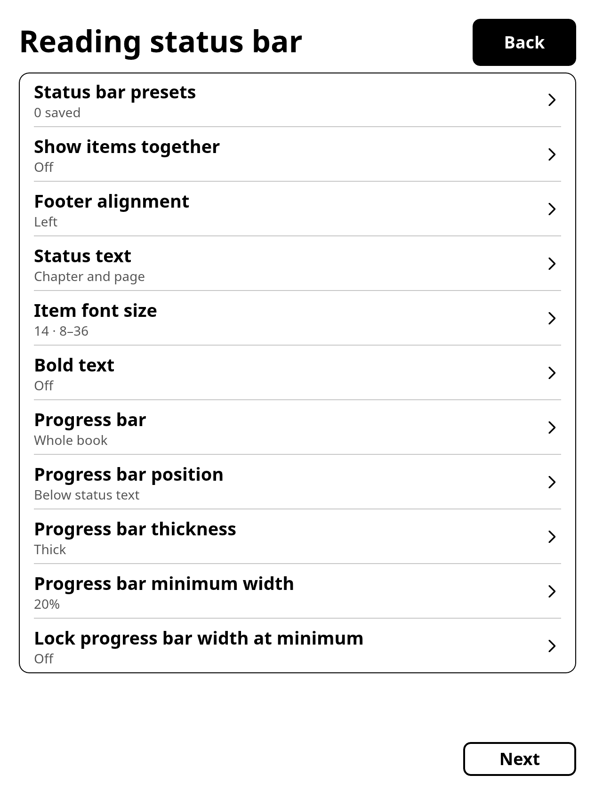
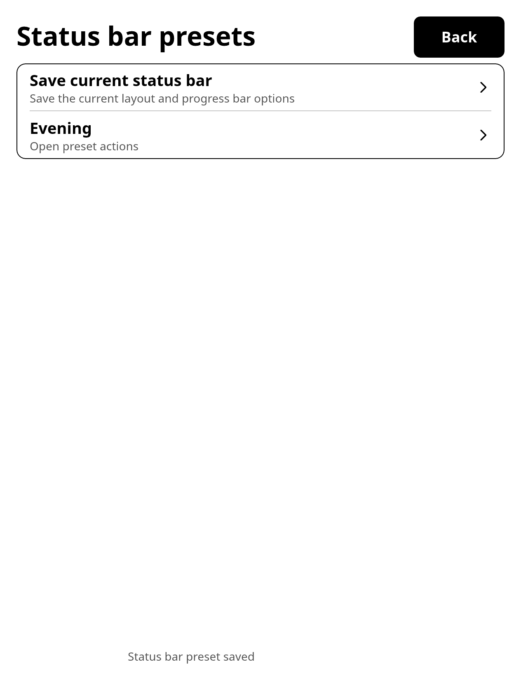
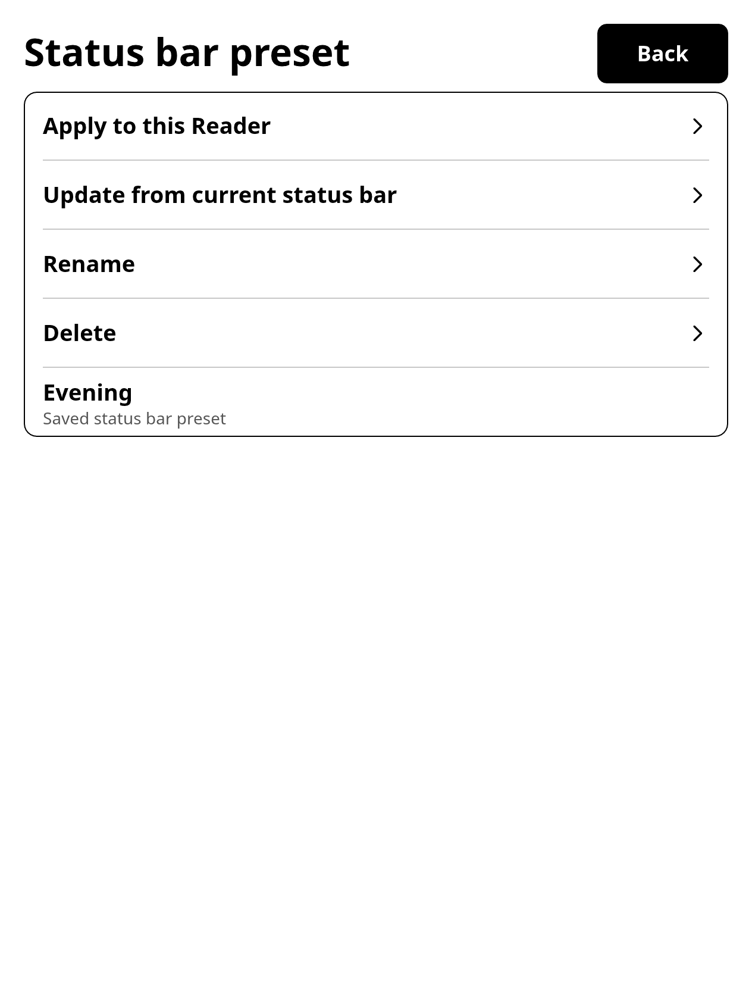

# Status bar presets

Reader can save, apply, update, rename, and delete named footer layouts from
**Reading controls → Reading status bar → Status bar presets**. A preset stores
the current status text mode, visible metrics and ordering, progress-track
layout, footer typography, container height and margin, alignment, separator
choices, custom text and repetition count, top header, and related footer
interactions. Applying one preserves unrelated preferences such as
physical-button inversion, night mode, text settings, and touch behavior.

Deleting asks for confirmation. Names are limited to 48 characters, are unique
without regard to case, and can contain at most 16 presets. Reader stores them
in `reader/data/status-bar-presets.json` with bounded reads and atomic writes.

## KOReader comparison

Pinned KOReader adds its dynamic **Status bar presets** submenu in
[`readerfooter.lua`](https://github.com/koreader/koreader/blob/9192014d8bd82a91dc1012473be0f238dedfdb54/frontend/apps/reader/modules/readerfooter.lua#L1792-L1796).
Its snapshot copies the footer settings and mode in
[`buildPreset`](https://github.com/koreader/koreader/blob/9192014d8bd82a91dc1012473be0f238dedfdb54/frontend/apps/reader/modules/readerfooter.lua#L2021-L2033);
the shared preset manager supplies create, load, update, rename, and delete
operations in [`presets.lua`](https://github.com/koreader/koreader/blob/9192014d8bd82a91dc1012473be0f238dedfdb54/frontend/ui/presets.lua#L171-L277).

Reader implements those named-preset operations for its native footer options
and saves custom footer text with each preset. It does not reproduce KOReader's
special fallback from an Off mode to Page Progress when saving a preset. Device
appearance and foreground operation remain to be checked on the Oasis.

The Mac unit and application workflow tests cover create, apply, update, rename,
delete, persistence across reopening, and preservation of unrelated settings.
The simulator captures show the settings entry, empty and populated lists,
preset actions, and delete confirmation.
