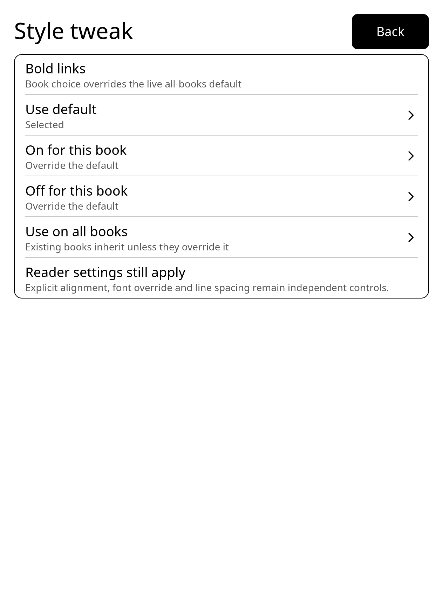
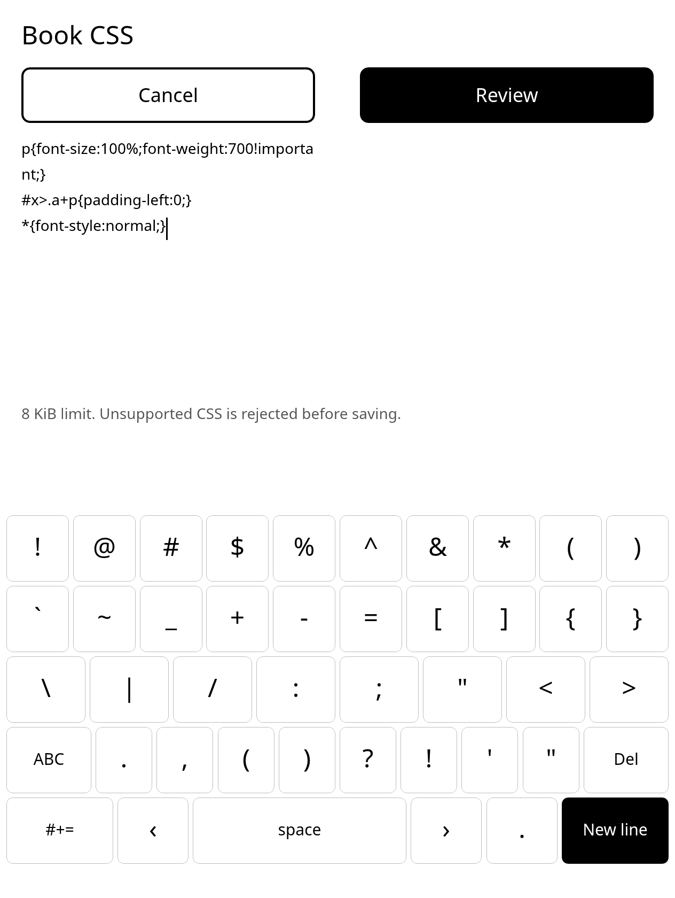
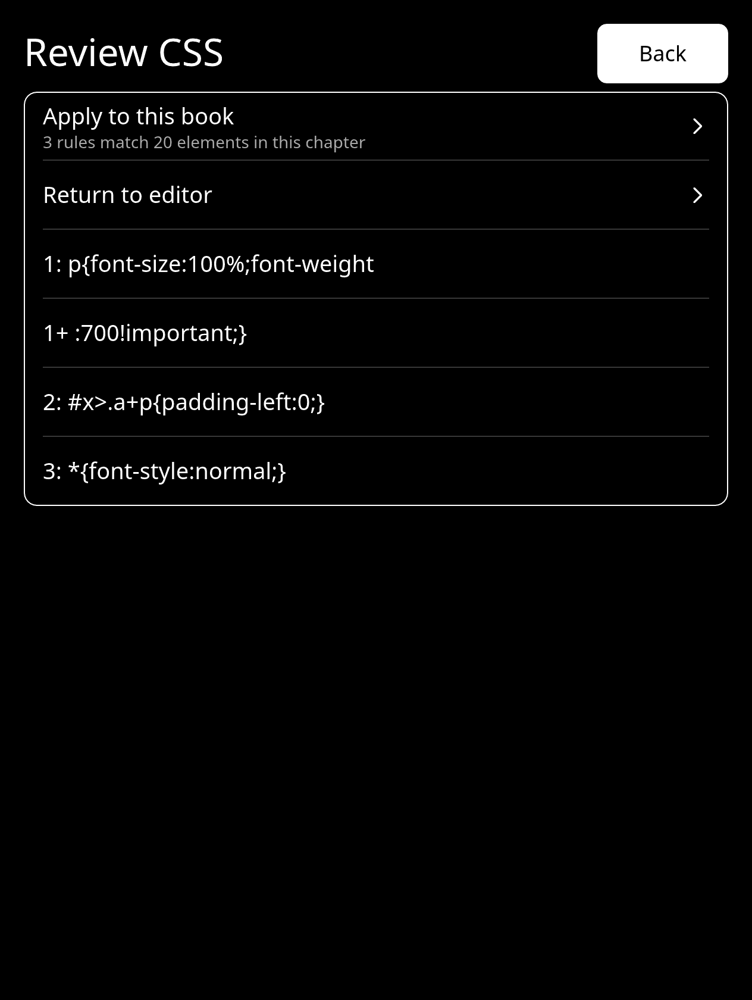

# User style tweaks

Open **Settings → Style tweaks** from the upper reading toolbar, or
**Text → Rendering → Style tweaks → Open** from the lower toolbar. These controls
apply to native reflowable books. Fixed-page PDF/image controls remain separate.

Each preset offers **Use default**, **On for this book**, and **Off for this
book**. **Use on all books** changes a live default: existing books inherit it
unless they have an explicit override. This differs from Document Defaults,
which saves typography for previously unseen books. Typography profiles also
remain independent of styles; applying a profile does not replace custom CSS.

**In-page EPUB footnotes** lays out eligible publisher-marked notes at the
bottom of the page. Find it and the independent footnote size settings under
**Style tweaks** while an EPUB is open.
[Footnote settings and layout comparison](in-page-footnotes.md)

The master switch disables all tweaks for the current book while retaining its
choices and CSS. Conflicting choices, such as left and justified paragraph
alignment, are resolved when selected. Unknown preset IDs are preserved and
reported as unavailable rather than replaced with another choice.

## Supported presets

The shipped rules are authored for Reader's implemented properties. They are not
a copy of KOReader's stylesheet catalog.

| Area | Controls |
| --- | --- |
| Paragraphs | No indentation, em indentation, flush first paragraph, left or justified alignment. |
| Headings | Center headings; start major headings on a new page. |
| Space and pagination | Remove horizontal or vertical padding; ignore authored forced breaks; protect widows and orphans. Implicit spine/chapter boundaries remain. |
| Links | Underline on/off; bold links. |
| Images and tables | Fit images to text width with automatic aspect height; visible table borders. Very tall images still fit the viewport. |
| Fonts | Inherit reading font sizes/family; preserve monospace code elements when inheriting the reading family. |

Explicit reader-wide alignment and font override still control the final text
renderer, and user line spacing adjusts the selected publisher line height.
Scoped CSS does not silently change those settings.

## Book-specific CSS

**Edit book CSS** opens a multiline editor with the shared alphabet and symbol
keyboards. Braces, colon, semicolon, ID/class symbols, combinators, percentages
and exclamation are available. **New line** inserts a line break; physical page
buttons scroll the editor. Cancel leaves the saved CSS unchanged.

Alternatively, copy UTF-8 `.css` files to `reader/data/style-tweaks` and select
**Import book CSS**. The importer reads regular files directly in that directory,
with at most 64 files listed. It saves a book-specific copy; the original file is
unchanged. Directory trees and globally reusable file catalogs are outside this
first implementation.

**Review** shows the CSS and the number of matching elements in the current
chapter. Zero matches are reported explicitly. This is a code review, not a
rendered-page preview. **Apply to this book** first prepares the replacement
layout/frame at the current source anchor, saves the configuration atomically,
and then shows the page. A new nonempty snippet becomes enabled. Editing a
disabled snippet retains its disabled state. Emptying it removes only that
snippet; **Clear book CSS** also has an explicit confirmation.

Unsupported syntax, properties, selectors and values produce a line/column
diagnostic before saving. A rejected change leaves the current page and saved
configuration intact. The editor/review draft remains available after a failed
layout or write.

[Review CSS in dark mode](screenshots/style-css-review-dark.png)

### Landscape layout

**Text → Rendering** keeps the base stylesheet and Publisher CSS controls
within the screen with large controls and Night pages enabled. The style
list, preset, review, and clear screens follow the reading viewport.
Rotating a list keeps the span containing its first visible item.

The CSS editor keeps its draft, caret, and first visible line when the
viewport changes. It fits ten lines in portrait and four in landscape above
the shared keyboard. Review and Cancel use the same bounds for drawing and
touch. Applying a change reopens the same source passage with the new layout.
Pinned KOReader similarly sizes its multiline input above the keyboard and
updates the reading position after applying base, embedded, or user CSS.
[Stock input sizing](https://github.com/koreader/koreader/blob/9192014d8bd82a91dc1012473be0f238dedfdb54/frontend/ui/widget/inputdialog.lua#L305-L328) · [Stock CSS apply](https://github.com/koreader/koreader/blob/9192014d8bd82a91dc1012473be0f238dedfdb54/frontend/apps/reader/modules/readertypeset.lua#L352-L365) · [Stock book CSS editor](https://github.com/koreader/koreader/blob/9192014d8bd82a91dc1012473be0f238dedfdb54/frontend/apps/reader/modules/readerstyletweak.lua#L1165-L1215)

Run `cargo test --locked --lib styles_viewport` for the Mac simulation.
The tests use authored material to check a staged rollback, real keyboard
entry, review return, the visible result of Apply, Cancel, and reopening.
[Rendering controls](screenshots/landscape-publisher-styles.png) · [Book CSS editor](screenshots/landscape-book-css-editor.png)

## Cascade and limits

User normal rules precede author normal rules. User `!important` declarations
outrank author `!important`, including inline author rules. Within an origin and
importance level, inline author priority, selector specificity and source order
are retained. An inherited important value does not protect a child from its own
declarations. Presets are ordered deterministically by priority and identifier;
book CSS comes last, without bypassing specificity.

The user layer remains enabled independently of **Publisher CSS**. Supported
properties have computed `inherit`, `initial` and `unset` behavior where exposed
by the parser. This also makes formerly ignored author font reset declarations
effective. `revert`/`revert-layer` are rejected in strict user input until origin
rollback is implemented.

| Input | Bound or support |
| --- | --- |
| Book snippet/imported file | 8 KiB UTF-8. |
| Effective combined user CSS | 64 KiB, 128 rules, 32 source declarations per rule. |
| Selectors | Type, universal, class, ID, descendant, child, adjacent sibling, `[href]`, link/any-link, first-child and first-of-type. 128 bytes/selector, 8 steps, 24 selectors/rule. |
| Supported properties | Existing reflow typography, padding/indentation, breaks/widows/orphans, simple-table borders/spacing and supported image/table dimensions. |
| Unsupported | Publisher block margins, CSS display/visibility, floats/clear, general positioned/block layout, arbitrary attribute selectors, `:not`, nth-child, pseudo content, text colors, vendor hints and at-rules including import/font-face. |

Unsupported user CSS is rejected as a complete proposed change, rather than
silently applying a partial sheet. Publisher parsing remains forgiving. The
separate user budget does not evict publisher rules. CSS cannot fetch remote
assets or add fonts; named families refer to available reading fonts.

The font-independent immutable session snapshot carries a content digest through
chapter navigation, facing pages and exports. The extracted footnote popup has
an independent stylesheet context, following the pinned reader's popup behavior.
No tweak rewrites book files, source text, anchors, fragments or mark selections.

## Persistence and source comparison

The non-secret `reader/data/style-tweaks.json` store uses version 1, with global
preset IDs and per-edition overrides/master/custom text in one atomic file.
It has a 4 MiB total limit, 1024 saved book entries and 128 IDs per selection map.
Unreadable, symlinked, oversized or unknown-version files are preserved read-only.
Reading-data backups include this file as a separately validated component and
reload it after restore. CSS files from the import directory are not themselves
embedded in backups; applied book-specific text is retained in the store.

Reference behavior was checked against KOReader
`9192014d8bd82a91dc1012473be0f238dedfdb54`, base
`6e4bc81af4e04f78d81677a323a780a71b29702a` and CREngine
`b32a88ffbbf505cf2ea5208c1a49002d70d3609f`:

- `readerstyletweak.lua:258–291,394–470,735–824,1185–1222`: ordering, live
  defaults, tri-state book choices, master switch and book CSS editing lifecycle.
- `readertypeset.lua:352–355`, base `cre.cpp:1760–1777`: rebuild stylesheet and
  restore position.
- CRE `lvtinydom.cpp:19187–19200`, `lvstsheet.cpp:7504–7511`,
  `lvstyles.h:298–311` and `include/lvtinydom.h:1488–1505`: origin order and
  important declarations overriding author inline important rules.

This is a supported subset, not full CRE CSS compatibility. Source tests, input
workflows, real-file checks and screenshot receipts are retained under the
private `build/parity-review/style-tweak-evidence` folder. Native compilation and
Kindle acceptance follow the integrated candidate; this slice makes no physical
display or release claim.

## Desktop verification

The exact corrected source passed **739 library + 14 package + 4 layout tests**;
60 opt-in cases were ignored. Fifteen focused cases cover origin/importance,
computed resets, a property-effect assertion for each of the 18 presets, strict
input diagnostics/caps, live inheritance, failed layout/save rollback, real
keyboard input and lifecycle, profiles/defaults independence, import and backup
restore. Six UI frames were reviewed for the controls and editor.

Three unchanged owner editions—EPUB, AZW3 and MOBI—each changed visible text ink,
retained the same selected source quote, reopened the same passage, and restored
the byte-identical baseline frame after styles were disabled. These are focused
reading workflows, not a full-corpus/all-page raster comparison.

The original EPUB test found a missing metadata checkpoint after accepting a
prepared style layout. The normal position checkpoint now runs after the
successful store/frame commit, matching typography changes. All three original
workflows and the complete suite were rerun after that correction. Earlier
receipts remain separately identified as preceding the correction.

The subsequent default-style replay at `4649b6ca` passes all 48 cached original
reflow editions: 1,509 sections, 28,075 painted frames, 28,065 exact page anchors
and all 33,405 fragment destinations. All 26,592,055 tested non-whitespace source
characters map to layout, with original hashes unchanged. Every recorded spine
result matches the earlier `b8ab53a6` baseline. The same 134 undeclared private-use
glyphs, damaged-book recovery, missing-source-image placeholders and empty
sections remain documented limitations. This replay begins with an empty user
style store; the separate focused workflows above actually apply styles.

