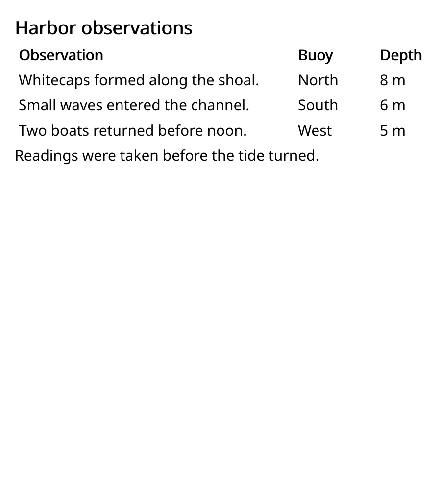
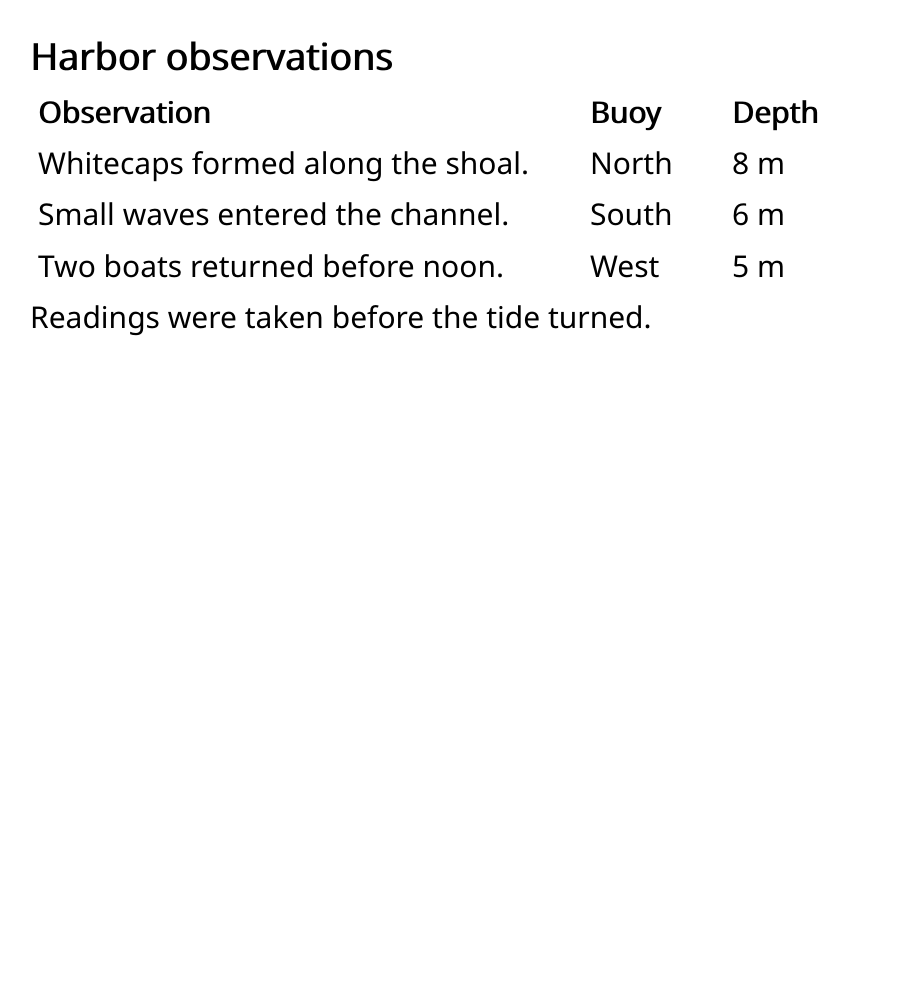

# Publisher column widths

Reader uses a publisher's header and cell widths when laying out horizontal EPUB tables. A row with longer prose can now share a line with narrower labels and numbers. The column boundaries apply to the painted text, word selection and link targets. A collapsed table ignores its own padding while preserving the padding inside its cells.

| Publisher’s column widths | Same source with automatic widths |
| --- | --- |
|  |  |

The authored 900 × 1000 px fixture uses 68%, 20% and 12% header widths. The test searches and taps the first word in three neighboring cells, removes the outer padding and compares their exact rectangles. A second fixture verifies that an unbroken word spanning an italic boundary stays together when measuring its column. [Authored table](../tests/fixtures/column-widths.xhtml) · [Layout checks](../src/parley_layout/publisher_padding_tests.rs)

## Reference behavior

KOReader defaults to Book rendering. We also tested its Web mode separately on the Oasis 3. At the same five positions in an original EPUB, Book produced identical selection starts for 60%, 80%, 95% and 100% table widths. Web produced different positions at each width. Both modes honor explicit widths on the individual columns. [KOReader reading controls](https://github.com/koreader/koreader/blob/v2026.07.1/frontend/apps/reader/modules/readertypeset.lua#L385-L438) · [KOReader default mode](https://github.com/koreader/koreader/blob/v2026.07.1/frontend/ui/data/creoptions.lua#L317-L328)

CREngine reads computed widths from cells, discards a collapsed table’s outside padding and apportions remaining space among the columns. It measures the widest unbroken word and the width of each cell without soft wrapping. Its whole-table width decision has a separate set of conditions. In the pinned C++ source the relative-unit predicate receives the width’s **type**. The implicit integer constructor converts that argument to a screen-pixel length before the predicate tests it. Book enables CSS widths and disables absolute width units. Web enables both flags. The independent Book/Web experiment above tests the observable effect. [Cell widths](https://github.com/koreader/crengine/blob/b32a88ffbbf505cf2ea5208c1a49002d70d3609f/crengine/src/lvrend.cpp#L480-L505) · [Content widths and collapsed borders](https://github.com/koreader/crengine/blob/b32a88ffbbf505cf2ea5208c1a49002d70d3609f/crengine/src/lvrend.cpp#L929-L1081) · [Column allocation](https://github.com/koreader/crengine/blob/b32a88ffbbf505cf2ea5208c1a49002d70d3609f/crengine/src/lvrend.cpp#L1092-L1375) · [Table width predicate](https://github.com/koreader/crengine/blob/b32a88ffbbf505cf2ea5208c1a49002d70d3609f/crengine/src/lvrend.cpp#L7909-L7945) · [Length constructor](https://github.com/koreader/crengine/blob/b32a88ffbbf505cf2ea5208c1a49002d70d3609f/crengine/include/cssdef.h#L496-L512)

## Original EPUB comparison

One original seven-row, three-column table specifies equal 33% header widths, 10 px cell padding, a 95% table width, collapsed borders and 0.5 em of table padding. The same five unique source passages were resolved under each condition. Their first-word rectangles were inspected at 1264 × 1606 pixels with 54 px margins and 42 px base type. These coordinates use the left screen edge as zero.

| Condition | First five selection starts in px |
| --- | --- |
| Previous Reader | 464, 837, 464, 837, 464 |
| Updated Reader | 450, 835, 450, 835, 450 |
| Installed KOReader in Book mode | 451, 831, 450, 831, 450 |
| Updated Reader with cell padding removed | 440, 825, 440, 825, 440 |
| KOReader with cell padding removed | 441, 825, 440, 825, 441 |
| Updated Reader with automatic column widths | 376, 816, 376, 816, 376 |
| KOReader with automatic column widths | 371, 809, 370, 809, 370 |

Turning off the table’s own padding leaves all five positions unchanged in both readers. Turning off the publisher’s 1 px borders in KOReader shifts all five starts left by 1 px. With the publisher’s original declarations, the largest difference between the two renderers is 4 px. The automatic-width control shows a difference of up to 7 px. [Installed KOReader comparison script](../scripts/koreader-table-widths.lua)

Reader measures text for simple publisher-styled tables up to 32 columns, with a chapter budget of 2,048 text blocks and 256 KiB. Measurements preserve original Unicode and inline font changes. Long words remain whole for the purpose of sizing a column and can still wrap at the page edge during final rendering. Larger grids, tables with spanning columns, illustrations, nested tables and explicit column groups continue through their existing rendering paths. Painting CSS table borders and optional Web-mode whole-table sizing remain separate capabilities. [Rust column allocation](../src/table_widths.rs)

## Verification

The Mac ran 504 library tests with zero failures. The original-file comparison is a separate opt-in test. On the Oasis 3, the same Rust source passed eight authored checks and recovered the exact Mac coordinates for all five original passages in eight layouts. Search resolved the same start and end byte offsets throughout. Tapping each selected word resolved inside the same source range, including words after an opening quotation mark. The test process used 12,576 KiB peak resident memory and took 7.2 seconds for all eight original-file comparisons; this is a headless comparison runtime. The original document, installed Reader, Browser session and existing reading data retained their checksums. The temporary test folder was removed.

The installed KOReader comparison reused its saved XPointers across 14 combinations of table styling and rendering mode, then recovered the original page, caret and selection rectangles. A second original EPUB retained 186 of 186 checked cell anchors across eight tables, 89 rows and 17 pages on the Mac. Its eight column-spanning and 16 row-spanning cells retained their expected positions. An intentionally empty or nonword cell had no selectable word. All 17 page images were restored after navigation.
