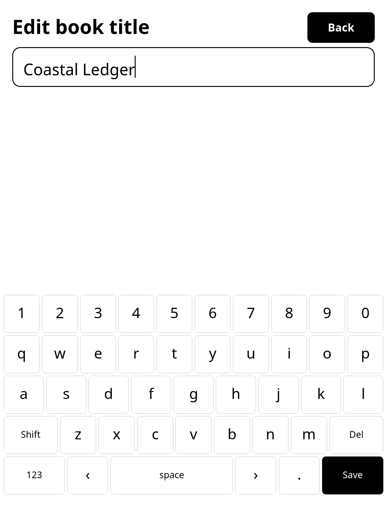
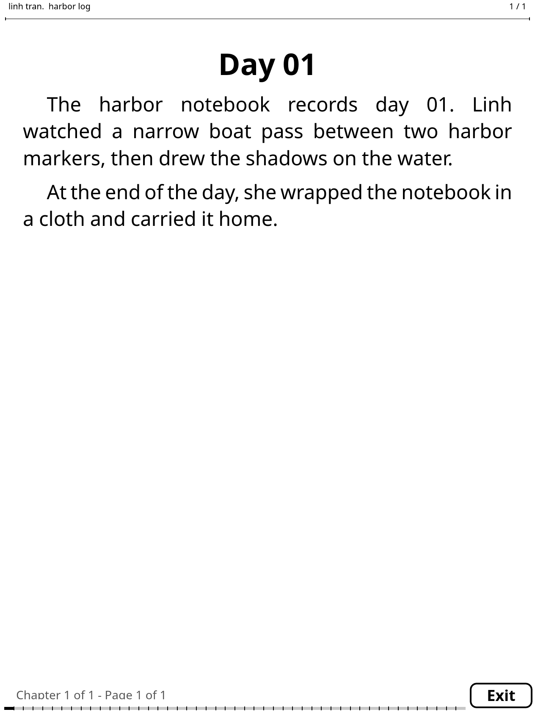

# Optional top status header

The optional status header shows reading information above a reflowable book
in page-turn mode. It is off by default. Enable it for the current book from
the lower **Screen** panel. The upper **Controls → Reading status bar** changes
what it shows. [Per-book controls and new-book default](per-book-top-status-header.md)

Reader reserves a 48 px strip, keeps the source position when the header is
enabled or disabled, and clips the page so the bitmap leaves the header
visible. The header hides during continuous scroll and returns in page-turn
mode. The bottom footer keeps its default chapter and page caption, marked
progress track, and Exit button.

When enabled, the header shows the author and title at left and the time,
current page, total pages, and battery icon at right by default. When author
and title compete for space, odd pages show the author and even pages show the
title. Reader truncates long text at a grapheme boundary.

While reading a reflowable book, open the upper **Library → Book details**
menu and choose **Title** or **Author**. Save the edit and return to the page
to see the new value immediately. **Restore book metadata** removes the
Reader override for that field. Reader then uses a readable KOReader custom
metadata sidecar, followed by the book's original metadata. Reader stores
these edits in its per-book reading state for Book details and the header.
Title and author are the editable fields. The EPUB and imported KOReader sidecar remain byte-for-byte intact
in the desktop workflow. Reader reloads that sidecar when opening the book,
enabling its header, or opening Book details for the active book.

The current page, total pages, and progress percentage can each be displayed
independently. The progress track distinguishes the read and unread portions
by line weight. The **Header chapter marks** control toggles boundary notches
independently of the track. Marker positions use the active contents and depth
settings. [Page labels and screen counts](top-header-page-labels.md)

**Header battery status** offers **Battery icon** and **Battery percentage**.
Tap the active choice to turn it off. Both displays indicate charging.
**Header font size** ranges from 8 to 36 px with 20 px as the normal size and
14 px as the Reset value. **Refresh header automatically** refreshes changing
fields at the minute boundary. It pauses through sleep or continuous scroll
and skips a battery-only redraw when the reading is unchanged. The clock uses
the local time zone and the shared 12- or 24-hour preference.
[Font picker](top-header-font-picker.md) · [Clock details](device-local-time.md)

## Desktop evidence

The native KOReader replay uses pin
`9192014d8bd82a91dc1012473be0f238dedfdb54`. Its real alternate-header Lua
module and CRE renderer verify independently selectable page fields, publisher
labels, chapter-mark painting, battery menu choices, a charging-triggered
redraw, refresh scheduling, scroll suppression, and immediate title and author
repaints on `BookMetadataChanged`. Run the script from the pinned native
runtime. Pass the authored `many-chapters.epub` fixture, a temporary CRE cache
directory, `NotoSans-Regular.ttf`, the output PNG path, and the authored
`nonlinear-note-flows.epub` fixture in that order. A sixth argument saves a
second frame after editing the title and author. The reference frames use the
authored 48-page EPUB and a controlled 37% battery reading. The publisher labels and charge state
are provided to the stock module by the replay.
[Stock header source](https://github.com/koreader/koreader/blob/9192014d8bd82a91dc1012473be0f238dedfdb54/frontend/apps/reader/modules/readercoptlistener.lua)
· [Stock replay](../scripts/koreader-engine-header-check.lua)

Reader’s native tests use bundled test fonts for the fixture and exercise
menu taps, custom metadata, the formatting of
regular and supplemental page values, track marks and weights, battery
painting, preserving the source position, and exact framebuffer equality
after restoring the default footer-only view.

The Book details test uses the real touchscreen keyboard to change both
fields and the Restore control to remove just the title override. It compares
every pixel below the header and confirms the same reading position and
footer after editing. It saves, reopens, and checks that editing has preserved
the EPUB and imported sidecar.

Reader uses the Kindle kit’s main battery reading and detects charging
transitions at the scheduled refresh. KOReader receives `charging` and
`notCharging` from the Kindle’s `com.lab126.powerd` LIPC event stream and
dispatches them to the header. The pinned Primitive toolkit subscribes to
screensaver events on that stream. Immediate charging redraws require the
toolkit to expose both charge transitions separately from USB storage mode.
Auxiliary-battery data and Kindle refresh verification are also pending.
[KOReader Kindle event subscription](https://github.com/koreader/koreader-base/blob/6e4bc81af4e04f78d81677a323a780a71b29702a/input/input-kindle.h#L143-L147)
· [Primitive toolkit power subscription](https://github.com/PrimitiveOS/kindle-primtitive-tools/blob/86e593eb865b56615108406d8a7bf7bd20a38c6d/crates/primitive-device/src/lib.rs#L876-L895)

**About the top status header** explains when the header appears and how to
set it for the book or by default. [About panel](top-header-about.md)
