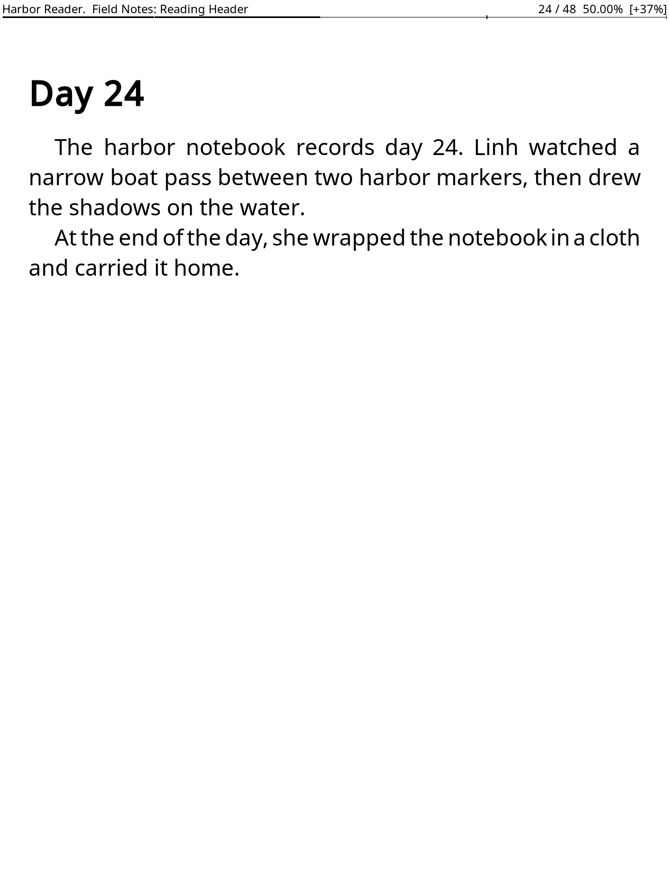
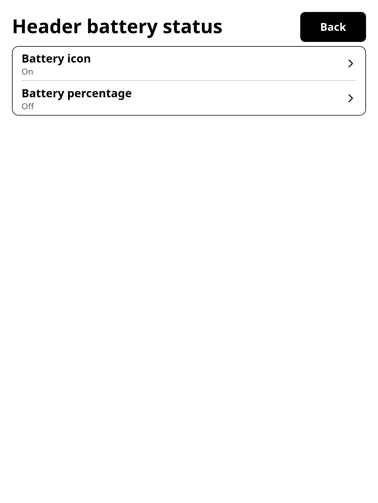
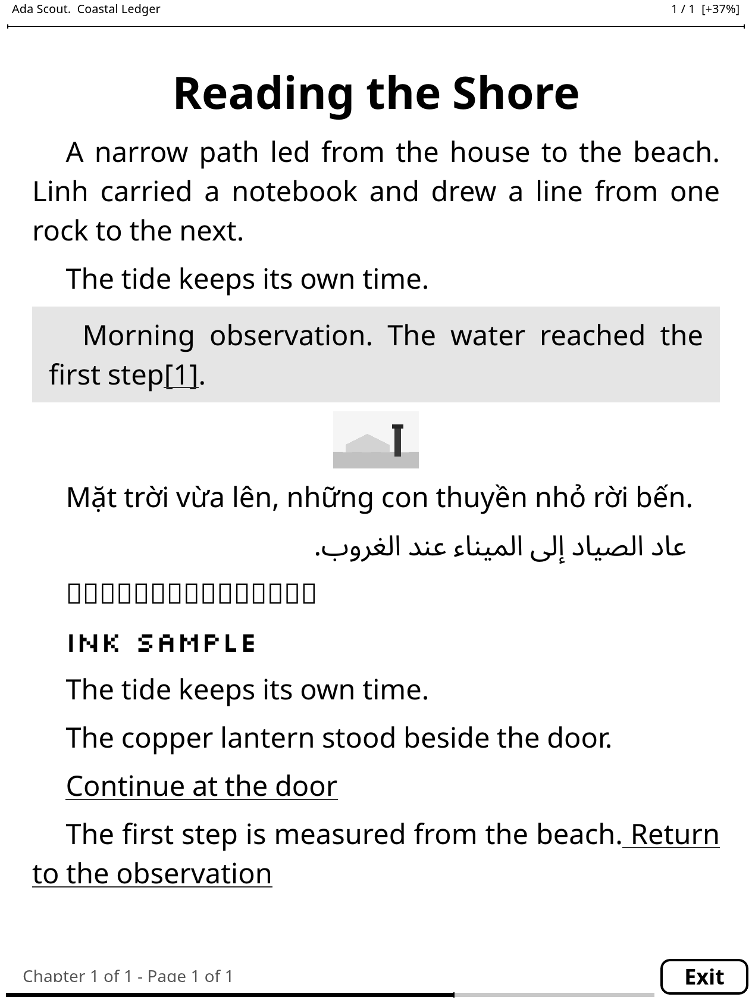

# Optional top status header

The optional status header shows reading information above a reflowable book
in page-turn mode. It is off by default. Enable it for the current book from
the lower **Screen** panel. The upper **Controls → Reading status bar** changes
what it shows. [Per-book controls and new-book default](per-book-top-status-header.md)

Reader reserves a 48 px strip, keeps the source position when the header is
enabled or disabled, and clips the page so the bitmap leaves the header
visible. The header hides during continuous scroll and returns in page-turn
mode. The bottom footer keeps its default chapter and page caption, marked
progress track, and Exit button.

When enabled, the header shows the author and title at left and the time,
current page, total pages, and battery icon at right by default. When author
and title compete for space, odd pages show the author and even pages show the
title. Reader truncates long text at a grapheme boundary. A readable KOReader
custom metadata sidecar supplies its title and author when Reader opens the
book or enables its header. KOReader also responds to metadata edits while
a book is open.

The current page, total pages, and progress percentage can each be displayed
independently. The progress track distinguishes the read and unread portions
by line weight. The **Header chapter marks** control toggles boundary notches
independently of the track. Marker positions use the active contents and depth
settings. [Page labels and screen counts](top-header-page-labels.md)

**Header battery status** offers **Battery icon** and **Battery percentage**.
Tap the active choice to turn it off. Both displays indicate charging.
**Header font size** ranges from 8 to 36 px with 20 px as the normal size and
14 px as the Reset value. **Refresh header automatically** refreshes changing
fields at the minute boundary. It pauses through sleep or continuous scroll
and skips a battery-only redraw when the reading is unchanged. The clock uses
the local time zone and the shared 12- or 24-hour preference.
[Font picker](top-header-font-picker.md) · [Clock details](device-local-time.md)

## Desktop evidence

The native KOReader replay uses pin
`9192014d8bd82a91dc1012473be0f238dedfdb54`. Its real alternate-header Lua
module and CRE renderer verify independently selectable page fields, publisher
labels, chapter-mark painting, battery menu choices, a charging-triggered
redraw, refresh scheduling,
and scroll suppression. Run the script from the pinned native runtime. Pass
the authored `many-chapters.epub` fixture, a temporary CRE cache directory,
`NotoSans-Regular.ttf`, the output PNG path, and the authored
`nonlinear-note-flows.epub` fixture in that order. The reference frame uses the authored 48-page EPUB
and a controlled 37% battery reading. The publisher labels and charge state
are provided to the stock module by the replay.
[Stock header source](https://github.com/koreader/koreader/blob/9192014d8bd82a91dc1012473be0f238dedfdb54/frontend/apps/reader/modules/readercoptlistener.lua)
· [Stock replay](../scripts/koreader-engine-header-check.lua)

Reader’s native tests use bundled test fonts for the fixture and exercise
menu taps, custom metadata, the formatting of
regular and supplemental page values, track marks and weights, battery
painting, preserving the source position, and exact framebuffer equality
after restoring the default footer-only view.

Reader uses the Kindle kit’s main battery reading and detects charging
transitions at the scheduled refresh. An immediate charge-event hook and
auxiliary-battery data are pending. The tested framebuffer uses Reader’s
typography and dimensions. Kindle refresh and battery behavior still need
hardware verification.

**About the top status header** explains when the header appears and how to
set it for the book or by default. [About panel](top-header-about.md)
