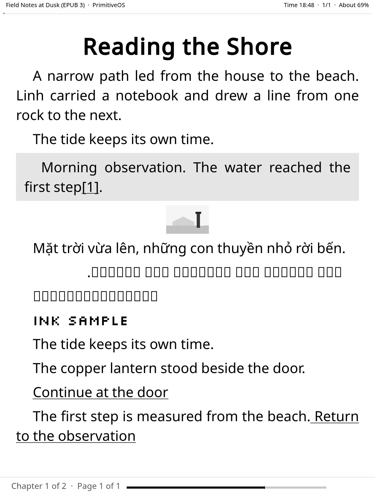
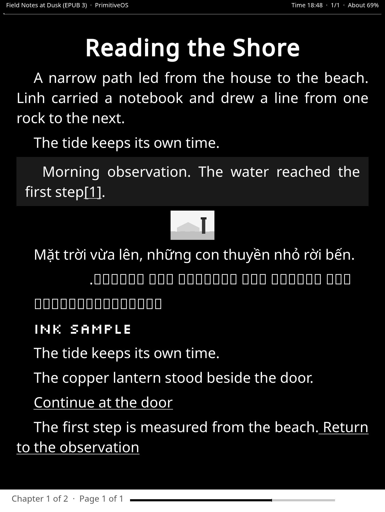

# Optional top status header

KOReader's CRE reader can draw a configurable status line at the top of a
reflowable document in page-turn mode. Reader now has the same reading
information in a separate, optional header. It is off by default. Enable it
for the current book from the lower **Screen** panel.
[Per-book controls and new-book default](per-book-top-status-header.md)
The upper **Controls → Reading status bar** configures the shared presentation. The pinned implementation
disables the header in continuous-scroll mode and refreshes it when the clock or
battery can change. [KOReader source](https://github.com/koreader/koreader/blob/9192014d8bd82a91dc1012473be0f238dedfdb54/frontend/apps/reader/modules/readercoptlistener.lua#L246-L319) · [Header options](https://github.com/koreader/koreader/blob/9192014d8bd82a91dc1012473be0f238dedfdb54/frontend/apps/reader/modules/readercoptlistener.lua#L372-L552)

Reader reserves a 48 px strip for the header, keeps the current source anchor
when it is enabled or disabled, and clips the page bitmap so its white margin
does not cover the status text. The header disappears in continuous scroll and
returns in page-turn mode. Chapter marks share the same progress boundaries as
the reading footer.

When enabled, Reader shows the title, author, local time, current and total page
numbers, chapter marks, and a battery icon by default. The progress percentage
is optional. Battery status cycles through Off, Icon, and Percentage; the icon
shows charging. Header text size ranges from 8 to 36 px, one step at a time,
with 20 px as the default. Automatic refresh runs at the minute boundary when
the clock or battery is visible, pauses during sleep and continuous scroll, and
only requests a battery redraw after its level or charging state changes.

## Desktop evidence

The simulator screenshots use the authored Field Notes EPUB and show the
header with the reading page and footer visible. Both light and night-page
rendering were checked.

Focused tests cover the default settings and persistence, bounded font and
battery choices, reflow from the current anchor, visible header pixels in the
simulator, continuous-scroll suppression and restoration in page mode, the
charging icon, and minute-boundary clock scheduling across sleep and wake.
Kindle visual and battery acceptance remain open.

Current and total page values use [stable labels](top-header-page-labels.md)
when enabled and resolved. The fallback is the current reflow section.
The [font picker](top-header-font-picker.md) includes a 14 px Reset choice.
Reader's 24-hour clock uses the Kindle time zone. [Clock details](device-local-time.md)

The KOReader **About alt status bar** information dialog is still a checklist
gap; the display and configuration behavior are implemented independently.
