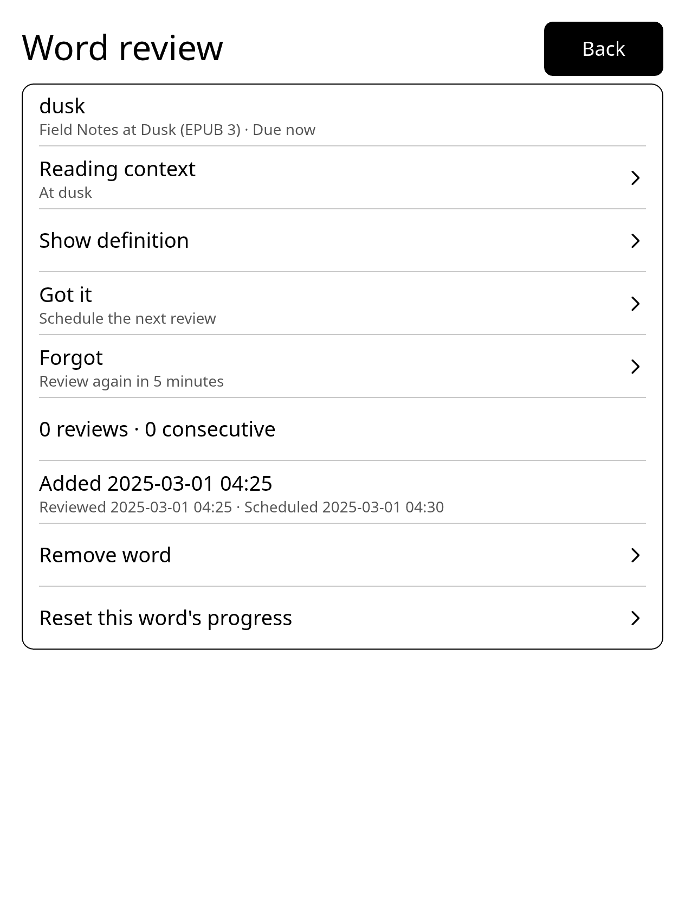
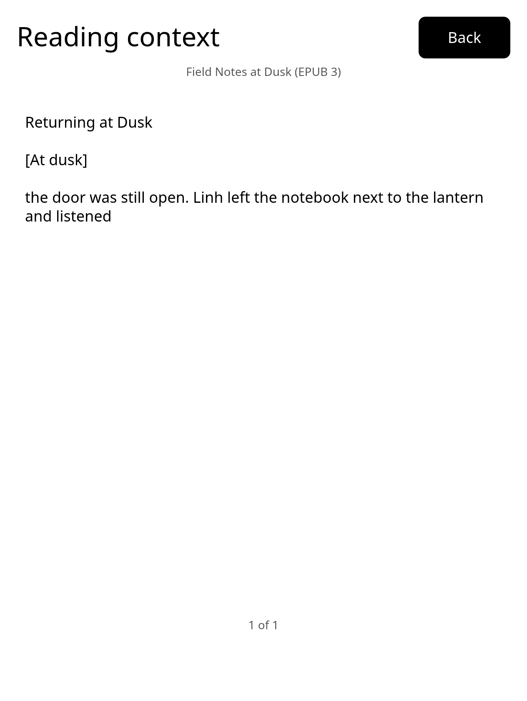

# Vocabulary review

Vocabulary keeps saved dictionary words with their source book, reading context and review progress. Open **Vocabulary** from the upper Search category. A word offers its definition, context, Got it, Forgot, Undo, removal and an individual progress reset. Returning from a definition keeps the word under review and the reading passage.

The reference is KOReader `9192014d8bd82a91dc1012473be0f238dedfdb54`, especially [`db.lua`](https://github.com/koreader/koreader/blob/9192014d8bd82a91dc1012473be0f238dedfdb54/plugins/vocabbuilder.koplugin/db.lua) and [`main.lua`](https://github.com/koreader/koreader/blob/9192014d8bd82a91dc1012473be0f238dedfdb54/plugins/vocabbuilder.koplugin/main.lua). Reader independently implements the observed behavior in Rust.

## Compared behavior

| Workflow | Reader behavior |
| --- | --- |
| Add a word | Manual saving is available in the dictionary overlay. Automatic capture is off initially and can be enabled in Review options. Context is on initially. |
| Look up a saved word | Existing progress stays intact until Got it, Forgot or Replace is chosen. Cancel leaves the record intact. Looking up the current review word, including nested dictionary lookup, does not schedule it again. |
| Context | Reflow source anchors identify the selected passage. PDF word boxes identify the selection in its text layer. Each side retains up to 15 Unicode word segments and 512 Unicode scalars. The complete retained context has its own readable view and physical page-button controls. |
| Review | Got it increases the review count and consecutive streak. Forgot reduces the review count to a minimum of zero and clears the streak. Each word retains its own in-memory undo snapshot. |
| Schedule | Consecutive successful reviews schedule 30 minutes, 12 hours, 1, 2, 4, 7 and 15 days, followed by 30 days doubled per success, capped at 1,920 days. Forgot schedules 5 minutes. |
| Replace | An explicitly replaced lookup updates the source and creation time, reduces the review count to a minimum of zero, clears the streak and schedules 5 minutes. Missing incoming context preserves previously saved context. |
| Filter | Review options select all scheduled words or due words. All words use ascending due order. Due-only uses descending due order. Book inclusion and a case-insensitive Unicode word search combine with that selection. |
| Remove or reset | A confirmation overlays the current screen. Removal clears the chosen word and its review history. An individual reset keeps the source and context and makes that word due. A full reset keeps every word and context. Cancel changes neither. |
| Lifecycle | Sleep and wake events continue through the modal routing to the Reader lifecycle handler. |

Dates from older saved-word lists remain unknown. Those words become available for review without a fabricated creation date. The previous 256-word truncation no longer applies. Lookup history and vocabulary share an atomic JSON save, bounded at 8 MiB. A failed save keeps both the prior in-memory state and the existing file.

To rename a vocabulary source, open **Review options › Filter by book** and
hold its title. Enter a nonempty replacement and tap **Save**. Reader updates
all saved words for that title and carries its Included or Excluded state to
the new name; review progress and reading context stay intact. A title already
used by another vocabulary source is rejected. **Back** cancels, and a failed
save leaves the editor open. This changes the vocabulary source label, not the
book file or its metadata. The new workflow awaits integrated testing. [Pinned
KOReader rename dialog](https://github.com/koreader/koreader/blob/9192014d8bd82a91dc1012473be0f238dedfdb54/plugins/vocabbuilder.koplugin/main.lua#L1795-L1830)

To move one saved word, open it and choose **Change source book**. Select an
existing title or choose **New book title** and type one. The change is saved
for that word alone; review counts, schedule, reading context and the book
filter remain intact. **Back** cancels. The previous review remains undoable
without restoring the old source. Unlike KOReader's separate title catalog,
Reader creates the new title when the word is assigned. This workflow awaits
integrated testing. [Pinned KOReader book assignment](https://github.com/koreader/koreader/blob/9192014d8bd82a91dc1012473be0f238dedfdb54/plugins/vocabbuilder.koplugin/main.lua#L1148-L1247)

## Acceptance evidence

The development tests cover schedule boundaries, long streaks, failed reviews, explicit replacement, per-word undo, due and source filters, 600-word legacy migration, atomic save failure, cancellation, confirmed reset scope, Unicode context bounds, normal touch controls and reading-position restoration. `scripts/compare-vocabulary-review.py` runs the pinned upstream Lua scheduling method to generate 2,720 independent transitions for the opt-in Rust comparison.

The original-document opt-in workflow uses cached owner-authorized EPUB and PDF inputs. It selects source text, saves the context, reviews and undoes, reopens the state and checks both the reading position and original file bytes. Private documents and their extracted text remain outside the repository.

The component passed **586 library, 14 package and four system tests** on the Mac, with 36 opt-in cases skipped in that suite. A separate vocabulary run passed all 12 cases, including both opt-in checks. The scheduling check matched all 2,720 upstream transitions. The original-document workflow passed on two EPUBs and two PDFs with unchanged source SHA-256 values and restored reading positions.

Five authored framebuffer captures cover the word list, review in both themes, full context and the dark removal confirmation. The review and context views below use the generated Field Notes fixture. The long-context regression verifies both physical page commands and swipe navigation, followed by the visible Back control.

Native execution remains pending while the Kindle is disconnected. SQLite database import/export and synchronization retain separate acceptance work.
