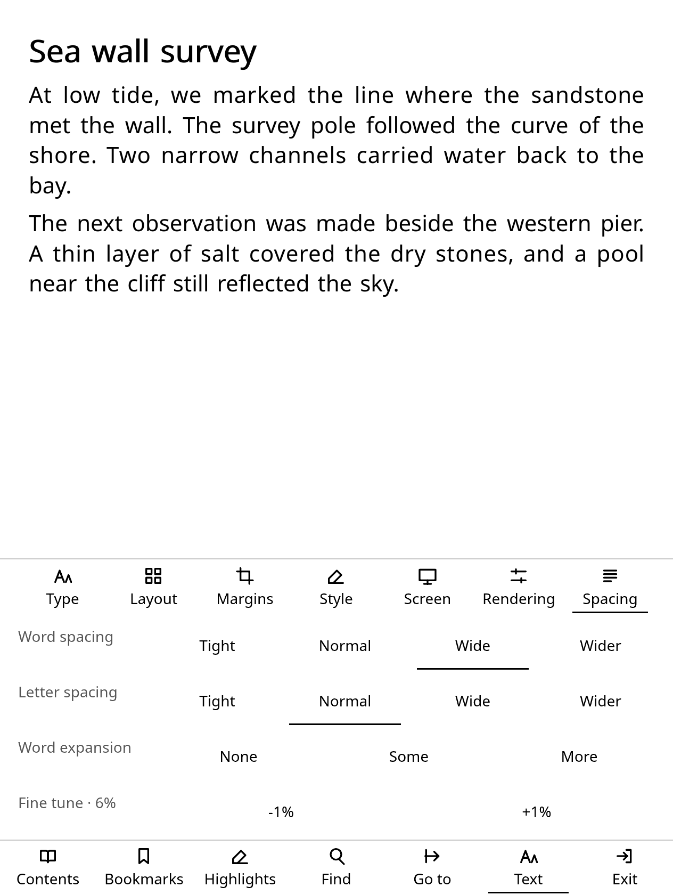

# Word expansion on justified pages

In an EPUB or reflowable Kindle book, open **Text › Spacing**. **Word expansion** offers None, Some and More at 0%, 5% and 15% of the current font size. Use **Fine tune** to choose any whole percentage from 0% to 20%. Reader stores the value in the current book or a named reading profile. Existing profiles use zero.

On a justified line with more than 5% unused width, eligible letters and digits receive a portion of the excess as tracking. Spaces receive the remaining width. Ordinary **Word spacing** and **Letter spacing** still control the line’s initial layout. Final lines keep their usual alignment. The renderer leaves joining scripts and ideographs at their original letter spacing, and applies a single adjustment at the edge of a shaped ligature. An adjusted word remains selectable at its rendered coordinates. [KOReader typography controls](https://github.com/koreader/koreader/blob/v2026.07.1/frontend/ui/data/creoptions.lua#L500-L568) · [CREngine’s justified-line calculation](https://github.com/koreader/crengine/blob/b32a88ffbbf505cf2ea5208c1a49002d70d3609f/crengine/src/lvtextfm.cpp#L2967-L3075)

Reader distributes surplus space within the geometry established by Parley. It leaves existing word breaks and page boundaries in place. The CREngine setting can also reclaim the width available through its word-space reduction setting. Reader uses available width without applying that secondary reduction. CJK width scaling remains a separate control to implement.

## Original EPUBs on Mac and Oasis

The Mac and the Oasis produced identical before-and-after word widths for 48 tracked selections in three original EPUBs. Each comparison preserved the rendered line ranges, page counts and exact source anchors. A tap inside each expanded word selected the original text. Two authored checks also exercised the live Spacing panel, reopening at the saved preference and the realignment of selected text. Source and saved library checksums matched after the runs. [Selection and geometry checks](../src/parley_layout/word_expansion_cases.rs)

The installed KOReader was also measured with its default **Book** style on the same three originals. At 15% expansion, 10 of 43 trackable selections became wider and 33 kept their width. None became narrower. The two originals with newly widened words showed four and six changes. All 15 trackable selections in the third kept their widths. Five of the 48 Reader selections had no unique on-page match in the CREngine pass. Different line wrapping and justification geometry limit exact cross-engine width comparisons. [KOReader block rendering modes](https://github.com/koreader/koreader/blob/v2026.07.1/frontend/apps/reader/modules/readertypeset.lua)
