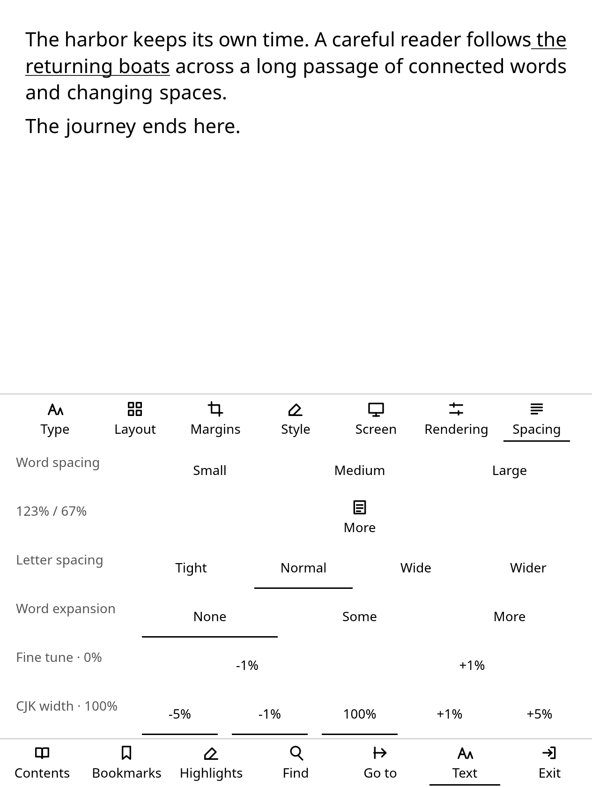

# Word spacing percentages

This candidate implements the two independent values in the pinned KOReader
Word Spacing control. It replaces the lower Spacing panel's additive-pixel
presets with Small, Medium and Large and a two-field More editor.

[Two-field picker with large controls in dark mode](screenshots/word-spacing-picker-dark.png)

| Preset | Scaling | Reduction: minimum remaining width |
| --- | --- | --- |
| Small | 75% | 50% |
| Medium | 95% | 75% |
| Large | 100% | 90% |

Scaling accepts whole percentages from 10 to 500; Reduction accepts 25 to 100.
Tap +/- changes the selected field by one; hold changes it by ten. A reduction
value of 100 prevents condensing. The default draft uses the explicitly saved
reflow default's pair, or Medium. Switching fields validates the current input;
neither switching, Default, sleep/wake nor Back applies a draft.

## Reference and rendering

The reference is local KOReader `9192014d8bd82a91dc1012473be0f238dedfdb54`
and CREngine `b32a88ffbbf505cf2ea5208c1a49002d70d3609f`.

| Pinned source | Relevant behavior |
| --- | --- |
| `defaults.lua:164–166` | Three exact percentage pairs. |
| `frontend/ui/data/creoptions.lua:457–496` | Separate scaling/reduction fields, bounds and steps. |
| `frontend/ui/widget/configdialog.lua:1171–1271` | Pair draft/current values and saved defaults. |
| `frontend/apps/reader/modules/readerfont.lua:245–250` | Update the pair and restore the reading position. |
| `frontend/document/credocument.lua:1306–1315` | Space scaling and minimum condensing are separate engine properties. |
| `crengine/src/lvtextfm.cpp:2181–2235` | Scale measured spaces, preserve preformatted spaces and lock leading/dialogue gaps against condensing. |
| `crengine/src/lvtextfm.cpp:4887–4905,5311–5320` | Compute per-space reduction capacity and use it while fitting a line. |
| `crengine/src/lvfntman.cpp:1448–1469` | The FreeType path flags ordinary spaces and NBSP, while fixed-width Unicode spaces remain separate. |
| `crengine/src/lvtextfm.cpp:6022–6031` | Engine bounds agree with the UI. |

Reader scales each shaped ordinary space or NBSP using its selected font's
measured advance, including its existing letter spacing. This follows the
reference's measurement order and keeps Reader's negative-tracking extension
within nonnegative gap bounds. It keeps the glyph outlines, source text, publication revisions and
anchor offsets. Permitted shrink enters the greedy line fitter, including its
saved normal/emergency break states. At line completion only the width actually
needed is spent; gaps outside the line's hanging suffix contribute no capacity.
The same effective gap is used by painting, carets, hit tests and selections.
Normal justification and optional word expansion follow this fitting step.
Intrinsic table measurements see the scaled natural width.

Leading and lone opening-dialogue gaps cannot condense. HTML `pre` ancestry
prevents both scaling and condensing, and fixed-width Unicode spaces receive
neither operation. An explicit 100%/100% policy takes the identity path.

Parley retains floating-point geometry; CREngine uses integer pixel widths.
This implements the percentage and bounded-fit behavior rather than asserting
pixel identity between different shaping engines. CREngine's extra correction
of italic run collisions and its flexible CJK punctuation are separate work.
Reader's existing canonical extractor collapses whitespace even inside `pre`;
this change protects the retained gaps without claiming to restore discarded
preformatted whitespace. CSS `word-spacing` and `white-space` remain unsupported
by the current cascade and strict user-CSS validator.

## Persistence and apply

`percent_word_spacing` is an optional, strictly validated pair. A missing field
retains the old `word_spacing` additive-pixel behavior exactly; it does not
inherit a newly saved percentage default. Old books, templates, profiles and
backups therefore keep their previous mode. None is omitted when serializing.
The old pixel value remains stored when a percentage pair is selected, but it
is inactive in percentage mode.

The application explicitly chooses Medium for an unseen book without an
existing reflow template. `Settings::default` and legacy deserialization remain
unchanged. Resetting to absent document defaults uses that same explicit
application policy. Saving current defaults or a profile captures the actual
mode; typed v2 backups validate and retain it.

Both fields apply together. Reader checks the active edition and actual file
identity, builds an anchored candidate without mutating the current page, checks
the source again, and atomically saves the new preference/position. Only then
does it replace the page. A failed layout or save keeps the frame, location,
other preferences and both draft fields. Presets use the same transaction.

## Verification status

Authored source includes percentage bounds/schema, natural-width scaling,
100%/100% raster identity, conditional shrink/minimum limits, NBSP/preformatted
locks, multiline word/link hits and copy, real two-field keyboard input,
steps/default/cancel/lifecycle, stale/replaced editions, layout/save rollback,
legacy/profile/default/backup round trips, and eight desktop capture targets.
An opt-in workflow uses original EPUB, AZW3 or MOBI files and preserves their
bytes while checking anchors, selections and reopening.

The exact-source `3d60149` desktop checkpoint passed:

| Check | Result |
| --- | --- |
| Mac native reflow suites | 850 library, 14 package and 4 layout tests passed; 64 opt-in cases excluded. |
| [GitHub CI](https://github.com/PrimitiveOS/kindle-primitive-reader/actions/runs/45014514352) | Passed at the same source. |
| Focused workflows | All 15 new ordinary cases passed, including 100%/100% raster identity on the authored publication, actual two-field keyboard input, conditional condensing and atomic failure behavior. |
| Original files | Authorized EPUB, AZW3 and MOBI each passed five percentage pairs, canonical selections, saved mode and reopening, with file SHA unchanged. This checks a text-bearing chapter of each original, not every original page. |
| Desktop UI | Eight raw compact/large light/dark frames generated and visually inspected; 12/12 preset labels, 12/12 numeric field/default labels and all four complete help blocks recognized independently. All four minus glyphs passed pixel-bound checks. |

The screenshots use an authored fixture. Detailed source/binary hashes, private
original-file results, logs and OCR crops are retained in
`build/parity-review/word-spacing-evidence`. Combined-candidate integration,
native Kindle and physical e-ink acceptance remain separate gates; no release
or Store acceptance is implied by this checkpoint.
